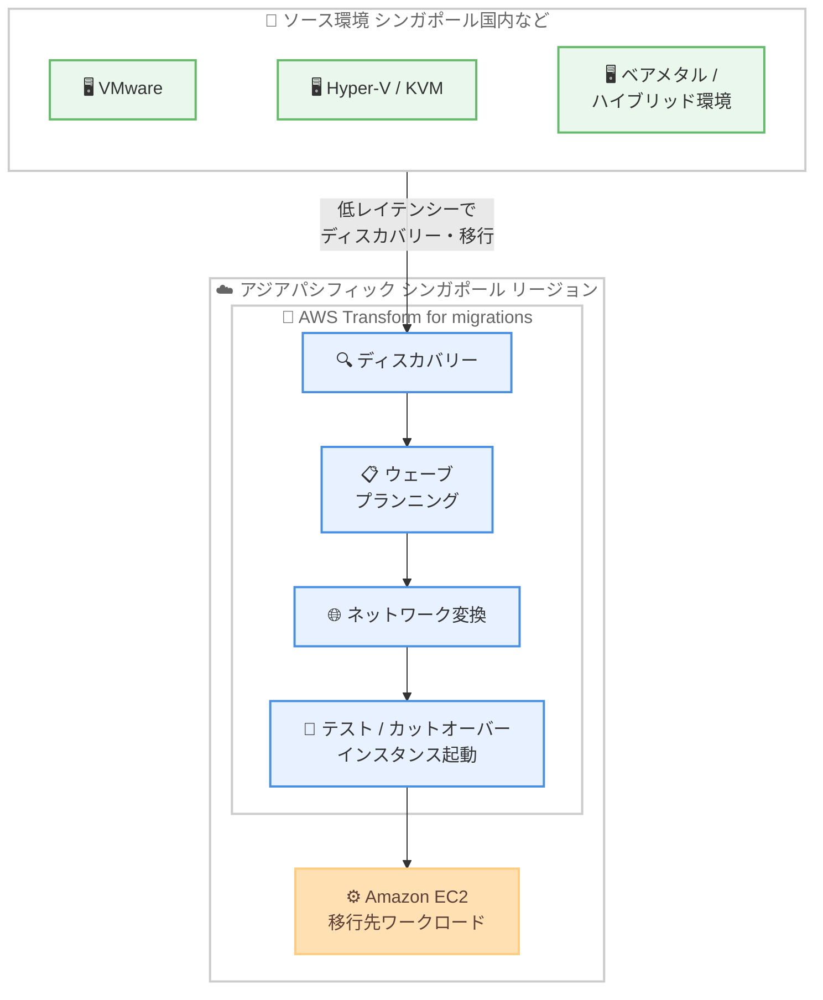

# AWS Transform - AWS Transform for migrations のアジアパシフィック (シンガポール) リージョン対応

**リリース日**: 2026 年 10 月 15 日
**サービス**: AWS Transform
**機能**: AWS Transform for migrations のアジアパシフィック (シンガポール) リージョン提供開始

📊 [このアップデートのインフォグラフィックを見る](https://takech9203.github.io/aws-news-summary/20261015-aws-transform-singapore.html)

## 概要

AWS Transform for migrations が、アジアパシフィック (シンガポール) リージョンで利用可能になりました。これにより、お客様は移行作業中のデータをリージョン内に保持 (データレジデンシー) できるとともに、ローカルのソースインフラストラクチャに対するレイテンシーを低減しながら移行を進められるようになります。

AWS Transform は、エージェント型 AI を活用したコラボレーション型のエンタープライズ IT トランスフォーメーションサービスで、クラウド移行、アプリケーションモダナイゼーション、継続的な技術的負債の削減を加速します。AWS Transform for migrations では、エンタープライズ IT チームが目的別に構築された AI エージェントを使用して、ディスカバリー、ウェーブプランニングからネットワーク変換、テスト・カットオーバーインスタンスの起動まで、移行ライフサイクル全体を自動化できます。VMware、Hyper-V、KVM、ベアメタル、ハイブリッド環境など、事実上あらゆるソースからのインフラストラクチャ移行をサポートし、チーム、ツール、ワークフローを単一のコラボレーションワークベンチに統合します。

東南アジアに拠点を置くお客様や、シンガポール国内でのデータ保持要件を持つお客様が、より近いリージョンで移行プロジェクトを実行できるようになる点が、このアップデートの主要な価値です。

**アップデート前の課題**

このアップデート以前には、以下の課題や制限がありました。

- 以前は東南アジアのお客様が AWS Transform for migrations を利用する場合、東京、シドニー、ムンバイなど地理的に離れたリージョンのワークスペースを使用する必要があった
- 移行ジョブのデータがシンガポール国外のリージョンで処理・保存されるため、国内でのデータ保持要件を持つお客様は利用のハードルが高かった
- ローカルのソースインフラストラクチャと AWS Transform の実行リージョンが離れていることで、ディスカバリーや移行作業時のレイテンシーが大きくなっていた

**アップデート後の改善**

今回のアップデートにより、以下が可能になりました。

- アジアパシフィック (シンガポール) リージョンに AWS Transform のワークスペースを作成し、移行ジョブをリージョン内で実行できるようになった
- 移行作業中のデータをシンガポールリージョン内に保持でき、データレジデンシー要件への対応が容易になった
- ローカルのソースインフラストラクチャに近いリージョンで移行を実行することで、レイテンシーを低減できるようになった

## アーキテクチャ図



シンガポールリージョンに作成した AWS Transform ワークスペース内で、AI エージェントがディスカバリーからウェーブプランニング、ネットワーク変換、テスト・カットオーバーインスタンスの起動までを自動化します。移行ジョブのデータはリージョン内で処理され、ローカルのソースインフラストラクチャへのレイテンシーも低減されます。

## サービスアップデートの詳細

### 主要機能

1. **シンガポールリージョンでの移行ジョブ実行**
   - アジアパシフィック (シンガポール) リージョンに AWS Transform のワークスペースを作成し、移行ジョブを実行可能
   - ワークスペースを作成したリージョンがジョブの実行リージョンとなり、ディスカバリーもそのリージョンで実行される
   - 移行作業中のデータをリージョン内に保持でき、データレジデンシー要件に対応

2. **移行ライフサイクル全体の自動化**
   - ディスカバリー: AWS Application Discovery Service のコレクター、オープンソースの Export for vCenter ツール、独自に収集したディスカバリーデータのインポートなど柔軟な選択肢を提供
   - インテリジェントな移行プランニング: アプリケーションの自動グルーピングと移行ウェーブの順序付け
   - AI 駆動のネットワーク移行: ソースのネットワーク構成を本番利用可能な Amazon VPC アーキテクチャへ変換
   - 自動化されたサーバーリホスト: ガイド付きのテストとカットオーバーワークフローで Amazon EC2 へ移行

3. **幅広いソース環境のサポート**
   - VMware、Hyper-V、KVM、ベアメタル、ハイブリッド環境など事実上あらゆるソースからのインフラストラクチャ移行に対応
   - Windows および Linux のサポート対象オペレーティングシステムの移行をサポート
   - チーム、ツール、ワークフローを単一のコラボレーションワークベンチに統合

## 技術仕様

### リージョンとジョブの関係

公式ドキュメントによると、AWS Transform のリージョンとジョブの関係は以下のとおりです。

| 項目 | 詳細 |
|------|------|
| ワークスペースとジョブ | ジョブを作成したワークスペースのリージョンが、そのジョブの AWS リージョンとなる。別リージョンでジョブを作成するには、そのリージョンに別のワークスペースが必要 |
| ディスカバリー | VMware プロジェクトでは、ワークスペースのリージョンがディスカバリーに使用される |
| 移行ターゲット | 移行先 (ターゲット) リージョンはワークスペースとは別のリージョンを指定可能。移行完了後のワークロードはターゲットリージョンでホストされる |
| シンガポールリージョンの対象 | VMware (migrations) エージェントのみが対象 |
| クロスリージョン処理 | リクエストの内容によっては、データがワークスペースとは異なるリージョンで処理される場合がある (詳細は Cross-region processing を参照) |

## 設定方法

### 前提条件

1. 管理者アクセス権を持つ AWS アカウント
2. IAM Identity Center の有効化と AWS Transform へのユーザー・コラボレーターの設定
3. ソース環境のディスカバリーデータ (AWS Application Discovery Service、Export for vCenter、または独自収集データ)

### 手順

#### ステップ 1: シンガポールリージョンにワークスペースを作成する

AWS Transform のウェブエクスペリエンスにサインインし、アジアパシフィック (シンガポール) リージョンを選択してワークスペースを作成します。ワークスペースのリージョンが移行ジョブの実行リージョンとなります。

#### ステップ 2: 移行ジョブを作成し、ソースデータを取り込む

ワークスペース内で migrations の移行ジョブを作成し、ディスカバリーデータを取り込みます。会話型インターフェースを通じて AI エージェントがステップごとにガイドします。

#### ステップ 3: 移行プランの確認からカットオーバーまで実行する

AI エージェントが生成したアプリケーションのグルーピングと移行ウェーブを確認し、ネットワーク変換の結果をレビューした上で、テストインスタンスとカットオーバーインスタンスの起動を実行します。移行先のターゲットリージョンは、要件に応じてワークスペースとは別のリージョンを指定できます。

## メリット

### ビジネス面

- **データレジデンシー要件への対応**: 移行作業中のデータをシンガポールリージョン内に保持でき、国内のデータ保持要件を持つ組織でも採用しやすくなる
- **移行プロジェクトの加速**: AI エージェントによる自動化で、大規模移行で従来必要だった手作業を削減できる
- **追加コストなしで利用可能**: AWS Transform の移行エージェントは無料で提供されており、リージョン拡大による追加料金もない

### 技術面

- **レイテンシーの低減**: 東南アジアのローカルソースインフラストラクチャに近いリージョンでディスカバリーと移行を実行でき、作業時のレイテンシーが低減される
- **移行ライフサイクルの一元化**: ディスカバリー、ウェーブプランニング、ネットワーク変換、テスト・カットオーバーを単一のワークベンチで完結できる
- **柔軟なターゲットリージョン指定**: ワークスペースはシンガポールに置きつつ、移行先は別リージョンを指定するといった構成も可能

## デメリット・制約事項

### 制限事項

- シンガポールリージョンで利用できるのは VMware (migrations) エージェントのみで、メインフレームモダナイゼーションや Windows モダナイゼーションなど他の機能は対象外
- ジョブのリージョンはワークスペース作成時のリージョンで決まるため、別リージョンでジョブを実行するには別のワークスペースが必要

### 考慮すべき点

- リクエストの内容によっては、データがワークスペースとは異なるリージョンで処理される場合があるため、厳格なデータレジデンシー要件がある場合はクロスリージョン処理に関するドキュメントの確認を推奨
- AWS Transform の出力により作成される EC2 インスタンスや VPC などの AWS リソースには、各サービスの通常の利用料金が発生する

## ユースケース

### ユースケース 1: シンガポール国内のデータ保持要件を満たす VMware 移行

**シナリオ**: シンガポールの金融機関が、オンプレミスの VMware 環境を Amazon EC2 へ移行するにあたり、移行作業中のデータを国内に保持する必要がある。

**実装例**:
```text
1. アジアパシフィック (シンガポール) リージョンに AWS Transform ワークスペースを作成
2. VMware 環境のディスカバリーデータを取り込み、移行ジョブを実行
3. ターゲットリージョンにもシンガポールを指定し、国内で移行を完結
```

**効果**: 移行作業中のデータと移行後のワークロードの両方をシンガポール国内に保持し、規制要件を満たしながら移行を加速できる。

### ユースケース 2: 東南アジア拠点のハイブリッド環境の大規模移行

**シナリオ**: 東南アジアに複数拠点を持つ企業が、VMware、Hyper-V、ベアメタルが混在するハイブリッド環境を AWS へ移行したい。

**実装例**:
```text
1. シンガポールリージョンのワークスペースで各ソース環境のディスカバリーデータを統合
2. AI エージェントがアプリケーションをグルーピングし、移行ウェーブを自動計画
3. ネットワーク変換とサーバーリホストをウェーブごとに実行
```

**効果**: 混在環境の移行計画を自動化し、拠点に近いリージョンで低レイテンシーに移行作業を進められる。

### ユースケース 3: ローカルソースへの低レイテンシーなディスカバリー

**シナリオ**: シンガポールのデータセンターで稼働する大規模な VMware 環境に対して、ディスカバリーとウェーブプランニングを効率的に実施したい。

**実装例**:
```text
1. AWS Application Discovery Service のコレクターまたは Export for vCenter でソースデータを収集
2. シンガポールリージョンのワークスペースにデータを取り込み、依存関係を分析
3. 7Rs 戦略レポートや構成図を生成し、移行プランを策定
```

**効果**: ソースインフラストラクチャに近いリージョンで処理することで、ディスカバリーから計画策定までを低レイテンシーで実行できる。

## 料金

公式の料金ページによると、AWS Transform の移行エージェント (VMware migration agent) は無料で提供されています。ただし、移行の結果として作成される Amazon EC2 インスタンス、Amazon VPC、AWS Application Migration Service などの AWS リソースには、各サービスの通常の利用料金が発生します。

## 利用可能リージョン

公式ドキュメントによると、AWS Transform のワークスペースを作成できるリージョンは以下のとおりです (今回アジアパシフィック (シンガポール) が追加)。

- 米国東部 (バージニア北部)
- 欧州 (フランクフルト)
- 欧州 (ロンドン)
- アジアパシフィック (ムンバイ)
- アジアパシフィック (ソウル)
- アジアパシフィック (東京)
- アジアパシフィック (シドニー)
- アジアパシフィック (シンガポール) - VMware (migrations) エージェントのみ
- カナダ (中部)
- 南米 (サンパウロ) - メインフレームモダナイゼーションエージェントのみ

## 関連サービス・機能

- **AWS Application Discovery Service**: ソース環境のディスカバリーデータ収集に使用されるサービス。AWS Transform のアシスト付きディスカバリーと連携
- **AWS Application Migration Service (MGN)**: サーバーリホストの基盤となる移行サービス。テスト・カットオーバーインスタンスの起動を支える
- **Amazon EC2**: 移行先のコンピューティングサービス。Windows および Linux サーバーをネイティブに実行

## 参考リンク

- 📊 [インフォグラフィック](https://takech9203.github.io/aws-news-summary/20261015-aws-transform-singapore.html)
- [公式発表 (What's New)](https://aws.amazon.com/about-aws/whats-new/2026/10/aws-transform-singapore)
- [AWS Transform 製品ページ](https://aws.amazon.com/transform/)
- [AWS Transform ドキュメント](https://docs.aws.amazon.com/transform/latest/userguide/)
- [Migrations (including VMware) ドキュメント](https://docs.aws.amazon.com/transform/latest/userguide/transform-app-vmware.html)
- [Supported Regions for AWS Transform](https://docs.aws.amazon.com/transform/latest/userguide/regions.html)
- [料金ページ](https://aws.amazon.com/transform/pricing/)

## まとめ

AWS Transform for migrations がアジアパシフィック (シンガポール) リージョンで利用可能になり、東南アジアのお客様はデータレジデンシー要件を満たしながら、ローカルのソースインフラストラクチャへの低レイテンシーな移行を実行できるようになりました。シンガポール国内でのデータ保持が必要な移行プロジェクトを検討しているお客様は、シンガポールリージョンにワークスペースを作成し、AI エージェントによる移行ライフサイクルの自動化を活用することを推奨します。
