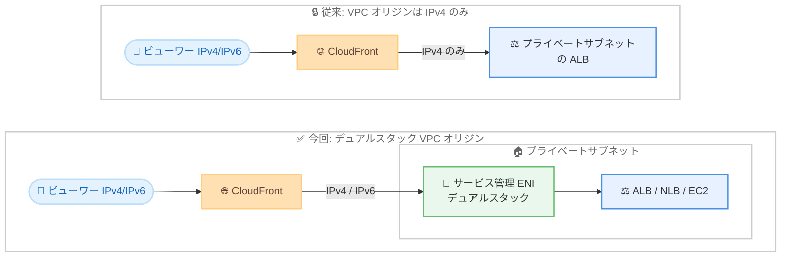

# Amazon CloudFront - VPC オリジンのデュアルスタック対応

**リリース日**: 2026 年 10 月 15 日
**サービス**: Amazon CloudFront
**機能**: VPC オリジンのデュアルスタック (IPv4/IPv6) サポート

📊 [このアップデートのインフォグラフィックを見る](https://takech9203.github.io/aws-news-summary/20261015-cloudfront-vpc-origin-dualstack.html)

## 概要

Amazon CloudFront が、VPC オリジンのデュアルスタックサポートを発表しました。これにより、Amazon VPC 内のプライベートサブネットに配置したオリジンに対して、エンドツーエンドの IPv6 配信が可能になります。

VPC オリジンは、Application Load Balancer (ALB)、Network Load Balancer (NLB)、EC2 インスタンスをプライベートサブネットに配置したまま、CloudFront ディストリビューションからのみアクセス可能にする機能です。今回のアップデートにより、これらのプライベートオリジンまで IPv6 トラフィックを送信できるようになり、オリジンをインターネットに公開することなく、IPv6 アーキテクチャ要件や規制要件を満たすことができます。

IPv6 への移行を進める組織や、政府・公共機関などで IPv6 対応が求められる環境において、セキュリティを犠牲にせずに要件を満たせる重要なアップデートです。

**アップデート前の課題**

このアップデート以前は、CloudFront のデュアルスタック対応に以下の制約がありました。

- CloudFront はパブリックオリジンに対してはデュアルスタックをサポートしていたが、VPC オリジンへの接続は IPv4 のみだった
- IPv6 でオリジンに接続するには、オリジンをパブリックサブネットに移動する必要があり、VPC オリジンによるセキュリティ (プライベートサブネット配置) を諦めるしかなかった
- オリジンをプライベートに保つ場合は IPv4 に留まる必要があり、IPv6 アーキテクチャ要件や規制要件を満たせなかった

**アップデート後の改善**

- VPC オリジンをデュアルスタックとして設定し、プライベートサブネット内のオリジンまでエンドツーエンドの IPv6 配信が可能になった
- セキュリティ (プライベートサブネット配置、CloudFront を単一エントリポイントとする構成) を維持したまま IPv6 要件を満たせるようになった
- 追加コストなしで利用でき、`IpAddressType` パラメータを `dualstack` に設定するだけで有効化できる

## アーキテクチャ図



従来は CloudFront から VPC オリジンへの接続が IPv4 に限定されていましたが、今回のアップデートにより、CloudFront が作成するサービス管理 ENI がデュアルスタックに対応し、プライベートサブネット内のオリジンまで IPv6 トラフィックを届けられるようになりました。

## サービスアップデートの詳細

### 主要機能

1. **デュアルスタック VPC オリジン**
   - VPC オリジン作成時または更新時に、IP アドレスタイプとして `ipv4` (デフォルト) または `dualstack` を選択可能
   - デュアルスタックを選択すると、CloudFront からオリジンへの接続で IPv4 と IPv6 の両方が利用可能になる
   - ALB、NLB、EC2 インスタンスのいずれの VPC オリジンタイプでも利用可能

2. **エンドツーエンドの IPv6 配信**
   - ビューワーから CloudFront、CloudFront からプライベートオリジンまで、通信経路全体で IPv6 を利用可能
   - IPv6 アーキテクチャ要件や各国の規制・コンプライアンス要件への対応が、オリジンを公開せずに実現できる

3. **セキュリティモデルの維持**
   - オリジンはプライベートサブネットに配置したまま、CloudFront のみを単一エントリポイントとする構成を維持
   - デュアルスタック VPC オリジン用に、IPv6 用の CloudFront マネージドプレフィックスリスト `com.amazonaws.global.ipv6.cloudfront.origin-facing` をセキュリティグループで利用可能

## 技術仕様

### デュアルスタック VPC オリジンの要件

| 項目 | 詳細 |
|------|------|
| IP アドレスタイプ | `ipv4` (デフォルト) または `dualstack` |
| 対応オリジン | ALB、NLB (TLS リスナーなし、セキュリティグループ必須)、EC2 インスタンス |
| サブネット要件 | プライベートサブネットに利用可能な IPv4 アドレスが 1 つ以上、デュアルスタックの場合は加えて利用可能な IPv6 アドレスが 1 つ以上必要 |
| ENI | CloudFront がサービス管理 ENI を作成してサブネットにルーティング |
| セキュリティグループ | IPv4 用に加えて IPv6 用プレフィックスリスト `com.amazonaws.global.ipv6.cloudfront.origin-facing` の許可が必要 (プレフィックスリスト方式の場合) |
| 追加料金 | なし |

### API変更履歴

| 日付 | サービス | 変更内容 |
|------|----------|----------|
| 2026/10/14 | [cloudfront](https://awsapichanges.com/archive/changes/fca45a-cloudfront.html) | 5 updated api methods - `VpcOriginEndpointConfig` に `IpAddressType` フィールド (`ipv4` \| `dualstack`) を追加。`CreateVpcOrigin`、`UpdateVpcOrigin`、`GetVpcOrigin`、`ListVpcOrigins`、`DeleteVpcOrigin` が更新 |

### VPC オリジン設定の例

```json
{
  "VpcOriginEndpointConfig": {
    "Name": "my-dualstack-vpc-origin",
    "Arn": "arn:aws:elasticloadbalancing:ap-northeast-1:123456789012:loadbalancer/app/my-alb/abcdef1234567890",
    "HTTPPort": 80,
    "HTTPSPort": 443,
    "OriginProtocolPolicy": "https-only",
    "OriginSslProtocols": {
      "Quantity": 1,
      "Items": ["TLSv1.2"]
    },
    "IpAddressType": "dualstack"
  }
}
```

## 設定方法

### 前提条件

1. VPC オリジンがサポートされているリージョンに VPC を作成し、インターネットゲートウェイをアタッチしていること (インターネットゲートウェイはオリジンへのルーティングには使用されない)
2. プライベートサブネットがデュアルスタック構成で、利用可能な IPv4 アドレスと IPv6 アドレスがそれぞれ 1 つ以上あること
3. オリジンとなる ALB、NLB、または EC2 インスタンスがプライベートサブネットにデプロイ済みで、セキュリティグループがアタッチされていること

### 手順

#### ステップ1: デュアルスタック VPC オリジンの作成

```bash
aws cloudfront create-vpc-origin \
  --vpc-origin-endpoint-config '{
    "Name": "my-dualstack-vpc-origin",
    "Arn": "arn:aws:elasticloadbalancing:ap-northeast-1:123456789012:loadbalancer/app/my-alb/abcdef1234567890",
    "HTTPPort": 80,
    "HTTPSPort": 443,
    "OriginProtocolPolicy": "https-only",
    "OriginSslProtocols": {"Quantity": 1, "Items": ["TLSv1.2"]},
    "IpAddressType": "dualstack"
  }'
```

ALB を対象とした VPC オリジンを `IpAddressType: dualstack` で作成しています。コンソールの場合は [VPC origins] - [Create VPC origin] で Origin type に dualstack を選択します。デプロイ完了 (Deployed ステータス) まで最大 15 分程度かかります。

#### ステップ2: オリジンのセキュリティグループを更新

```bash
# IPv4 用プレフィックスリストの許可
aws ec2 authorize-security-group-ingress \
  --group-id sg-0123456789abcdef0 \
  --ip-permissions '[{"IpProtocol": "tcp", "FromPort": 443, "ToPort": 443, "PrefixListIds": [{"PrefixListId": "pl-xxxxxxxx", "Description": "CloudFront origin-facing IPv4"}]}]'

# IPv6 用プレフィックスリストの許可
aws ec2 authorize-security-group-ingress \
  --group-id sg-0123456789abcdef0 \
  --ip-permissions '[{"IpProtocol": "tcp", "FromPort": 443, "ToPort": 443, "PrefixListIds": [{"PrefixListId": "pl-yyyyyyyy", "Description": "CloudFront origin-facing IPv6"}]}]'
```

オリジンリソースのセキュリティグループで、CloudFront のオリジン向けマネージドプレフィックスリストからのインバウンドトラフィックを許可しています。デュアルスタック VPC オリジンの場合は、IPv4 用の `com.amazonaws.global.cloudfront.origin-facing` と IPv6 用の `com.amazonaws.global.ipv6.cloudfront.origin-facing` の両方を許可する必要があります。代替として、VPC オリジン作成後に生成されるサービス管理セキュリティグループ `CloudFront-VPCOrigins-Service-SG` からのトラフィックを許可する方法もあります。

#### ステップ3: ディストリビューションへの関連付けと確認

ディストリビューションのオリジン設定で、作成したデュアルスタック VPC オリジンを選択します。既存ディストリビューションに追加する場合は、継続的デプロイのステージングディストリビューションでテストしてから本番にプロモートする方法が推奨されています。既存の IPv4 VPC オリジンをデュアルスタックに変更する場合は、`UpdateVpcOrigin` API または コンソールの編集画面で `IpAddressType` を変更します。

## メリット

### ビジネス面

- **規制・コンプライアンス対応**: 政府機関や規制業界で求められる IPv6 義務化要件 (例: 米国 OMB の IPv6 移行方針など) に、セキュリティを損なわずに対応できる
- **追加コストなし**: デュアルスタック VPC オリジンの利用に追加料金は発生しない
- **運用負荷の軽減**: IPv6 対応のためにオリジンの公開やネットワーク構成の大幅な変更を行う必要がなくなる

### 技術面

- **エンドツーエンド IPv6**: ビューワーからプライベートオリジンまで通信経路全体で IPv6 を利用でき、IPv4 アドレス枯渇対策や NAT 依存の削減につながる
- **セキュリティ維持**: オリジンをプライベートサブネットに保ち、CloudFront を単一エントリポイントとするセキュリティモデルをそのまま維持できる
- **シンプルな移行**: `IpAddressType` パラメータの変更のみで有効化でき、既存の VPC オリジン構成からの移行が容易

## デメリット・制約事項

### 制限事項

- デュアルスタック VPC オリジンには、プライベートサブネットに利用可能な IPv6 アドレスが必要 (サブネット自体のデュアルスタック化が前提)
- VPC オリジン共通の制約として、Gateway Load Balancer や TLS リスナー付き NLB はオリジンにできない
- VPC オリジンでは gRPC トラフィック、Lambda@Edge のオリジンリクエスト/オリジンレスポンストリガーはサポートされない
- 一部リージョンでは特定のアベイラビリティーゾーンが対象外 (例: 東京リージョンの apne1-az3)

### 考慮すべき点

- セキュリティグループでプレフィックスリスト方式を使う場合、IPv6 用プレフィックスリストの許可を追加し忘れると IPv6 接続が失敗する
- NACL のインバウンドルールは CloudFront から VPC オリジンへのトラフィックには評価されないが、アウトバウンドルールは戻りの経路で評価されるため、エフェメラルポート (1024-65535) の許可が必要
- VPC オリジンの作成・更新はデプロイ完了まで最大 15 分程度かかるため、本番環境への適用は継続的デプロイ機能によるテストを推奨

## ユースケース

### ユースケース1: 政府・公共機関向けシステムの IPv6 義務化対応

**シナリオ**: 政府調達要件により、Web アプリケーションの通信経路全体で IPv6 対応が義務付けられているが、オリジンサーバーはインターネットに公開したくない。

**実装例**:
```
1. VPC とプライベートサブネットをデュアルスタック構成にする
2. ALB をプライベートサブネットに配置
3. IpAddressType: dualstack で VPC オリジンを作成
4. CloudFront ディストリビューションで IPv6 を有効化し、VPC オリジンを関連付け
```

**効果**: オリジンを非公開に保ったまま、ビューワーからオリジンまでエンドツーエンドの IPv6 通信を実現し、規制要件を満たせる。

### ユースケース2: パブリックサブネットに置いていたオリジンのプライベート化

**シナリオ**: IPv6 対応のためにやむを得ず ALB をパブリックサブネットに配置していたが、セキュリティ強化のためプライベート化したい。

**実装例**:
```
1. デュアルスタック VPC オリジンを作成し、ステージングディストリビューションでテスト
2. 本番ディストリビューションにプロモート
3. サブネットのルートテーブルを変更してオリジンをプライベート化
4. パブリックアクセス用のセキュリティグループルールを削除
```

**効果**: IPv6 対応を維持したままオリジンへの直接アクセス経路を排除し、CloudFront を単一エントリポイントとするセキュアな構成に移行できる。

### ユースケース3: IPv4 アドレス管理負荷の軽減

**シナリオ**: 大規模な VPC 環境で IPv4 アドレスの枯渇が課題となっており、IPv6 中心のネットワーク設計へ段階的に移行したい。

**実装例**:
```
1. 新規ワークロードをデュアルスタックサブネットにデプロイ
2. CloudFront 経由の配信はデュアルスタック VPC オリジンで構成
3. 既存の IPv4 VPC オリジンは UpdateVpcOrigin で順次 dualstack に更新
```

**効果**: CloudFront からオリジンへの通信を IPv6 で処理できるようになり、IPv4 アドレス空間への依存を段階的に削減できる。

## 料金

デュアルスタック VPC オリジンの利用に追加料金はありません。VPC オリジン自体も追加料金なしで利用でき、CloudFront の通常のデータ転送・リクエスト料金のみが適用されます。CloudFront がサブネットに作成するサービス管理 ENI のプライベート IP アドレスにも追加コストは発生しません。

## 利用可能リージョン

VPC オリジンがサポートされているすべての AWS 商用リージョンで利用可能です。東京 (ap-northeast-1、apne1-az3 を除く)、大阪 (ap-northeast-3) を含む 30 以上のリージョンがサポートされています。最新のリージョン一覧は[公式ドキュメント](https://docs.aws.amazon.com/AmazonCloudFront/latest/DeveloperGuide/private-content-vpc-origins.html#vpc-origins-supported-regions)を参照してください。

## 関連サービス・機能

- **Amazon VPC**: デュアルスタックサブネットの構成が前提となる。IPv6 CIDR の割り当てとサブネットへの関連付けが必要
- **Elastic Load Balancing (ALB/NLB)**: VPC オリジンの代表的なオリジンタイプ。プライベートサブネットに配置して利用する
- **AWS Resource Access Manager (AWS RAM)**: VPC オリジンはアカウント間で共有可能で、マルチアカウント構成でも利用できる
- **CloudFront 継続的デプロイ**: 既存ディストリビューションへの VPC オリジン追加を安全にテスト・プロモートできる

## 参考リンク

- 📊 [インフォグラフィック](https://takech9203.github.io/aws-news-summary/20261015-cloudfront-vpc-origin-dualstack.html)
- [公式発表 (What's New)](https://aws.amazon.com/about-aws/whats-new/2026/10/cloudfront-vpc-origin-dualstack/)
- [ドキュメント: Restrict access with VPC origins](https://docs.aws.amazon.com/AmazonCloudFront/latest/DeveloperGuide/private-content-vpc-origins.html)
- [API リファレンス: CreateVpcOrigin](https://docs.aws.amazon.com/cloudfront/latest/APIReference/API_CreateVpcOrigin.html)
- [API 変更履歴 (awsapichanges.com)](https://awsapichanges.com/archive/changes/fca45a-cloudfront.html)
- [料金ページ](https://aws.amazon.com/cloudfront/pricing/)

## まとめ

CloudFront の VPC オリジンがデュアルスタックに対応したことで、プライベートサブネット内のオリジンに対してもエンドツーエンドの IPv6 配信が可能になりました。これまで「IPv6 対応のためにオリジンを公開する」か「プライベートを維持して IPv4 に留まる」かのトレードオフを迫られていた環境では、`IpAddressType` を `dualstack` に変更するだけで両立できます。IPv6 要件を持つワークロードや、パブリックサブネットに配置しているオリジンのプライベート化を検討している場合は、本機能の適用を推奨します。
