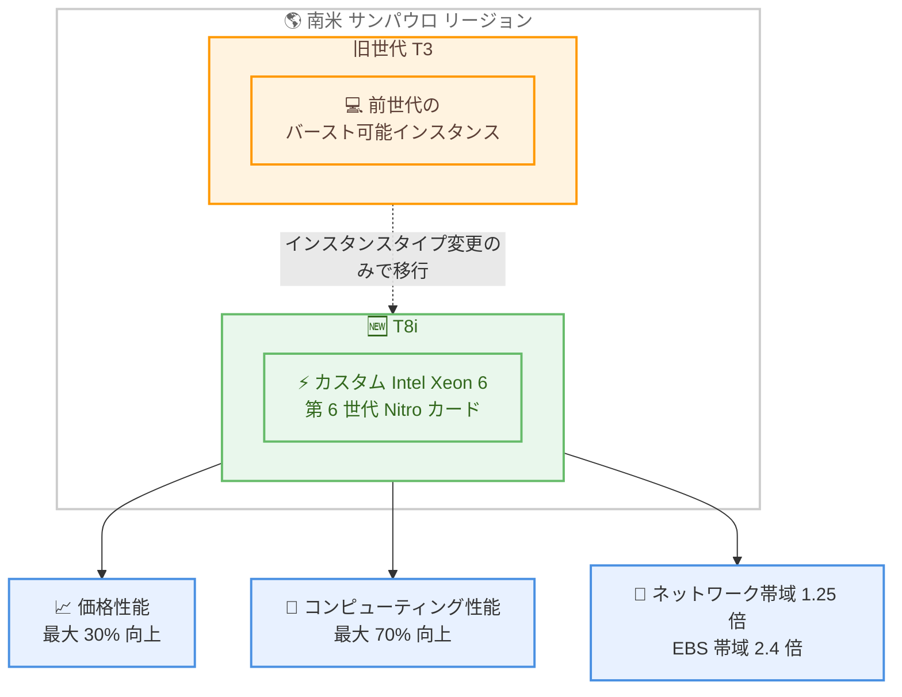

# Amazon EC2 - T8i インスタンスが南米 (サンパウロ) リージョンで利用可能に

**リリース日**: 2026 年 10 月 15 日
**サービス**: Amazon Elastic Compute Cloud (Amazon EC2)
**機能**: T8i インスタンスの南米 (サンパウロ) リージョン対応

📊 [このアップデートのインフォグラフィックを見る](https://takech9203.github.io/aws-news-summary/20261015-ec2-t8i-instances-south-america.html)

## 概要

Amazon EC2 T8i インスタンスが南米 (サンパウロ) リージョンで利用可能になりました。T8i インスタンスは、AWS 専用にカスタマイズされた第 6 世代 Intel Xeon 6 プロセッサを搭載し、最新の第 6 世代 AWS Nitro カード上に構築されたバースト可能汎用インスタンスです。

T8i インスタンスは、前世代の T3 インスタンスと比較して最大 30% 優れた価格性能を実現し、nano、micro、small、medium の 4 サイズで提供されます。データ処理、ログインゲートウェイ、小規模データベース、バッチ処理、イベント駆動型関数、CI/CD パイプライン、マイクロサービス、低トラフィック Web サイトなど、CPU 使用率が低～中程度のワークロードに適しています。

T3 と同じ CPU クレジットシステム (Standard モードと Unlimited モード) を採用しているため、既存の T3 ユーザーはインスタンスタイプを変更するだけで、すぐに価格性能の向上と TCO の削減を享受できます。南米リージョンのユーザーにとって、コスト効率の高いエントリーポイントが拡充されたアップデートです。

**アップデート前の課題**

南米 (サンパウロ) リージョンでは T8i インスタンスが利用できず、以下の制約がありました。

- 最新世代のバースト可能インスタンスを利用するには他リージョンを選択する必要があった
- 前世代の T3 インスタンスでは、最新世代と比較して価格性能が劣っていた
- 南米のユーザーに低レイテンシでサービスを提供しつつ、最新インスタンスのコストメリットを得ることができなかった

**アップデート後の改善**

- 南米 (サンパウロ) リージョンで T8i インスタンスが利用可能になった
- T3 比で最大 30% 優れた価格性能、最大 70% 高いコンピューティング性能を同リージョンで利用できるようになった
- 既存の T3 ユーザーはインスタンスタイプの変更のみで移行でき、TCO を削減できるようになった

## アーキテクチャ図



T3 から T8i への移行はインスタンスタイプの変更のみで可能であり、サンパウロリージョンにおいて価格性能・コンピューティング性能・帯域幅の向上をすぐに利用できます。

## サービスアップデートの詳細

### 主要機能

1. **カスタム第 6 世代 Intel Xeon 6 プロセッサ**
   - AWS 専用にカスタマイズされた第 6 世代 Intel Xeon 6 プロセッサを搭載
   - 第 6 世代 AWS Nitro カード上に構築され、仮想化処理を専用ハードウェアにオフロード
   - T3 比で最大 70% 高いコンピューティング性能を実現

2. **T3 比で大幅な性能向上**
   - 最大 30% 優れた価格性能
   - 1.25 倍のネットワーク帯域幅 (最大 6.25 Gbps バースト)
   - 2.4 倍の EBS 帯域幅 (最大 5 Gbps バースト)

3. **T3 と互換性のある CPU クレジットシステム**
   - Standard モードと Unlimited モードの両方をサポート
   - ベースライン未満の使用時にクレジットを蓄積し、バースト時に消費する仕組みは T3 と同一
   - 既存の T3 ユーザーは運用モデルを変更せずに移行可能

4. **AWS 無料利用枠への対応**
   - t8i.micro と t8i.small は AWS 無料利用枠の対象
   - AWS を初めて利用するユーザーやオンプレミスからの移行ユーザーに、コスト効率の高いエントリーポイントを提供

## 技術仕様

### インスタンスサイズ

| サイズ | vCPU | メモリ (GiB) | ベースライン性能/vCPU | CPU クレジット獲得数/時 |
|--------|------|--------------|----------------------|------------------------|
| t8i.nano | 2 | 0.5 | 5% | 6 |
| t8i.micro | 2 | 1.0 | 10% | 12 |
| t8i.small | 2 | 2.0 | 20% | 24 |
| t8i.medium | 2 | 4.0 | 20% | 24 |

全サイズ共通で、ネットワーク帯域幅は最大 6.25 Gbps (バースト)、EBS 帯域幅は最大 5 Gbps (バースト) です。

### T3 インスタンスとの比較

| 項目 | T3 比の改善 |
|------|-------------|
| 価格性能 | 最大 30% 向上 |
| コンピューティング性能 | 最大 70% 向上 |
| ネットワーク帯域幅 | 1.25 倍 |
| EBS 帯域幅 | 2.4 倍 |

### CPU クレジットシステム

| モード | 動作 |
|--------|------|
| Unlimited モード (デフォルト) | クレジットを使い切った後も追加料金でバースト継続が可能。24 時間平均の使用率がベースライン以下であれば追加料金なし |
| Standard モード | 蓄積したクレジットを使い切るとベースライン性能に制限される |

1 CPU クレジットは、1 vCPU が 100% 使用率で 1 分間稼働することに相当します。

## 設定方法

### 前提条件

1. AWS アカウントを保有していること
2. 南米 (サンパウロ) リージョン (sa-east-1) を利用できること
3. EC2 インスタンスを起動する IAM 権限があること

### 手順

#### ステップ 1: 利用可能なインスタンスタイプの確認

```bash
aws ec2 describe-instance-type-offerings \
  --region sa-east-1 \
  --filters "Name=instance-type,Values=t8i.*" \
  --query "InstanceTypeOfferings[].InstanceType"
```

サンパウロリージョンで利用可能な T8i インスタンスタイプの一覧を取得します。

#### ステップ 2: T8i インスタンスの起動

```bash
aws ec2 run-instances \
  --region sa-east-1 \
  --instance-type t8i.micro \
  --image-id ami-xxxxxxxxxxxxxxxxx \
  --count 1 \
  --credit-specification CpuCredits=unlimited
```

t8i.micro インスタンスを Unlimited モードで起動します。`CpuCredits` には `standard` または `unlimited` を指定できます。

#### ステップ 3: 既存の T3 インスタンスからの移行

```bash
# インスタンスを停止
aws ec2 stop-instances --region sa-east-1 --instance-ids i-xxxxxxxxxxxxxxxxx

# インスタンスタイプを T8i に変更
aws ec2 modify-instance-attribute \
  --region sa-east-1 \
  --instance-id i-xxxxxxxxxxxxxxxxx \
  --instance-type "{\"Value\": \"t8i.micro\"}"

# インスタンスを再起動
aws ec2 start-instances --region sa-east-1 --instance-ids i-xxxxxxxxxxxxxxxxx
```

既存の T3 インスタンスを停止し、インスタンスタイプを T8i に変更してから再起動します。CPU クレジットシステムが共通のため、運用方法の変更は不要です。

## メリット

### ビジネス面

- **TCO の削減**: T3 比で最大 30% 優れた価格性能により、同等ワークロードの運用コストを削減できる
- **低コストのエントリーポイント**: AWS 無料利用枠対象の t8i.micro / t8i.small により、新規ユーザーや移行ユーザーが低コストで開始できる
- **南米ユーザーへの低レイテンシ提供**: サンパウロリージョンで最新世代インスタンスを利用し、現地ユーザー向けサービスの品質とコスト効率を両立できる

### 技術面

- **性能向上**: 最大 70% 高いコンピューティング性能、1.25 倍のネットワーク帯域幅、2.4 倍の EBS 帯域幅
- **移行の容易さ**: T3 と同じ CPU クレジットシステムのため、インスタンスタイプの変更のみで移行可能
- **Nitro System による効率化**: 第 6 世代 Nitro カードが仮想化処理をオフロードし、性能とセキュリティを向上

## デメリット・制約事項

### 制限事項

- サイズは nano、micro、small、medium の 4 種類のみで、全サイズ 2 vCPU 構成 (より大きなサイズや持続的な高 CPU 使用には M8i-flex などが推奨される)
- 購入オプションは現時点でオンデマンドインスタンスとスポットインスタンスのみ (Savings Plans は近日対応予定)
- バースト可能インスタンスのため、持続的に高い CPU 使用率が必要なワークロードには不向き

### 考慮すべき点

- Unlimited モードでは、24 時間平均の CPU 使用率がベースラインを超えると vCPU 時間あたりの追加料金が発生する
- Standard モードでは、クレジット枯渇時にベースライン性能へ制限されるため、ワークロード特性に応じたモード選択が必要
- Savings Plans の適用を前提としたコスト計画の場合は、対応開始を待つ必要がある

## ユースケース

### ユースケース 1: 低トラフィック Web サイトのコスト最適化

**シナリオ**: 南米のユーザー向けに低トラフィックのコーポレートサイトを T3 インスタンスで運用しており、コストを削減したい。

**実装例**:
```bash
aws ec2 modify-instance-attribute \
  --region sa-east-1 \
  --instance-id i-xxxxxxxxxxxxxxxxx \
  --instance-type "{\"Value\": \"t8i.small\"}"
```

**効果**: インスタンスタイプの変更のみで最大 30% の価格性能向上を得られ、運用コストを削減できる。

### ユースケース 2: CI/CD パイプラインのビルドエージェント

**シナリオ**: 断続的に実行される CI/CD パイプラインのビルドエージェントを、コスト効率よく運用したい。

**実装例**:
```bash
aws ec2 run-instances \
  --region sa-east-1 \
  --instance-type t8i.medium \
  --image-id ami-xxxxxxxxxxxxxxxxx \
  --credit-specification CpuCredits=unlimited
```

**効果**: アイドル時間にクレジットを蓄積し、ビルド実行時にバーストすることで、小さいインスタンスサイズでも快適なビルド性能を確保できる。

### ユースケース 3: AWS 無料利用枠での検証環境構築

**シナリオ**: AWS を初めて利用する開発チームが、サンパウロリージョンで小規模な検証環境を構築したい。

**実装例**:
```bash
aws ec2 run-instances \
  --region sa-east-1 \
  --instance-type t8i.micro \
  --image-id ami-xxxxxxxxxxxxxxxxx \
  --count 1
```

**効果**: 無料利用枠対象の t8i.micro を使用して、最新世代インスタンスの性能を低コストで検証できる。

## 料金

T8i インスタンスは、オンデマンドインスタンスおよびスポットインスタンスで購入できます。Savings Plans への対応は近日提供予定です。

- t8i.micro と t8i.small は AWS 無料利用枠の対象です
- Unlimited モードで 24 時間平均の CPU 使用率がベースラインを超えた場合、vCPU 時間あたりの少額の追加料金が発生します

最新の料金は [Amazon EC2 料金ページ](https://aws.amazon.com/ec2/pricing/) を参照してください。

## 利用可能リージョン

今回の発表により、T8i インスタンスは以下のリージョンで利用可能です。

- 米国東部 (バージニア北部、オハイオ)
- 米国西部 (オレゴン、北カリフォルニア)
- 欧州 (フランクフルト、アイルランド、ロンドン、パリ)
- アジアパシフィック (ハイデラバード、マレーシア、ムンバイ、ソウル、シンガポール、シドニー、東京)
- カナダ (中部)
- 南米 (サンパウロ) ← **今回追加**

## 関連サービス・機能

- **Amazon EC2 T3 インスタンス**: 前世代のバースト可能インスタンス。T8i と同じ CPU クレジットシステムを採用しており、容易に移行できる
- **Amazon EC2 M8i / M8i-flex インスタンス**: 同じ第 6 世代 Intel Xeon 6 プロセッサを採用した汎用インスタンス。より大きなサイズや持続的な CPU 使用が必要な場合の移行先
- **AWS Nitro System**: 仮想化機能を専用ハードウェアにオフロードし、性能とセキュリティを向上させる基盤技術
- **AWS 無料利用枠**: t8i.micro と t8i.small が対象となり、低コストで AWS を開始できる

## 参考リンク

- 📊 [インフォグラフィック](https://takech9203.github.io/aws-news-summary/20261015-ec2-t8i-instances-south-america.html)
- [公式発表 (What's New)](https://aws.amazon.com/about-aws/whats-new/2026/10/ec2-t8i-instances-south-america/)
- [Amazon EC2 T8i インスタンスページ](https://aws.amazon.com/ec2/instance-types/t8i/)
- [AWS 無料利用枠](https://aws.amazon.com/free/)
- [Amazon EC2 料金ページ](https://aws.amazon.com/ec2/pricing/)

## まとめ

Amazon EC2 T8i インスタンスが南米 (サンパウロ) リージョンに拡大し、T3 比で最大 30% 優れた価格性能を同リージョンで利用できるようになりました。CPU クレジットシステムが T3 と共通のため、既存の T3 ユーザーはインスタンスタイプの変更のみで移行でき、すぐに TCO を削減できます。サンパウロリージョンで T3 を運用中のユーザーは、T8i への移行によるコスト効果の検証を推奨します。
