# Kiro - Kimi K3 の提供開始と IDE 1.3.11 (Markdown Review、What's new アナウンス、ワークフローステップ通知)

**リリース日**: 2026 年 10 月 15 日
**サービス**: Kiro
**機能**: Kimi K3 モデルの実験的サポート / Kiro IDE 1.3.11 (Markdown Review ほか)

📊 [このアップデートのインフォグラフィックを見る](https://takech9203.github.io/aws-news-summary/20261015-kiro-changelog-2026-10-15.html)

## 概要

2026 年 10 月 15 日、Kiro (kiro.dev) の Changelog に 2 件のアップデートが公開されました。1 件目はモデル関連のアップデートで、Moonshot AI のオープンウェイトモデル **Kimi K3** が、Kiro の US ジオグラフィーを利用する Pro、Pro+、Pro Max、Power プランのユーザー向けに、Kiro IDE、CLI、Crew、Web の全サーフェスで実験的サポート (experimental support) として利用可能になりました。Kimi K3 はテキストと画像の入力に対応し、100 万トークンのコンテキストウィンドウを備えているため、長時間のコーディング、推論、ナレッジワークに適しています。クレジット倍率は 2.4 倍です。

2 件目は **Kiro IDE 1.3.11** のリリースです。すべての Kiro IDE ユーザーに **Markdown Review** が提供され、ワークスペース内の Markdown ファイルにコメントを付けて、まとめて Kiro に送信できるようになりました。さらに、What's new アナウンスブラウザの追加、ワークフローステップ通知の視認性向上、ステージング前のコミットメッセージ生成、ターミナル・ワークフロー・サインインに関する不具合修正が含まれています。

**アップデート前の課題**

- Kimi シリーズの最新モデル K3 を Kiro 上で利用できず、長大なコンテキストを扱うタスクで選択肢が限られていた
- Markdown ドキュメントのレビューコメントは、チャットに逐一貼り付けるなど手作業で Kiro に伝える必要があった
- Kiro の新機能情報を IDE 内で一覧確認する手段がなく、Changelog を別途確認する必要があった
- ワークフローステップの通知が親チャット上で長文表示され、状態の把握に時間がかかった
- コミットメッセージの生成には変更をステージングしておく必要があった

**アップデート後の改善**

- Kimi K3 を IDE、CLI、Crew、Web のすべてのサーフェスで利用可能になった (US ジオグラフィーの対象プラン)
- Markdown ファイルをレンダリングされたレビューパネルで開き、該当箇所にコメントを付けて一括送信できるようになった
- ステータスバーなどから未読数付きのアナウンス一覧を開き、各エントリのドキュメントや Changelog へ移動できるようになった
- ワークフローステップの通知が 1 行のステータス行 (Info、Completed、Needs input、Failed) として表示され、展開して詳細を確認できるようになった
- ステージングしていない作業ツリーの変更 (無視されていない未追跡ファイルを含む) からもコミットメッセージを生成できるようになった

## アーキテクチャ図

```mermaid
flowchart TD
    subgraph Update1["🤖 Kimi K3 実験的サポート"]
        direction LR
        Model["🧠 Kimi K3<br/>Moonshot AI<br/>1M トークン<br/>テキスト + 画像"]
        subgraph Surfaces["🖥️ 対応サーフェス"]
            direction LR
            IDE["🖥️ IDE"]
            CLI["⌨️ CLI"]
            Crew["👥 Crew"]
            Web["🌐 Web"]
            IDE ~~~ CLI ~~~ Crew ~~~ Web
        end
        Model --> Surfaces
    end

    subgraph Update2["📝 IDE 1.3.11 Markdown Review"]
        MD["📄 Markdown ファイル"]
        Panel["🪟 レビューパネル<br/>アウトライン / Mermaid 操作"]
        Comments["💬 複数コメント"]
        Agent["🤖 Kiro エージェント"]
        MD --> Panel
        Panel --> Comments
        Comments -->|一括送信| Agent
    end

    User(["👤 開発者"]) --> Update1
    User --> Update2

    classDef layer fill:none,stroke:#CCCCCC,stroke-width:2px,color:#666666
    classDef compute fill:#FFE0B2,stroke:#FFCC80,stroke-width:2px,color:#5D4037
    classDef internal fill:#E8F1FF,stroke:#4A90E2,stroke-width:2px,color:#333333
    classDef input fill:#E9F7EC,stroke:#66BB6A,stroke-width:2px,color:#333333
    classDef user fill:#E3F2FD,stroke:#BBDEFB,stroke-width:2px,color:#1565C0

    class Update1,Update2,Surfaces layer
    class Model compute
    class IDE,CLI,Crew,Web,Panel,Agent internal
    class MD,Comments input
    class User user
```



今回の 2 つのアップデートの全体像です。Kimi K3 は 4 つのサーフェスすべてで利用でき、Markdown Review ではレビューパネル上のコメントを一括で Kiro エージェントに送信できます。

## サービスアップデートの詳細

### 主要機能

1. **Kimi K3 の実験的サポート (Models)**
   - Moonshot AI のオープンウェイトモデル Kimi K3 が Kiro IDE、CLI、Crew、Web で利用可能
   - 対象は Kiro の US ジオグラフィーを利用する Pro、Pro+、Pro Max、Power プランのユーザー
   - テキストと画像の入力に対応し、100 万トークンのコンテキストウィンドウを搭載。長時間のコーディング、推論、ナレッジワークに適する
   - クレジット倍率は 2.4 倍
   - 最新のモデルリストを読み込むには、IDE または CLI の再起動、Crew では `kirocrew restart` の実行、Web ではブラウザの更新が必要

2. **Markdown Review (IDE 1.3.11)**
   - ワークスペース内の `.md` ファイルをレンダリングされたレビューパネルで開き、特定の箇所にコメントを付けて一括送信できる
   - パネルはファイルの変更に追従して最新状態を維持し、アウトライン表示、Mermaid 図の操作、幅の広いテーブルの水平スクロールに対応
   - エディタタイトルバー、コマンドパレット、Specs ビュー、対応するスペックドキュメントの Review ボタンから起動できる
   - すべての Kiro IDE ユーザーに提供

3. **What's new アナウンスブラウザ (IDE 1.3.11)**
   - ステータスバーおよび Agent Focus フッターの What's new エントリから、未読数付きのアナウンス一覧を開ける
   - 各エントリにはドキュメントと Changelog へのリンク、機能リクエスト用のリンクが付属
   - 新規インストールではエントリは表示されず、アップグレードで未読のアナウンスが届いた場合にのみ自動的に開く

4. **ワークフローステップ通知の改善 (IDE 1.3.11)**
   - 親チャット内のステップメッセージが 1 行のステータス行 (Info、Completed、Needs input、Failed) として表示される
   - 行を展開するとメッセージ全文を確認でき、実行セッションが判明している場合はそのステップセッションへのリンクを表示

5. **ステージング前のコミットメッセージ生成 (IDE 1.3.11)**
   - ステージングされた変更がない場合、作業ツリーの変更 (無視されていない未追跡ファイルを含む) からコミットメッセージを下書きできる
   - ステージングされていない変更を使用した場合はその旨を通知し、リポジトリの変更を読み取れない場合は理由を説明。チャットを開く前でも生成可能

6. **その他の改善と修正 (IDE 1.3.11)**
   - `/workflow-run` コマンドとレシピが入力を `key=value` 形式で一覧表示する 1 つのチップとして表示されるなど、チャットからのワークフロー起動を改善
   - bash 5.1 以降で `PROMPT_COMMAND` が複数エントリの配列の場合 (例: Fedora 43) に、エージェント実行のターミナルコマンドが実際の出力と終了ステータスを返すよう修正
   - ワークフローステップのセッションタブを開くと保留中の許可リクエストが拒否される問題を修正 (ステップタブと親チャットが同じリクエストに 1 回で応答)
   - ブラウザが開けない場合に IAM Identity Center サインインが無言で待機する問題を修正 (失敗を表示して再試行可能に)
   - 複数の Kiro プロファイルを持つエンタープライズアカウントで、保存済みプロファイルがない場合に先頭のプロファイルが自動割り当てされる問題を修正 (プロファイル選択画面を表示)

## 技術仕様

### Kimi K3 の仕様

| 項目 | 詳細 |
|------|------|
| モデル提供元 | Moonshot AI (オープンウェイトモデル) |
| 入力モダリティ | テキスト、画像 |
| コンテキストウィンドウ | 1M (100 万) トークン |
| クレジット倍率 | 2.4 倍 |
| 対応サーフェス | Kiro IDE、CLI、Crew、Web |
| 対象プラン | Pro、Pro+、Pro Max、Power |
| 提供ジオグラフィー | US ジオグラフィー |
| 提供ステータス | 実験的サポート (experimental support) |

### IDE 1.3.11 の主な変更点

| 分類 | 内容 |
|------|------|
| 新機能 | Markdown Review (全ユーザー提供) |
| 改善 | What's new アナウンスブラウザ、ワークフローステップ通知、ステージング前のコミットメッセージ生成、`/workflow-run` チップ表示 |
| 修正 | ターミナル出力 (bash 5.1 以降の `PROMPT_COMMAND` 配列)、ワークフローステップの許可リクエスト、IAM Identity Center サインイン、エンタープライズプロファイル選択 |

## 設定方法

### 前提条件

1. Kimi K3 を利用する場合: Pro、Pro+、Pro Max、Power のいずれかのプランと、Kiro の US ジオグラフィーの利用
2. IDE 1.3.11 の新機能を利用する場合: Kiro IDE を最新バージョンへ更新
3. 実験的機能のデータ保護とクロスリージョン推論の挙動を事前に確認すること (参考リンクのドキュメントを参照)

### 手順

#### ステップ 1: Kimi K3 を利用可能にする

```bash
# Crew の場合: Crew を再起動して最新のモデルリストを読み込む
kirocrew restart
```

IDE または CLI の場合はアプリケーションを再起動し、Web の場合はブラウザでページを更新します。これにより最新のモデルリストが読み込まれ、モデルセレクターに Kimi K3 が表示されます。

#### ステップ 2: Markdown Review を開く

ワークスペース内の `.md` ファイルを、以下のいずれかの方法でレビューパネルとして開きます。

- エディタタイトルバーのアイコン
- コマンドパレット
- Specs ビュー
- 対応するスペックドキュメントの [Review] ボタン

#### ステップ 3: コメントを一括送信する

レビューパネル上で該当する箇所を選択してコメントを追加し、まとめて Kiro に送信します。Kiro はコメントの内容に基づいてドキュメントの修正を進めます。

## メリット

### ビジネス面

- **モデル選択肢の拡大**: 1M トークンのコンテキストを持つオープンウェイトモデルを追加コストの見通し (2.4 倍のクレジット倍率) とともに利用でき、タスクに応じたコスト最適化がしやすくなる
- **ドキュメントレビューの効率化**: Markdown Review により、仕様書やドキュメントのレビューとフィードバック反映のサイクルが短縮される
- **情報キャッチアップの容易化**: What's new アナウンスブラウザにより、チームが IDE 内で新機能を把握でき、活用の立ち上がりが早くなる

### 技術面

- **長大コンテキストへの対応**: 1M トークンのコンテキストウィンドウにより、大規模コードベースの読解や長時間のエージェントタスクに対応しやすい
- **レビューコメントの一括処理**: 複数のコメントを 1 つのバッチとして Kiro に送信できるため、個別チャットでの指示に比べて文脈が揃った修正が期待できる
- **ワークフロー運用の改善**: ステータス行による通知の視認性向上とステップセッションへのリンクにより、長時間ワークフローの監視が容易になる

## デメリット・制約事項

### 制限事項

- Kimi K3 は実験的サポートであり、対象は Pro、Pro+、Pro Max、Power プランかつ US ジオグラフィーのユーザーに限定される (Free プランは対象外)
- Kimi K3 のクレジット倍率は 2.4 倍であり、標準倍率のモデルよりクレジット消費が大きい
- 最新のモデルリストを読み込むには、各サーフェスで再起動または更新の操作が必要

### 考慮すべき点

- 実験的機能に対するデータ保護やクロスリージョン推論の扱いは、公式ドキュメントで事前に確認することを推奨
- What's new エントリは新規インストールでは表示されず、アップグレード後に未読アナウンスがある場合にのみ自動表示される
- ステージング前のコミットメッセージ生成は未追跡ファイルも対象に含むため、生成結果に意図しない変更が反映されていないか確認が必要

## ユースケース

### ユースケース 1: 大規模コードベースのリファクタリング調査

**シナリオ**: モノレポ全体の依存関係を把握しながらリファクタリング方針を検討したい。

**実装例**:
```
1. モデルセレクターで Kimi K3 を選択
2. 対象ディレクトリのコードと設計資料をコンテキストに含めて調査を依頼
3. 1M トークンのコンテキストを活かし、広範囲のコードを一度に分析
```

**効果**: コンテキスト分割の手間を減らし、コードベース全体を踏まえた一貫性のある分析結果を得られる。

### ユースケース 2: スペックドキュメントのレビューと修正依頼

**シナリオ**: スペック駆動開発で作成した要件定義や設計ドキュメントをレビューし、修正点をまとめて反映したい。

**実装例**:
```
1. Specs ビューから対象の .md ファイルを Review ボタンで開く
2. レンダリングされたパネル上で、気になる箇所ごとにコメントを追加
3. すべてのコメントを一括で Kiro に送信し、修正案を生成させる
```

**効果**: レビュー指摘の伝達漏れを防ぎ、ドキュメント修正のサイクルを短縮できる。

### ユースケース 3: ステージング前のこまめなコミット運用

**シナリオ**: 作業の区切りごとに素早くコミットしたいが、メッセージ作成に時間をかけたくない。

**実装例**:
```
1. 変更をステージングせずにコミットメッセージ生成を実行
2. Kiro が作業ツリーの変更 (未追跡ファイル含む) から下書きを生成
3. 内容を確認し、必要な変更のみステージングしてコミット
```

**効果**: コミットメッセージ作成の手間を減らし、こまめなコミット習慣を維持しやすくなる。

## 料金

Kiro の各プラン (Free、Pro、Pro+、Pro Max、Power) のクレジットに基づく従量制です。Kimi K3 のクレジット倍率は 2.4 倍で、同じ処理でも標準倍率のモデルより多くのクレジットを消費します。IDE 1.3.11 の新機能自体に追加料金はありません。詳細は [Kiro の料金ページ](https://kiro.dev/pricing/) を参照してください。

## 利用可能リージョン

グローバル (Kiro はグローバルサービスとして提供)。ただし、Kimi K3 は Kiro の US ジオグラフィーを利用するユーザーが対象です。

## 関連サービス・機能

- **Kiro CLI**: Kimi K3 は CLI でも利用可能。再起動によりモデルリストが更新される
- **Kiro Crew / Kiro Web**: Kimi K3 の対応サーフェス。Crew は `kirocrew restart`、Web はブラウザ更新で最新モデルを読み込む
- **Kiro Specs (スペック駆動開発)**: Markdown Review は Specs ビューやスペックドキュメントの Review ボタンと統合されている
- **Kiro Workflows**: ステップ通知の改善と `/workflow-run` コマンドの表示改善により、ワークフローの運用性が向上

## 参考リンク

- 📊 [インフォグラフィック](https://takech9203.github.io/aws-news-summary/20261015-kiro-changelog-2026-10-15.html)
- [Kiro Changelog](https://kiro.dev/changelog/)
- [Changelog: Kimi K3 now available in Kiro](https://kiro.dev/changelog/models/kimi-k3-now-available-in-kiro/)
- [Changelog: IDE 1.3.11](https://kiro.dev/changelog/ide/1-3-11/)
- [ドキュメント: Available models - Kimi K3 (experimental)](https://kiro.dev/docs/models/available-models/#kimi-k3-experimental)
- [ドキュメント: 実験的機能のクロスリージョン推論とデータ保護](https://kiro.dev/docs/privacy-and-security/data-protection/#global-cross-region-inference-for-experimental-features)
- [ドキュメント: コミットメッセージ生成](https://kiro.dev/docs/ide/editor/source-control/#commit-message-generation)
- [料金ページ](https://kiro.dev/pricing/)

## まとめ

Kimi K3 の追加により、Kiro は 1M トークンのコンテキストを持つオープンウェイトモデルという新たな選択肢を全サーフェスで提供し、長時間のコーディングや大規模コードベースの分析に対応しやすくなりました。あわせて IDE 1.3.11 の Markdown Review は、スペック駆動開発におけるドキュメントレビューのフィードバックループを大きく効率化します。US ジオグラフィーの対象プランを利用している場合は Kimi K3 を試し、IDE ユーザーは最新バージョンへ更新して Markdown Review を活用することを推奨します。
