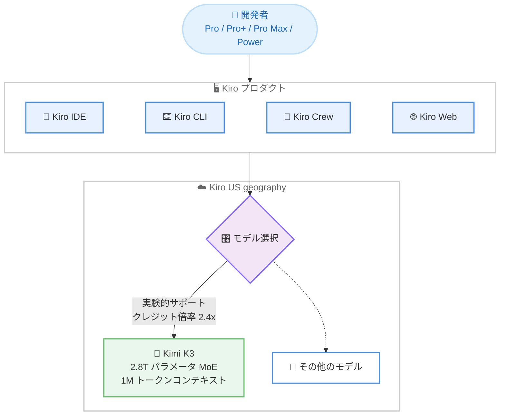

# Kiro - Kimi K3 モデルの提供開始

**リリース日**: 2026 年 10 月 15 日
**サービス**: Kiro
**機能**: Kimi K3 モデルの実験的サポート

📊 [このアップデートのインフォグラフィックを見る](https://takech9203.github.io/aws-news-summary/20261015-kiro-kimi-k3.html)

## 概要

Moonshot AI の Kimi K3 モデルが Kiro で利用可能になりました。Kiro の IDE、CLI、Crew、Web の各プロダクトで実験的サポート (experimental support) として提供され、Kiro の US geography を使用する Pro、Pro+、Pro Max、Power プランのすべてのユーザーが対象です。

Kimi K3 は、Moonshot AI によると世界初のオープンウェイト 2.8 兆パラメータモデルであり、1M (100 万) トークンのコンテキストウィンドウと、トークン効率に優れた MoE (Mixture-of-Experts) アーキテクチャを備えています。テキストと画像の入力を受け付け、長時間のコーディング (long-horizon coding)、深い推論、エンドツーエンドのナレッジワークといった、プロフェッショナルな開発者にとって重要なタスクに適したモデルです。

Kiro は本モデルの追加により、開発者が利用できるオープンウェイトモデルの選択肢をさらに拡大しました。ルーティンタスクには効率的なモデルを、複雑な作業には高性能なモデルを選択できるという、モデル選択の自由へのコミットメントを強化するアップデートです。

**アップデート前の課題**

このアップデート以前は、以下のような課題がありました。

- Kiro で Moonshot AI の Kimi K3 を選択できず、2.8 兆パラメータ規模のオープンウェイトモデルを Kiro のワークフローで利用できなかった
- 大規模コードベース、仕様書、テストスイート、会話履歴を同時に保持できる超長文コンテキストのモデルの選択肢が限られていた
- 複数ファイルにまたがるリファクタリングや深くネストした依存関係の理解など、長時間の複雑なタスクに適したモデルの選択肢が限られていた

**アップデート後の改善**

今回のアップデートにより、以下が可能になりました。

- Kiro の IDE、CLI、Crew、Web のすべてのプロダクトで Kimi K3 を選択できるようになった
- 1M トークンのコンテキストウィンドウにより、コードベース全体、仕様書、テストスイート、会話履歴を同時に保持したまま、要件定義から設計、実装、検証まで一貫したコンテキストで作業できるようになった
- 2.8 兆パラメータのフロンティアレベルの知能を、スペック駆動開発のワークフローに組み合わせられるようになった

## アーキテクチャ図



Kiro の各プロダクトからモデル選択で Kimi K3 を指定すると、US geography 上で提供される Kimi K3 がリクエストを処理します。利用にはクレジット倍率 2.4x が適用されます。

## サービスアップデートの詳細

### 主要機能

1. **2.8 兆パラメータのオープンウェイトモデル**
   - Moonshot AI によると、世界初のオープンウェイト 2.8 兆パラメータモデル
   - トークン効率に優れた MoE (Mixture-of-Experts) アーキテクチャを採用
   - 長時間のコーディング、深い推論、エンドツーエンドのナレッジワークでフロンティアレベルの知能を発揮

2. **1M トークンのコンテキストウィンドウ**
   - コードベース全体、仕様書一式、テストスイート、会話履歴を同時に保持可能
   - 要件定義から設計、実装、検証に至るスペック駆動開発のワークフロー全体でコンテキストの継続性を実現
   - 複数ファイルのリファクタリングや、深くネストした依存関係チェーンの理解に対応

3. **マルチモーダル入力**
   - テキストと画像の入力に対応

4. **Kiro のスペック駆動開発との組み合わせ**
   - Kimi K3 の推論能力により、要件をより網羅的な実行可能仕様へ変換
   - Kiro の自動化された決定論的検証により、生成コードが仕様と開発者の意図に一致することを検証
   - 1M コンテキストによりシステム全体を考慮して満たすべきプロパティを特定し、2.8 兆パラメータの知識により初回パスで仕様を満たす実装を生成しやすくなる

5. **幅広い提供範囲**
   - Kiro IDE、CLI、Crew、Web のすべてで利用可能
   - Pro、Pro+、Pro Max、Power のすべての有料プランが対象

## 技術仕様

### Kimi K3 モデルの仕様

| 項目 | 詳細 |
|------|------|
| 開発元 | Moonshot AI |
| モデル形態 | オープンウェイト |
| パラメータ数 | 2.8 兆 (Moonshot AI による) |
| アーキテクチャ | MoE (Mixture-of-Experts) |
| コンテキストウィンドウ | 1M (100 万) トークン |
| 入力モダリティ | テキスト、画像 |
| 提供ステータス | 実験的サポート (experimental support) |
| 対応プロダクト | Kiro IDE、CLI、Crew、Web |
| 対象プラン | Pro、Pro+、Pro Max、Power |
| 提供場所 | Kiro の US geography (us-east-1、IAD) |
| クレジット倍率 | 2.4x |

## 設定方法

### 前提条件

1. Kiro の Pro、Pro+、Pro Max、Power のいずれかの有料プランに加入していること
2. Kiro の US geography を使用していること
3. Kiro IDE、CLI、Crew、Web のいずれかを利用できること

### 手順

#### ステップ 1: Kiro を最新の状態にする

Kiro IDE または CLI を利用している場合は、最新バージョンへ更新します。Kiro Web および Crew はブラウザからアクセスするため更新は不要です。

#### ステップ 2: モデルセレクターで Kimi K3 を選択する

Kiro のチャットやエージェントセッションのモデルセレクターから Kimi K3 を選択します。実験的サポートのモデルとして表示されます。

#### ステップ 3: クレジット消費を確認しながら利用する

Kimi K3 の利用にはクレジット倍率 2.4x が適用されるため、ダッシュボードでクレジット消費状況を確認しながら利用します。

## メリット

### ビジネス面

- **モデル選択の自由**: オープンウェイトモデルの選択肢が拡大し、タスクの性質やコストに応じた最適なモデルを選択できる
- **大規模開発の生産性向上**: 1M トークンのコンテキストにより、大規模コードベースを扱うプロジェクトでもコンテキストの分割や再説明の手間を削減できる
- **品質の向上**: Kimi K3 の推論能力と Kiro の決定論的検証の組み合わせにより、仕様に対して検証済みのソフトウェアを生成できる

### 技術面

- **超長文コンテキスト**: コードベース全体、仕様書、テストスイート、会話履歴を同時に保持し、スペック駆動開発の全フェーズで一貫したコンテキストを維持できる
- **複雑なタスクへの対応**: 複数ファイルのリファクタリング、深い依存関係チェーンの理解、大規模コードベースにまたがるアーキテクチャ的に整合性のあるコード生成に対応できる
- **トークン効率**: MoE アーキテクチャにより、性能と効率を両立している

## デメリット・制約事項

### 制限事項

- 実験的サポート (experimental support) としての提供であり、一般提供 (GA) ではない
- Kiro の US geography (us-east-1、IAD) のユーザーのみが対象で、他の geography では利用できない
- 対象は Pro、Pro+、Pro Max、Power の有料プランのみで、無料プランでは利用できない

### 考慮すべき点

- クレジット倍率が 2.4x と高めに設定されているため、ルーティンタスクでは軽量なモデルと使い分けるとクレジットを節約できる
- 1M トークンの長大なコンテキストを活用するタスクでは、消費クレジットが増加する可能性があるため、利用状況のモニタリングが推奨される

## ユースケース

### ユースケース 1: 大規模コードベースの複数ファイルリファクタリング

**シナリオ**: 数十万行規模のコードベースで、深くネストした依存関係を持つモジュール群を横断的にリファクタリングしたい。

**実装例**:
```
1. Kiro IDE のモデルセレクターで Kimi K3 を選択
2. リファクタリング対象のモジュール群と依存関係をコンテキストに含めてエージェントに指示
3. 1M トークンのコンテキストでコードベース全体を考慮した変更案を生成
```

**効果**: コンテキストを分割せずにシステム全体を考慮した、アーキテクチャ的に整合性のあるリファクタリングを実現できる。

### ユースケース 2: スペック駆動開発での一貫したコンテキスト維持

**シナリオ**: 要件定義から設計、実装、検証までのスペック駆動開発ワークフローで、仕様書とテストスイートを常に参照しながら実装を進めたい。

**実装例**:
```
1. Kiro のスペック機能で要件と設計を作成
2. Kimi K3 を選択し、仕様書・テストスイート・会話履歴を保持したまま実装を進行
3. Kiro の決定論的検証で生成コードが仕様と一致することを確認
```

**効果**: 1M コンテキストによりワークフロー全体でコンテキストの継続性が保たれ、初回パスで仕様を満たす実装を得やすくなる。

### ユースケース 3: 長時間のエージェントタスクとナレッジワーク

**シナリオ**: Kiro CLI や Crew で、長時間にわたるコーディングタスクや、コードベースの調査・ドキュメント化などのナレッジワークを実行したい。

**実装例**:
```
1. Kiro CLI または Crew で Kimi K3 を選択
2. 長時間のエージェントセッションでタスクを実行
3. 画像入力が必要な場合はスクリーンショット等も併せて渡す
```

**効果**: 長時間のコーディングや深い推論を要するタスクを、コンテキストの途切れなく実行できる。

## 料金

Kimi K3 の利用には、Kiro のクレジットに対して **2.4x のクレジット倍率**が適用されます。高性能な開発作業向けのモデルとして位置付けられており、消費クレジットは標準モデルの 2.4 倍となります。

対象プランは Pro、Pro+、Pro Max、Power です。各プランの料金詳細は [Kiro の料金ページ](https://kiro.dev/pricing/) を参照してください。

## 利用可能リージョン

Kiro はグローバルに利用可能なサービスですが、本アップデートの Kimi K3 は **Kiro の US geography (us-east-1、IAD) を使用するユーザーのみ**が対象です。

## 関連サービス・機能

- **Kiro IDE / CLI / Crew / Web**: Kimi K3 はこれらすべての Kiro プロダクトで利用可能
- **Kiro のスペック駆動開発**: Kimi K3 の長文コンテキストと推論能力は、要件から検証までのスペック駆動ワークフローと組み合わせて活用できる
- **Amazon Bedrock の Kimi K3**: Moonshot AI の Kimi K3 は Amazon Bedrock でも提供されており、アプリケーションへの組み込み用途では Bedrock 経由で利用できる (2026 年 9 月 18 日発表)

## 参考リンク

- 📊 [インフォグラフィック](https://takech9203.github.io/aws-news-summary/20261015-kiro-kimi-k3.html)
- [公式発表 (Kiro Blog)](https://kiro.dev/blog/kimi-k3/)
- [Kiro Changelog](https://kiro.dev/changelog/)
- [Kiro ドキュメント](https://kiro.dev/docs/)
- [Kiro 料金ページ](https://kiro.dev/pricing/)

## まとめ

Kiro に Moonshot AI の Kimi K3 が実験的サポートとして追加され、2.8 兆パラメータと 1M トークンコンテキストを備えたオープンウェイトモデルを IDE、CLI、Crew、Web のすべてで選択できるようになりました。US geography の Pro 以上のプランを利用している場合は、大規模コードベースのリファクタリングやスペック駆動開発などの複雑なタスクで試し、クレジット倍率 2.4x を踏まえて既存モデルと使い分けることを推奨します。
