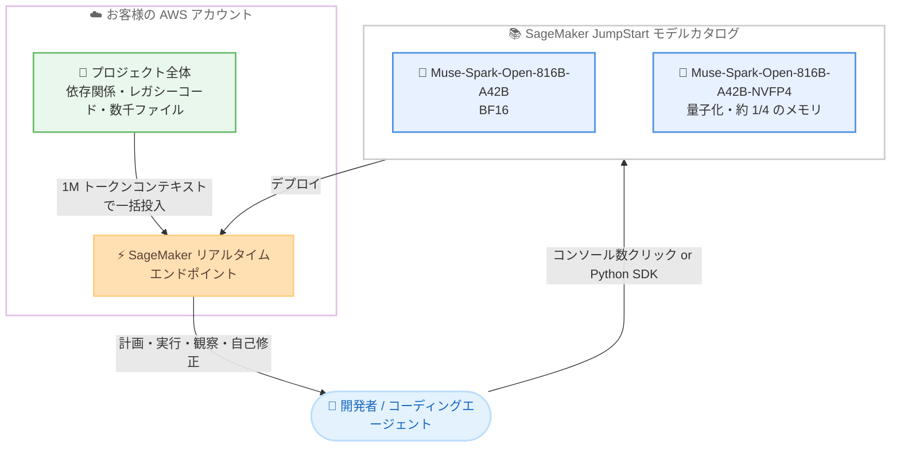

# Amazon SageMaker JumpStart - Meta Muse Spark Open モデルの提供開始

**リリース日**: 2026 年 10 月 15 日
**サービス**: Amazon SageMaker JumpStart
**機能**: Meta Muse Spark Open (オープンウェイトのエージェンティックコーディングモデル) の提供

📊 [このアップデートのインフォグラフィックを見る](https://takech9203.github.io/aws-news-summary/20261015-muse-spark-open-on-sagemaker-jumpstart.html)

## 概要

Meta のオープンウェイトモデル「Muse Spark Open」が Amazon SageMaker JumpStart で利用可能になりました。本モデルはエージェンティックコーディングワークフロー向けに特化して構築されたコーディング最適化モデルであり、マルチステップ推論とツール呼び出しの能力を AWS インフラストラクチャ上のエンタープライズソフトウェアエンジニアリングにもたらします。

Muse Spark Open は Mixture-of-Experts (MoE) アーキテクチャを採用し、総パラメータ数 816B、トークンあたりのアクティブパラメータ数 42B という構成です。これにより、非常に大規模なネットワークの能力を持ちながら、トークンあたりの計算量ははるかに小さい密 (dense) モデルに近い水準に抑えられています。また 1M トークンのコンテキストウィンドウを備え、依存関係、レガシーコード、数千のファイルを含むプロジェクト全体を分割せずに取り込むことができます。

SageMaker JumpStart を利用することで、お客様は数クリックで Muse Spark Open をデプロイでき、エンドポイントはお客様自身の AWS アカウント内で実行されるため、ソースコードとプロンプトを完全に管理下に置くことができます。

**アップデート前の課題**

- 長時間稼働するコーディングエージェント向けの大規模オープンウェイトモデルを AWS 上で利用するには、モデルの入手、推論環境の構築、サービング設定を自前で行う必要があった
- 大規模コードベースを扱う際、コンテキストウィンドウの制約によりタスクを小さく分割する必要があった
- 外部のマネージド API を利用する場合、ソースコードやプロンプトが自社アカウント外に送信されることへの懸念があった

**アップデート後の改善**

- SageMaker JumpStart のモデルカタログから数クリック、または SageMaker Python SDK で Muse Spark Open をデプロイできるようになった
- 1M トークンのコンテキストウィンドウにより、プロジェクト全体 (依存関係、レガシーコード、数千のファイル) を分割せずに一括で取り込めるようになった
- エンドポイントがお客様の AWS アカウント内で稼働するため、ソースコードとプロンプトを完全に自社管理下に置けるようになった
- NVFP4 量子化バリアントにより、BF16 比で約 4 分の 1 のメモリでコスト効率の高いデプロイが可能になった

## アーキテクチャ図



SageMaker JumpStart のモデルカタログから 2 つのバリアントのいずれかを選択してデプロイすると、お客様自身の AWS アカウント内にエンドポイントが作成され、プロジェクト全体を 1M トークンのコンテキストに取り込んだエージェンティックなコーディングワークフローを実行できます。

## サービスアップデートの詳細

### 主要機能

1. **エージェンティックコーディングに特化した設計**
   - 長時間稼働するコーディングエージェントとマルチモーダルなエンジニアリングワークフロー向けに設計
   - マルチファイルのリファクタリングや長時間のデバッグセッションといった実際の開発者ワークフローで学習
   - 単発のツール呼び出しではなく、長いタスク期間にわたって計画し、行動し、結果を観察し、自己修正するエージェント動作を実現

2. **MoE アーキテクチャによる効率的な推論**
   - 総パラメータ数 816B、トークンあたりのアクティブパラメータ数 42B の Mixture-of-Experts 構成
   - 超大規模ネットワークの能力を保ちながら、トークンあたりの計算量をはるかに小さい密モデルに近い水準に抑制

3. **1M トークンのコンテキストウィンドウ**
   - 依存関係、レガシーコード、数千のファイルを含むプロジェクト全体を分割せずに取り込み可能
   - タスクを小さな断片に分割する前処理が不要

4. **マルチモーダル入力対応**
   - 入力: テキスト、画像、ドキュメント、音声、音声付き動画
   - 出力: テキスト

5. **2 つのデプロイバリアント**
   - BF16 版と NVFP4 量子化版を提供
   - NVFP4 版は BF16 版の約 4 分の 1 のメモリで動作し、コスト効率の高いデプロイが可能

## 技術仕様

### モデル仕様

| 項目 | 詳細 |
|------|------|
| 提供元 | Meta |
| モデル種別 | オープンウェイト、コーディング最適化 |
| アーキテクチャ | Mixture-of-Experts (MoE) |
| 総パラメータ数 | 816B |
| アクティブパラメータ数 | 42B / トークン |
| コンテキストウィンドウ | 1M トークン |
| 入力モダリティ | テキスト、画像、ドキュメント、音声、音声付き動画 |
| 出力モダリティ | テキスト |

### 提供バリアント

| バリアント | 精度 | 特徴 |
|------------|------|------|
| Muse-Spark-Open-816B-A42B | BF16 | フル精度での推論 |
| Muse-Spark-Open-816B-A42B-NVFP4 | NVFP4 量子化 | BF16 比で約 4 分の 1 のメモリ、コスト効率の高いデプロイ向け |

## 設定方法

### 前提条件

1. AWS アカウントと Amazon SageMaker AI の利用環境 (SageMaker Studio など)
2. SageMaker JumpStart へのアクセス権限を持つ IAM ロール
3. モデルのデプロイに必要な GPU インスタンスのサービスクォータ

### 手順

#### ステップ 1: SageMaker JumpStart モデルカタログでモデルを検索

SageMaker コンソールから SageMaker JumpStart のモデルカタログを開き、「Muse Spark Open」を検索します。BF16 版と NVFP4 版の 2 つのバリアントから、要件に合わせて選択します。

#### ステップ 2: モデルをデプロイ

コンソールの場合は数クリックでデプロイできます。SageMaker Python SDK を使用する場合の例は以下のとおりです。

```python
from sagemaker.jumpstart.model import JumpStartModel

# JumpStart のモデル ID を指定してモデルオブジェクトを作成し、
# 自身の AWS アカウント内にエンドポイントをデプロイする
model = JumpStartModel(model_id="<Muse Spark Open のモデル ID>")
predictor = model.deploy()
```

このコードは、SageMaker JumpStart カタログ上のモデルを自身の AWS アカウント内のリアルタイムエンドポイントとしてデプロイします。実際のモデル ID とデフォルトのインスタンスタイプは、SageMaker JumpStart のモデルカタログで確認してください。

#### ステップ 3: エンドポイントを呼び出して推論を実行

```python
# デプロイしたエンドポイントに対して推論リクエストを送信する
response = predictor.predict({
    "inputs": "リポジトリ全体を解析し、非推奨 API の利用箇所をリファクタリングしてください。"
})
print(response)
```

このコードは、デプロイ済みのエンドポイントにプロンプトを送信し、モデルの生成結果を取得します。エンドポイントはお客様のアカウント内で稼働するため、ソースコードとプロンプトは外部に送信されません。

## メリット

### ビジネス面

- **データ主権の確保**: エンドポイントがお客様自身の AWS アカウント内で稼働するため、ソースコードやプロンプトといった機密性の高い知的財産を自社の管理下に置ける
- **導入の迅速化**: 数クリックまたは数行のコードでデプロイでき、大規模モデルのサービング環境構築にかかる時間と労力を削減できる
- **コスト最適化の選択肢**: NVFP4 量子化版により、必要なメモリを約 4 分の 1 に抑えた低コストなデプロイが選択できる

### 技術面

- **プロジェクト全体の一括処理**: 1M トークンのコンテキストウィンドウにより、数千ファイル規模のコードベースを分割せずに扱える
- **長時間のエージェント動作**: 計画、実行、観察、自己修正のループを長いタスク期間にわたって継続でき、マルチファイルリファクタリングや長時間デバッグに適する
- **MoE による推論効率**: 816B の総パラメータに対しトークンあたり 42B のみがアクティブとなるため、モデル能力と計算コストのバランスに優れる
- **マルチモーダル対応**: 設計資料の画像やドキュメント、音声・動画を入力として扱え、エンジニアリングワークフロー全体をカバーできる

## デメリット・制約事項

### 制限事項

- 出力はテキストのみで、画像や音声の生成には対応しない
- 816B 規模の MoE モデルであるため、BF16 版のホスティングには大容量メモリを持つ GPU インスタンスが必要となる
- 利用可能リージョンは発表では明記されておらず、SageMaker JumpStart のモデルカタログでの確認が必要

### 考慮すべき点

- セルフホスト型のため、Amazon Bedrock のようなサーバーレス API と異なり、エンドポイントの稼働時間に応じたインスタンス料金が発生する。利用パターンに応じてインスタンスタイプやオートスケーリングの設計が必要
- NVFP4 量子化版はメモリ効率に優れる一方、量子化による精度への影響は自社のユースケースで評価することが推奨される
- 必要な GPU インスタンスのサービスクォータを事前に確認し、不足している場合は引き上げ申請が必要

## ユースケース

### ユースケース 1: 大規模レガシーコードベースの一括リファクタリング

**シナリオ**: 数千ファイルからなるレガシーアプリケーションで、非推奨 API の置き換えやフレームワークのバージョンアップを行いたい。従来はコンテキスト制限のためモジュール単位に分割して進める必要があった。

**実装例**:
```text
1. リポジトリ全体 (依存関係・レガシーコードを含む) を 1M トークンの
   コンテキストとしてエンドポイントに投入
2. モデルが影響範囲を分析し、マルチファイルにまたがる変更計画を立案
3. 計画・実行・観察・自己修正のループで段階的に修正を適用
```

**効果**: タスク分割の前処理が不要になり、ファイル間の依存関係を踏まえた一貫性のあるリファクタリングを実現できる。

### ユースケース 2: 長時間稼働するデバッグエージェント

**シナリオ**: 再現条件が複雑な障害の原因調査で、ログ解析、仮説立案、修正、テスト実行を繰り返す長時間のデバッグセッションを自動化したい。

**実装例**:
```text
1. SageMaker エンドポイントをエージェントフレームワークのバックエンド LLM として構成
2. テスト実行やログ取得をツールとしてエージェントに提供
3. モデルが結果を観察しながら自己修正を繰り返し、原因特定と修正案の提示まで実行
```

**効果**: 単発のツール呼び出しでは解決できない複雑な障害調査を、長いタスク期間にわたる自律的な試行錯誤で進められる。

### ユースケース 3: 機密コードを扱うエンタープライズ開発での AI 活用

**シナリオ**: 規制業種の企業が、ソースコードを外部 API に送信できないポリシーのもとで AI コーディング支援を導入したい。

**実装例**:
```text
1. 自社 AWS アカウント内に Muse Spark Open をデプロイ
2. VPC 内から SageMaker エンドポイントを呼び出す構成とし、
   コードとプロンプトをアカウント外に出さない
3. コスト要件に応じて NVFP4 版を選択しメモリ使用量を約 1/4 に削減
```

**効果**: データ主権とコンプライアンス要件を満たしながら、最新のエージェンティックコーディングモデルを活用できる。

## 料金

Muse Spark Open 自体はオープンウェイトモデルであり、SageMaker JumpStart からのデプロイでは、エンドポイントで使用する SageMaker 推論インスタンスの稼働時間に基づく料金が発生します。具体的な料金はインスタンスタイプとリージョンによって異なるため、SageMaker AI の料金ページを確認してください。

NVFP4 量子化版は BF16 版と比較して約 4 分の 1 のメモリで動作するため、より小規模なインスタンス構成によるコスト削減が期待できます。

## 利用可能リージョン

発表では利用可能リージョンは明記されていません。SageMaker JumpStart のモデルカタログで、利用したいリージョンでの提供状況を確認してください。

## 関連サービス・機能

- **Amazon SageMaker JumpStart**: 基盤モデルのカタログからワンクリックでモデルをデプロイできる機能。今回 Muse Spark Open が追加された
- **Amazon SageMaker AI 推論エンドポイント**: デプロイされたモデルをホストするマネージド推論基盤。オートスケーリングや VPC 統合に対応
- **Amazon Bedrock**: サーバーレス API で基盤モデルを利用するサービス。セルフホスト型の JumpStart と用途に応じて使い分けが可能
- **SageMaker Python SDK**: コードによるモデルのデプロイと推論呼び出しを行うための SDK

## 参考リンク

- 📊 [インフォグラフィック](https://takech9203.github.io/aws-news-summary/20261015-muse-spark-open-on-sagemaker-jumpstart.html)
- [公式発表 (What's New)](https://aws.amazon.com/about-aws/whats-new/2026/01/muse-spark-open-on-sagemaker-jumpstart/)
- [Amazon SageMaker JumpStart ドキュメント](https://docs.aws.amazon.com/sagemaker/latest/dg/studio-jumpstart.html)
- [Amazon SageMaker AI 料金ページ](https://aws.amazon.com/sagemaker-ai/pricing/)

## まとめ

Meta の Muse Spark Open が SageMaker JumpStart に追加されたことで、816B パラメータの MoE アーキテクチャと 1M トークンコンテキストを備えたエージェンティックコーディングモデルを、自社 AWS アカウント内で数クリックでデプロイできるようになりました。ソースコードを外部に出せない企業でも、大規模コードベースのリファクタリングや長時間のデバッグ自動化に AI エージェントを活用できます。まずは SageMaker JumpStart のモデルカタログで提供リージョンとバリアントを確認し、NVFP4 版での検証から始めることを推奨します。
