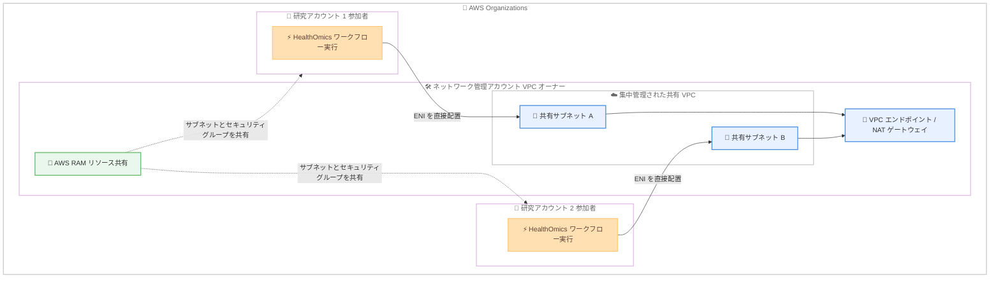

# AWS HealthOmics - 共有 VPC (クロスアカウント VPC) のサポート

**リリース日**: 2026 年 10 月 15 日
**サービス**: AWS HealthOmics
**機能**: ワークフロー実行における共有 VPC (AWS RAM によるクロスアカウント VPC 共有) のサポート

📊 [このアップデートのインフォグラフィックを見る](https://takech9203.github.io/aws-news-summary/20261015-omics-workflows-shared-vpcs.html)

## 概要

AWS HealthOmics が、AWS Resource Access Manager (AWS RAM) を使用して他の AWS アカウントが管理する Amazon VPC をアカウント間で共有し、その共有 VPC 内でワークフローを実行する機能をサポートしました。AWS HealthOmics は、ヘルスケア・ライフサイエンス分野のお客様がフルマネージドなバイオインフォマティクスワークフローを大規模に実行できる HIPAA 対応サービスです。

今回のアップデートにより、組織内の複数アカウントに対して単一の VPC からサブネットとセキュリティグループを共有し、ネットワーク管理を一元化できるようになりました。HealthOmics は各アカウントのワークフロー実行用 Elastic Network Interface (ENI) を共有サブネットに直接配置します。これにより、参加アカウントのワークフローは、VPC ピアリング接続や VPC エンドポイントの重複作成なしに、プライベートにデータへアクセスできます。

集中管理型ネットワークを採用する組織では、ネットワーク管理チームが VPC・サブネット・VPC エンドポイント・NAT ゲートウェイなどを一元管理しつつ、研究者や開発者は自身のアカウントでバイオインフォマティクスワークフローを実行する、という役割分担が実現できます。

**アップデート前の課題**

集中管理型ネットワークを採用するお客様には、以下の課題がありました。

- 以前は、各アカウントの VPC ごとに個別の AWS PrivateLink VPC エンドポイントを作成する必要があり、エンドポイントが重複してコストと管理負荷が増大していた
- 以前は、VPC ピアリングを使用してアカウントごとのルートテーブルを個別に維持する必要があった
- 以前は、ネットワーク構成がアカウントごとに分散し、セキュリティポリシーの一貫した適用が困難だった

**アップデート後の改善**

今回のアップデートにより、以下が可能になりました。

- 単一の集中管理された VPC 内で複数アカウントのワークフローを実行できるようになり、VPC エンドポイントや NAT ゲートウェイを組織全体で共用できるようになった
- VPC ピアリング接続や VPC エンドポイントの重複作成なしに、ワークフローがプライベートにデータへアクセスできるようになった
- `CreateConfiguration` API の `VpcConfig` に追加された `vpcOwnerAccountId` パラメータを指定するだけで、共有 VPC を利用する構成を作成できるようになった

## アーキテクチャ図



ネットワーク管理アカウントが AWS RAM でサブネットとセキュリティグループを研究アカウントに共有し、各アカウントの HealthOmics ワークフローの ENI が共有サブネットに直接配置される構成を示しています。VPC エンドポイントや NAT ゲートウェイは共有 VPC 側で一元管理されます。

## サービスアップデートの詳細

### 主要機能

1. **AWS RAM によるクロスアカウント VPC 共有**
   - VPC オーナーアカウントが AWS RAM のリソース共有を使用して、サブネット (およびオプションでセキュリティグループ) を参加アカウントに共有する
   - 参加アカウントの HealthOmics ワークフロー実行用 ENI は、共有サブネット内に直接配置される
   - 両アカウントが同一の AWS Organizations 組織に所属している必要がある

2. **`vpcOwnerAccountId` パラメータの追加**
   - HealthOmics の構成リソース (Configuration) の `VpcConfig` に、オプションの `vpcOwnerAccountId` フィールドが追加された
   - 共有サブネットとセキュリティグループを所有する VPC オーナーの 12 桁のアカウント ID を指定する
   - 構成の作成後、ステータスが `ACTIVE` になるまで最大 15 分かかる

3. **VPC ピアリングによるクロスアカウント接続 (補完手段)**
   - 組織をまたぐアカウント間や、特定リソースへのアクセスのみが必要な場合は、従来どおり VPC ピアリングを利用できる
   - ピアリングの場合、ENI は自アカウントの VPC 内に残り、`vpcOwnerAccountId` は設定しない
   - ドキュメントでは RAM 共有と VPC ピアリングの使い分け基準が整理されている

4. **共有停止時の保護機能**
   - VPC オーナーが共有を停止すると、参加アカウントは共有解除されたリソースを使用した新規実行や新規構成の作成ができなくなる
   - HealthOmics が共有サブネット内に作成した ENI は、未使用状態が 48 時間続いた後に自動的に削除 (スイープ) される
   - ENI が残っている間、VPC オーナーは共有 VPC やサブネットを削除できないため、クリーンアップのタイミングを計画する必要がある

### RAM 共有と VPC ピアリングの使い分け

| 観点 | RAM 共有 | VPC ピアリング |
|------|----------|----------------|
| AWS Organizations | 必須 (同一組織に所属) | 不要 |
| ENI の配置場所 | 共有 VPC のサブネット内 | 自アカウントの VPC 内 |
| 適するケース | 集中型 Egress や中央ネットワークアカウントなど、共有 VPC 内でワークフローを動かす必要がある場合 | 他アカウント VPC 内の特定リソースへのアクセスのみが必要な場合 |
| スケーリング上の考慮 | AWS RAM のサービスクォータに依存 (デフォルトでリージョンあたり 25,000 リソース共有) | VPC あたりアクティブなピアリング接続はデフォルト 50 件。超過が見込まれる場合は RAM 共有を検討 |

## 技術仕様

### 前提条件 (RAM 共有)

| 項目 | 詳細 |
|------|------|
| AWS Organizations | VPC オーナーアカウントと参加アカウントが同一組織に所属していること |
| サービスリンクロール | `AWSServiceRoleForHealthOmics` が両方のアカウントに存在すること。参加アカウント側は初回の構成作成時に自動作成されるが、VPC オーナー側はクロスアカウント操作となるため自動作成されず、VPC オーナーが用意する必要がある |
| VPC | VPC オーナーアカウントに、接続要件を満たす非デフォルト VPC のサブネットがあること (デフォルト VPC のサブネットは共有不可)。サブネットは HealthOmics が動作するアベイラビリティーゾーンに配置する |
| セキュリティグループ | 共有 VPC 内のセキュリティグループ。VPC オーナー所有 (RAM で共有) と参加アカウント所有のどちらでも利用可能 |
| 権限 | VPC オーナー側で AWS RAM リソース共有の作成権限、参加アカウント側で HealthOmics 構成リソースの作成権限とワークフロー実行権限 |

### API変更履歴

| 日付 | サービス | 変更内容 |
|------|----------|----------|
| 2026/10/12 | [omics](https://awsapichanges.com/archive/changes/05bce7-omics.html) | 3 updated api methods - `CreateConfiguration` の `VpcConfig` にオプションの `vpcOwnerAccountId` フィールドが追加され、AWS RAM で共有されたサブネットとセキュリティグループを所有するアカウントを指定可能に |

### 構成リソースの設定例

```json
{
  "name": "cross-account-ram-config",
  "runConfigurations": {
    "vpcConfig": {
      "securityGroupIds": ["sg-1234567890abcdef0"],
      "subnetIds": ["subnet-1234567890abcdef0"],
      "vpcOwnerAccountId": "111122223333"
    }
  }
}
```

## 設定方法

### 前提条件

1. VPC オーナーアカウントと参加アカウントが同一の AWS Organizations 組織に所属していること
2. 両アカウントに `AWSServiceRoleForHealthOmics` サービスリンクロールが存在すること
3. VPC オーナーアカウントに、共有するサブネット・セキュリティグループ・必要な接続性 (NAT ゲートウェイなど) を備えた非デフォルト VPC があること

### 手順

#### ステップ1: 組織での RAM 共有を有効化 (管理アカウント)

```bash
aws ram enable-sharing-with-aws-organization
```

AWS Organizations 内でのリソース共有を有効にします。これにより、メンバーアカウントは招待の承諾なしで共有リソースを受け取れるようになります。

#### ステップ2: リソース共有を作成 (VPC オーナーアカウント)

AWS RAM コンソールで [Create resource share] を選択し、ワークフロー実行に使用するサブネット (必要に応じてセキュリティグループも) をリソースとして追加します。プリンシパルには参加アカウントの ID または組織 ID を指定します。

#### ステップ3: HealthOmics 構成を作成 (参加アカウント)

```bash
aws omics create-configuration \
  --name cross-account-ram-config \
  --run-configurations '{
    "vpcConfig": {
      "securityGroupIds": ["sg-1234567890abcdef0"],
      "subnetIds": ["subnet-1234567890abcdef0"],
      "vpcOwnerAccountId": "111122223333"
    }
  }'
```

共有サブネット ID・セキュリティグループ ID と、VPC オーナーの 12 桁のアカウント ID を指定して HealthOmics の構成リソースを作成します。作成後、ステータスが `ACTIVE` になるまで最大 15 分待ちます。

#### ステップ4: ワークフローを実行

ネットワーキングモードを `VPC` に設定し、作成した構成の名前を指定してワークフロー実行を開始します。実行の ENI は共有サブネット内に配置され、共有 VPC 内のリソースにプライベートにアクセスできます。

## メリット

### ビジネス面

- **インフラコストの削減**: VPC エンドポイントや NAT ゲートウェイをアカウントごとに重複作成する必要がなくなり、組織全体でネットワークインフラを共用できる
- **ガバナンスの強化**: ネットワーク管理チームが VPC 構成・ルーティング・セキュリティポリシーを一元管理でき、コンプライアンス要件への対応が容易になる
- **研究開発の俊敏性向上**: 研究者や開発者はネットワーク構築を待たずに、自身のアカウントでワークフローの実行に集中できる

### 技術面

- **ネットワーク管理の簡素化**: VPC ピアリング接続やアカウントごとのルートテーブル維持が不要になり、集中管理型ネットワークの運用負荷が軽減される
- **シンプルな API 統合**: 構成リソースに `vpcOwnerAccountId` を指定するだけで共有 VPC を利用でき、ワークフロー定義の変更は不要
- **安全な共有解除**: 共有停止時には新規実行がブロックされ、未使用 ENI は 48 時間後に自動削除されるため、VPC オーナーがリソースの制御を失わない

## デメリット・制約事項

### 制限事項

- RAM 共有を利用するには、VPC オーナーアカウントと参加アカウントが同一の AWS Organizations 組織に所属している必要がある (組織をまたぐ場合は VPC ピアリングを使用)
- デフォルト VPC のサブネットは AWS RAM で共有できず、非デフォルト VPC のサブネットのみ共有可能
- `AWSServiceRoleForHealthOmics` サービスリンクロールが VPC オーナーアカウント側では自動作成されないため、VPC オーナーが事前に用意する必要がある
- 構成リソースが `ACTIVE` になるまで最大 15 分かかる

### 考慮すべき点

- 共有停止後も、HealthOmics が作成した ENI が未使用状態で 48 時間経過するまで、VPC オーナーは共有 VPC やサブネットを削除できない
- 共有サブネットは HealthOmics が動作するアベイラビリティーゾーンに配置する必要がある
- セキュリティグループは最小権限で構成し、VPC フローログや CloudWatch メトリクスでクロスアカウントのトラフィックを監視することが推奨される
- AWS RAM のサービスクォータ (デフォルトでリージョンあたり 25,000 リソース共有、共有あたり 5,000 リソース・5,000 プリンシパル) に注意する

## ユースケース

### ユースケース1: 中央ネットワークアカウントによる集中型 Egress

**シナリオ**: 製薬企業がネットワーク管理専用アカウントで共有 VPC・NAT ゲートウェイ・VPC エンドポイントを一元管理し、複数の研究チームがそれぞれのアカウントでゲノム解析ワークフローを実行する。

**実装例**:
```
1. ネットワークアカウントで共有 VPC・サブネット・NAT ゲートウェイ・S3 用 VPC エンドポイントを構築
2. AWS RAM でサブネットとセキュリティグループを組織 ID 宛てに共有
3. 各研究アカウントで vpcOwnerAccountId を指定した HealthOmics 構成を作成
4. ネットワーキングモード VPC でワークフローを実行
```

**効果**: VPC エンドポイントと NAT ゲートウェイの重複が解消され、アウトバウンド通信の制御とコストを一元管理できる。

### ユースケース2: オンプレミスのリファレンスデータへのプライベートアクセス

**シナリオ**: 医療機関が AWS Direct Connect や Site-to-Site VPN を終端する共有 VPC を中央アカウントで管理し、各部門のアカウントからオンプレミスのリファレンスデータベースやライセンスサーバーにアクセスするワークフローを実行する。

**実装例**:
```
1. 中央アカウントの共有 VPC にオンプレミス接続とルーティングを集約
2. 共有サブネットを各部門アカウントに RAM で共有
3. 各部門アカウントのワークフロー ENI を共有サブネットに配置して実行
```

**効果**: 部門アカウントごとにハイブリッド接続やルートテーブルを構築する必要がなくなり、オンプレミス資源へのアクセス経路を一元管理できる。

### ユースケース3: 組織外アカウントの特定リソースへのアクセス (VPC ピアリング)

**シナリオ**: 共同研究先の別組織アカウントが保有する Amazon RDS クラスターのアノテーションデータに、自アカウントのワークフローからプライベートにアクセスする。

**実装例**:
```
1. 自アカウント (リクエスタ) に CIDR が重複しない VPC を作成
2. 相手アカウント (アクセプタ) との VPC ピアリング接続を作成・承諾
3. 双方のルートテーブルとセキュリティグループを更新
4. vpcOwnerAccountId は設定せず、自アカウントのサブネットでワークフローを実行
```

**効果**: AWS Organizations の組織をまたぐ場合でも、ピアリング経由で相手 VPC 内の特定リソースにプライベートにアクセスできる。

## 料金

共有 VPC のサポート自体に対する HealthOmics の追加料金の記載はありません。HealthOmics のワークフロー実行料金は従来どおり適用されます。

なお、公式ドキュメントには、クロスアカウント接続のために作成する Amazon VPC や関連リソース (NAT ゲートウェイ、VPC エンドポイント、ピアリング経由のデータ転送など) によって課金が発生する可能性があると記載されています。詳細は各サービスの料金ページを確認してください。

## 利用可能リージョン

AWS HealthOmics が利用可能なすべてのリージョンで利用できます。

- 米国東部 (バージニア北部、オハイオ)
- 米国西部 (オレゴン)
- 欧州 (フランクフルト、アイルランド、ロンドン)
- イスラエル (テルアビブ)
- アジアパシフィック (シンガポール、ソウル、東京)

## 関連サービス・機能

- **AWS Resource Access Manager (AWS RAM)**: サブネットとセキュリティグループをアカウント間で共有するための中核サービス。組織での共有を有効化するとメンバーアカウントは招待なしで共有リソースを利用できる
- **AWS Organizations**: RAM 共有の前提条件。VPC オーナーと参加アカウントが同一組織に所属している必要がある
- **Amazon VPC**: 共有 VPC・サブネット・セキュリティグループ・VPC ピアリングなど、本機能の基盤となるネットワーキングサービス
- **AWS PrivateLink**: 従来は各 VPC に個別のエンドポイント作成が必要だったが、共有 VPC により組織全体でエンドポイントを共用できるようになった

## 参考リンク

- 📊 [インフォグラフィック](https://takech9203.github.io/aws-news-summary/20261015-omics-workflows-shared-vpcs.html)
- [公式発表 (What's New)](https://aws.amazon.com/about-aws/whats-new/2026/10/omics-workflows-shared-vpcs/)
- [ドキュメント: Connecting to a VPC in another account](https://docs.aws.amazon.com/omics/latest/dev/workflows-vpc-cross-account.html)
- [AWS HealthOmics 製品ページ](https://aws.amazon.com/healthomics/)
- [Amazon VPC: Share your VPC subnets with other accounts](https://docs.aws.amazon.com/vpc/latest/userguide/vpc-sharing.html)
- [AWS RAM ユーザーガイド](https://docs.aws.amazon.com/ram/latest/userguide/)

## まとめ

AWS HealthOmics の共有 VPC サポートにより、集中管理型ネットワークを採用する組織は、VPC エンドポイントの重複やピアリング接続の維持なしに、複数アカウントのバイオインフォマティクスワークフローを単一の共有 VPC 内で実行できるようになりました。マルチアカウント環境で HealthOmics を運用しているお客様は、`AWSServiceRoleForHealthOmics` ロールの両アカウントでの準備と AWS RAM によるサブネット共有を確認した上で、`vpcOwnerAccountId` を指定した構成への移行を検討することを推奨します。
