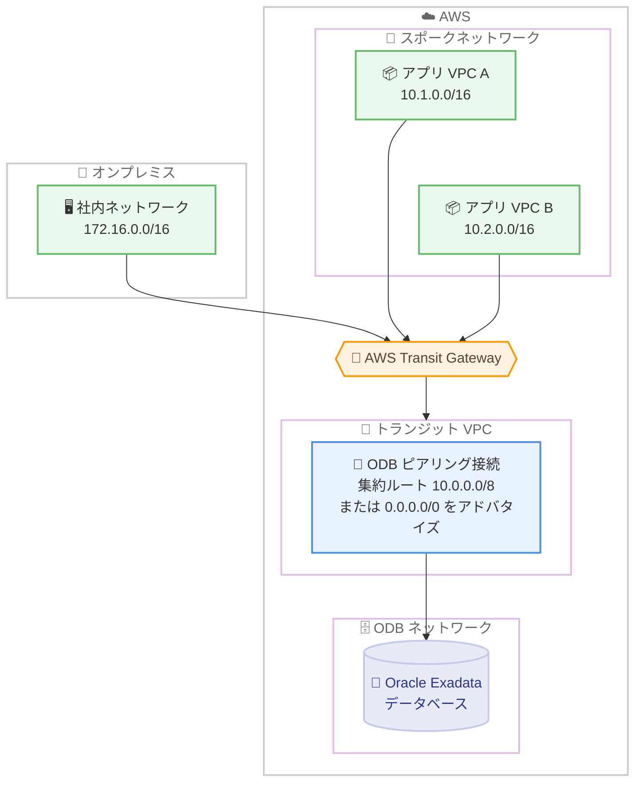

# Oracle Database@AWS - ODB ピアリングにおける集約ルートとデフォルトルートのサポート

**リリース日**: 2026 年 10 月 15 日
**サービス**: Oracle Database@AWS (ODB)
**機能**: ODB ピアリングでの集約ルート (スーパーネット) およびデフォルトルート (0.0.0.0/0) のアドバタイズ

📊 [このアップデートのインフォグラフィックを見る](https://takech9203.github.io/aws-news-summary/20261015-oracle-database-aws-aggregate-routes-odb.html)

## 概要

Oracle Database@AWS (ODB) が、Amazon VPC 内のアプリケーションと ODB ネットワーク内のデータベースを接続する ODB ピアリングの設定において、集約ルート (スーパーネット) とデフォルトルート (0.0.0.0/0) のアドバタイズをサポートしました。ピア側ネットワークの CIDR として /0 から /32 までの任意の IPv4 プレフィックスを指定できるようになり、1 つの集約ルートまたはデフォルトルートで、ピアリングされた VPC を経由して到達可能なすべてのネットワークをカバーできます。

これにより、新しい VPC やオンプレミスネットワークをデータベースへ接続するたびに、アドバタイズする CIDR を個別に追加・更新する必要がなくなり、ネットワーク運用が大幅に簡素化されます。特に、AWS Transit Gateway を経由して多数のネットワークがトランジット VPC 越しに ODB ネットワークへ接続するアーキテクチャで効果を発揮します。

ルーティングはロンゲストプレフィックスマッチ (最長プレフィックス一致) に従うため、より具体的な CIDR を持つルートが常に優先されます。スーパーネットやデフォルトルートは、より具体的なルートが処理しないトラフィックのみを運ぶため、既存の個別 CIDR と共存させながら段階的に移行できます。

**アップデート前の課題**

- 以前は、ODB ネットワークへ到達する各ネットワークを個別の CIDR としてアドバタイズする必要があった
- 以前は、広い集約レンジやデフォルトルートをアドバタイズできなかった
- 以前は、Transit Gateway 配下に新しい VPC やオンプレミスネットワークを追加するたびに、ピアリング接続の CIDR 設定を更新する必要があった

**アップデート後の改善**

- 今回のアップデートにより、任意の CIDR レンジ (/0〜/32) をアドバタイズできるようになり、単一の集約ルートやデフォルトルートでピア VPC 経由のすべてのネットワークをカバーできるようになった
- 今回のアップデートにより、Transit Gateway 経由で接続されるネットワークを追加しても、ピアリング接続の CIDR を個別に追加する作業が不要になった
- 既存のピアリング接続はそのまま動作し、広い CIDR を利用するための再作成は不要

## アーキテクチャ図



トランジット VPC の ODB ピアリング接続で集約ルート (例: 10.0.0.0/8) またはデフォルトルート (0.0.0.0/0) をアドバタイズすることで、Transit Gateway 配下のすべての VPC やオンプレミスネットワークが、個別の CIDR 登録なしに ODB ネットワーク内のデータベースへ到達できる構成を示しています。

## サービスアップデートの詳細

### 主要機能

1. **任意の CIDR レンジのアドバタイズ**
   - ピア側ネットワーク CIDR として、/0 から /32 までの任意の IPv4 プレフィックスを指定可能
   - 集約されたスーパーネット (例: 10.0.0.0/8) やデフォルトルート (0.0.0.0/0) を 1 エントリでアドバタイズできる
   - 狭い CIDR を指定すればアクセスを必要なサブネットに限定でき、セグメンテーションにも対応

2. **ロンゲストプレフィックスマッチによるルート解決**
   - CIDR が重複する場合、最も具体的な CIDR が常に優先される
   - スーパーネットやデフォルトルートは、より具体的なルートが処理しないトラフィックのみを運ぶ
   - 複数のピアリング接続にまたがって広い CIDR と狭い CIDR を組み合わせ、ルート解決を自動化できる

3. **ゼロダウンタイムのルート集約**
   - 既存の個別 CIDR を残したまま、先に集約スーパーネットを追加できる (同一ピアリング上の重複は許容)
   - トラフィックはより具体的な既存 CIDR に留まるため、動作確認後に個別 CIDR を削除すれば無停止で集約ルートへ移行できる
   - 1 回の `update-odb-peering-connection` コマンドで CIDR の追加と削除を同時に実行可能

4. **デフォルトルートの安全な取り扱い**
   - 0.0.0.0/0 はピアリング接続上のピア側ネットワーク CIDR のみを指し、ODB ネットワークが VPC のデフォルトゲートウェイになるわけではない
   - 別のピアリングで直接接続された VPC の CIDR は、ロンゲストプレフィックスマッチにより引き続きそのピアリングが優先される

## 技術仕様

### ピア側ネットワーク CIDR の仕様

| 項目 | 詳細 |
|------|------|
| 指定可能なプレフィックス | /0〜/32 の任意の IPv4 プレフィックス (スーパーネット、デフォルトルート 0.0.0.0/0 を含む) |
| ルート解決 | ロンゲストプレフィックスマッチ (最も具体的な CIDR が優先) |
| CIDR の一意性 | 同一の CIDR (スーパーネットや 0.0.0.0/0 を含む) は、1 つの ODB ネットワークにつき 1 つのピアリング接続にのみ登録可能 |
| ピアリング接続数の上限 | 1 つの ODB ネットワークあたり最大 125 接続 |
| 既存接続への影響 | 既存のピアリング接続は動作を継続し、再作成は不要 |
| 制限 IP アドレス範囲 | ピア側ネットワーク CIDR には、ODB ネットワークと同じ制限付き IP アドレス範囲が適用される (スーパーネットや 0.0.0.0/0 を使用する場合も同様) |
| 対応するピアリング形態 | 同一アカウント内ピアリング、および AWS RAM で共有された ODB ネットワークとのクロスアカウントピアリング |

### ピア側 CIDR のルールと制約

- 同一のプレフィックスを 2 つのピアリング接続に登録することはできない (ロンゲストプレフィックスマッチで優劣を判定できないため)
- 同じ ODB ネットワークに直接ピアリングされた 2 つの VPC の CIDR は重複してはならず、サブネットも同一であってはならない
- ピア側 CIDR は ODB ネットワークのクライアントサブネットを包含できるが、同一であってはならない
- 直接ピアリングされた VPC の CIDR 重複はピアリング作成・更新時にのみ検証され、その後にセカンダリ CIDR を追加した場合などの重複はユーザー側で管理する必要がある

## 設定方法

### 前提条件

1. Oracle Database@AWS を AWS Marketplace 経由でサブスクライブ済みであること
2. 複数の ODB ピアリング接続をサポートする ODB ネットワークが作成済みであること
3. ピアリング対象の Amazon VPC (トランジット VPC など) が存在し、必要に応じて AWS Transit Gateway にアタッチされていること

### 手順

#### ステップ1: 集約ルートを指定して ODB ピアリング接続を作成

```bash
aws odb create-odb-peering-connection \
  --odb-network-id odbnet-1234567890abcdef \
  --peer-network-id vpc-abcdef1234567890 \
  --peer-network-cidrs-to-be-added "10.0.0.0/8"
```

ODB ネットワークとトランジット VPC の間にピアリング接続を作成し、ピア側ネットワーク CIDR としてスーパーネット 10.0.0.0/8 をアドバタイズします。Transit Gateway 配下の多数の宛先を 1 エントリに集約できます。デフォルトルートを使う場合は `"0.0.0.0/0"` を指定します。

#### ステップ2: 既存接続を無停止で集約ルートへ移行

```bash
aws odb update-odb-peering-connection \
  --odb-peering-connection-id odbpcx-1234567890abcdef \
  --peer-network-cidrs-to-be-added "10.0.0.0/16" \
  --peer-network-cidrs-to-be-removed "10.0.0.0/24,10.0.1.0/24"
```

既存のピアリング接続に集約スーパーネットを追加し、置き換え対象の個別 CIDR を削除します。より具体的なルートが常に優先されるため、先にスーパーネットを追加してから個別 CIDR を削除する順序であれば、トラフィックの中断は発生しません。

#### ステップ3: VPC ルートテーブルを設定

```bash
aws ec2 create-route \
  --route-table-id rtb-1234567890abcdef \
  --destination-cidr-block 10.0.0.0/16 \
  --odb-network-arn arn:aws:odb:us-east-1:111111111111:odb-network/odbnet_1234567890abcdef
```

VPC 側のルートテーブルに、ODB ネットワーク宛てのルートを追加します。ピアリング接続の作成時に `--peer-network-route-table-ids` パラメータで暗黙的なルート管理を選択した場合、この手順は不要です。なお、ODB ネットワーク側のルートテーブルは Oracle Database@AWS が自動的に設定します。

## メリット

### ビジネス面

- **運用コストの削減**: ネットワーク追加のたびに発生していた CIDR 更新作業が不要になり、ネットワークチームの運用負荷が軽減される
- **拡張の俊敏性**: 新しい VPC やオンプレミス拠点を Transit Gateway に接続するだけでデータベースへ到達でき、ビジネスの拡大に迅速に対応できる
- **設定ミスのリスク低減**: ネットワークごとの個別エントリ管理が不要になることで、CIDR の登録漏れや誤設定による接続障害を防止できる

### 技術面

- **ルート管理の簡素化**: 単一の集約ルートまたはデフォルトルートで、トランジット VPC 経由のすべての宛先をカバーできる
- **ゼロダウンタイム移行**: ロンゲストプレフィックスマッチを利用し、スーパーネット追加後に個別 CIDR を削除することで無停止でルートを集約できる
- **柔軟なセグメンテーション**: 広い CIDR と狭い CIDR を組み合わせ、特定サブネットへのアクセス制限と広域の到達性を両立できる

## デメリット・制約事項

### 制限事項

- 本機能は、複数の ODB ピアリング接続をサポートする ODB ネットワークでのみ利用可能
- 同一の CIDR (0.0.0.0/0 を含む) は、1 つの ODB ネットワークにつき 1 つのピアリング接続にのみ登録できる
- ピア側 CIDR は ODB ネットワークのクライアントサブネットと同一にはできない
- ピア側 CIDR には ODB ネットワークと同じ制限付き IP アドレス範囲が適用される

### 考慮すべき点

- 広い CIDR やデフォルトルートをアドバタイズすると ODB ネットワークから到達可能な範囲が広がるため、セキュリティ要件に応じてより狭い CIDR によるセグメンテーションを検討する必要がある
- 直接ピアリングされた VPC の CIDR 重複はピアリング作成・更新時にのみ検証されるため、ピアリング作成後にセカンダリ CIDR ブロックを VPC へ追加する場合は、重複が生じないようユーザー側での管理が必要
- 0.0.0.0/0 の登録はピアリング接続上のアドバタイズルートに限定され、VPC 自体のデフォルトゲートウェイ設定は変更されない点を理解した上で設計する

## ユースケース

### ユースケース1: Transit Gateway ハブアンドスポーク構成の集約

**シナリオ**: 多数のアプリケーション VPC とオンプレミスネットワークが AWS Transit Gateway に接続されており、すべてのネットワークから ODB ネットワーク内の Oracle Exadata データベースへアクセスする。

**実装例**:
```
1. トランジット VPC と ODB ネットワークの間に ODB ピアリング接続を作成
2. ピア側ネットワーク CIDR として 10.0.0.0/8 (または 0.0.0.0/0) を登録
3. Transit Gateway とトランジット VPC のルートテーブルを設定
4. 以降、スポーク VPC を追加してもピアリング設定の変更は不要
```

**効果**: ネットワーク追加時の CIDR 登録作業がなくなり、大規模なハブアンドスポーク環境でもルート管理を 1 エントリに集約できる。

### ユースケース2: 個別 CIDR から集約ルートへの無停止移行

**シナリオ**: 既存の ODB ピアリング接続に多数の個別 CIDR が登録されており、運用簡素化のため集約ルートへ移行したいが、本番データベースへの接続を中断できない。

**実装例**:
```
1. update-odb-peering-connection で集約スーパーネット 10.0.0.0/16 を追加
   (既存の具体的な CIDR が優先されるため、トラフィックへの影響なし)
2. ルーティングが正常であることを確認
3. 同コマンドの --peer-network-cidrs-to-be-removed で個別 CIDR を削除
   (トラフィックはスーパーネットのルートへ無停止で移行)
```

**効果**: ロンゲストプレフィックスマッチを活用し、サービス停止なしでルート構成を簡素化できる。

### ユースケース3: デフォルトルートと直接ピアリングの併用

**シナリオ**: レイテンシー要件の厳しい主要アプリケーション VPC は ODB ネットワークへ直接ピアリングしつつ、その他の多数のネットワークからのトラフィックはトランジット VPC 経由で集約したい。

**実装例**:
```
1. 主要アプリケーション VPC と ODB ネットワークを直接ピアリングし、VPC の CIDR を登録
2. トランジット VPC とのピアリング接続に 0.0.0.0/0 を登録
3. 直接ピアリングされた VPC 宛てのトラフィックは、より具体的な CIDR により
   直接ピアリング経由で転送され、それ以外はトランジット VPC 経由となる
```

**効果**: 重要なワークロードには低レイテンシーの直接経路を確保しながら、その他のネットワークはデフォルトルートで包括的にカバーできる。

## 料金

本機能自体に関する追加料金の記載はありません。Oracle Database@AWS の利用料金は、AWS Marketplace 経由のサブスクリプションに基づいて適用されます。詳細は AWS Marketplace の Oracle Database@AWS 製品ページを確認してください。

## 利用可能リージョン

Oracle Database@AWS が利用可能なすべての AWS リージョンで利用できます。なお、本機能は複数の ODB ピアリング接続をサポートする ODB ネットワークで利用可能です。

## 関連サービス・機能

- **Amazon VPC**: ODB ピアリングの接続先となるアプリケーション実行環境。ルートテーブルの設定により ODB ネットワークへのトラフィックを制御する
- **AWS Transit Gateway**: 多数の VPC やオンプレミスネットワークを集約するハブ。本アップデートにより、Transit Gateway 配下のネットワークを単一の集約ルートで ODB ネットワークへ到達させることが可能になった
- **AWS Cloud WAN**: Transit Gateway と同様に、Oracle Database@AWS のドキュメントで接続構成がガイドされているグローバルネットワークサービス
- **AWS RAM**: ODB ネットワークをアカウント間で共有し、クロスアカウントの ODB ピアリングを構成するためのサービス

## 参考リンク

- 📊 [インフォグラフィック](https://takech9203.github.io/aws-news-summary/20261015-oracle-database-aws-aggregate-routes-odb.html)
- [公式発表 (What's New)](https://aws.amazon.com/about-aws/whats-new/2026/10/oracle-database-aws-aggregate-routes-odb/)
- [ドキュメント: Configuring ODB peering to an Amazon VPC](https://docs.aws.amazon.com/odb/latest/UserGuide/configuring.html)
- [Oracle Database@AWS ユーザーガイド](https://docs.aws.amazon.com/odb/latest/UserGuide/what-is-odb.html)
- [Oracle Database@AWS 製品ページ](https://aws.amazon.com/marketplace/featured-seller/oracle/)
- [AWS Marketplace: Oracle Database@AWS](https://aws.amazon.com/marketplace/pp/prodview-qks5dl3hr7nfw)

## まとめ

Oracle Database@AWS の ODB ピアリングが集約ルートとデフォルトルート (0.0.0.0/0) のアドバタイズに対応し、Transit Gateway 配下の多数のネットワークから ODB ネットワークへの接続を単一のルートエントリで管理できるようになりました。多数の VPC やオンプレミスネットワークから Oracle Exadata データベースへ接続しているお客様は、ロンゲストプレフィックスマッチを活用した無停止のルート集約により、ピアリング接続の CIDR 管理の簡素化を検討することを推奨します。
