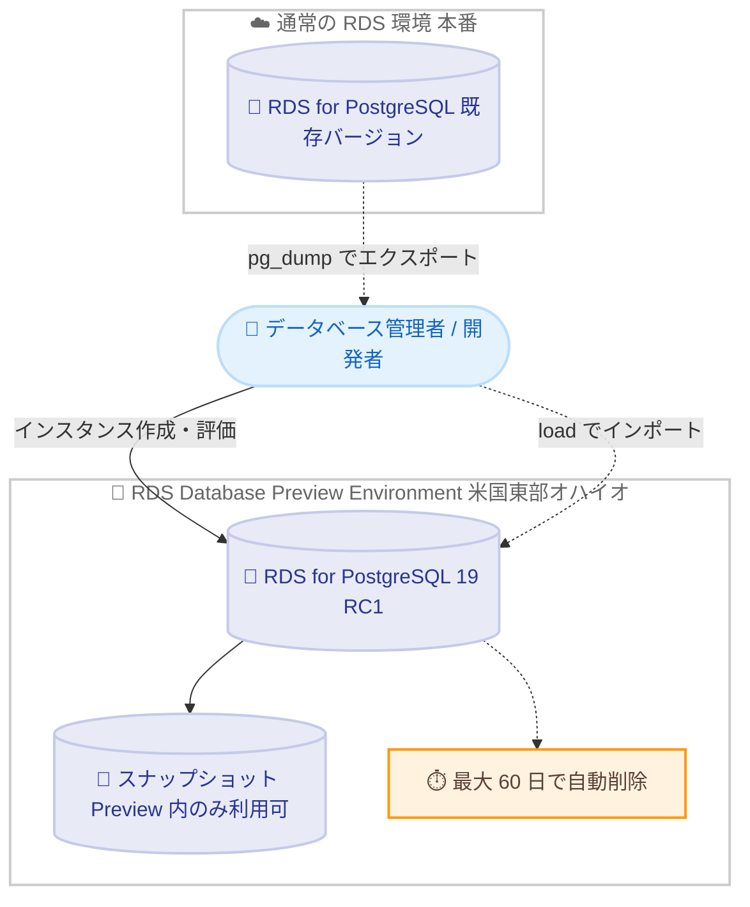

# Amazon RDS for PostgreSQL - PostgreSQL 19 RC1 が RDS Database Preview Environment で利用可能に

**リリース日**: 2026 年 10 月 15 日
**サービス**: Amazon RDS for PostgreSQL
**機能**: Amazon RDS Database Preview Environment における PostgreSQL 19 Release Candidate 1 (RC1) の提供

📊 [このアップデートのインフォグラフィックを見る](https://takech9203.github.io/aws-news-summary/20261015-postgresql-19-rc1-amazon-rds-database-preview-environment.html)

## 概要

Amazon RDS for PostgreSQL において、PostgreSQL 19 Release Candidate 1 (RC1) が Amazon RDS Database Preview Environment で利用可能になりました。これにより、PostgreSQL 19 の正式リリース (GA) に先立ち、プレリリース版をマネージドな RDS 環境上で評価できます。

PostgreSQL 19 RC1 は安定性に重点を置いたリリースで、Beta 4 のテスト期間中に報告されたバグ修正と改善が含まれています。AWS の発表によると、複雑な全文検索式のエラーハンドリングの改善、並列 autovacuum の堅牢化、GIN インデックスメンテナンスの信頼性向上が含まれます。PostgreSQL コミュニティのリリーススケジュールでは、2026 年 11 月 12 日に RC2、問題がなければ 2026 年 11 月 19 日に GA が予定されています。

このアップデートは、PostgreSQL 19 への移行を計画しているデータベース管理者やアプリケーション開発者が、自社のワークロードや拡張機能との互換性を GA 前に検証するためのものです。Preview Environment のインスタンスは最大 60 日間保持され、保持期間終了後に自動削除されます。

**アップデート前の課題**

PostgreSQL の新メジャーバージョンを事前評価する際、以下の課題がありました。

- 以前は、PostgreSQL 19 のプレリリース版を試すにはセルフマネージドな EC2 インスタンスやオンプレミス環境にコミュニティ版を自分でインストールする必要があった
- 以前は、RDS 特有の構成 (パラメータグループ、マネージドバックアップなど) と組み合わせた動作検証を GA 前に行うことが難しかった
- 以前は、GA 後に初めて互換性問題が発覚し、アップグレード計画の手戻りが発生するリスクがあった

**アップデート後の改善**

今回のアップデートにより、以下が可能になりました。

- PostgreSQL 19 RC1 をマネージドな RDS 環境でプロビジョニングし、GA 前にアプリケーションの互換性やパフォーマンスを評価できるようになった
- Beta 4 までのフィードバックを反映した安定版候補 (RC1) で、本番移行に近い品質のテストを実施できるようになった
- PostgreSQL の dump / load 機能を使用して既存データベースを Preview Environment にインポートし、実データに近い条件で検証できるようになった

## アーキテクチャ図



Preview Environment で PostgreSQL 19 RC1 インスタンスを作成し、既存データベースから dump / load でデータを持ち込んで評価する流れを示しています。スナップショットは Preview Environment 内でのみ利用でき、インスタンスは最大 60 日で自動削除されます。

## サービスアップデートの詳細

### 主要機能

1. **PostgreSQL 19 RC1 の提供**
   - PostgreSQL 19 の Release Candidate 1 を RDS のマネージド環境で評価可能
   - Beta 4 テスト期間のバグ修正と改善を反映した、安定性重視のリリース
   - AWS の発表によると、複雑な全文検索式のエラーハンドリング改善、並列 autovacuum の堅牢化、GIN インデックスメンテナンスの信頼性向上が含まれる

2. **PostgreSQL 19 の注目機能 (コミュニティ発表より)**
   - `REPACK (CONCURRENTLY)`: テーブルをブロックせずに再編成する新コマンド
   - `pg_plan_advice`: クエリプランに関するアドバイスを提供する新モジュール
   - 並列 autovacuum: `autovacuum_max_parallel_workers` により autovacuum が並列ワーカーを利用可能
   - `effective_wal_level`: `wal_level` が `replica` でも論理レプリケーションを自動的に有効化できる挙動
   - `COPY ... TO (FORMAT json)`: COPY の JSON 形式出力をサポートし、RC1 ではクエリの列名 (エイリアス含む) を JSON キーとして使用するよう修正
   - `postgres_fdw` の統計インポート: RC1 では `ANALYZE` 実行ユーザーではなく外部テーブルの所有者として実行されるよう修正

3. **Preview Environment の運用ルール**
   - インスタンスは最大 60 日間保持され、保持期間終了後に自動削除
   - Preview Environment で作成したスナップショットは、Preview Environment 内でのインスタンス作成・復元にのみ使用可能
   - PostgreSQL の dump / load 機能でデータベースのインポート / エクスポートが可能

## 技術仕様

### Preview Environment の仕様

| 項目 | 詳細 |
|------|------|
| 提供バージョン | PostgreSQL 19 RC1 |
| 提供環境 | Amazon RDS Database Preview Environment |
| リージョン | 米国東部 (オハイオ) us-east-2 のみ |
| インスタンス保持期間 | 最大 60 日 (期間終了後に自動削除) |
| スナップショット | Preview Environment 内でのみ作成・復元可能 |
| データ移行手段 | PostgreSQL dump / load 機能 |
| 料金 | 米国東部 (オハイオ) リージョンの RDS for PostgreSQL 料金に準拠 |

### PostgreSQL 19 コミュニティのリリーススケジュール

| 日付 | マイルストーン |
|------|----------------|
| 2026/10/15 | RC1 リリース |
| 2026/11/12 | RC2 リリース予定 (同日の定期アップデートリリースの修正を取り込むため) |
| 2026/11/19 | GA 予定 (問題が発生しない場合) |

## 設定方法

### 前提条件

1. AWS アカウントと Amazon RDS へのアクセス権限
2. 米国東部 (オハイオ) us-east-2 リージョンの利用
3. 評価用データを持ち込む場合は、`pg_dump` / `pg_restore` などの PostgreSQL クライアントツール

### 手順

#### ステップ 1: Preview Environment で利用可能なエンジンバージョンを確認する

```bash
aws rds describe-db-engine-versions \
  --engine postgres \
  --region us-east-2 \
  --endpoint-url https://rds-preview.us-east-2.amazonaws.com
```

Preview Environment 専用のエンドポイントに対してエンジンバージョン一覧を取得し、PostgreSQL 19 RC1 のバージョン識別子を確認します。

#### ステップ 2: PostgreSQL 19 RC1 のインスタンスを作成する

```bash
aws rds create-db-instance \
  --db-instance-identifier pg19-rc1-eval \
  --engine postgres \
  --engine-version <ステップ 1 で確認したバージョン> \
  --db-instance-class db.m5.large \
  --allocated-storage 100 \
  --master-username postgres \
  --manage-master-user-password \
  --region us-east-2 \
  --endpoint-url https://rds-preview.us-east-2.amazonaws.com
```

Preview Environment に PostgreSQL 19 RC1 の DB インスタンスを作成します。マネジメントコンソールの場合は、RDS Database Preview Environment 専用コンソールから作成します。

#### ステップ 3: 既存データをインポートして評価する

```bash
# 既存環境からエクスポート
pg_dump -h <既存インスタンスのエンドポイント> -U postgres -Fc mydb > mydb.dump

# Preview Environment のインスタンスへインポート
pg_restore -h <Preview インスタンスのエンドポイント> -U postgres -d mydb mydb.dump
```

既存データベースを `pg_dump` でエクスポートし、Preview Environment のインスタンスへ `pg_restore` でインポートします。この環境でアプリケーションの互換性テスト、拡張機能の動作確認、性能評価を実施します。

## メリット

### ビジネス面

- **アップグレードリスクの低減**: GA 前に互換性問題を発見でき、本番アップグレード計画の手戻りを防止できる
- **移行準備期間の確保**: GA (2026 年 11 月 19 日予定) に先行して評価を開始でき、GA 後すみやかに移行判断ができる
- **インフラ構築コストの削減**: プレリリース版の検証環境をセルフマネージドで構築・運用する手間が不要

### 技術面

- **マネージド環境での検証**: パラメータグループなど RDS の運用モデルに沿った形で新バージョンを評価できる
- **安定性重視の RC 品質**: Beta 4 までのフィードバックを反映した修正 (REPACK (CONCURRENTLY)、pg_plan_advice、並列 autovacuum 関連など) を含む候補版でテストできる
- **実データでの評価**: dump / load により既存データベースを持ち込み、実ワークロードに近い条件で検証できる

## デメリット・制約事項

### 制限事項

- Preview Environment のインスタンスは最大 60 日間で自動削除されるため、長期利用はできない
- Preview Environment で作成したスナップショットは Preview Environment 内でのみ使用でき、通常の RDS 環境への復元はできない
- 提供リージョンは米国東部 (オハイオ) のみ
- RC1 はプレリリース版であり、本番ワークロードでの利用は想定されていない

### 考慮すべき点

- GA 版では RC1 から変更が入る可能性があるため、GA 後に最終確認が必要 (コミュニティは 2026 年 11 月 12 日に RC2 を予定)
- データの持ち出しは dump / load 経由となるため、大規模データベースでは移行時間を考慮する必要がある
- Preview Environment の利用にも米国東部 (オハイオ) リージョンの RDS for PostgreSQL 料金が発生する

## ユースケース

### ユースケース 1: 既存アプリケーションの互換性検証

**シナリオ**: PostgreSQL 16 で稼働中の業務アプリケーションを PostgreSQL 19 へアップグレードする計画があり、SQL やドライバの互換性を GA 前に確認したい。

**実装例**:
```bash
# 本番スキーマとデータのサブセットを Preview 環境へ投入
pg_dump -h prod-instance.xxxx.ap-northeast-1.rds.amazonaws.com -Fc appdb > appdb.dump
pg_restore -h pg19-rc1-eval.xxxx.us-east-2.rds-preview.amazonaws.com -d appdb appdb.dump

# アプリケーションの回帰テストスイートを Preview 環境に向けて実行
```

**効果**: GA 前に非互換の SQL や拡張機能の問題を特定し、アップグレード計画に事前に織り込める。

### ユースケース 2: 並列 autovacuum による運用改善の評価

**シナリオ**: 大規模テーブルで autovacuum の遅延が課題となっており、PostgreSQL 19 の並列 autovacuum による改善効果を測定したい。

**実装例**:
```sql
-- パラメータグループで autovacuum_max_parallel_workers を設定し、
-- 大規模テーブルに対する vacuum 処理時間を比較測定する
SELECT relname, last_autovacuum, autovacuum_count
FROM pg_stat_user_tables
ORDER BY last_autovacuum DESC;
```

**効果**: 新機能による autovacuum 処理時間の短縮効果を本番導入前に定量評価できる。

### ユースケース 3: REPACK (CONCURRENTLY) によるメンテナンス戦略の検討

**シナリオ**: テーブルの肥大化対策として定期的な再編成が必要だが、現行バージョンではロックの影響が大きく実施時間帯が限られている。

**実装例**:
```sql
-- PostgreSQL 19 の新コマンドでテーブルをブロックせずに再編成
REPACK (CONCURRENTLY) large_table;
```

**効果**: サービス無停止でのテーブル再編成が可能かを事前に検証し、メンテナンス運用の簡素化を計画できる。

## 料金

Amazon RDS Database Preview Environment のデータベースインスタンスは、米国東部 (オハイオ) リージョンにおける Amazon RDS for PostgreSQL の料金に準じて課金されます。Preview Environment 自体の追加料金はありませんが、インスタンス稼働時間とストレージに応じた通常の RDS 料金が発生します。

詳細は [Amazon RDS for PostgreSQL 料金ページ](https://aws.amazon.com/rds/postgresql/pricing/) を参照してください。

## 利用可能リージョン

米国東部 (オハイオ) us-east-2 リージョンのみ (Amazon RDS Database Preview Environment の提供リージョン)

## 関連サービス・機能

- **Amazon RDS for PostgreSQL**: PostgreSQL 19 の GA 後に正式サポートされる予定のマネージドデータベースサービス
- **Amazon Aurora PostgreSQL 互換エディション**: PostgreSQL 互換のクラウドネイティブデータベース。メジャーバージョン対応の動向確認に関連
- **Amazon RDS Blue/Green Deployments**: 本番環境でのメジャーバージョンアップグレードをダウンタイム最小で実施する際に有効な機能

## 参考リンク

- 📊 [インフォグラフィック](https://takech9203.github.io/aws-news-summary/20261015-postgresql-19-rc1-amazon-rds-database-preview-environment.html)
- [公式発表 (What's New)](https://aws.amazon.com/about-aws/whats-new/2026/10/postgresql-19-rc1-amazon-rds-database-preview-environment/)
- [PostgreSQL 19 RC1 コミュニティ発表](https://www.postgresql.org/about/news/postgresql-19-rc-1-released-3409/)
- [ドキュメント: Amazon RDS Database Preview Environment でのインスタンス作成](https://docs.aws.amazon.com/AmazonRDS/latest/UserGuide/create-db-instance-in-preview-environment.html)
- [Amazon RDS for PostgreSQL 製品ページ](https://aws.amazon.com/rds/postgresql/)
- [料金ページ](https://aws.amazon.com/rds/postgresql/pricing/)

## まとめ

PostgreSQL 19 RC1 が Amazon RDS Database Preview Environment で利用可能になり、2026 年 11 月 19 日に予定されている GA に先立って、マネージド環境で新バージョンの互換性と新機能を評価できるようになりました。PostgreSQL 19 へのアップグレードを計画している場合は、Preview Environment で既存ワークロードの互換性テストを開始し、GA 後の移行計画を具体化することを推奨します。インスタンスは最大 60 日で自動削除される点とスナップショットの制約に注意が必要です。
