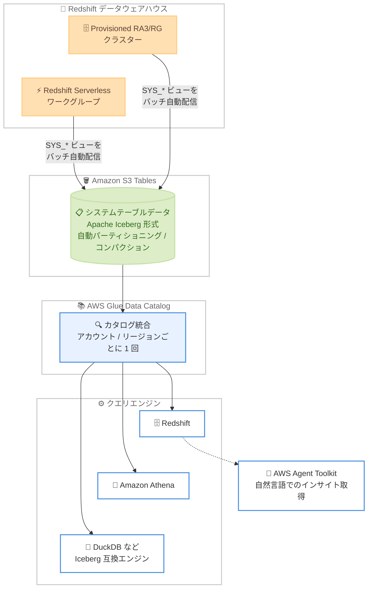

# Amazon Redshift - Amazon S3 Tables によるシステムテーブル長期保存の対応リージョン拡大

**リリース日**: 2026 年 10 月 15 日
**サービス**: Amazon Redshift
**機能**: Amazon S3 Tables とのネイティブ統合によるシステムテーブルデータの長期保存 (追加リージョン対応)

📊 [このアップデートのインフォグラフィックを見る](https://takech9203.github.io/aws-news-summary/20261015-redshift-long-term-system-table-retention-expansion.html)

## 概要

Amazon Redshift のシステムテーブルデータを Amazon S3 Tables とのネイティブ統合により長期保存する機能が、追加の AWS リージョンで利用可能になりました。今回追加されたのは、アジアパシフィック (ニュージーランド)、カナダ西部 (カルガリー)、AWS GovCloud (US-East)、AWS GovCloud (US-West) の 4 リージョンです。

この機能を有効化すると、AWS がシステムテーブルデータを Apache Iceberg 形式で S3 Tables に自動的に書き込み、パーティショニング、コンパクション、保持期間の管理まで行います。これにより、従来 7 日間に制限されていたシステムテーブルデータの保持期間を、コンプライアンス、監査、オブザーバビリティの要件に合わせて自由に延長できます。データはオープンな Apache Iceberg 形式で保存されるため、Redshift に加えて Amazon Athena、DuckDB などの Iceberg 互換エンジンからクエリできます。

特に AWS GovCloud (US) リージョンへの対応は、厳格なコンプライアンス要件を持つ政府機関や規制業界のユーザーにとって重要です。クエリ履歴や接続ログなどの監査証跡を数か月から数年単位で保持する要件に、カスタム ETL パイプラインなしで対応できるようになります。

**アップデート前の課題**

今回の対象リージョンでは、以前は以下の課題がありました。

- Redshift のシステムテーブルデータはデータウェアハウス内で 7 日間しか保持されず、長期の監査・コンプライアンス要件を満たせなかった
- 7 日を超えてデータを保持するには、システムテーブルを S3 にエクスポートするカスタム ETL パイプラインの構築・運用が必要だった
- エクスポート処理が本番ワークロードとリソースを競合する可能性があった
- 複数のデータウェアハウスを運用する場合、横断的なオブザーバビリティ分析のためのデータ集約を自前で実装する必要があった

**アップデート後の改善**

- アジアパシフィック (ニュージーランド)、カナダ西部 (カルガリー)、AWS GovCloud (US-East)、AWS GovCloud (US-West) でもこの機能が利用可能になった
- 7 日間の制限を超えて、コンプライアンス要件に応じた期間 (無期限も可能) でシステムテーブルデータを保持できるようになった
- AWS が S3 Tables への書き込み、パーティショニング、コンパクション、スナップショット管理を自動で行うため、カスタム ETL パイプラインが不要になった
- 複数のデータウェアハウスのシステムテーブルデータを単一の場所に集約し、フリート全体の横断分析ができるようになった
- AWS Agent Toolkit のスキルを使用して、システムテーブルデータから自然言語でパフォーマンスインサイトや最適化の推奨を取得できるようになった

## アーキテクチャ図



Redshift が完了済みのシステムテーブルレコードをバッチで S3 Tables に自動配信し、AWS Glue Data Catalog との統合を経て、Redshift、Athena、DuckDB などの Iceberg 互換エンジンから長期保存データをクエリできます。

## サービスアップデートの詳細

### 主要機能

1. **7 日間を超えるシステムテーブルデータの保持**
   - Redshift のシステムテーブル (SYS_* ビュー) はデータウェアハウス内では 7 日間しか保持されない
   - 本機能を有効化すると、完了済みのレコードが S3 Tables に Apache Iceberg 形式で自動配信される
   - 保持期間は S3 Tables のレコード有効期限ポリシーで設定し、設定しない場合は無期限に保持される

2. **サービスマネージドなデータ配信とテーブル管理**
   - S3 テーブルバケット (`aws-redshift`)、名前空間、テーブルの作成は AWS が自動で行う
   - スキーマの定義と進化、Iceberg 形式での書き込み、コンパクションとスナップショット管理も AWS が担当
   - 配信は本番ワークロードと分離されており、リソース競合やワークロードへの影響がない
   - 各レコードは Exactly-once で配信され、再有効化しても重複しない

3. **2 つのデプロイメントモデル**
   - **ウェアハウス個別**: データウェアハウスごとに専用の S3 テーブルセットへ書き込み、物理的に分離する
   - **統合 (consolidated)**: 同一アカウント・リージョン内の複数ウェアハウスのデータを共有テーブルに集約し、`warehouse_namespace_arn` や `warehouse_name` 列で区別する
   - 統合モデルによりフリート全体の横断的なオブザーバビリティ分析が可能

4. **オープンフォーマットによるマルチエンジンクエリ**
   - データは Apache Iceberg 形式のため、Redshift、Amazon Athena、DuckDB など任意の Iceberg 互換エンジンでクエリ可能
   - AWS Glue Data Catalog との統合 (アカウント・リージョンごとに 1 回) により、IAM や AWS Lake Formation で細かなアクセス制御が可能
   - AWS Agent Toolkit のシステムテーブルスキルを使用すると、自然言語でパフォーマンスインサイトや最適化推奨を取得できる

5. **追加リージョンへの拡大**
   - アジアパシフィック (ニュージーランド)、カナダ西部 (カルガリー)、AWS GovCloud (US-East)、AWS GovCloud (US-West) で新たに利用可能
   - GovCloud 対応により、政府機関や規制業界の厳格な監査要件にも対応しやすくなった

## 技術仕様

### 対応環境と前提条件

| 項目 | 詳細 |
|------|------|
| 対応インスタンス | Amazon Redshift Provisioned RA3 / RG インスタンス、Amazon Redshift Serverless |
| 保存形式 | Apache Iceberg (S3 Tables) |
| 配信方式 | 固定頻度のバッチ配信、完了済みレコードのみ、Exactly-once |
| デプロイメントモデル | ウェアハウス個別 (cluster / namespace) または統合 (account) |
| 対応システムテーブル | SYS_QUERY_HISTORY、SYS_QUERY_TEXT、SYS_CONNECTION_LOG、SYS_USERLOG など 25 以上の SYS_* ビュー |
| 暗号化 | デフォルトは SSE-S3、AWS KMS カスタマーマネージドキーも指定可能 |
| 保持期間 | S3 Tables のレコード有効期限ポリシーで設定 (未設定時は無期限) |
| スコープ | 単一アカウント・単一リージョン内 (クロスアカウントは Glue Data Catalog 共有で対応) |

### 追加されるメタデータ列

各 S3 テーブルには、元の SYS_* ビューの全列に加えて以下のメタデータ列が追加されます。

| 列名 | 型 | 説明 |
|------|------|------|
| warehouse_account_id | string | ソースデータウェアハウスを所有する AWS アカウント |
| warehouse_region_name | string | ソースデータウェアハウスのリージョン |
| warehouse_namespace_arn | string | 名前空間の ARN (リネームや再作成でも不変の一意識別子) |
| warehouse_name | string | クラスター名またはワークグループ名 |
| s3_tables_ingestion_time | timestamp | Redshift が行を S3 Tables にコミットした時刻 (UTC) |

### 有効化に必要な権限

有効化を実行するプリンシパルには以下の権限が必要です。

```json
{
  "Version": "2012-10-17",
  "Statement": [
    {
      "Effect": "Allow",
      "Action": [
        "redshift:EnableLogging",
        "s3tables:CreateTableBucket",
        "s3tables:PutTableBucketEncryption",
        "s3tables:PutTableBucketPolicy"
      ],
      "Resource": "*"
    }
  ]
}
```

Redshift Serverless の場合は `redshift:EnableLogging` の代わりに `redshift-serverless:UpdateNamespace` が必要です。バケット作成後の名前空間とテーブルの作成は、Redshift と S3 Tables 間のサービス信頼関係により行われます。

## 設定方法

### 前提条件

1. Amazon Redshift Provisioned RA3 / RG インスタンス、または Redshift Serverless ワークグループを利用していること
2. 有効化するプリンシパルに前述の IAM 権限が付与されていること
3. 保存データをクエリするには、S3 テーブルバケットが AWS Glue Data Catalog と統合されていること (アカウント・リージョンごとに 1 回の作業)
4. 一部のビュー (SYS_QUERY_DETAIL、SYS_QUERY_EXPLAIN など) はパッチ P203 以降が必要

### 手順

#### ステップ 1: システムテーブル統合の有効化 (Provisioned クラスター)

```bash
aws redshift enable-logging \
    --cluster-identifier my-redshift-cluster \
    --log-destination-type s3table \
    --log-exports all \
    --s3-table-granularity account
```

既存のログ設定 API に新しいログ出力先タイプ `s3table` を指定して有効化します。`--log-exports` には `all` または SYS_* ビュー名のリストを指定し、`--s3-table-granularity` で `cluster` (個別) または `account` (統合) を選択します。実行するとアカウント内に `aws-redshift` という S3 テーブルバケットが作成され、配信が開始されます。

#### ステップ 2: システムテーブル統合の有効化 (Redshift Serverless)

```bash
aws redshift-serverless update-namespace \
    --namespace-name my-namespace \
    --log-destination-type s3table \
    --s3-table-action Enable \
    --s3-table-names all \
    --s3-table-granularity namespace
```

Serverless では名前空間単位で設定します。`--s3-table-names` に対象のシステムテーブルを指定し、`--s3-table-action Enable` で配信を有効化します。

#### ステップ 3: 配信ステータスの確認

```bash
# Provisioned クラスターの場合
aws redshift describe-logging-status \
    --cluster-identifier my-redshift-cluster

# Serverless の場合
aws redshift-serverless get-namespace \
    --namespace-name my-namespace
```

有効化されているシステムテーブル、S3 Tables の名前空間、粒度、システムテーブルごとの最終取り込み時刻を確認できます。

#### ステップ 4: Glue Data Catalog 統合と保持期間の設定

S3 テーブルバケットを AWS Glue Data Catalog と統合すると、Redshift では外部スキーマの作成 (`CREATE EXTERNAL SCHEMA ... FROM DATA CATALOG`)、Athena ではそのままの SQL でクエリできるようになります。保持期間は S3 Tables のレコード有効期限ポリシーをテーブル単位で設定します (例: 365 日)。

## メリット

### ビジネス面

- **コンプライアンス・監査要件への対応**: クエリ履歴、接続ログ、変更履歴を数か月から数年単位で保持でき、監査証跡の要件を満たせる。GovCloud 対応により政府機関や規制業界でも利用可能
- **運用コストの削減**: カスタム ETL パイプラインの構築・保守が不要になり、エンジニアリングリソースを本来の業務に集中できる
- **ログ配信は追加料金なし**: Redshift から S3 Tables への配信自体は無料で、課金は S3 Tables のストレージとメンテナンス、クエリエンジンの利用分のみ

### 技術面

- **本番ワークロードへの影響なし**: 配信はバックグラウンドで行われ、リソース競合が発生しない。Serverless ではワークグループを起動状態に保つこともない
- **オープンフォーマットの柔軟性**: Apache Iceberg 形式のため、Redshift、Athena、DuckDB、Spark など任意の Iceberg 互換エンジンで分析でき、ベンダーロックインがない
- **フリート全体の一元的オブザーバビリティ**: 統合デプロイメントモデルにより、複数ウェアハウスのシステムテーブルデータを単一テーブルで横断分析できる
- **監査証跡の完全性**: 配信済みデータはイミュータブルで、管理者であっても改変・削除ができないため、監査証跡としての信頼性が高い

## デメリット・制約事項

### 制限事項

- 単一アカウント・単一リージョン内でのみ動作する。クロスリージョン・クロスアカウント分析はクエリ時の結合、または Glue Data Catalog のクロスアカウント共有で対応する必要がある
- 1 つのデータウェアハウスで同時に使用できるデプロイメントパターンは 1 つのみ
- デプロイメントパターンの切り替え、無効化後の再有効化、テーブルの削除後の再追加では、過去データのバックフィルは行われない
- 配信済みデータはイミュータブルで、Redshift から個別行の変更・削除はできない
- S3 テーブルを削除すると保存データは完全に失われ、再有効化しても復元されない
- 配信は固定頻度のバッチベースであり、リアルタイムではない。進行中のクエリなど完了していないアクティビティは配信されない
- 暗号化キーは S3 テーブル作成後に変更できない。変更するには統合の無効化とテーブル削除 (データ完全削除) が必要

### 考慮すべき点

- SYS_QUERY_TEXT や SYS_PROCEDURE_MESSAGES などはクエリ内のリテラル値 (機密情報を含む可能性) を保持するため、データの機密性を評価したうえで対象テーブルとデプロイメントモデルを選択する
- 保持期間を設定しない場合データは無期限に保持されるため、コンプライアンス要件を満たす最小限の保持期間を設定してストレージコストを管理する
- 大量の履歴データをクエリする際は `warehouse_name` や `s3_tables_ingestion_time` などのメタデータ列でフィルタリングし、スキャン量を削減する
- KMS カスタマーマネージドキーを使用する場合、`systemtables.redshift.amazonaws.com` と `maintenance.s3tables.amazonaws.com` のサービスプリンシパルにキー使用を許可するキーポリシーが必要

## ユースケース

### ユースケース 1: GovCloud 環境での長期監査証跡の保持

**シナリオ**: AWS GovCloud (US) で Redshift を運用する政府機関が、規制要件により全クエリと接続の履歴を 1 年以上保持する必要がある。

**実装例**:
```bash
aws redshift enable-logging \
    --cluster-identifier gov-dwh-cluster \
    --log-destination-type s3table \
    --log-exports sys_query_history sys_query_text sys_connection_log sys_userlog \
    --s3-table-granularity cluster
```
S3 Tables 側でレコード有効期限を 400 日に設定する。

**効果**: カスタム ETL なしで監査証跡を自動保存できる。データはイミュータブルなため、監査人に対して改変されていない証跡として提示できる。

### ユースケース 2: 複数ウェアハウスの横断的なパフォーマンス分析

**シナリオ**: 同一アカウント・リージョン内で複数の Redshift Serverless ワークグループと Provisioned クラスターを運用しており、フリート全体のクエリパフォーマンスのトレンドを一元的に分析したい。

**実装例**:
```sql
-- 統合モデル (account 粒度) で有効化後、Athena から横断クエリ
SELECT warehouse_name,
       DATE_TRUNC('week', start_time) AS week,
       AVG(elapsed_time) / 1000000.0 AS avg_elapsed_sec,
       COUNT(*) AS query_count
FROM "aws-redshift"."sys_query_history"
WHERE start_time > CURRENT_DATE - INTERVAL '90' DAY
GROUP BY 1, 2
ORDER BY 1, 2;
```

**効果**: 7 日を超える期間のトレンドをウェアハウス横断で可視化でき、キャパシティプランニングやワークロード変更前後の影響比較に活用できる。

### ユースケース 3: 過去インシデントの根本原因分析

**シナリオ**: 3 週間前に発生したパフォーマンス劣化の根本原因を分析したいが、クラスター内のシステムテーブルには直近 7 日分しか残っていない。

**実装例**:
```sql
-- Redshift から外部スキーマ経由で過去のクエリ詳細を分析
CREATE EXTERNAL SCHEMA sys_history
FROM DATA CATALOG DATABASE 'aws_redshift_namespace'
IAM_ROLE 'arn:aws:iam::123456789012:role/RedshiftS3TablesRole';

SELECT query_id, start_time, elapsed_time, queue_time, status
FROM sys_history.sys_query_history
WHERE start_time BETWEEN '2026-09-20' AND '2026-09-27'
ORDER BY elapsed_time DESC
LIMIT 50;
```

**効果**: 保存期間の制限なく過去のインシデントを調査でき、ポストモーテムや再発防止策の立案に必要なデータを確保できる。

## 料金

Redshift から S3 Tables へのシステムテーブルデータの書き込み (ログ配信) 自体は無料です。課金対象は以下のとおりです。

- 保存データに対する S3 Tables の標準的なストレージ料金とメンテナンス料金
- データの読み取りに使用するクエリエンジン (Redshift、Athena など) の料金

詳細は [Amazon S3 の料金ページ](https://aws.amazon.com/s3/pricing/) を参照してください。保持期間をコンプライアンス要件を満たす最小限に設定することで、ストレージコストを最適化できます。

## 利用可能リージョン

今回のアップデートで、以下の AWS リージョンが追加されました。

- アジアパシフィック (ニュージーランド)
- カナダ西部 (カルガリー)
- AWS GovCloud (US-East)
- AWS GovCloud (US-West)

本機能は、Redshift と S3 Tables の両方がサポートされているすべての AWS 商用リージョンで利用できます。対象は Amazon Redshift Provisioned RG / RA3 インスタンスと Amazon Redshift Serverless です。

## 関連サービス・機能

- **Amazon S3 Tables**: システムテーブルデータの保存先。Apache Iceberg 形式のフルマネージドなテーブルストレージで、パーティショニング、コンパクション、レコード有効期限を自動管理
- **AWS Glue Data Catalog**: S3 テーブルバケットのカタログ統合により、Redshift や Athena からのクエリと、IAM / Lake Formation によるアクセス制御を実現
- **Amazon Athena**: サーバーレス SQL エンジン。インフラ不要で長期保存されたシステムテーブルデータをクエリ可能
- **AWS Lake Formation**: 統合デプロイメントモデルにおいて、テーブル・列・行レベルの細かなアクセス制御を提供
- **AWS Agent Toolkit**: システムテーブルデータをクエリしてパフォーマンスインサイトや最適化推奨を提示する AI エージェントスキルを提供

## 参考リンク

- 📊 [インフォグラフィック](https://takech9203.github.io/aws-news-summary/20261015-redshift-long-term-system-table-retention-expansion.html)
- [公式発表 (What's New)](https://aws.amazon.com/about-aws/whats-new/2026/10/redshift-long-term-system-table-retention-expansion/)
- [AWS Blog: Long-term system tables retention in Amazon Redshift with Amazon S3 Tables](https://aws.amazon.com/blogs/big-data/long-term-system-tables-retention-in-amazon-redshift-with-amazon-s3-tables/)
- [ドキュメント: System table integration with S3 Tables](https://docs.aws.amazon.com/redshift/latest/mgmt/system-table-s3-tables.html)
- [AWS Agent Toolkit: System table skills](https://github.com/aws/agent-toolkit-for-aws/tree/main/skills/specialized-skills/system-table-skills)
- [料金ページ (Amazon S3)](https://aws.amazon.com/s3/pricing/)

## まとめ

Amazon Redshift のシステムテーブルを S3 Tables に長期保存する機能が、アジアパシフィック (ニュージーランド)、カナダ西部 (カルガリー)、AWS GovCloud (US) の 2 リージョンに拡大されました。7 日間の保持制限をカスタム ETL なしで克服でき、特に GovCloud 対応により厳格な監査・コンプライアンス要件を持つ組織でも利用しやすくなりました。該当リージョンで Redshift を運用し、監査証跡の長期保持や横断的なオブザーバビリティが必要な場合は、本機能の有効化を検討することを推奨します。
