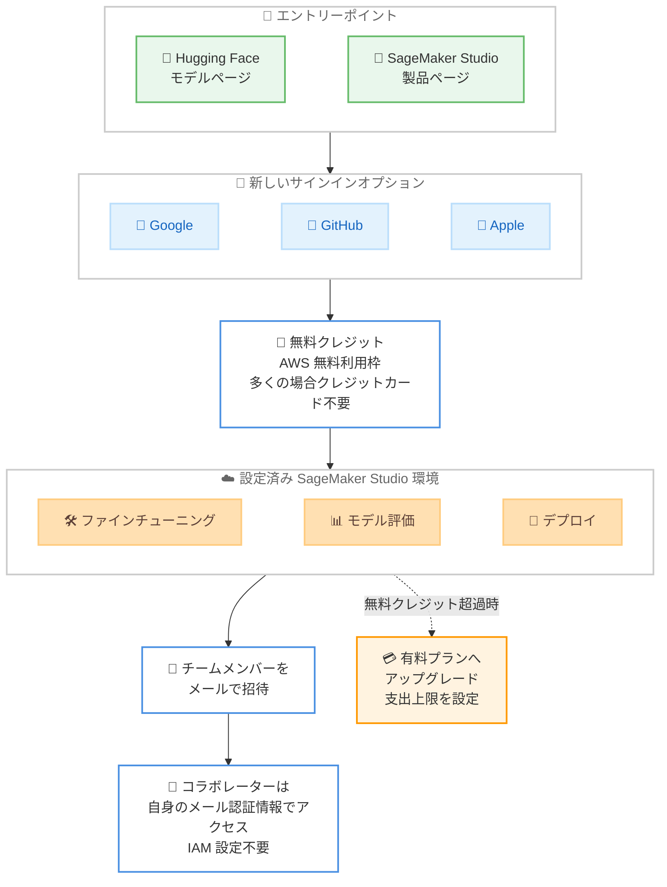

# Amazon SageMaker Studio - 新しいサインインオプションによる新規 AI/ML ビルダー向けオンボーディング簡素化

**リリース日**: 2026 年 10 月 15 日
**サービス**: Amazon SageMaker Studio
**機能**: 新しいサインインオプション (Google / GitHub / Apple 認証情報によるサインアップ)

📊 [このアップデートのインフォグラフィックを見る](https://takech9203.github.io/aws-news-summary/20261015-sagemaker-studio-new-sign-in-options.html)

## 概要

Amazon SageMaker Studio で、新規顧客が Google、GitHub、または Apple の認証情報を使ってサインアップし、設定済みの SageMaker Studio 環境に直接アクセスできるようになりました。従来の AWS アカウント作成手続きや AWS コンソールの操作は不要です。

サインアップが完了すると、AWS 無料利用枠 (AWS Free Tier) を通じて無料クレジットが付与され (多くの場合クレジットカードの登録は不要)、すぐに利用可能な Studio 環境で基盤モデルのファインチューニング、評価、デプロイを開始できます。また、メールでチームメンバーを招待でき、招待されたコラボレーターは自身のメール認証情報でサインインするだけで、共有されたモデル、ノートブック、エンドポイントにアクセスできます。IAM ユーザーや権限の設定は必要ありません。

このアップデートは、Hugging Face や AWS 製品ページでモデルを見つけた新規 AI/ML ビルダーの参入障壁を下げる一連の改善 (約 20 秒での環境セットアップ、モデルカスタマイズ権限の事前設定、Hugging Face や AWS 製品ページからのディープリンク) に続くものです。

**アップデート前の課題**

- 以前は、新規ユーザーが SageMaker Studio を利用するには、複数ステップの AWS アカウント作成を完了し、クレジットカード情報を入力する必要があった
- AWS コンソールから SageMaker AI を探し、環境を構成し、IAM 権限を設定してから、ようやくモデル開発を開始できた
- チームメンバーと環境を共有するには、IAM ユーザーの作成や権限設定といった管理作業が必要だった

**アップデート後の改善**

- Google、GitHub、Apple の既存の認証情報で簡素化されたサインアップを完了し、設定済みの SageMaker Studio 環境に直接到達できるようになった
- AWS 無料利用枠を通じて無料クレジットが付与され、多くの場合クレジットカードの登録が不要になった
- メール招待だけで、IAM 設定なしにチームでの共同作業 (共有モデル、ノートブック、エンドポイントの利用) が可能になった
- 無料クレジットを超えてプロジェクトが成長した場合は、有料プランにアップグレードし、支出上限を設定して予算内で利用できるようになった

## アーキテクチャ図



Hugging Face や SageMaker Studio 製品ページから、Google / GitHub / Apple の認証情報によるサインアップを経て、設定済みの Studio 環境に直接到達するまでの流れを示しています。チーム招待と有料プランへのアップグレードもこのフローに統合されています。

## サービスアップデートの詳細

### 主要機能

1. **Google / GitHub / Apple 認証情報によるサインアップ**
   - 既存の Google、GitHub、Apple のアイデンティティを使った簡素化されたサインアップが可能
   - 従来の AWS アカウント作成プロセスやコンソール操作が不要
   - サインアップ完了後、設定済みの SageMaker Studio 環境に直接到達し、基盤モデルのファインチューニング、評価、デプロイをすぐに開始可能

2. **AWS 無料利用枠による無料クレジット**
   - サインアップ時に AWS 無料利用枠を通じて無料クレジットを付与
   - 多くの場合、クレジットカードの登録は不要
   - 無料クレジットを超えてプロジェクトが成長した場合は、有料プランにアップグレードし、支出上限 (spending limit) を設定して予算を管理可能

3. **IAM 設定不要のチームコラボレーション**
   - オーナーはメールアドレスでチームメンバーを招待可能
   - コラボレーターは自身のメール認証情報でサインインし、共有された Studio 環境にアクセス
   - 共有モデル、ノートブック、エンドポイントを、IAM ユーザーや権限の設定なしで利用可能

4. **デフォルトの GPU アクセス**
   - 検証済み (verified) の顧客は、クォータ引き上げ申請なしで G5、G6、G6e、G4dn インスタンスへのデフォルトアクセスが可能
   - エンドポイント、トレーニングジョブ、ノートブックのすべてで GPU を利用可能

## 技術仕様

### サインアップフローの比較

| 項目 | 従来の AWS アカウント作成 | 新しいサインインオプション |
|------|---------------------------|----------------------------|
| 認証情報 | 新規 AWS アカウントの作成が必要 | Google / GitHub / Apple の既存の認証情報 |
| クレジットカード | 登録が必須 | 多くの場合不要 |
| 環境構築 | コンソールで SageMaker AI を探して環境を構成 | 設定済み環境に直接到達 |
| IAM 設定 | ユーザー・権限の設定が必要 | 不要 |
| チーム共有 | IAM ユーザーの作成・権限管理が必要 | メール招待 + メール認証情報でのサインイン |
| GPU クォータ | 引き上げ申請が必要な場合あり | 検証済み顧客は G5 / G6 / G6e / G4dn にデフォルトアクセス |

### デフォルトアクセス可能な GPU インスタンス

| インスタンスファミリー | 主な用途 |
|------------------------|----------|
| G5 | NVIDIA A10G GPU 搭載。モデルのファインチューニング・推論 |
| G6 | NVIDIA L4 GPU 搭載。コスト効率の高い推論 |
| G6e | NVIDIA L40S GPU 搭載。大規模モデルの推論・ファインチューニング |
| G4dn | NVIDIA T4 GPU 搭載。エントリーレベルの GPU ワークロード |

## 設定方法

### 前提条件

1. Google、GitHub、または Apple のいずれかのアカウントを保有していること
2. 新規顧客としてサインアップすること (本機能は新規顧客向けのオンボーディングフロー)

### 手順

#### ステップ 1: エントリーポイントからアクセス

以下のいずれかの方法で SageMaker Studio のサインアップを開始します。

- [Hugging Face](https://huggingface.co/models) でサポート対象のモデルを開き、[Customize and Deploy on SageMaker AI] または [Deploy on SageMaker AI] を選択
- [SageMaker Studio 製品ページ](https://aws.amazon.com/sagemaker/ai/studio/) で [Get Started] をクリック

#### ステップ 2: 既存の認証情報でサインアップ

Google、GitHub、Apple のいずれかの認証情報を選択し、簡素化されたサインアップを完了します。AWS 無料利用枠を通じて無料クレジットが付与され、多くの場合クレジットカードの登録は不要です。

#### ステップ 3: SageMaker Studio で開発を開始

サインアップ完了後、すぐに利用可能な SageMaker Studio 環境に到達します。基盤モデルのファインチューニング、評価、デプロイを開始できます。

#### ステップ 4: チームメンバーの招待 (任意)

メールアドレスでチームメンバーを招待します。招待されたコラボレーターは自身のメール認証情報でサインインし、共有モデル、ノートブック、エンドポイントを含む Studio 環境にアクセスできます。IAM の設定は不要です。

## メリット

### ビジネス面

- **参入障壁の大幅な低減**: AWS アカウント作成やコンソール操作が不要で、多くの場合クレジットカードも不要なため、AI/ML 開発を試したい個人やスタートアップがすぐに着手できる
- **コスト管理の安心感**: 無料クレジットから開始し、有料プラン移行時も支出上限を設定できるため、予算超過のリスクを抑えられる
- **チーム立ち上げの迅速化**: メール招待だけでコラボレーションを開始でき、管理者による IAM 設計・運用の負担がない

### 技術面

- **環境構築の自動化**: 設定済みの Studio 環境が提供されるため、環境セットアップや権限設定の作業が不要
- **GPU リソースへの即時アクセス**: 検証済み顧客はクォータ引き上げ申請なしで G5 / G6 / G6e / G4dn インスタンスを利用可能
- **Hugging Face との統合**: モデル発見からファインチューニング・デプロイまでの導線がシームレスにつながる

## デメリット・制約事項

### 制限事項

- 本機能は新規顧客向けのオンボーディングフローであり、既存の AWS アカウント運用を置き換えるものではない
- デフォルトの GPU アクセスは検証済み (verified) の顧客が対象
- 利用可能なのは SageMaker Studio がサポートされている AWS 商用リージョンに限られる

### 考慮すべき点

- エンタープライズ環境で求められる細かなアクセス制御 (IAM ポリシーによる最小権限設計など) が必要な場合は、従来の AWS アカウントベースの運用を検討する必要がある
- 無料クレジットを使い切った後の継続利用には、有料プランへのアップグレードが必要
- 組織のセキュリティポリシーによっては、Google / GitHub / Apple アカウントによる業務利用が制限される場合がある

## ユースケース

### ユースケース 1: Hugging Face で見つけたモデルの即時カスタマイズ

**シナリオ**: AI/ML を学び始めた開発者が Hugging Face で興味のあるモデルを発見し、すぐにファインチューニングを試したい。

**実装例**:
```text
1. Hugging Face のモデルページで [Customize and Deploy on SageMaker AI] を選択
2. GitHub の認証情報でサインアップ
3. 設定済みの Studio 環境でファインチューニングを実行
```

**効果**: AWS アカウント作成や環境構築に時間を取られることなく、モデル発見から数分でファインチューニングを開始できる。

### ユースケース 2: スタートアップでのプロトタイプ開発とチーム共有

**シナリオ**: 少人数のスタートアップが、基盤モデルを使ったプロダクトのプロトタイプを短期間で開発し、チームで検証したい。

**実装例**:
```text
1. 代表者が Google の認証情報でサインアップし、無料クレジットで開発を開始
2. チームメンバーをメールで招待
3. メンバーは各自のメール認証情報でサインインし、共有ノートブックとエンドポイントで検証
```

**効果**: IAM の設計・運用なしでチーム開発を開始でき、インフラ管理ではなくプロダクト開発に集中できる。

### ユースケース 3: 無料クレジットから本番利用へのスムーズな移行

**シナリオ**: 無料クレジットで検証したモデルの手応えが得られ、本格的なトレーニングとデプロイに進みたい。

**実装例**:
```text
1. 無料クレジットの範囲でモデルの評価・検証を完了
2. 有料プランにアップグレードし、支出上限を設定
3. G5 / G6e などの GPU インスタンスでトレーニングジョブとエンドポイントを拡大
```

**効果**: 支出上限により予算内でのスケールアップが可能になり、クォータ引き上げ申請なしで GPU リソースを拡大できる。

## 料金

サインアップ時に AWS 無料利用枠を通じて無料クレジットが付与され、多くの場合クレジットカードの登録は不要です。プロジェクトが無料クレジットを超えて成長した場合は、有料プランにアップグレードできます。その際、支出上限を設定して予算内に収めることができます。

SageMaker AI 自体の利用料金は、使用するインスタンスタイプと稼働時間に基づく従量課金です。詳細は [Amazon SageMaker AI の料金ページ](https://aws.amazon.com/sagemaker/ai/pricing/) を参照してください。

## 利用可能リージョン

Amazon SageMaker Studio がサポートされているすべての AWS 商用リージョンで利用可能です。

## 関連サービス・機能

- **Amazon SageMaker JumpStart**: 基盤モデルのカタログとワンクリックデプロイを提供。Studio 環境でのモデルカスタマイズ基盤として連携
- **AWS 無料利用枠**: 本機能で付与される無料クレジットの提供元。多くの場合クレジットカード不要でのサインアップを実現
- **Hugging Face 連携**: モデルページの [Deploy on SageMaker AI] ボタンから Studio へのディープリンクを提供し、モデル発見から開発までをシームレスに接続

## 参考リンク

- 📊 [インフォグラフィック](https://takech9203.github.io/aws-news-summary/20261015-sagemaker-studio-new-sign-in-options.html)
- [公式発表 (What's New)](https://aws.amazon.com/about-aws/whats-new/2026/10/sagemaker-studio-new-sign-in-options/)
- [AWS サインアップドキュメント](https://docs.aws.amazon.com/accounts/latest/reference/sign-in-new.html)
- [SageMaker Studio セットアップガイド](https://docs.aws.amazon.com/sagemaker/latest/dg/onboard-quick-start.html)
- [SageMaker Studio 製品ページ](https://aws.amazon.com/sagemaker/ai/studio/)
- [Amazon SageMaker AI 料金ページ](https://aws.amazon.com/sagemaker/ai/pricing/)

## まとめ

本アップデートにより、新規 AI/ML ビルダーは Google、GitHub、Apple の既存の認証情報だけで、AWS アカウント作成やコンソール操作、IAM 設定なしに SageMaker Studio での基盤モデル開発を開始できるようになりました。AI/ML 開発の参入障壁を大きく下げる重要な改善であり、これから SageMaker を試すユーザーには Hugging Face のモデルページまたは SageMaker Studio 製品ページからのサインアップを推奨します。既存のエンタープライズ利用者にとっても、社内の検証・学習用途のオンボーディング手段として検討する価値があります。
