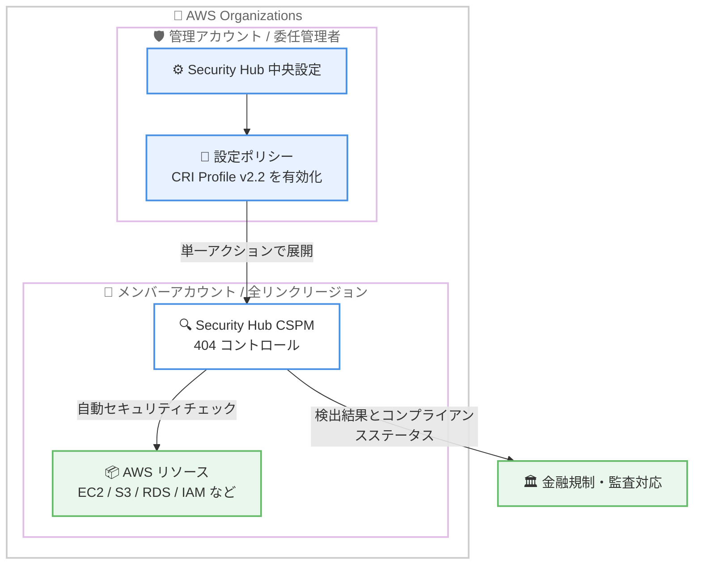

# AWS Security Hub CSPM - Cyber Risk Institute プロファイル v2.2 のサポート

**リリース日**: 2026 年 10 月 15 日
**サービス**: AWS Security Hub CSPM
**機能**: CRI Profile v2.2 セキュリティ基準のサポート

📊 [このアップデートのインフォグラフィックを見る](https://takech9203.github.io/aws-news-summary/20261015-security-hub-cspm-cri-profile-v22.html)

## 概要

AWS Security Hub CSPM が、Cyber Risk Institute (CRI) プロファイル version 2.2 に準拠した自動セキュリティチェックをサポートしました。CRI Profile は、金融機関と業界団体の非営利連合体である Cyber Risk Institute が開発したサイバーセキュリティフレームワークです。金融サービスセクターに適用される多数のサイバーセキュリティ要件と規制上の期待事項を共通の要件セットに調和 (ハーモナイズ) させることで、組織は一度の自己評価で複数の規制に対する報告を行うことができます。

今回のアップデートにより、Security Hub CSPM は CRI Profile v2.2 要件のサブセットをサポートする 404 個のコントロールを提供します。これらのコントロールは AWS のサービスとリソースに対する自動セキュリティチェックを実行します。なお、手動チェックが必要な要件には対応していません。

新しい基準は、AWS GovCloud (US) および中国リージョンを含む、Security Hub CSPM が利用可能なすべての AWS リージョンで利用できます。金融機関やフィンテック企業など、金融サービスセクターの規制対応が求められる組織にとって、コンプライアンス評価の自動化を大きく前進させるアップデートです。

**アップデート前の課題**

- 以前は Security Hub CSPM に CRI Profile に対応した基準が存在せず、金融機関は CRI Profile v2.2 への準拠状況を評価するために、個別のツールや手動のマッピング作業が必要だった
- 金融サービスセクターでは複数の規制 (各国の金融規制、業界ガイドラインなど) への対応が求められ、規制ごとに個別の評価を実施する運用負荷が大きかった
- FSBP や CIS などの既存基準の結果を CRI Profile の要件に手動で対応付ける必要があり、監査対応に時間がかかっていた

**アップデート後の改善**

- CRI Profile v2.2 を Security Hub CSPM の基準 (スタンダード) として有効化するだけで、404 個のコントロールによる自動セキュリティチェックが実行可能になった
- 「一度評価して複数の規制に報告する」という CRI Profile の思想に沿って、AWS 環境のコンプライアンス評価を効率化できるようになった
- 中央設定 (central configuration) を使用することで、組織内の全アカウント・全リンクリージョンに対して単一のアクションで基準を有効化できるようになった

## アーキテクチャ図



中央設定で CRI Profile v2.2 基準を有効化すると、組織内の対象アカウントと全リンクリージョンに単一のアクションで展開され、404 個のコントロールが AWS リソースを自動チェックします。

## サービスアップデートの詳細

### 主要機能

1. **CRI Profile v2.2 基準の提供**
   - Cyber Risk Institute が策定した金融サービスセクター向けサイバーセキュリティフレームワーク v2.2 に対応
   - CRI Profile v2.2 要件のサブセットをサポートする 404 個のコントロールを提供
   - 手動チェックが必要な要件は対象外 (自動チェック可能な要件のみをカバー)

2. **幅広い AWS サービスをカバーするコントロール**
   - IAM、CloudTrail、CloudWatch、GuardDuty、Inspector、Macie などのセキュリティ関連サービス
   - EC2、S3、RDS、DynamoDB、EKS、Lambda などの主要なコンピューティング・ストレージ・データベースサービス
   - CloudFront、ELB、Network Firewall、WAF などのネットワーク・配信サービスまで広範囲にチェック

3. **中央設定による組織全体への一括展開**
   - Security Hub の中央設定 (central configuration) を使用して、組織の全アカウントまたは一部のアカウントに対して基準を有効化可能
   - Security Hub にリンクされたすべての AWS リージョンへ単一のアクションで展開可能
   - AWS 公式も中央設定の利用を推奨

## 技術仕様

### 基準の概要

| 項目 | 詳細 |
|------|------|
| 基準名 | CRI Profile v2.2 |
| 策定団体 | Cyber Risk Institute (金融機関と業界団体の非営利連合体) |
| 対象セクター | 金融サービス (銀行、保険、証券、フィンテックなど) |
| コントロール数 | 404 個 |
| カバー範囲 | CRI Profile v2.2 要件のサブセット (自動チェック可能な要件のみ) |
| 有効化方法 | Security Hub CSPM コンソール、API、中央設定 |

### 代表的なコントロールの例

| カテゴリ | コントロール例 |
|------|------|
| アカウント管理 | Account.1 (セキュリティ連絡先の設定)、Account.2 (Organizations への参加) |
| ID・アクセス管理 | IAM.1 (管理者権限ポリシーの禁止)、IAM.9 (ルートユーザーの MFA) |
| ログ・監視 | CloudTrail.1 (マルチリージョン証跡)、CloudWatch.1 - 17 (メトリクスフィルターとアラーム) |
| 脅威検知 | GuardDuty.1 - 13 (GuardDuty と各種保護機能の有効化) |
| データ保護 | S3.1 (パブリックアクセスブロック)、EC2.3 (EBS 暗号化)、RDS.3 (保管時の暗号化) |
| ネットワーク | EC2.13 / EC2.14 (SSH / RDP の無制限アクセス禁止)、EC2.6 (VPC フローログ) |

## 設定方法

### 前提条件

1. AWS Security Hub CSPM が有効化されていること
2. コントロールの評価に必要な AWS Config の記録が有効であること
3. 組織全体に展開する場合は、Security Hub の中央設定と委任管理者アカウントが設定されていること

### 手順

#### ステップ1: 利用可能な基準の確認

```bash
aws securityhub describe-standards \
  --query "Standards[?contains(Name, 'CRI')]"
```

Security Hub CSPM で利用可能な基準の一覧から、CRI Profile v2.2 の基準 ARN を確認します。

#### ステップ2: CRI Profile v2.2 基準の有効化

```bash
aws securityhub batch-enable-standards \
  --standards-subscription-requests '[{"StandardsArn": "<ステップ1で確認した CRI Profile v2.2 の基準 ARN>"}]'
```

単一アカウント・単一リージョンで CRI Profile v2.2 基準を有効化します。有効化すると、404 個のコントロールによる自動チェックが開始されます。

#### ステップ3: 中央設定による組織全体への展開 (推奨)

組織全体に展開する場合は、委任管理者アカウントで Security Hub コンソールの [設定] から中央設定の設定ポリシーを作成または更新し、有効化する基準に CRI Profile v2.2 を追加します。設定ポリシーを対象の組織単位 (OU) またはアカウントに関連付けることで、リンクされたすべてのリージョンに単一のアクションで基準が展開されます。

#### ステップ4: コンプライアンスステータスの確認

```bash
aws securityhub get-findings \
  --filters '{"ComplianceStatus": [{"Value": "FAILED", "Comparison": "EQUALS"}], "RecordState": [{"Value": "ACTIVE", "Comparison": "EQUALS"}]}' \
  --max-items 10
```

有効化後、FAILED ステータスの検出結果を確認し、CRI Profile v2.2 の要件を満たしていないリソースを特定して修復します。コンソールの基準詳細ページではセキュリティスコアも確認できます。

## メリット

### ビジネス面

- **規制対応の効率化**: 「一度評価して複数の規制に報告する」という CRI Profile の設計思想により、金融サービスセクターに適用される複数の規制・ガイドラインへの対応工数を削減できる
- **監査対応の迅速化**: 404 個のコントロールによる継続的な自動チェック結果を監査のエビデンスとして活用でき、監査準備の期間を短縮できる
- **コスト効率**: AWS 無料利用枠により Security Hub CSPM を 30 日間無料で試用でき、導入前に効果を検証できる

### 技術面

- **自動化された継続的評価**: 手動のチェックリスト評価と異なり、AWS 環境の構成変更を継続的に監視し、準拠状況をほぼリアルタイムに把握できる
- **組織全体への一括展開**: 中央設定により、全アカウント・全リンクリージョンへ単一のアクションで基準を有効化でき、設定漏れを防止できる
- **既存の Security Hub 運用との統合**: 検出結果は他の基準 (FSBP、CIS、NIST など) と同じ形式で集約され、既存の通知・修復ワークフローをそのまま活用できる

## デメリット・制約事項

### 制限事項

- 手動チェックが必要な CRI Profile v2.2 要件はコントロールでサポートされず、別途組織的・運用的な評価が必要
- 提供されるコントロールは CRI Profile v2.2 要件のサブセットであり、フレームワーク全体を網羅するものではない
- 基準を有効化してコントロールのチェックに合格しても、それ自体が CRI Profile v2.2 への準拠を確立・証明するものではない (準拠は Security Hub CSPM が評価できない組織的・運用的なプラクティスに依存する)

### 考慮すべき点

- 404 個という多数のコントロールが有効化されるため、既存環境では大量の検出結果が生成される可能性があり、優先度付けと修復計画が必要
- コントロールの評価には AWS Config の記録が必要であり、Config の記録対象リソースが増えることによるコストへの影響を考慮する
- 他の基準 (FSBP、CIS など) と重複するコントロールが多いため、統合コントロールビューの活用や通知の重複排除を検討する

## ユースケース

### ユースケース1: 金融機関のマルチアカウント環境における規制対応

**シナリオ**: 複数の AWS アカウントを運用する銀行が、金融規制当局への報告に向けて CRI Profile v2.2 に基づく自己評価を実施したい。

**実装例**:
```text
1. 委任管理者アカウントで Security Hub 中央設定を構成
2. 設定ポリシーで CRI Profile v2.2 基準を有効化し、本番系 OU に関連付け
3. 全リンクリージョンに基準が自動展開され、404 コントロールのチェックが開始
4. セキュリティスコアと FAILED の検出結果を定期レビュー
```

**効果**: 全アカウント・全リージョンの準拠状況を一元的に可視化し、自動チェック可能な範囲の評価工数を大幅に削減できる。

### ユースケース2: フィンテック企業のコンプライアンス体制の立ち上げ

**シナリオ**: 金融サービスへ参入するスタートアップが、限られたセキュリティ人員で業界標準のサイバーセキュリティフレームワークに沿った体制を構築したい。

**実装例**:
```text
1. AWS 無料利用枠で Security Hub CSPM を 30 日間試用
2. CRI Profile v2.2 基準を有効化し、現状のギャップを把握
3. FAILED のコントロールを重大度順に修復
4. 手動チェックが必要な要件は CRI Profile の文書に基づき別途評価
```

**効果**: 金融業界の規制期待事項を集約したフレームワークを基準として、技術的対策のベースラインを短期間で確立できる。

### ユースケース3: 既存の Security Hub 運用への CRI Profile の追加

**シナリオ**: すでに FSBP と CIS AWS Foundations Benchmark を運用している金融機関が、CRI Profile v2.2 への対応を追加したい。

**実装例**:
```text
1. 既存の中央設定の設定ポリシーに CRI Profile v2.2 を追加
2. 統合コントロールビューで基準間の重複コントロールを確認
3. EventBridge 経由の既存通知・自動修復ワークフローをそのまま活用
4. CRI Profile のセキュリティスコアを監査レポートに組み込み
```

**効果**: 既存の検出・修復の仕組みを変更することなく、CRI Profile v2.2 の観点でのコンプライアンス評価を追加できる。

## 料金

Security Hub CSPM の料金は、セキュリティチェック数と取り込まれた検出結果の件数に基づく従量課金です。CRI Profile v2.2 基準の有効化自体に追加料金はありませんが、404 個のコントロールによるセキュリティチェック数が増加するため、チェック対象リソース数に応じた課金が発生します。

AWS 無料利用枠により、Security Hub CSPM を 30 日間無料で試用できます。詳細は [Security Hub CSPM 料金ページ](https://aws.amazon.com/security-hub/cspm/pricing/) を参照してください。

## 利用可能リージョン

AWS GovCloud (US) および中国リージョンを含む、Security Hub CSPM が現在利用可能なすべての AWS リージョンで利用できます (東京・大阪リージョンを含む)。

## 関連サービス・機能

- **AWS Config**: Security Hub CSPM のコントロール評価の基盤。リソースの構成記録が有効になっている必要がある
- **AWS Organizations / Security Hub 中央設定**: 組織内の複数アカウント・複数リージョンへ基準を一括展開する仕組み
- **Amazon EventBridge / Amazon SNS**: 検出結果の通知や自動修復ワークフローとの連携。Security Hub SNS トピックを購読すると新機能・新コントロールの通知を受け取れる
- **他のセキュリティ基準**: AWS Foundational Security Best Practices (FSBP)、CIS AWS Foundations Benchmark、NIST SP 800-53、PCI DSS など、同一の仕組みで併用可能

## 参考リンク

- 📊 [インフォグラフィック](https://takech9203.github.io/aws-news-summary/20261015-security-hub-cspm-cri-profile-v22.html)
- [公式発表 (What's New)](https://aws.amazon.com/about-aws/whats-new/2026/10/security-hub-cspm-cri-profile-v22/)
- [ドキュメント: CRI Profile v2.2 in Security Hub CSPM](https://docs.aws.amazon.com/securityhub/latest/userguide/standards-reference-cri-profile.html)
- [Security Hub アナウンス通知 (SNS トピック)](https://docs.aws.amazon.com/securityhub/latest/userguide/securityhub-announcements.html)
- [Cyber Risk Institute: CRI Profile 概要](https://cyberriskinstitute.org/cri-profile-overview/)
- [料金ページ](https://aws.amazon.com/security-hub/cspm/pricing/)

## まとめ

AWS Security Hub CSPM が金融サービスセクター向けフレームワークである CRI Profile v2.2 に対応し、404 個のコントロールによる自動セキュリティチェックが可能になりました。金融機関やフィンテック企業は、中央設定を利用して組織全体に基準を一括展開することを推奨します。ただし、コントロールのチェック合格のみでは準拠の証明にはならないため、手動チェックが必要な要件を含めた包括的なコンプライアンスプログラムの一部として活用してください。
