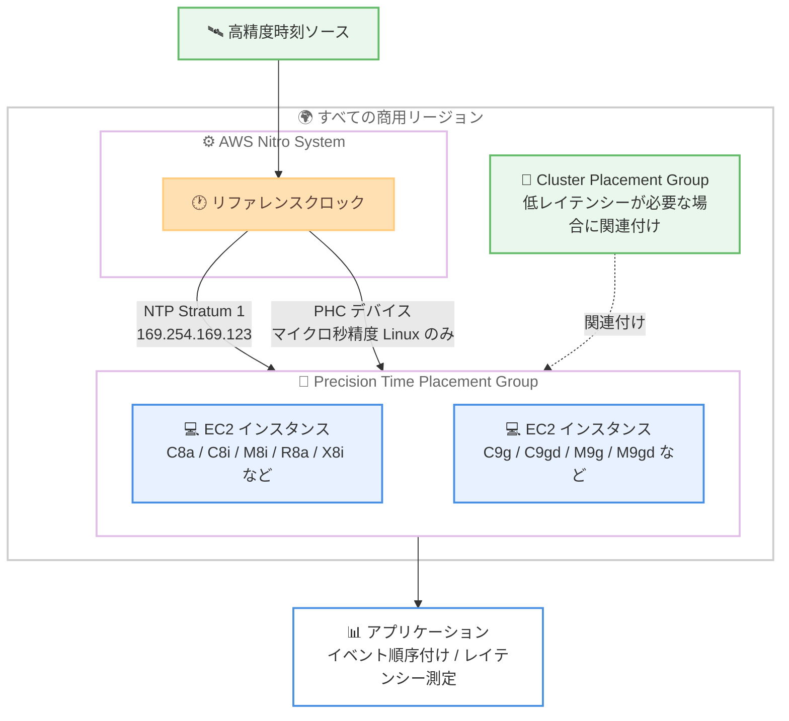

# Amazon Time Sync Service - マイクロ秒精度の時刻同期を 135 の追加 EC2 インスタンスタイプでサポート

**リリース日**: 2026 年 10 月 15 日
**サービス**: Amazon Time Sync Service (Amazon EC2)
**機能**: マイクロ秒精度の時刻同期の対象インスタンス拡大と Precision Time Placement Group (PTPG)

📊 [このアップデートのインフォグラフィックを見る](https://takech9203.github.io/aws-news-summary/20261015-time-sync-additional-instances-all-regions.html)

## 概要

Amazon Time Sync Service が、マイクロ秒精度の時刻同期を 135 の追加 EC2 インスタンスタイプ (12 インスタンスファミリー) で、すべての商用リージョンにおいてサポートしました。マイクロ秒精度の時刻とナノ秒精度のハードウェアタイムスタンプは、AWS Nitro System 内で動作するリファレンスクロックを直接利用しており、アプリケーションイベントの順序付け、片方向ネットワークレイテンシーの測定、分散アプリケーションのトランザクション速度向上を容易に実現できます。

新たにサポートされたのは、8 つの第 8 世代ファミリー (C8a、C8i、C8i-flex、C8id、M8i、M8i-flex、R8a、X8i) と 4 つの第 9 世代ファミリー (C9g、C9gd、M9g、M9gd) です。あわせて、Precision Time Placement Group (PTPG) という新しいプレイスメント戦略が導入され、PTP ハードウェアクロック (PHC) が有効なインスタンスを起動できるようになりました。低ネットワークレイテンシーと高精度時刻の両方が必要な場合は、PTPG を Cluster Placement Group (CPG) に関連付けることで、低レイテンシーワークロードでもマイクロ秒精度の時刻を利用できます。

金融取引システム、分散データベース、ログ分析基盤など、イベントの正確な順序付けやレイテンシー測定が重要なワークロードを運用するユーザーにとって、最新世代インスタンスで高精度時刻を利用できる重要なアップデートです。

**アップデート前の課題**

- マイクロ秒精度の時刻同期は一部のインスタンスファミリー (M7a、M7g、M7i、R7a、R7g、R7i、I8g、I8ge など) と一部リージョンに限定されており、最新の第 8 世代・第 9 世代インスタンスでは利用できなかった
- 高精度時刻を利用できるかどうかはインスタンスが配置されるハードウェアに依存し、ユーザーが PHC 対応ハードウェアへの配置を明示的に指定する手段がなかった
- 低ネットワークレイテンシー (CPG) と高精度時刻の両方を必要とするワークロードで、両者を確実に組み合わせる方法がなかった

**アップデート後の改善**

- 第 8 世代・第 9 世代の 12 ファミリー 135 インスタンスタイプで、すべての商用リージョンにおいてマイクロ秒精度の時刻を利用できるようになった
- 新しいプレイスメント戦略 `precision-time` (PTPG) により、PHC が有効なハードウェアへのインスタンス配置を明示的に指定できるようになった
- PTPG を CPG に関連付けることで、低レイテンシーと高精度時刻を両立できるようになった

## アーキテクチャ図



PTPG で起動したインスタンスは、AWS Nitro System のリファレンスクロックから拡張 NTP ソースと PHC デバイスの両方で高精度時刻を取得できます。低レイテンシーが必要な場合は CPG と関連付けて利用します。

## サービスアップデートの詳細

### 主要機能

1. **対象インスタンスの大幅な拡大**
   - 135 の追加 EC2 インスタンスタイプ (12 ファミリー) でマイクロ秒精度の時刻をサポート
   - 第 8 世代: C8a、C8i、C8i-flex、C8id、M8i、M8i-flex、R8a、X8i
   - 第 9 世代: C9g、C9gd、M9g、M9gd
   - すべての商用リージョンで利用可能

2. **Precision Time Placement Group (PTPG)**
   - 新しいプレイスメント戦略 `precision-time` により、PHC が有効なインスタンスを起動できる
   - PTPG で起動すると、AWS インフラストラクチャの高精度時刻ソースに直接アクセスできるハードウェアに配置される
   - 単一のプレイスメント戦略で、すべてのインスタンスに高精度時刻機能を確保できる

3. **Cluster Placement Group (CPG) との関連付け**
   - 低ネットワークレイテンシーと高精度時刻の両方が必要なワークロード向けに、PTPG を CPG に関連付け可能
   - 低レイテンシーワークロードもマイクロ秒精度の時刻を利用できる

4. **拡張 NTP ソースと PHC デバイス**
   - PTPG 内のインスタンスは、リンクローカルアドレス (169.254.169.123 / fd00:ec2::123) 経由で Stratum 1 の拡張 NTP ソースに自動的にアクセスできる (OS を問わず利用可能、追加設定不要)
   - Linux インスタンスは ENA ドライバー経由で PHC デバイスを利用でき、マイクロ秒精度のクロック同期を実現
   - ナノ秒精度のハードウェアパケットタイムスタンプにより、低レベルのネットワーク測定が可能

## 技術仕様

### Precision Time Placement Group の仕様

| 項目 | 詳細 |
|------|------|
| プレイスメント戦略 | `precision-time` |
| 利用可能リージョン | すべての AWS 商用リージョン |
| 対応インスタンスファミリー | 第 7 世代以降 (汎用: M7a、M7g、M7gd、M7i、M7i-flex、M8a、M8g、M8i、M8i-flex、M9g、M9gd / コンピューティング最適化: C7a、C7gd、C7i、C7i-flex、C8a、C8g、C8gd、C8i、C8i-flex、C9g、C9gd / メモリ最適化: R7a、R7g、R7i、R8a、R8g、R9g、R9gd、X8g、X8i / ストレージ最適化: I8g、I8ge) |
| 追加料金 | なし |
| PHC デバイス | Linux インスタンスのみ (Windows は NTP 経由で拡張時刻ソースを利用) |

### 時刻ソースの比較

| 時刻ソース | 精度 | 対象 | 備考 |
|------------|------|------|------|
| 標準 NTP (169.254.169.123) | ミリ秒レベル | すべての EC2 インスタンス | うるう秒はスメアリング処理 |
| 拡張 NTP (PTPG 内) | 高精度 (Stratum 1) | PTPG 内のインスタンス (全 OS) | 追加設定不要 |
| PHC デバイス | マイクロ秒精度 | PTPG 内の Linux インスタンス | うるう秒はスメアリングなし。ENA ドライバー 2.10.0 以降が必要 |

### PHC 利用の要件

- ENA ドライバーバージョン 2.10.0 以降
- Linux を実行する EC2 インスタンス (Windows は PHC 非対応)
- Precision Time Placement Group 内で起動されたインスタンス

### 制限事項に関する仕様

- PTPG でインスタンスを起動・開始する際、拡張 Amazon Time Sync Service へのアクセスを提供できるハードウェアが不足している場合、リクエストは失敗する
- リンクローカルアドレスを使用するサービス (NTP、IMDS、Route 53 Resolver DNS クエリなど) の合計で 1,024 パケット/秒の制限がある

## 設定方法

### 前提条件

1. AWS アカウントを保有していること
2. 対応インスタンスファミリー (第 7 世代以降の対応ファミリー) を使用すること
3. PHC を利用する場合: Linux インスタンスで ENA ドライバー 2.10.0 以降が利用可能であること

### 手順

#### ステップ 1: Precision Time Placement Group の作成

```bash
aws ec2 create-placement-group \
    --group-name my-precision-time-pg \
    --strategy precision-time
```

`precision-time` 戦略を指定してプレイスメントグループを作成します。返却されるグループ名またはグループ ID をインスタンス起動時に使用します。

#### ステップ 2: PTPG 内でインスタンスを起動

```bash
aws ec2 run-instances \
    --image-id ami-0abcdef1234567890 \
    --instance-type c8i.2xlarge \
    --placement GroupName=my-precision-time-pg
```

作成した PTPG を指定して対応インスタンスを起動します。起動したインスタンスは、リンクローカル NTP アドレス経由で拡張時刻ソース (Stratum 1) に追加設定なしでアクセスできます。

#### ステップ 3: 拡張 NTP ソースの確認

```bash
chronyc sources
```

chrony が参照する時刻ソースを確認します。PTPG 内のインスタンスでは、169.254.169.123 が Stratum 1 として表示され、クロック精度の指標が改善されていることを確認できます。

#### ステップ 4: PHC デバイスの設定 (Linux、マイクロ秒精度が必要な場合)

```bash
# PTP デバイスの確認
ls -l /dev/ptp*

# chrony に PHC を参照クロックとして追加
echo "refclock PHC /dev/ptp_ena poll 0 delay 0.000010 prefer" | sudo tee -a /etc/chrony.conf
sudo systemctl restart chronyd

# PHC が優先時刻ソース (Stratum 0) になっていることを確認
chronyc sources
```

ENA ドライバーが提供する PHC デバイス (`/dev/ptp_ena` シムリンク) を chrony の参照クロックとして設定し、マイクロ秒精度のクロック同期を有効化します。最新の Amazon Linux 2023 AMI には `/dev/ptp_ena` シムリンクを作成する udev ルールが含まれています。古い ENA ドライバーの場合は、GitHub の ENA ドライバードキュメントに従って PHC サポート付きでビルドし、`phc_enable=1` で読み込む必要があります。

## メリット

### ビジネス面

- **規制対応の強化**: 金融業界などで求められるタイムスタンプ精度要件 (MiFID II、FINRA CAT など) を、追加コストなしで最新世代インスタンスでも満たしやすくなる
- **追加料金なし**: Precision Time Placement Group は無料で利用でき、高精度時刻のために専用ハードウェアや外部 GPS 機器を導入する必要がない
- **最新世代への移行促進**: 高精度時刻を理由に旧世代インスタンスに留まっていたワークロードを、価格性能に優れた第 8 世代・第 9 世代へ移行できる

### 技術面

- **マイクロ秒精度のクロック同期**: Nitro System のリファレンスクロックを PHC 経由で直接参照し、マイクロ秒精度を実現
- **ナノ秒精度のハードウェアタイムスタンプ**: パケット単位のハードウェアタイムスタンプにより、片方向ネットワークレイテンシーの正確な測定が可能
- **配置の確実性**: PTPG により PHC 対応ハードウェアへの配置が保証され、「配置されたハードウェア次第」という不確実性が解消される
- **低レイテンシーとの両立**: CPG との関連付けにより、低ネットワークレイテンシーと高精度時刻を同時に実現できる

## デメリット・制約事項

### 制限事項

- PHC デバイスは Linux インスタンスのみ利用可能 (Windows インスタンスは NTP 経由で拡張時刻ソースを利用)
- PTPG への起動・再開時に PHC 対応ハードウェアの容量が不足していると、リクエストが失敗する
- PHC の利用には ENA ドライバー 2.10.0 以降が必要
- 対応インスタンスファミリーは第 7 世代以降に限定される

### 考慮すべき点

- NTP 時刻ソースはうるう秒をスメアリングするが、PHC はスメアリングしないため、両者を混在させる場合はうるう秒の扱いに注意が必要
- 容量不足で起動が失敗した場合は、時間をおいて再試行するか、別のアベイラビリティーゾーンを試す必要がある
- プレイスメントグループの一般的なルールと制限が適用される
- 従来一部リージョン・一部ファミリーで提供されていたレガシーアクセス (PTPG なしでの PHC 利用) は引き続き利用可能だが、AWS は PTPG の利用を推奨している

## ユースケース

### ユースケース 1: 金融取引システムのイベント順序付け

**シナリオ**: 複数のインスタンスにまたがる取引システムで、注文イベントの正確な順序付けと規制要件を満たすタイムスタンプ精度が必要。

**実装例**:
```bash
aws ec2 create-placement-group \
    --group-name trading-ptpg \
    --strategy precision-time

aws ec2 run-instances \
    --image-id ami-0abcdef1234567890 \
    --instance-type c8i.4xlarge \
    --count 4 \
    --placement GroupName=trading-ptpg
```

**効果**: 全インスタンスがマイクロ秒精度で同期されたクロックを持ち、分散システム全体で取引イベントを正確に順序付けできる。

### ユースケース 2: 低レイテンシー HPC と高精度時刻の両立

**シナリオ**: Cluster Placement Group で運用している低レイテンシー分散処理ワークロードで、ノード間の片方向ネットワークレイテンシーを正確に測定したい。

**実装例**:
```
1. Precision Time Placement Group を作成
2. 既存の Cluster Placement Group に PTPG を関連付け
3. CPG 内でインスタンスを起動し、PHC とハードウェアパケットタイムスタンプを有効化
```

**効果**: ノード間の低レイテンシー通信を維持しながら、ナノ秒精度のハードウェアタイムスタンプで片方向レイテンシーを測定し、性能ボトルネックを特定できる。

### ユースケース 3: 分散データベースのトランザクション高速化

**シナリオ**: Graviton ベースの最新インスタンス (M9g) で分散データベースを運用し、トランザクションのコミット待ち時間を短縮したい。

**実装例**:
```bash
aws ec2 run-instances \
    --image-id ami-0abcdef1234567890 \
    --instance-type m9g.8xlarge \
    --count 3 \
    --placement GroupName=db-precision-time-pg
```

**効果**: クロックの不確実性ウィンドウが縮小することで、タイムスタンプベースの整合性制御における待機時間が減り、分散トランザクションの速度が向上する。

## 料金

Precision Time Placement Group およびマイクロ秒精度の時刻同期機能は、追加料金なしで利用できます。インスタンス自体の料金は通常の EC2 料金が適用されます。

最新の料金は [Amazon EC2 料金ページ](https://aws.amazon.com/ec2/pricing/) を参照してください。

## 利用可能リージョン

すべての AWS 商用リージョンで利用可能です。

なお、以下のリージョンでは、一部のインスタンスファミリー (M7a、M7g、M7i、R7a、R7g、R7i、I8g、I8ge) に限り、PTPG なしでのレガシーアクセスも引き続き利用できます。

- 米国東部 (バージニア北部、オハイオ)
- アジアパシフィック (マレーシア、タイ、東京)
- 欧州 (ストックホルム)
- Local Zones: 米国東部 (ニューヨークシティ)

## 関連サービス・機能

- **AWS Nitro System**: マイクロ秒精度時刻の基盤となるリファレンスクロックを提供するハードウェア基盤
- **EC2 プレイスメントグループ**: 今回 `precision-time` 戦略が追加された。既存の `cluster`、`partition`、`spread` 戦略と同様にインスタンス配置を制御する機能
- **Elastic Network Adapter (ENA)**: PHC デバイスとハードウェアパケットタイムスタンプを提供するネットワークドライバー (バージョン 2.10.0 以降で PHC サポート)
- **ClockBound**: AWS が提供するオープンソースツール。クロックの誤差範囲を考慮した信頼性の高いタイムスタンプ比較を実現する

## 参考リンク

- 📊 [インフォグラフィック](https://takech9203.github.io/aws-news-summary/20261015-time-sync-additional-instances-all-regions.html)
- [公式発表 (What's New)](https://aws.amazon.com/about-aws/whats-new/2026/10/time-sync-additional-instances-all-regions)
- [AWS Blog: It's About Time: Microsecond-Accurate Clocks on Amazon EC2 Instances](https://aws.amazon.com/blogs/compute/its-about-time-microsecond-accurate-clocks-on-amazon-ec2-instances/)
- [Amazon Time Sync Service ドキュメント](https://docs.aws.amazon.com/AWSEC2/latest/UserGuide/configure-ec2-ntp.html#enhanced-amazon-time-sync-service)
- [Amazon EC2 料金ページ](https://aws.amazon.com/ec2/pricing/)

## まとめ

Amazon Time Sync Service のマイクロ秒精度時刻が、第 8 世代・第 9 世代を含む 135 の追加インスタンスタイプとすべての商用リージョンに拡大し、新しい Precision Time Placement Group により PHC 対応ハードウェアへの配置を確実に指定できるようになりました。追加料金なしで利用できるため、イベント順序付けやレイテンシー測定が重要なワークロードを運用している場合は、PTPG を活用した高精度時刻の導入検証を推奨します。
