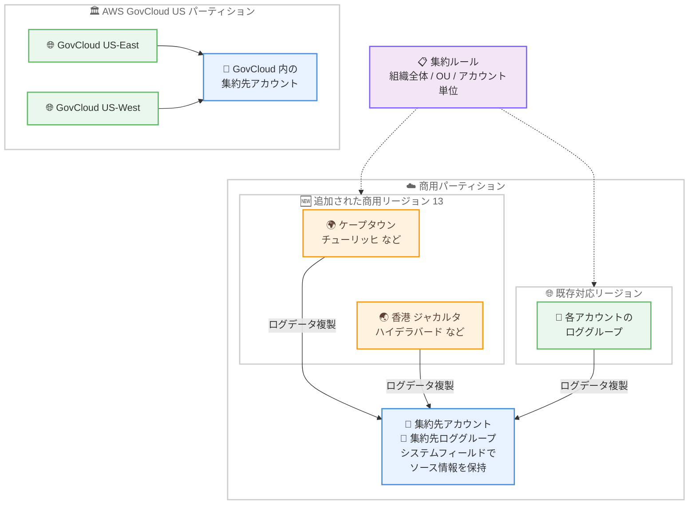

# Amazon CloudWatch - ログ集約機能が AWS GovCloud (US) と 13 の商用リージョンに拡大

**リリース日**: 2026 年 10 月 16 日
**サービス**: Amazon CloudWatch (CloudWatch Logs)
**機能**: CloudWatch Logs Centralization のリージョン拡大 (AWS GovCloud (US) および追加商用リージョン)

📊 [このアップデートのインフォグラフィックを見る](https://takech9203.github.io/aws-news-summary/20261016-amazon-cloudwatch-centralization-region-expansion.html)

## 概要

Amazon CloudWatch のログ集約機能 (CloudWatch Logs Centralization) が、AWS GovCloud (US) パーティションと 13 の追加商用リージョンで利用可能になりました。ログ集約機能は、複数の AWS アカウント・リージョンのログデータを単一の集約先アカウントに複製する機能で、AWS Organizations と連携することで、カスタムソリューションを構築することなく効率的なログ集約を実現します。

今回のリージョン拡大により、AWS GovCloud (US) パーティションと商用パーティションのそれぞれの組織が、アカウント・リージョンをまたいだログの一元化と集中監視を行えるようになりました。集約ルールの適用範囲は、組織全体、特定の組織単位 (OU)、または選択したアカウントにスコープでき、ソースのコンテキストはエンリッチされたシステムフィールドにより保持されたまま、単一アカウントにログがコピーされます。

政府機関や規制業種で AWS GovCloud (US) を利用している組織や、中東・アフリカ・アジアパシフィックなどの拡大対象リージョンを利用している組織にとって、独自のログ転送基盤を構築せずに組織全体のログを集約できるようになる重要なアップデートです。

**アップデート前の課題**

- AWS GovCloud (US) パーティションではログ集約機能が利用できず、政府機関や規制業種の組織は Kinesis Data Firehose やサブスクリプションフィルターなどを組み合わせたカスタムのログ集約基盤を構築・運用する必要があった
- ケープタウン、香港、ジャカルタ、チューリッヒなどの非対応リージョンにワークロードを持つ組織は、該当リージョンのログを集約ルールの対象にできなかった
- 非対応リージョンのログを一元化するには、クロスリージョンのカスタム転送処理が必要で、運用負荷と追加コストが発生していた

**アップデート後の改善**

- AWS GovCloud (US-East) と AWS GovCloud (US-West) でログ集約機能が利用可能になり、GovCloud パーティション内で組織全体のログを一元化できるようになった
- 13 の追加商用リージョンが集約対象に加わり、グローバルに展開するワークロードのログをより広い範囲でカバーできるようになった
- CloudWatch コンソール、AWS CLI、AWS SDK から集約ルールを作成するだけで、新規対応リージョンのログも含めた集中監視を開始できるようになった

## アーキテクチャ図



商用パーティションと AWS GovCloud (US) パーティションのそれぞれの内部で、追加対応リージョンを含む複数アカウント・リージョンのログを単一の集約先アカウントに複製できます。パーティションをまたいだ集約は行われず、各パーティション内で完結します。

## サービスアップデートの詳細

### 主要機能

1. **AWS GovCloud (US) パーティションでの利用開始**
   - AWS GovCloud (US-East) と AWS GovCloud (US-West) の両リージョンでログ集約機能が利用可能に
   - GovCloud パーティション内の組織が、アカウント・リージョンをまたいだログの一元化を実現可能
   - 政府機関や規制要件の厳しい業種でも、マネージドなログ集約を利用できるように

2. **13 の商用リージョンへの拡大**
   - アフリカ (ケープタウン)、アジアパシフィック (香港、ハイデラバード、ジャカルタ、マレーシア、メルボルン)、カナダ西部 (カルガリー)、欧州 (ミラノ、スペイン、チューリッヒ)、イスラエル (テルアビブ)、中東 (バーレーン、UAE) が追加
   - グローバル展開するワークロードのログを、より広いリージョンカバレッジで集約可能に

3. **AWS Organizations との統合による柔軟なスコープ設定**
   - 集約ルールを組織全体、特定の組織単位 (OU)、または選択したアカウントにスコープ可能
   - ソースアカウント ID やソースリージョンなどのコンテキストは、エンリッチされたシステムフィールドとして保持
   - 集約先では単一アカウントに集まったログを、ソース情報でフィルタリング・分析可能

## 技術仕様

### 今回追加されたリージョン

| パーティション | リージョン |
|------|------|
| 商用 (アフリカ) | アフリカ (ケープタウン) |
| 商用 (アジアパシフィック) | 香港、ハイデラバード、ジャカルタ、マレーシア、メルボルン |
| 商用 (カナダ) | カナダ西部 (カルガリー) |
| 商用 (欧州) | ミラノ、スペイン、チューリッヒ |
| 商用 (イスラエル) | イスラエル (テルアビブ) |
| 商用 (中東) | バーレーン、UAE |
| AWS GovCloud (US) | AWS GovCloud (US-East)、AWS GovCloud (US-West) |

### ログ集約機能の主な仕様

| 項目 | 詳細 |
|------|------|
| 前提条件 | AWS Organizations (すべての機能が有効)、管理アカウントまたは委任管理者 |
| スコープ | 組織全体 / 特定の OU / 選択したアカウント |
| 集約方式 | ソースロググループのログイベントを集約先アカウントのロググループに複製 (コピーベース) |
| ソース情報の保持 | エンリッチされたシステムフィールドによりソースアカウント・リージョンの情報を保持 |
| 集約対象 | ルール作成後に取り込まれた新しいログイベント (既存の履歴ログは対象外) |
| 設定方法 | CloudWatch コンソール、AWS CLI、AWS SDK |

### API 変更履歴

今回のアップデートはリージョン拡大であり、関連する API の変更はありません。ログ集約機能自体は CloudWatch Observability Admin サービスの `CreateCentralizationRuleForOrganization` などの API で操作します。

## 設定方法

### 前提条件

1. AWS Organizations がセットアップされており、すべての機能が有効化されていること
2. ソースアカウントと集約先アカウントが同一組織 (同一パーティション) に所属していること
3. 管理アカウントまたは CloudWatch Observability Admin の委任管理者アカウントから操作すること

### 手順

#### ステップ 1: 集約ルールを作成

```bash
aws observabilityadmin create-centralization-rule-for-organization \
  --rule-name "org-logs-centralization" \
  --rule '{
    "Source": {
      "Regions": ["af-south-1", "eu-central-2", "ap-east-1"],
      "Scope": "OrganizationId = o-example12345",
      "SourceLogsConfiguration": {
        "LogGroupSelectionCriteria": "*",
        "EncryptedLogGroupStrategy": "ALLOW"
      }
    },
    "Destination": {
      "Region": "ap-northeast-1",
      "Account": "111122223333"
    }
  }'
```

管理アカウントまたは委任管理者アカウントから集約ルールを作成します。`Source.Regions` に今回追加されたリージョン (例: ケープタウン `af-south-1`、チューリッヒ `eu-central-2`、香港 `ap-east-1`) を含めることで、該当リージョンのログを集約先アカウント・リージョンに複製できます。コンソールの場合は CloudWatch の設定画面から集約ルールを構成します。

#### ステップ 2: 集約ルールの状態を確認

```bash
aws observabilityadmin get-centralization-rule-for-organization \
  --rule-identifier "org-logs-centralization"
```

作成した集約ルールの詳細とヘルスステータスを取得し、ルールが正常に動作していることを確認します。

#### ステップ 3: 集約先アカウントでログを確認

集約先アカウントの CloudWatch Logs コンソールまたは CloudWatch Logs Insights で、複製されたログを確認します。エンリッチされたシステムフィールドにより、ソースアカウントやソースリージョンでのフィルタリングが可能です。

## メリット

### ビジネス面

- **GovCloud 対応による公共部門での活用**: 政府機関や規制業種が、AWS GovCloud (US) パーティション内でマネージドなログ集約を利用でき、コンプライアンス要件を満たしながら監視基盤を簡素化できる
- **カスタムソリューションの廃止による運用コスト削減**: これまで非対応リージョンのために構築していた独自のログ転送基盤が不要になり、構築・保守の工数を削減できる
- **無料枠による導入のしやすさ**: ログの 1 つ目のコピーは無料で集約でき、追加コストを抑えながら組織全体の集中監視を開始できる

### 技術面

- **広がったリージョンカバレッジ**: 中東、アフリカ、アジアパシフィックなどの拡大対象リージョンにあるワークロードのログも、ネイティブ機能だけで一元化できる
- **ソースコンテキストの保持**: エンリッチされたシステムフィールドによりソースアカウント・リージョンの情報が保持され、集約後も横断的な分析や原因調査が容易
- **AWS Organizations ベースの自動適用**: スコープに合致する新規アカウントは自動的に集約対象となり、アカウント追加時の設定漏れを防止できる

## デメリット・制約事項

### 制限事項

- パーティションをまたいだ集約はできない (AWS GovCloud (US) パーティションと商用パーティションは、それぞれのパーティション内で集約が完結する)
- ルール作成後に取り込まれた新しいログイベントのみが集約対象であり、既存の履歴ログは複製されない
- 集約はコピーベースであり、ソース側のログ削除は集約先に反映されない

### 考慮すべき点

- ログの 1 つ目のコピーは無料だが、追加のコピーには 0.05 USD/GB の料金が発生するため、バックアップリージョンの設定などコピー数の設計に注意が必要
- 集約先アカウントでは複製されたログの保存に対して通常の CloudWatch Logs 料金が適用されるため、保持期間の設定によるコスト管理を推奨
- 対応リージョンの最新情報は AWS リージョン別サービス表で確認が必要

## ユースケース

### ユースケース 1: GovCloud 環境での組織全体のログ一元化

**シナリオ**: 政府機関向けシステムを AWS GovCloud (US) で運用する組織が、複数アカウントの監査ログやアプリケーションログを単一の監視アカウントに集約したい。

**実装例**:
```
1. GovCloud パーティション内の管理アカウントで信頼されたアクセスを有効化
2. 集約ルールを作成し、スコープを組織全体に設定
3. ソースリージョンに GovCloud US-East と US-West を指定
4. 集約先に監視専用アカウントを指定
```

**効果**: カスタムのログ転送基盤を構築することなく、GovCloud パーティション内で組織全体のログを一元化し、コンプライアンス要件を満たした集中監視を実現できる。

### ユースケース 2: 拡大対象リージョンを含むグローバルワークロードの集中監視

**シナリオ**: 欧州と中東にワークロードを展開する企業が、チューリッヒ、スペイン、バーレーン、UAE の各リージョンのログを単一アカウントで監視したい。

**実装例**:
```
1. 集約ルールの Source.Regions に eu-central-2、eu-south-2、
   me-south-1、me-central-1 を指定
2. 集約先リージョンに主たる監視リージョンを指定
3. 集約先アカウントの CloudWatch Logs Insights でシステムフィールドを
   使用してリージョン横断の分析を実施
```

**効果**: これまで対象外だったリージョンを含むすべての拠点のログが単一アカウントに集まり、リージョン横断でのトラブルシューティングやセキュリティ分析が容易になる。

### ユースケース 3: 特定 OU のみを対象とした段階的な導入

**シナリオ**: 大規模組織が、まず本番環境の OU のみを対象にログ集約を導入し、効果を確認してから全社展開したい。

**実装例**:
```
1. 集約ルールのスコープに本番環境の OU を指定
2. ロググループ選択条件で対象を重要なログに限定
3. 無料枠 (1 つ目のコピー) の範囲でコストを確認
4. 効果検証後、スコープを組織全体に拡大
```

**効果**: スモールスタートで導入リスクとコストを抑えながら、OU 単位の柔軟なスコープ設定により段階的に集中監視を展開できる。

## 料金

ログの 1 つ目のコピーは無料で集約できます。追加のコピーには 0.05 USD/GB の料金が発生します。

| 項目 | 料金 |
|--------|------------------|
| 1 つ目のログコピーの集約 | 無料 |
| 追加のログコピー | 0.05 USD/GB |

集約先アカウントでのログ保存には通常の CloudWatch Logs 料金が適用されます。詳細は [Amazon CloudWatch 料金ページ](https://aws.amazon.com/cloudwatch/pricing/) を参照してください。

## 利用可能リージョン

今回のアップデートで、以下の 15 リージョンが追加されました。

- アフリカ (ケープタウン)
- アジアパシフィック (香港)
- アジアパシフィック (ハイデラバード)
- アジアパシフィック (ジャカルタ)
- アジアパシフィック (マレーシア)
- アジアパシフィック (メルボルン)
- カナダ西部 (カルガリー)
- 欧州 (ミラノ)
- 欧州 (スペイン)
- 欧州 (チューリッヒ)
- イスラエル (テルアビブ)
- 中東 (バーレーン)
- 中東 (UAE)
- AWS GovCloud (US-East)
- AWS GovCloud (US-West)

対応リージョンの全一覧は [AWS リージョン別サービス表](https://aws.amazon.com/about-aws/global-infrastructure/regional-product-services/) を参照してください。

## 関連サービス・機能

- **AWS Organizations**: ログ集約機能の前提となるサービス。集約ルールのスコープ設定 (組織全体 / OU / アカウント) に使用する
- **CloudWatch Logs Insights**: 集約先アカウントに集まったログを、システムフィールドを使用してソースアカウント・リージョン別に分析できる
- **CloudWatch Observability Admin**: 集約ルールの作成・管理を行うサービス。委任管理者アカウントの登録にも対応
- **AWS KMS**: 暗号化されたソースロググループの取り扱いや、集約先ロググループの暗号化設定を制御できる

## 参考リンク

- 📊 [インフォグラフィック](https://takech9203.github.io/aws-news-summary/20261016-amazon-cloudwatch-centralization-region-expansion.html)
- [公式発表 (What's New)](https://aws.amazon.com/about-aws/whats-new/2026/10/amazon-cloudwatch-centralization-region-expansion)
- [ドキュメント: Log centralization (Amazon CloudWatch Logs User Guide)](https://docs.aws.amazon.com/AmazonCloudWatch/latest/logs/CloudWatchLogs_Centralization.html)
- [AWS リージョン別サービス表](https://aws.amazon.com/about-aws/global-infrastructure/regional-product-services/)
- [料金ページ](https://aws.amazon.com/cloudwatch/pricing/)

## まとめ

CloudWatch のログ集約機能が AWS GovCloud (US) と 13 の商用リージョンに拡大され、政府機関・規制業種を含むより多くの組織が、カスタムソリューションなしで組織全体のログを一元化できるようになりました。拡大対象リージョンにワークロードを持つ組織や、GovCloud でログ集約基盤を独自に運用している組織は、CloudWatch コンソールまたは AWS CLI から集約ルールを作成し、マネージドなログ集約への移行を検討することを推奨します。1 つ目のログコピーは無料のため、まずは小さなスコープから試すことができます。
