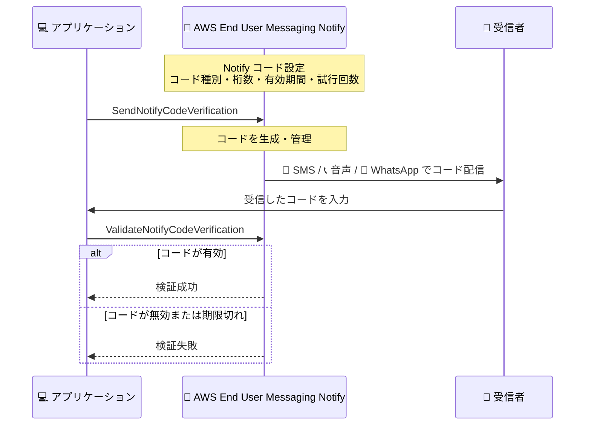

# AWS End User Messaging - Notify によるエンドツーエンドのマネージド OTP 検証

**リリース日**: 2026 年 10 月 16 日
**サービス**: AWS End User Messaging
**機能**: Notify のエンドツーエンドマネージドワンタイムパスコード (OTP) 検証

📊 [このアップデートのインフォグラフィックを見る](https://takech9203.github.io/aws-news-summary/20261016-aws-end-user-messaging-adds-end-to-end-managed-OTP.html)

## 概要

AWS End User Messaging は、Notify 機能においてエンドツーエンドのマネージドワンタイムパスコード (OTP) 検証を発表しました。電話番号のセットアップ、通信キャリアへの登録、メッセージ配信の管理を行うことなく、AWS 提供の電話番号とコード検証を含む完全な OTP ソリューションを 5 分以内に構築できます。

これまで Notify を利用する場合、パスコードは利用者側で生成して Notify に渡して送信する必要があり、コードの生成・保存・有効期限管理のロジックを自前で構築・保守する必要がありました。今回のアップデートにより、Notify がコードの生成、配信、受信者が入力したコードの検証までを一貫して実行するため、これらの作業が不要になり、完全な検証フローを短時間でリリースできます。コードの配信チャネルとして、テキスト (SMS)、音声に加えて、新たに WhatsApp がサポートされました。

サインアップ・ログイン時の本人確認、トランザクション認証、アカウント復旧などの検証フローを実装する開発者や、認証基盤の運用負荷を削減したい事業者が主な対象です。

**アップデート前の課題**

このアップデート以前には、以下の課題がありました。

- パスコードを利用者側のアプリケーションで生成し、Notify に渡して送信する必要があった
- コードの生成、保存、有効期限切れを管理するロジックを自前で構築・保守する必要があった
- 受信者が入力したコードを照合する検証ロジックも利用者側で実装する必要があった

**アップデート後の改善**

今回のアップデートにより、以下が可能になりました。

- Notify がコードの生成、配信、検証までをエンドツーエンドで実行し、自前実装が不要になった
- AWS 提供の電話番号とコード検証を含む OTP ソリューションを 5 分以内に構築できるようになった
- テキスト、音声に加えて WhatsApp でもコードを配信できるようになった
- Notify コード設定でルールを一度定義すれば、2 つの API 呼び出し (送信と検証) だけで検証フローを完結できるようになった

## アーキテクチャ図



アプリケーションは送信と検証の 2 つの API を呼び出すだけで、コードの生成・配信・照合はすべて Notify が実行します。

## サービスアップデートの詳細

### 主要機能

1. **マネージドコード生成・検証**
   - `endusermessaging` 名前空間の `SendNotifyCodeVerification` と `ValidateNotifyCodeVerification` の 2 つの API 操作で検証フローが完結
   - AWS End User Messaging がパスコードを生成して配信し、受信者が入力したコードを検証
   - コードの保存や有効期限管理のロジックを自前で実装する必要がない

2. **Notify コード設定による一元的なポリシー管理**
   - コードの種別、桁数、有効期間、受信者ごとの試行回数を一度定義すれば再利用可能
   - チャネルごとのテンプレートをあわせて設定
   - 設定後は、送信 API の呼び出し 1 回で選択したチャネルにコードを配信

3. **マルチチャネル配信 (WhatsApp 対応を追加)**
   - テキスト (SMS)、音声に加えて、新たに WhatsApp でのコード配信をサポート
   - AWS 管理の送信元電話番号と事前承認済みテンプレートを使用するため、電話番号のプロビジョニングやキャリア登録が不要

4. **組み込みの不正対策**
   - すべての Notify 設定に、人為的に増幅されたトラフィック (AIT) をフィルタリングする不正対策が必須で含まれる
   - 即時利用可能な Basic ティアと、上限引き上げと対応国拡大が可能な Advanced ティアを提供

## 技術仕様

### Notify の送信方式

| 方式 | 使用する API | 特徴 |
|------|--------------|------|
| 利用者がコードを生成 | `SendNotifyTextMessage`、`SendNotifyVoiceMessage` (`sms-voice` 名前空間) | 自前で生成したコードをテンプレート変数として渡し、Notify が配信 |
| AWS がコードを生成・検証 (今回の新機能) | `SendNotifyCodeVerification`、`ValidateNotifyCodeVerification` (`endusermessaging` 名前空間) | Notify コード設定に基づき AWS がコードを生成・配信・検証 |

### 主要な概念

| 項目 | 詳細 |
|------|------|
| Notify 設定 | 表示名、ユースケース、有効化するチャネルと国などのブランド・メッセージング設定を保持する中心リソース |
| Notify コード設定 | コードの種別、桁数、有効期間、試行回数を定義する再利用可能なポリシー |
| テンプレート | AWS 管理の事前承認済みテンプレート。対応国で事前検証済みで多言語をサポート |
| サービスティア | Basic ティア (即時利用、保守的な上限) と Advanced ティア (上限引き上げ、対応国拡大) |
| AIT 保護 | すべての Notify 設定に含まれる必須の不正トラフィックフィルタリング |

## 設定方法

### 前提条件

1. AWS アカウントと AWS End User Messaging へのアクセス権限
2. メッセージ送信前に、ユーザーガイドの Compliance セクションに記載されたモバイルキャリアの前提条件 (利用規約、プライバシー、オプトイン) を完了していること
3. 送信先の電話番号は E.164 形式で指定すること

### 手順

#### ステップ 1: Notify 設定の作成

AWS End User Messaging コンソールで Notify 設定を作成し、表示名、ユースケース、有効化するチャネル (SMS、音声、WhatsApp) と国を定義します。AWS 管理の送信元電話番号と事前承認済みテンプレートが利用できるため、電話番号の取得やキャリア登録は不要です。

#### ステップ 2: Notify コード設定の作成

コードの種別、桁数、有効期間、受信者ごとの試行回数と、チャネルごとのテンプレートを一度定義します。この設定は複数の検証フローで再利用できます。

#### ステップ 3: コードの送信

```bash
# endusermessaging 名前空間の SendNotifyCodeVerification を呼び出し、
# 選択したチャネルで受信者にコードを送信する
```

`SendNotifyCodeVerification` API を呼び出すと、Notify コード設定に基づいて AWS End User Messaging がパスコードを生成し、指定したチャネル (SMS、音声、WhatsApp) で受信者に配信します。パラメータの詳細は API リファレンスを参照してください。

#### ステップ 4: コードの検証

```bash
# endusermessaging 名前空間の ValidateNotifyCodeVerification を呼び出し、
# 受信者が入力したコードを検証する
```

受信者がアプリケーションに入力したコードを `ValidateNotifyCodeVerification` API に渡すと、AWS End User Messaging が有効期限と試行回数の範囲内でコードを照合し、検証結果を返します。

## メリット

### ビジネス面

- **市場投入の迅速化**: 電話番号の取得やキャリア登録なしに、5 分以内で動作する OTP ソリューションを構築可能
- **運用負荷の削減**: コード生成・保存・有効期限管理の自前実装と保守が不要になり、開発リソースを本来の機能開発に集中できる
- **不正コストの抑制**: すべての Notify 設定に AIT フィルタリングが必須で含まれ、人為的に増幅されたトラフィックによる課金被害を軽減

### 技術面

- **シンプルな実装**: 送信と検証の 2 つの API 呼び出しだけで完全な検証フローを実装可能
- **一元的なポリシー管理**: コード種別、桁数、有効期間、試行回数を Notify コード設定で一度定義すれば再利用可能
- **マルチチャネル対応**: SMS、音声、WhatsApp の中から受信者に適したチャネルを選択してコードを配信可能

## デメリット・制約事項

### 制限事項

- テンプレートは AWS 管理の事前承認済みテンプレートから選択する方式であり、独自テンプレートの作成・変更はできない
- Basic ティアは即時利用できるが上限が保守的に設定されており、上限引き上げと対応国の拡大には Advanced ティアへのアップグレード検証が必要
- メッセージ送信前に、モバイルキャリアの前提条件 (利用規約、プライバシー、オプトイン) への対応が必要

### 考慮すべき点

- OTP 検証には成功した検証ごとの料金が通常のメッセージ送信料金に加算されるため、既存の自前実装と比較したコスト評価が必要
- 既にコード生成・検証ロジックを自前で運用している場合は、マネージド方式への移行による挙動の違い (有効期間、試行回数の扱いなど) を確認する必要がある

## ユースケース

### ユースケース 1: サインアップ・ログイン時の本人確認

**シナリオ**: Web サービスやモバイルアプリの新規登録・ログイン時に、電話番号の所有確認を行いたい。

**実装例**:
```
1. Notify コード設定で 6 桁・有効期間数分・試行回数制限を定義
2. 登録フォーム送信時に SendNotifyCodeVerification で SMS にコードを送信
3. ユーザーが入力したコードを ValidateNotifyCodeVerification で検証
```

**効果**: コード管理基盤を自前で構築することなく、短期間で本人確認フローをリリースできる。

### ユースケース 2: トランザクション認証

**シナリオ**: EC サイトや金融サービスで、高額決済や設定変更などの重要操作時に追加認証を行いたい。

**実装例**:
```
1. 重要操作の実行前に SendNotifyCodeVerification を呼び出し
2. ユーザーの選択に応じて SMS、音声、WhatsApp のチャネルを指定
3. 検証成功時のみトランザクションを続行
```

**効果**: AIT 保護が組み込まれたマネージド基盤により、不正トラフィックを抑えつつ重要操作のセキュリティを強化できる。

### ユースケース 3: アカウント復旧

**シナリオ**: パスワードを忘れたユーザーのアカウント復旧時に、登録済み電話番号で本人確認を行いたい。

**実装例**:
```
1. 復旧リクエスト受付時に SendNotifyCodeVerification でコードを送信
2. SMS が届きにくい環境のユーザーには音声または WhatsApp を選択
3. ValidateNotifyCodeVerification の検証成功後にパスワード再設定を許可
```

**効果**: 複数チャネルへの対応により、ユーザー環境を問わず確実な本人確認を実現できる。

## 料金

Notify は従量課金制で、メッセージごとに Notify 利用料と各チャネルの標準メッセージ送信料金が課金されます。Notify 利用料は段階制で、1 メッセージあたり 0.045 USD から始まり、月間 250,001 メッセージ超では 0.030 USD まで低減します。OTP 検証は、成功した検証 1 件あたり 0.045 USD が標準のメッセージ送信料金に加えて課金されます。

WhatsApp 配信では、AWS 利用料 (送信 1 件あたり 0.005 USD など) に加えて、国とメッセージタイプにより異なる Meta の料金が発生します。音声は分単位の課金で、送信先の国・キャリアにより料金が異なります。

最新の料金は [AWS End User Messaging 料金ページ](https://aws.amazon.com/end-user-messaging/pricing/) を参照してください。

## 利用可能リージョン

Notify は、AWS End User Messaging が利用可能なすべての商用 AWS リージョンで利用できます。

## 関連サービス・機能

- **Amazon Cognito**: ユーザープールによる認証基盤。カスタム認証フローと組み合わせて Notify の OTP 検証を利用可能
- **AWS Lambda**: 認証フローのバックエンド処理として Notify API を呼び出すサーバーレス実装に活用可能
- **Amazon SNS**: 汎用的な SMS 送信サービス。OTP 検証に特化したマネージド機能が必要な場合は Notify が適する

## 参考リンク

- 📊 [インフォグラフィック](https://takech9203.github.io/aws-news-summary/20261016-aws-end-user-messaging-adds-end-to-end-managed-OTP.html)
- [公式発表 (What's New)](https://aws.amazon.com/about-aws/whats-new/2026/10/aws-end-user-messaging-adds-end-to-end-managed-OTP)
- [AWS Blog: Getting started with AWS End User Messaging Notify](https://aws.amazon.com/blogs/messaging-and-targeting/getting-started-with-aws-end-user-messaging-notify/)
- [ドキュメント: Setup Notify (ユーザーガイド)](https://docs.aws.amazon.com/end-user-messaging/latest/userguide/nx-notify.html)
- [ドキュメント: Send a message (ユーザーガイド)](https://docs.aws.amazon.com/end-user-messaging/latest/userguide/nx-notify-send.html)
- [料金ページ](https://aws.amazon.com/end-user-messaging/pricing/)

## まとめ

今回のアップデートにより、OTP 検証フローの構築に必要だったコード生成・保存・有効期限管理の自前実装が不要になり、2 つの API 呼び出しだけで SMS、音声、WhatsApp に対応した本人確認を実装できるようになりました。認証フローを自前で運用しているチームは、運用負荷とコストを比較のうえ、Notify のマネージド OTP 検証への移行を検討することを推奨します。まずはユーザーガイドに従って Notify 設定と Notify コード設定を作成し、テスト送信から始めてください。
