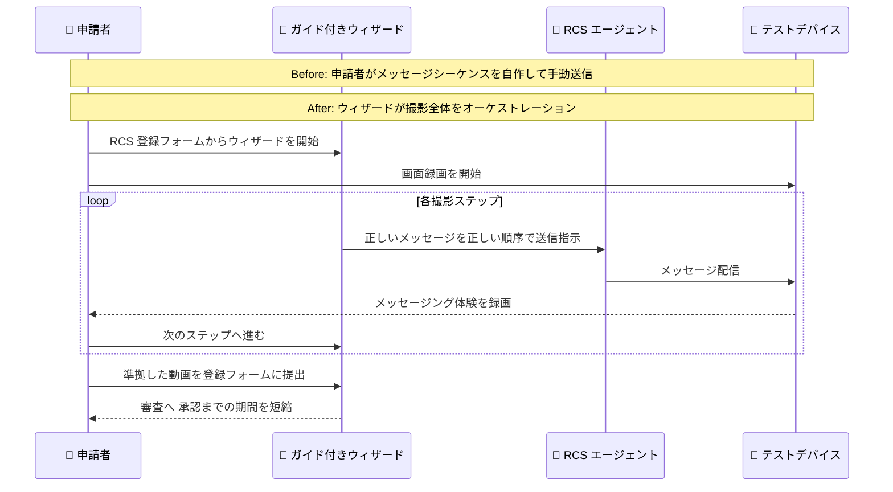

# AWS End User Messaging - RCS 登録動画のガイド付きウィザード

**リリース日**: 2026 年 10 月 16 日
**サービス**: AWS End User Messaging
**機能**: RCS エージェント登録動画の撮影をガイドするウィザード

📊 [このアップデートのインフォグラフィックを見る](https://takech9203.github.io/aws-news-summary/20261016-aws-end-user-messaging-adds-guided-wizard-rcs-registration-videos.html)

## 概要

AWS End User Messaging に、RCS (Rich Communication Services) エージェント登録に必要な動画撮影の全プロセスをオーケストレーションするウィザードが追加されました。米国を含む複数の国の RCS 登録では、メッセージング体験を実演するスクリーンレコーディング (画面録画) の提出が必須となっており、この動画の品質が登録審査の重要な要素になっています。

これまで、この動画を録画するには、特定の順序でメッセージをテストデバイスに送信する必要があり、そのメッセージの組み立てを申請者自身がスクリプト化していました。この手作業はミスを招きやすく、要件と一致しない動画や不完全な動画が RCS 登録における最大の難関のひとつになっていました。今回追加されたウィザードは、撮影の各ステップを自動的に進行し、正しいメッセージを正しい順序で送信します。これにより、初回の撮影で準拠した動画を録画でき、エージェントの承認をより早く得られます。

ウィザードは、動画の提出が必要なすべての RCS 登録フォームで利用できます。RCS エージェントの立ち上げを予定しているブランドや、顧客の RCS 登録を支援する ISV にとって、登録の手戻りを減らし承認までの期間を短縮できる実用的なアップデートです。

**アップデート前の課題**

- RCS 登録動画の撮影には、特定のメッセージシーケンスをテストデバイスに送信する必要があり、そのスクリプトを申請者が自分で作成する必要があった
- 手作業によるメッセージ送信はミスを招きやすく、送信順序の誤りや漏れが発生しやすかった
- 要件と一致しない動画や不完全な動画が原因で登録が却下され、撮影のやり直しにより承認までの期間が長期化していた

**アップデート後の改善**

- ウィザードが撮影の各ステップを進行し、正しいメッセージを正しい順序で自動送信するため、スクリプトを自作する必要がなくなった
- 初回の撮影で準拠した動画を録画できるようになり、動画の不備による却下と再撮影の手戻りを回避できるようになった
- 動画提出が必要なすべての RCS 登録フォームでウィザードが利用でき、エージェントの承認をより早く得られるようになった

## アーキテクチャ図



ウィザードが撮影の各ステップを進行し、必要なメッセージをテストデバイスへ正しい順序で送信します。申請者は画面録画をしながらウィザードに従うだけで、要件に準拠した登録動画を初回で作成できます。

## サービスアップデートの詳細

### 主要機能

1. **動画撮影プロセス全体のオーケストレーション**
   - RCS エージェント登録に必要な動画撮影の全プロセスをウィザードが進行
   - 撮影の各ステップでウィザードが正しいメッセージを正しい順序でテストデバイスに送信
   - 申請者がメッセージシーケンスを自分でスクリプト化する必要がなくなり、手作業によるミスを排除

2. **初回での準拠動画の作成**
   - 要件に沿ったメッセージシーケンスが保証されるため、初回の撮影で準拠した動画を録画可能
   - 動画の不一致や不完全さによる却下を回避し、エージェントの承認までの期間を短縮

3. **すべての対象登録フォームで利用可能**
   - 動画の提出が必要なすべての RCS 登録フォームにウィザードを搭載
   - 米国を含む、動画提出が必須となっている国の RCS 登録で利用可能

## 技術仕様

### RCS 登録動画の要件とウィザードの対応

| 項目 | 詳細 |
|------|------|
| 対象登録 | 動画の提出が必要な RCS エージェント登録 (米国を含む複数の国で必須) |
| 提出物 | メッセージング体験を実演するスクリーンレコーディング |
| 従来の手順 | 申請者が特定のメッセージシーケンスを自作し、テストデバイスへ手動送信しながら録画 |
| 新しい手順 | ウィザードが各ステップを進行し、正しいメッセージを正しい順序で自動送信 |
| 提供場所 | AWS End User Messaging コンソールの RCS 登録フォーム |

### API 変更履歴

今回のアップデートはコンソールの登録フォームに追加されたウィザード機能であり、awsapichanges.com の直近のフィードに対応する API 変更エントリは確認できませんでした。RCS 登録自体は Amazon Pinpoint SMS Voice V2 API (`pinpoint-sms-voice-v2`) の登録 API からも操作できます。

## 設定方法

### 前提条件

1. AWS アカウントを保有し、AWS End User Messaging を利用できること
2. RCS エージェントの登録を作成済み、または作成する予定があること
3. メッセージング体験を録画するためのテストデバイス (RCS 対応端末) と画面録画の手段を用意していること

### 手順

#### ステップ 1: RCS 登録フォームを開く

AWS End User Messaging コンソールで RCS エージェントの登録を開始し、動画の提出が必要な登録フォームへ進みます。動画提出が必須の国 (米国など) を対象とする登録では、フォーム上でウィザードを利用できます。

#### ステップ 2: ウィザードに従って動画を撮影する

テストデバイスで画面録画を開始し、ウィザードを起動します。ウィザードが撮影の各ステップを進行し、必要なメッセージを正しい順序でテストデバイスに送信するため、画面に表示されるメッセージング体験をそのまま録画します。

#### ステップ 3: 動画を提出して登録を申請する

撮影した動画を登録フォームに添付し、その他の必須項目とあわせて登録を申請します。ウィザードに沿って撮影した動画は要件に準拠しているため、動画の不備による却下リスクを低減できます。詳細な手順は [AWS End User Messaging User Guide](https://docs.aws.amazon.com/end-user-messaging/latest/userguide/nx-overview.html) を参照してください。

## メリット

### ビジネス面

- **承認までの期間短縮**: 初回の撮影で準拠した動画を提出できるため、RCS エージェントの承認とリッチメッセージ配信の開始を早められる
- **手戻りコストの削減**: 動画の不備による却下と再撮影の繰り返しがなくなり、登録作業にかかる工数を削減できる
- **RCS 導入ハードルの低下**: 登録の最大の難関のひとつだった動画作成が容易になり、RCS チャネル採用の障壁が下がる

### 技術面

- **メッセージシーケンスの自動化**: 正しいメッセージを正しい順序で送信する処理をウィザードが担うため、スクリプトの自作や手動送信によるミスを排除できる
- **要件準拠の仕組み化**: 準拠した動画の作成手順がウィザードとしてサービスに組み込まれ、属人的なノウハウに依存しない
- **既存フォームへのシームレスな統合**: 動画提出が必要なすべての RCS 登録フォームに組み込まれており、追加の設定なしで利用できる

## デメリット・制約事項

### 制限事項

- ウィザードが対象とするのは RCS 登録の動画撮影プロセスであり、その他の登録資料 (オプトイン証跡など) は従来どおり申請者が準備する必要がある
- 動画の提出が不要な RCS 登録ではウィザードは表示されない
- 画面録画自体はテストデバイス側で申請者が行う必要がある

### 考慮すべき点

- 登録の審査はキャリアや審査機関の基準に基づいて行われるため、ウィザードを利用しても承認が保証されるわけではない
- 動画以外の登録項目の品質も審査結果に影響するため、同日に発表された登録プロセス改善 (準拠例のモックアップなど) とあわせて活用することを推奨

## ユースケース

### ユースケース 1: 米国向け RCS エージェントの新規登録

**シナリオ**: ブランドが米国の顧客向けに RCS エージェントを立ち上げる。米国の登録では動画提出が必須だが、初めての登録で撮影手順が分からない。

**実装例**:
```
1. コンソールで RCS エージェントの登録を作成
2. 登録フォームからウィザードを起動し、テストデバイスで
   画面録画を開始
3. ウィザードの進行に従って各ステップを録画し、
   完成した動画を提出
```

**効果**: メッセージシーケンスを自作することなく、初回の撮影で準拠した動画を提出でき、エージェントの承認を早められる。

### ユースケース 2: 過去に動画不備で却下された登録の再申請

**シナリオ**: 以前の RCS 登録申請で、動画の内容が要件と一致せず却下された。再撮影の手順に確信が持てず、申請が停滞している。

**実装例**:
```
1. 登録フォームのウィザードを起動
2. ウィザードが送信するメッセージに沿って
   メッセージング体験を録画
3. 準拠した動画で再申請
```

**効果**: 却下原因となった動画の不一致・不完全さをウィザードで解消し、再申請の承認可能性を高められる。

### ユースケース 3: ISV による複数ブランドの RCS 登録支援

**シナリオ**: 多数のブランドのメッセージング導入を支援する ISV が、ブランドごとの RCS 登録動画の作成を効率化したい。

**実装例**:
```
1. ブランドごとに RCS エージェントの登録を作成
2. 各登録フォームのウィザードを利用して、標準化された
   手順で動画を撮影
3. 動画作成のノウハウを個別に整備することなく、
   複数ブランドの登録を並行して進行
```

**効果**: ブランドごとの動画作成を標準化された手順で進められ、登録支援業務のスループットと品質を向上できる。

## 料金

ウィザードの利用に追加料金はありません。RCS のメッセージ送信やエージェント運用には従来どおりの料金が適用されます。詳細は [AWS End User Messaging 料金ページ](https://aws.amazon.com/end-user-messaging/pricing/) を参照してください。

## 利用可能リージョン

ウィザードは、動画の提出が必要なすべての RCS 登録フォームで利用できます。AWS End User Messaging の RCS 登録が利用可能なリージョンで提供されます。

## 関連サービス・機能

- **AWS End User Messaging RCS**: ブランドの検証済みエージェントからリッチなメッセージング体験を提供するチャネル。今回のウィザードはこの RCS エージェント登録を支援
- **登録プロセスの改善 (同日発表)**: 準拠したオプトイン・サンプルメッセージのモックアップ例や、登録 API での条件付き必須項目の明示とあわせて利用することで、登録全体の品質を向上可能
- **Amazon Pinpoint SMS Voice V2 API**: RCS を含む登録を API から操作する際に使用する API

## 参考リンク

- 📊 [インフォグラフィック](https://takech9203.github.io/aws-news-summary/20261016-aws-end-user-messaging-adds-guided-wizard-rcs-registration-videos.html)
- [公式発表 (What's New)](https://aws.amazon.com/about-aws/whats-new/2026/10/aws-end-user-messaging-adds-guided-wizard-rcs-registration-videos)
- [ドキュメント: AWS End User Messaging User Guide](https://docs.aws.amazon.com/end-user-messaging/latest/userguide/nx-overview.html)
- [料金ページ](https://aws.amazon.com/end-user-messaging/pricing/)

## まとめ

AWS End User Messaging に、RCS エージェント登録に必要な動画撮影をガイドするウィザードが追加され、正しいメッセージを正しい順序で自動送信することで、初回の撮影で準拠した動画を作成できるようになりました。これまで RCS 登録の最大の難関のひとつだった動画作成の手戻りを解消し、エージェント承認までの期間を短縮できます。米国など動画提出が必須の国で RCS エージェントの登録を予定している場合は、登録フォームのウィザードの利用を推奨します。
