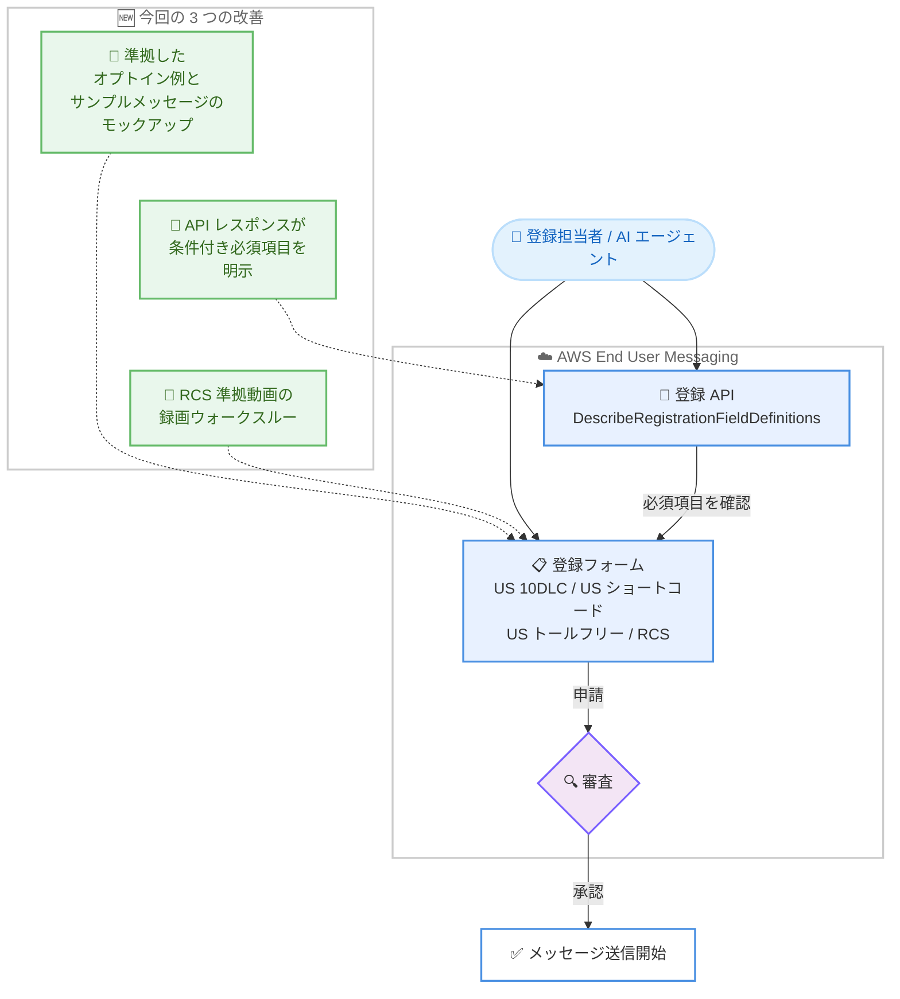

# AWS End User Messaging - 登録プロセスの改善による迅速で高品質な申請の実現

**リリース日**: 2026 年 10 月 16 日
**サービス**: AWS End User Messaging
**機能**: メッセージング登録 (Registration) の改善 (準拠例のモックアップ提供、API での必須項目明示、RCS 動画ウォークスルー)

📊 [このアップデートのインフォグラフィックを見る](https://takech9203.github.io/aws-news-summary/20261016-aws-end-user-messaging-adds-registration-improvements-for-faster-higher-quality-submissions.html)

## 概要

AWS End User Messaging のメッセージング登録 (Registration) プロセスが改善され、より明確なガイダンス、明示的な必須項目の提示、よくある却下理由を回避するための支援により、初回の申請で正しく登録を完了しやすくなりました。SMS や RCS などのメッセージング登録では、オプトインの証跡やサンプルメッセージといったコンプライアンスの根拠資料の提出が求められますが、これらの資料が不完全であったり必須項目が漏れていたりすると、申請が遅延または却下されることがよくありました。

今回の改善では、(1) US 10DLC、US ショートコード、US トールフリー、RCS の各登録に準拠したオプトインとサンプルメッセージのモックアップ例が提供され、(2) 登録 API のレスポンスが条件付きロジックを明示することで、他の項目の値に応じてどの項目が必須になるかを推測する必要がなくなり、(3) RCS 登録にはエージェント登録で必要となる準拠動画を録画するためのウォークスルーが追加されました。

米国向け SMS (10DLC、ショートコード、トールフリー) や RCS を利用するすべての事業者に加え、AI エージェントを使って登録作業を自動化する開発者にとっても、申請の手戻りを減らし送信開始までの期間を短縮できる実用的なアップデートです。

**アップデート前の課題**

- オプトイン証跡やサンプルメッセージについて「何が準拠した状態か」の具体例がなく、申請者は手探りで資料を作成する必要があり、不完全な証跡が原因で申請が遅延・却下されることが多かった
- 登録フォームの必須項目が他の項目の値に依存して変化する (条件付き必須) 場合、どの項目が必須になるかを API レスポンスから判断できず、申請者や AI エージェントが推測する必要があった
- RCS のエージェント登録で必要となる準拠動画について、録画手順の具体的なガイダンスがなく、動画の内容が原因で却下されるケースがあった

**アップデート後の改善**

- US 10DLC、US ショートコード、US トールフリー、RCS の各登録に、準拠したオプトインとサンプルメッセージのモックアップ例が含まれるようになり、申請前に「準拠した申請がどのようなものか」を確認できるようになった
- 登録 API のレスポンスが条件付きロジックを明示するようになり、個々の登録内容に応じてどの項目が必須かをレスポンスから直接把握できるようになった
- RCS 登録に準拠動画の録画ウォークスルーが追加され、却下の原因になりやすい動画コンテンツを正しく準備できるようになった

## アーキテクチャ図



今回の 3 つの改善は、登録フォームと登録 API の両方に適用されます。モックアップ例とウォークスルーが申請前の資料作成を支援し、API レスポンスの条件付きロジックにより必須項目を正確に把握したうえで申請できるため、審査での却下リスクを低減できます。

## サービスアップデートの詳細

### 主要機能

1. **準拠したオプトインとサンプルメッセージのモックアップ例**
   - US 10DLC、US ショートコード、US トールフリー、RCS の各登録に、準拠したオプトインとサンプルメッセージのモックアップ例が含まれるように
   - 自分の申請資料を作成する前に、準拠した申請がどのようなものかを具体例で確認可能
   - 却下理由として最も多い、オプトイン証跡やサンプルメッセージの不備を事前に回避

2. **登録 API レスポンスでの条件付きロジックの明示**
   - 登録 API のレスポンスが、個々の登録内容に対してどの項目が必須かを明示するように
   - 他の項目の値に応じて必須項目が変わる場合でも、申請者や AI エージェントが推測する必要がなくなった
   - `DescribeRegistrationFieldDefinitions` のレスポンスには、項目間の依存関係を表す `ConditionalBehavior` (依存先の項目パス、条件、適用される動作) が含まれる

3. **RCS 準拠動画の録画ウォークスルー**
   - RCS のエージェント登録で必要となる準拠動画について、録画手順のウォークスルーを提供
   - 動画コンテンツの不備による却下を回避し、RCS エージェントの承認までの期間を短縮

## 技術仕様

### 対象となる登録タイプ

| 登録タイプ | 概要 | 今回の改善 |
|------|------|------|
| US 10DLC | 米国向け 10 桁ロングコード。ブランド登録とキャンペーン登録が必要 | オプトイン・サンプルメッセージのモックアップ例 |
| US ショートコード | 米国向け短縮番号。キャリア審査が必要 | オプトイン・サンプルメッセージのモックアップ例 |
| US トールフリー | 米国向けトールフリー番号。検証登録が必要 | オプトイン・サンプルメッセージのモックアップ例 |
| RCS | リッチコミュニケーションサービスのエージェント登録 | モックアップ例 + 準拠動画の録画ウォークスルー |

### 登録 API のレスポンス構造 (条件付きロジック)

`DescribeRegistrationFieldDefinitions` のレスポンスに含まれる主な要素は以下のとおりです。

| 要素 | 説明 |
|------|------|
| `FieldPath` | 登録フォーム項目のパス |
| `FieldRequirement` | 項目の必須区分 |
| `ConditionalBehavior.DefaultBehavior` | 条件に合致しない場合のデフォルト動作 |
| `ConditionalBehavior.Rules[].Conditions[]` | `DependsOnFieldPath` (依存先の項目)、`Operator`、`Values` による条件定義 |
| `ConditionalBehavior.Rules[].RuleBehavior` | 条件に合致した場合に適用される動作 |
| `DisplayHints` | タイトル、説明、入力例 (`ExampleTextValue`)、ドキュメントリンクなどの表示ヒント |

```json
{
  "RegistrationFieldDefinitions": [
    {
      "FieldPath": "string",
      "FieldRequirement": "string",
      "ConditionalBehavior": {
        "DefaultBehavior": "string",
        "Rules": [
          {
            "Conditions": [
              {
                "DependsOnFieldPath": "string",
                "Operator": "string",
                "Values": ["string"]
              }
            ],
            "RuleBehavior": "string"
          }
        ]
      }
    }
  ]
}
```

### API 変更履歴

awsapichanges.com の直近のフィードには、今回のアップデートに直接対応する API 変更エントリは確認できませんでした。登録 API は Amazon Pinpoint SMS Voice V2 API (`pinpoint-sms-voice-v2`) として提供されており、条件付きロジックは `DescribeRegistrationFieldDefinitions` のレスポンスで取得できます。

## 設定方法

### 前提条件

1. AWS アカウントを保有し、AWS End User Messaging を利用できること
2. 登録 API を呼び出す場合、`sms-voice:DescribeRegistration*` などの IAM 権限が付与されていること
3. US 10DLC、US ショートコード、US トールフリー、または RCS のいずれかの登録を行う予定があること

### 手順

#### ステップ 1: 登録タイプと必須項目を確認する

```bash
# 利用可能な登録タイプの一覧を取得
aws pinpoint-sms-voice-v2 describe-registration-type-definitions

# 特定の登録タイプの項目定義 (条件付きロジックを含む) を取得
aws pinpoint-sms-voice-v2 describe-registration-field-definitions \
  --registration-type US_TEN_DLC_CAMPAIGN_REGISTRATION
```

`describe-registration-type-definitions` で登録タイプの一覧を確認し、`describe-registration-field-definitions` で対象の登録タイプの項目定義を取得します。レスポンスの `ConditionalBehavior` により、他の項目の値に応じてどの項目が必須になるかを事前に把握できます。

#### ステップ 2: モックアップ例を参照して申請資料を準備する

AWS End User Messaging コンソールの登録画面、またはユーザーガイドで提供される準拠したオプトインとサンプルメッセージのモックアップ例を確認し、自社のオプトインフローの証跡 (スクリーンショットなど) とサンプルメッセージを準備します。RCS のエージェント登録では、録画ウォークスルーに沿って準拠動画を作成します。

#### ステップ 3: 登録を作成して申請する

```bash
# 登録を作成
aws pinpoint-sms-voice-v2 create-registration \
  --registration-type US_TEN_DLC_CAMPAIGN_REGISTRATION

# 項目に値を設定 (項目ごとに実行)
aws pinpoint-sms-voice-v2 put-registration-field-value \
  --registration-id "registration-id" \
  --field-path "fieldPath" \
  --text-value "value"

# 登録を申請
aws pinpoint-sms-voice-v2 submit-registration-version \
  --registration-id "registration-id"
```

`create-registration` で登録を作成し、`put-registration-field-value` で各項目に値を設定したうえで、`submit-registration-version` により審査に申請します。ステップ 1 で確認した必須項目をすべて満たしてから申請することで、却下や手戻りを回避できます。

## メリット

### ビジネス面

- **送信開始までの期間短縮**: 初回の申請で承認される可能性が高まり、キャンペーン開始やサービスローンチに向けたメッセージ送信をより早く開始できる
- **申請の手戻り削減による工数削減**: 却下と再申請の繰り返しが減り、登録作業にかかる運用工数を削減できる
- **コンプライアンス品質の向上**: 準拠例に沿った資料作成により、キャリアや規制要件に適合した高品質な申請を安定して行える

### 技術面

- **API ベースの登録自動化が容易に**: レスポンスが必須項目を明示するため、登録ワークフローのプログラムによる自動化や検証ロジックの実装がシンプルになる
- **AI エージェントとの親和性**: AI エージェントが項目要件を推測する必要がなくなり、エージェントによる登録作業の自動化・支援の精度が向上する
- **具体例による学習コストの低減**: モックアップ例と録画ウォークスルーにより、初めて登録を行う開発者でも要件を正確に理解できる

## デメリット・制約事項

### 制限事項

- モックアップ例の提供対象は US 10DLC、US ショートコード、US トールフリー、RCS の登録であり、その他の登録タイプへの適用は発表に明記されていない
- 登録の審査自体はキャリアや審査機関の基準に基づいて行われるため、改善されたガイダンスに従っても承認が保証されるわけではない

### 考慮すべき点

- 既存の登録自動化ツールで項目要件を独自に推測・ハードコードしている場合は、API レスポンスの条件付きロジックを参照する実装への見直しを推奨
- モックアップ例はあくまで参考例であり、実際のオプトイン証跡とサンプルメッセージは自社の実際の運用に即した内容で作成する必要がある

## ユースケース

### ユースケース 1: 初めての US 10DLC 登録をスムーズに完了する

**シナリオ**: 米国の顧客に SMS 通知を送信するため、初めて 10DLC のブランド登録とキャンペーン登録を行う。過去に他社で登録が何度も却下された経験があり、初回承認を目指したい。

**実装例**:
```
1. コンソールの登録画面でモックアップ例を確認し、準拠した
   オプトイン証跡とサンプルメッセージの要件を把握
2. 自社の Web フォームのオプトイン画面を例に合わせて整備し、
   スクリーンショットを証跡として準備
3. 必須項目をすべて入力して申請
```

**効果**: 却下理由として最も多いオプトイン証跡とサンプルメッセージの不備を事前に回避し、初回申請での承認可能性を高められる。

### ユースケース 2: AI エージェントによる登録作業の自動化

**シナリオ**: 多数のブランドを扱う ISV が、AI コーディングアシスタントや自社の AI エージェントを使って顧客ごとの登録作業を自動化したい。

**実装例**:
```
1. describe-registration-field-definitions で登録タイプの
   項目定義と ConditionalBehavior を取得
2. エージェントがレスポンスの条件付きロジックに基づき、
   顧客の入力値に応じた必須項目を動的に判定
3. put-registration-field-value で値を設定し、必須項目の
   充足を確認してから submit-registration-version で申請
```

**効果**: エージェントが項目要件を推測する必要がなくなり、入力漏れによる却下を防ぎながら登録作業を高精度に自動化できる。

### ユースケース 3: RCS エージェント登録の準拠動画を正しく準備する

**シナリオ**: ブランドの RCS エージェントを立ち上げるにあたり、エージェント登録で必要となる準拠動画の作成方法が分からず、申請が止まっている。

**実装例**:
```
1. RCS 登録に追加された録画ウォークスルーに沿って、
   必要な画面と操作を含む動画を録画
2. モックアップ例を参考にオプトインとサンプルメッセージも準備
3. 必須項目と添付資料を揃えて登録を申請
```

**効果**: 動画コンテンツの不備による却下を回避し、RCS エージェントの承認とリッチメッセージ配信の開始を早められる。

## 料金

今回の登録プロセス改善自体に追加料金はありません。各登録タイプには従来どおりの登録料金 (例: 10DLC のブランド・キャンペーン登録料) やメッセージ送信料金が適用されます。詳細は [AWS End User Messaging 料金ページ](https://aws.amazon.com/end-user-messaging/pricing/) を参照してください。

## 利用可能リージョン

AWS End User Messaging の登録機能が利用可能なすべてのリージョンで、今回の改善が利用できます。

## 関連サービス・機能

- **Amazon Pinpoint SMS Voice V2 API**: AWS End User Messaging の登録・送信を操作する API。`DescribeRegistrationFieldDefinitions` などの登録 API が今回の改善の対象
- **AWS End User Messaging RCS**: 準拠動画の録画ウォークスルーが追加された RCS エージェント登録を提供するチャネル
- **AI コーディングアシスタント連携**: AWS End User Messaging はエージェントスキルを公開しており、Claude Code や Kiro などのアシスタントから登録作業を進められる

## 参考リンク

- 📊 [インフォグラフィック](https://takech9203.github.io/aws-news-summary/20261016-aws-end-user-messaging-adds-registration-improvements-for-faster-higher-quality-submissions.html)
- [公式発表 (What's New)](https://aws.amazon.com/about-aws/whats-new/2026/10/aws-end-user-messaging-adds-registration-improvements-for-faster-higher-quality-submissions)
- [ドキュメント: AWS End User Messaging User Guide](https://docs.aws.amazon.com/end-user-messaging/latest/userguide/nx-overview.html)
- [API リファレンス: DescribeRegistrationFieldDefinitions](https://docs.aws.amazon.com/pinpoint/latest/apireference_smsvoicev2/API_DescribeRegistrationFieldDefinitions.html)
- [料金ページ](https://aws.amazon.com/end-user-messaging/pricing/)

## まとめ

AWS End User Messaging の登録プロセスが改善され、準拠例のモックアップ、API レスポンスでの必須項目の明示、RCS 準拠動画の録画ウォークスルーにより、初回の申請で正しく登録を完了しやすくなりました。US 10DLC、US ショートコード、US トールフリー、RCS の登録を予定している場合は、申請前にモックアップ例を確認することを推奨します。登録作業を自動化している場合は、`DescribeRegistrationFieldDefinitions` の条件付きロジックを活用した実装への見直しを検討してください。
