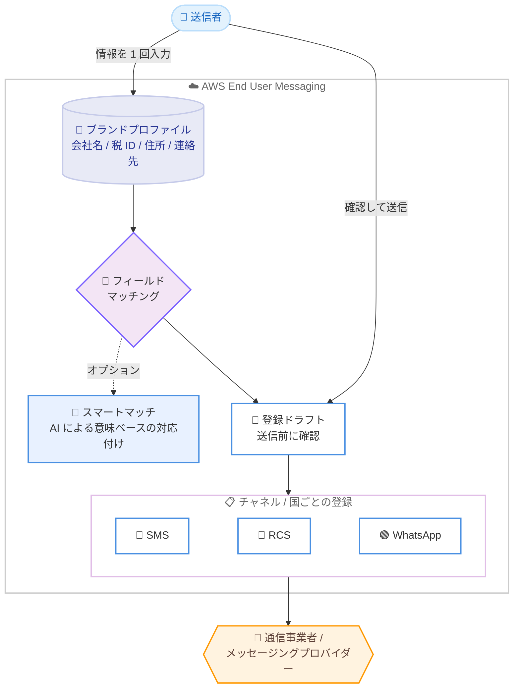

# AWS End User Messaging - ブランドプロファイル (Brand Profiles) のサポート

**リリース日**: 2026 年 10 月 16 日
**サービス**: AWS End User Messaging
**機能**: Brand Profiles (ブランドプロファイル)

📊 [このアップデートのインフォグラフィックを見る](https://takech9203.github.io/aws-news-summary/20261016-aws-end-user-messaging-now-supports-brand-profiles.html)

## 概要

AWS End User Messaging が Brand Profiles (ブランドプロファイル) を発表しました。ブランドプロファイルは、会社名、住所、連絡先、コンプライアンス文書、ロゴなどのブランド情報と企業情報を 1 回だけ保存し、複数のメッセージング登録で再利用できる機能です。

SMS、RCS、WhatsApp でメッセージを送信するには、通信事業者やメッセージングプロバイダーへのブランド登録が必要です。これまでは、チャネルごと、国ごとに、すべての登録フォームへ同じ企業情報を手作業で入力する必要がありました。ブランドプロファイルを使用すると、情報を 1 回入力するだけで各登録に適用できるため、登録作業が高速化され、チャネルや国をまたいで情報の一貫性を維持できます。

本機能は、自社ブランドのメッセージを送信する企業だけでなく、単一の AWS アカウントで複数のブランドを管理する事業者 (ISV や代理店など) にも対応しています。

**アップデート前の課題**

このアップデート以前は、メッセージング登録に次のような課題がありました。

- チャネル (SMS、RCS、WhatsApp) ごと、国ごとに、同じ会社情報、住所、連絡先、ユースケースをすべての登録フォームへ手作業で入力する必要があった
- 繰り返しの入力作業により、新規登録のたびに時間がかかっていた
- 入力ミス (タイプミスなど) により登録が却下されると、メッセージ送信開始が遅延するリスクがあった
- 複数のブランドを管理する場合、情報の一貫性を保つことが難しかった

**アップデート後の改善**

今回のアップデートにより、次のことが可能になりました。

- ブランド情報と企業情報を 1 回保存するだけで、新しい登録のたびに再利用できるようになった
- 登録開始時に、保存済みの情報から該当フィールドが自動入力され、送信前にドラフトを確認できるようになった
- スマートマッチ (AI によるフィールドマッピング) により、フィールド名が異なる場合でも情報を自動的に対応付けられるようになった
- 既存の登録情報からブランドプロファイルを作成できるため、移行も容易になった

## アーキテクチャ図



ブランドプロファイルに保存した企業情報が、各チャネル・各国の登録フォームへ自動的にマッピングされる流れを示しています。送信者はドラフトを確認してから登録を送信できます。

## サービスアップデートの詳細

### 主要機能

1. **ブランド情報の一元管理**
   - 会社名、税 ID、住所、連絡先、コンプライアンス文書、ロゴなどのビジネスアイデンティティ情報を柔軟な属性のセットとして 1 か所に保存
   - 登録のたびに同じ情報を再入力する必要がなくなり、チャネルや国をまたいで情報の一貫性を維持
   - 単一の AWS アカウントで複数ブランドの管理にも対応

2. **登録フォームへの自動入力とドラフト確認**
   - ブランドプロファイルを使用して登録を開始すると、保存済みの情報から該当するフィールドが自動入力される
   - 送信前にドラフトとして内容を確認できるため、入力ミスによる登録却下のリスクを低減
   - デフォルトでは、会社名、税 ID、住所、連絡先などの標準フィールドをマッチング

3. **スマートマッチ (AI によるフィールドマッピング)**
   - オプション機能として、AI モデルを使用してブランドプロファイルの属性と登録フォームのフィールドを意味的にマッピング
   - プロファイルの属性名と登録フォームのフィールド名が異なる場合でも、情報を正しく対応付けられる

4. **既存の登録からのプロファイル作成**
   - ブランドプロファイルはゼロから作成することも、既存の登録情報をもとに作成することも可能
   - すでに登録済みのユーザーも、既存情報を活用してスムーズに移行できる

## 技術仕様

### ブランドプロファイルの仕様

| 項目 | 詳細 |
|------|------|
| 保存される情報 | 会社詳細、連絡先情報、住所、コンプライアンス文書、ロゴ |
| プロファイルのステータス | `ACTIVE`、`BLOCKED`、`PAUSED`、`CANCELLED`、`FAILED` |
| 削除保護 | 誤削除を防止する削除保護を有効化可能 |
| データ保存場所 | AWS End User Messaging 用に選択した AWS リージョン内に保存 |
| 暗号化 | 保存時は AWS 境界内で暗号化、転送時は Amazon のセキュアネットワーク上で暗号化 |
| データの再利用方式 | 登録ごとにコピーを保存するのではなく、保存済み属性を各登録フォームへマッピング |

### スマートマッチのデータ処理

ユーザーガイドによると、スマートマッチの AI 推論リクエストは、リクエストの発信元の地理的エリア内のコンピューティングリソースへ安全にルーティングされます。

| 発信元 | 処理場所 |
|------|------|
| 欧州連合 (EU) | EU 域内で処理 |
| 米国 | 米国内で処理 |
| オーストラリア | オーストラリア国内で処理 |
| 日本 | 日本国内で処理 |
| 上記以外のエリア | AWS End User Messaging 用に選択した AWS リージョンのリージョナルエンドポイントで処理 |

この処理によってブランドプロファイル情報の保存場所が変わることはありません。

## 設定方法

### 前提条件

1. AWS アカウントと AWS End User Messaging へのアクセス権限
2. 登録に使用する会社情報 (会社名、税 ID、住所、連絡先など) の準備
3. 既存の登録からプロファイルを作成する場合は、作成済みの登録情報

### 手順

ユーザーガイドによると、ブランドプロファイルは次の 3 つのステップで利用します。

#### ステップ 1: ブランドデータを属性として追加

AWS End User Messaging でブランドプロファイルを作成し、会社詳細、連絡先情報、住所、コンプライアンス文書、ロゴなどを柔軟な属性のセットとして登録します。ゼロから作成するか、既存の登録情報をもとに作成します。

#### ステップ 2: 属性を登録フォームにマッチング

登録を開始すると、保存した属性が登録フォームのフィールドへマッピングされます。デフォルトでは会社名、税 ID、住所、連絡先などの標準フィールドがマッチングされます。必要に応じてスマートマッチを有効化すると、AI によってフィールド名が異なる場合でも意味的に対応付けられます。

#### ステップ 3: ドラフトを確認して送信、プロファイルを再利用

自動入力されたドラフトの内容を確認し、登録を送信します。同じブランドプロファイルを別のチャネルや国の登録タイプでも再利用できます。

## メリット

### ビジネス面

- **登録作業の高速化**: 繰り返しの手入力が不要になり、新しいチャネルや国への展開に要する時間を短縮できる
- **送信開始遅延リスクの低減**: 入力ミスによる登録却下を防ぎ、メッセージ送信開始までのリードタイムを安定させられる
- **複数ブランド管理の効率化**: 単一の AWS アカウントで複数ブランドの情報を一元管理でき、ISV や代理店のオペレーションを簡素化できる

### 技術面

- **情報の一貫性**: 登録ごとのコピーではなく、保存済み属性のマッピングにより、チャネルや国をまたいで常に同じ情報を適用できる
- **セキュアなデータ管理**: 保存時・転送時の暗号化、リージョン内でのデータ保存、削除保護により、企業情報を安全に管理できる
- **AI によるマッピングの柔軟性**: スマートマッチにより、フォームごとに異なるフィールド名にも対応でき、手動での読み替え作業が不要になる

## デメリット・制約事項

### 制限事項

- スマートマッチはオプション機能であり、AI モデルによる処理を利用するかどうかは利用者が選択する
- 送信者を登録すると、該当する登録情報はその国と番号タイプの登録を審査する規制機関または通信事業者と共有される
- ユーザーガイドではブランドプロファイルの再利用対象として SMS と RCS の登録が中心に記載されており、チャネルごとの対応範囲は最新のドキュメントで確認が必要

### 考慮すべき点

- 自動入力された内容はドラフトとして提供されるため、送信前に内容の正確性を必ず確認する必要がある
- ブランドプロファイルには企業の機密情報 (税 ID など) が含まれるため、IAM によるアクセス制御の設計が重要
- 重要なプロファイルには削除保護を有効化し、誤削除を防止することが推奨される

## ユースケース

### ユースケース 1: 多国展開する SMS 送信の登録効率化

**シナリオ**: グローバル EC 企業が、複数の国で SMS によるトランザクション通知を提供するため、国ごとに送信者登録を行う。

**実装例**:
```
1. ブランドプロファイルに会社情報、住所、連絡先、ユースケースを登録
2. 各国の SMS 登録 (センダー ID や番号申請) をブランドプロファイルから開始
3. 自動入力されたドラフトを確認して送信
```

**効果**: 国ごとの登録フォームへの手入力が不要になり、展開スピードが向上。入力ミスによる却下と送信開始遅延を防止できる。

### ユースケース 2: マルチチャネル展開 (SMS / RCS / WhatsApp)

**シナリオ**: 金融機関が SMS に加えて RCS と WhatsApp での顧客通知を開始するため、チャネルごとにブランド登録を行う。

**実装例**:
```
1. 既存の SMS 登録情報からブランドプロファイルを作成
2. RCS、WhatsApp の新規登録でブランドプロファイルを適用
3. スマートマッチを有効化し、チャネルごとに名称が異なるフィールドも自動対応付け
```

**効果**: チャネル間で情報の一貫性を維持しながら、新チャネルの立ち上げを迅速化できる。

### ユースケース 3: 複数ブランドを管理する ISV / 代理店

**シナリオ**: メッセージング SaaS を提供する ISV が、単一の AWS アカウントで複数の顧客ブランドの登録を代行管理する。

**実装例**:
```
1. 顧客ブランドごとにブランドプロファイルを作成
2. 新規チャネルや国への登録時に、該当ブランドのプロファイルを適用
3. 削除保護を有効化し、運用中のプロファイルの誤削除を防止
```

**効果**: ブランドごとの情報管理が一元化され、登録代行オペレーションの品質とスピードが向上する。

## 料金

What's New およびユーザーガイドに、ブランドプロファイル固有の追加料金に関する記載はありません。AWS End User Messaging の利用料金 (SMS、音声、プッシュ通知などの送信料金) の詳細は料金ページを参照してください。

## 利用可能リージョン

AWS End User Messaging が利用可能なすべての商用 AWS リージョンで利用できます。

## 関連サービス・機能

- **AWS End User Messaging の登録改善機能**: 同日に発表された登録プロセスの改善 (より速く高品質な申請) と組み合わせることで、登録ワークフロー全体を効率化できる
- **AWS End User Messaging Social**: WhatsApp Business メッセージの送信機能。ブランド登録が必要なチャネルの 1 つ
- **AWS IAM**: ブランドプロファイルに含まれる企業情報へのアクセスを制御するために使用

## 参考リンク

- 📊 [インフォグラフィック](https://takech9203.github.io/aws-news-summary/20261016-aws-end-user-messaging-now-supports-brand-profiles.html)
- [公式発表 (What's New)](https://aws.amazon.com/about-aws/whats-new/2026/10/aws-end-user-messaging-now-supports-brand-profiles)
- [ドキュメント (Brand profiles - User Guide)](https://docs.aws.amazon.com/end-user-messaging/latest/userguide/nx-features-brand-profiles.html)
- [料金ページ](https://aws.amazon.com/end-user-messaging/pricing/)

## まとめ

ブランドプロファイルにより、チャネルや国ごとに繰り返していたブランド登録の手入力作業が不要になり、登録の高速化と情報の一貫性維持を同時に実現できます。SMS、RCS、WhatsApp で複数の登録を管理している、または今後マルチチャネル・多国展開を予定している場合は、既存の登録情報からブランドプロファイルを作成し、スマートマッチの活用を検討することを推奨します。
