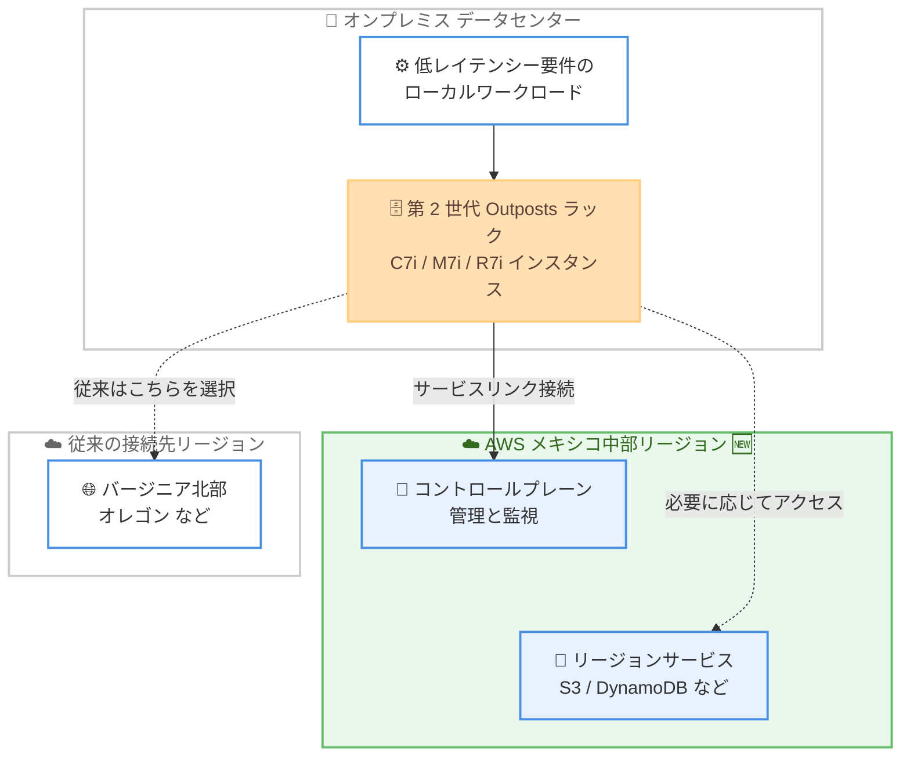

# AWS Outposts - 第 2 世代 Outposts ラックが AWS メキシコ (中部) リージョンをサポート

**リリース日**: 2026 年 10 月 16 日
**サービス**: AWS Outposts
**機能**: 第 2 世代 Outposts ラックの AWS メキシコ (中部) リージョン対応

📊 [このアップデートのインフォグラフィックを見る](https://takech9203.github.io/aws-news-summary/20261016-aws-outposts-racks-mexico-central.html)

## 概要

第 2 世代 AWS Outposts ラックが、AWS メキシコ (中部) リージョンへの接続をサポートしました。Outposts ラックは、AWS のインフラストラクチャ、サービス、API、ツールをオンプレミスのデータセンターやコロケーションスペースに拡張し、クラウドと一貫性のあるハイブリッド体験を提供するフルマネージドサービスです。

今回のリージョン拡大により、スタートアップからエンタープライズ、公共機関まで、あらゆる規模の組織が、メキシコ (中部) リージョンに接続する Outposts ラックを注文できるようになりました。Outposts は親リージョン (接続先リージョン) との通信を前提とするため、地理的に近いリージョンへの接続は、コントロールプレーン通信のレイテンシー最適化とデータレジデンシー要件への対応の両面で重要です。

メキシコ国内や中南米でオンプレミス環境と AWS を組み合わせたハイブリッド構成を運用する組織にとって、第 2 世代ラックの高いパフォーマンスを近接リージョンと組み合わせて利用できるようになる、選択肢を広げるアップデートです。

**アップデート前の課題**

- 第 2 世代 Outposts ラックはメキシコ (中部) リージョンに接続できず、メキシコ国内の利用者は米国などの遠隔リージョンを親リージョンとして選択する必要があった
- 遠隔リージョンへの接続では、サービスリンク経由のコントロールプレーン通信やリージョン連携機能のレイテンシーが大きくなる場合があった
- データレジデンシー要件により接続先リージョンを国内に限定したい組織は、第 2 世代ラックの採用が難しかった

**アップデート後の改善**

- メキシコ (中部) リージョンを親リージョンとして第 2 世代 Outposts ラックを注文できるようになった
- 地理的に近いリージョンへの接続により、レイテンシーの最適化とデータレジデンシー要件への対応が容易になった
- Outposts の接続先として選択できるリージョンが増え、ハイブリッド構成の設計の柔軟性が向上した

## アーキテクチャ図



オンプレミスに設置した第 2 世代 Outposts ラックが、新たにメキシコ (中部) リージョンをサービスリンクの接続先 (親リージョン) として選択できるようになり、近接リージョンでの管理・連携が可能になりました。

## サービスアップデートの詳細

### 主要機能

1. **メキシコ (中部) リージョンへの接続サポート**
   - 第 2 世代 Outposts ラックの親リージョンとしてメキシコ (中部) リージョンを選択可能になった
   - あらゆる規模の組織 (スタートアップ、エンタープライズ、公共機関) が注文可能
   - レイテンシーの最適化とデータレジデンシー要件への対応を目的としたリージョン選択の柔軟性が向上

2. **第 2 世代 Outposts ラックの特長**
   - 第 4 世代 Intel Xeon スケーラブルプロセッサを搭載した C7i、M7i、R7i インスタンスをサポート
   - 第 1 世代ラックの C5、M5、R5 インスタンスと比較して vCPU、メモリ、ネットワーク帯域幅が 2 倍、最大 40% のパフォーマンス向上
   - 専用のネットワークラックによりコンピュートとネットワークを独立してスケール可能で、デバイス障害時の自動対応などの耐障害性も向上

3. **ハイブリッド体験の一貫性**
   - リージョンと同じ AWS の API、コンソール、ガバナンスツールをオンプレミスで利用可能
   - IP アドレス、VLAN、BGP などのネットワーク設定を API またはコンソールから簡素化された手順で構成可能

## 技術仕様

### 第 2 世代 Outposts ラックの概要

| 項目 | 詳細 |
|------|------|
| サポートインスタンス | C7i (コンピュート最適化)、M7i (汎用)、R7i (メモリ最適化) |
| プロセッサ | 第 4 世代 Intel Xeon スケーラブルプロセッサ (Sapphire Rapids) |
| 性能向上 | 第 1 世代比で vCPU・メモリ・ネットワーク帯域幅が 2 倍、最大 40% の性能向上 |
| ネットワーク | 専用ネットワークラックによる集中トラフィックハブ構成 |
| 今回の対応リージョン | AWS メキシコ (中部) リージョン |

## 設定方法

### 前提条件

1. AWS アカウントを保有していること
2. Outposts ラックを設置するオンプレミスのデータセンターまたはコロケーションスペースの施設要件 (電源、冷却、スペース) を満たしていること
3. 親リージョンへのサービスリンク接続のためのネットワーク要件を満たしていること

### 手順

#### ステップ 1: Outposts の注文

AWS コンソールの AWS Outposts ページから、第 2 世代 Outposts ラックの構成を選択し、接続先リージョンとしてメキシコ (中部) リージョンを指定して注文します。カタログからワークロードに適したコンピュートとストレージの構成を選択できます。

#### ステップ 2: サイト要件の確認と設置

AWS がサイト要件 (電源、冷却、ネットワーク) を確認し、ラックの配送と設置を行います。設置後、サービスリンク経由で親リージョンに接続されます。

#### ステップ 3: リソースの起動

```bash
# Outposts 上にサブネットを作成し EC2 インスタンスを起動する例
aws ec2 create-subnet \
  --vpc-id vpc-xxxxxxxx \
  --cidr-block 10.0.1.0/24 \
  --outpost-arn arn:aws:outposts:mx-central-1:123456789012:outpost/op-xxxxxxxx

aws ec2 run-instances \
  --instance-type m7i.xlarge \
  --subnet-id subnet-xxxxxxxx \
  --image-id ami-xxxxxxxx
```

VPC を Outpost に拡張するサブネットを作成し、Outposts ラック上に EC2 インスタンスを起動しています。リージョンと同じ API で操作できる点が Outposts の特長です。

## メリット

### ビジネス面

- **データレジデンシー対応**: メキシコ国内のリージョンに接続することで、データの所在に関する規制要件や社内ポリシーへの対応が容易になる
- **ユーザー体験の向上**: 近接リージョンとの連携によりレイテンシーが最適化され、ローカルワークロードの応答性能を維持しやすい
- **採用範囲の拡大**: スタートアップから公共機関まで、メキシコおよび周辺地域の幅広い組織が第 2 世代ラックを採用しやすくなる

### 技術面

- **接続先リージョンの柔軟性**: Outposts が接続できるリージョンの選択肢が増え、ハイブリッドアーキテクチャの設計自由度が向上する
- **最新世代の性能**: 第 1 世代比で最大 40% の性能向上と 2 倍のリソース容量を近接リージョン接続で利用できる
- **一貫した運用**: リージョンと同一の API、ツール、ガバナンスでオンプレミスのリソースを管理できる

## デメリット・制約事項

### 制限事項

- 第 2 世代 Outposts ラックで利用できるサービスは第 1 世代のサブセットから順次拡大中であり、必要なサービスが対応済みか事前確認が必要
- 対応インスタンスは現時点で C7i、M7i、R7i が中心であり、GPU 搭載インスタンスなどは順次提供予定
- 設置先の国・地域と接続可能なリージョンの組み合わせは、Outposts rack FAQ の最新情報で確認が必要

### 考慮すべき点

- Outposts は親リージョンへの常時接続 (サービスリンク) を前提とするため、ネットワーク回線の帯域と冗長性の設計が重要
- ラックの設置には電源、冷却、スペースなどの施設要件を満たす必要がある
- 既存の第 1 世代 Outposts からの移行を検討する場合は、ワークロードの互換性と移行計画の策定が必要

## ユースケース

### ユースケース 1: 金融機関の低レイテンシー処理とデータレジデンシー対応

**シナリオ**: メキシコ国内の金融機関が、規制によりデータを国内に保持しつつ、取引処理システムを低レイテンシーで運用したい。

**実装例**:
```
オンプレミスの第 2 世代 Outposts ラックで取引処理ワークロードを実行し、
親リージョンとしてメキシコ (中部) リージョンを指定。
分析やアーカイブはリージョン側の S3 や分析サービスと連携。
```

**効果**: データレジデンシー要件を満たしながら、オンプレミスでの低レイテンシー処理とリージョンサービスの活用を両立できる。

### ユースケース 2: 製造業の工場システムとクラウドの統合

**シナリオ**: 工場の生産管理システムや産業制御システムをオンプレミスで稼働させつつ、クラウドと同じツールで統一的に運用したい。

**実装例**:
```
工場内に Outposts ラックを設置し、生産管理アプリケーションを
M7i インスタンスで実行。CloudWatch や Systems Manager など
リージョンの運用ツールで一元管理。
```

**効果**: 工場設備との低レイテンシー通信を維持しながら、クラウドと一貫した運用・ガバナンスを実現できる。

### ユースケース 3: 公共機関のハイブリッドクラウド移行

**シナリオ**: メキシコの公共機関が、データの国内保持要件を満たしながら段階的にクラウド移行を進めたい。

**実装例**:
```
既存データセンターに Outposts ラックを設置し、移行対象システムを
段階的に Outposts 上へリフト。将来的にメキシコ (中部) リージョンへの
移行パスも確保。
```

**効果**: 国内リージョン接続によりコンプライアンスを維持しつつ、クラウドネイティブな運用スキルと移行パスを段階的に獲得できる。

## 料金

AWS Outposts ラックの料金は、選択したコンピュートとストレージの構成に基づく容量ベースの料金で、3 年間の契約期間に対して全額前払い、一部前払い、前払いなしの支払いオプションを選択できます。料金には設置、保守、ソフトウェアの更新が含まれます。詳細は [AWS Outposts ラックの料金ページ](https://aws.amazon.com/outposts/rack/pricing/) を参照してください。

## 利用可能リージョン

第 2 世代 AWS Outposts ラックの接続先リージョンに、AWS メキシコ (中部) リージョンが追加されました。第 2 世代 Outposts ラックがサポートされる国・地域および接続可能なリージョンの最新一覧は、[Outposts rack FAQ ページ](https://aws.amazon.com/outposts/rack/faqs/) を参照してください。

## 関連サービス・機能

- **Amazon EC2**: Outposts ラック上で C7i、M7i、R7i などのインスタンスを起動し、リージョンと同じ API で管理できる
- **Amazon VPC**: VPC をオンプレミスの Outposts に拡張し、サブネット単位でリソースを配置できる
- **AWS Outposts サーバー**: ラックよりも小規模な設置スペース向けの選択肢として、1U / 2U のサーバーフォームファクタも提供されている

## 参考リンク

- 📊 [インフォグラフィック](https://takech9203.github.io/aws-news-summary/20261016-aws-outposts-racks-mexico-central.html)
- [公式発表 (What's New)](https://aws.amazon.com/about-aws/whats-new/2026/10/aws-outposts-racks-mexico-central/)
- [AWS Blog: Announcing second-generation AWS Outposts racks](https://aws.amazon.com/blogs/aws/announcing-second-generation-aws-outposts-racks-with-breakthrough-performance-and-scalability-on-premises/)
- [ドキュメント: What is AWS Outposts?](https://docs.aws.amazon.com/outposts/latest/network-userguide/what-is-outposts.html)
- [Outposts rack FAQ](https://aws.amazon.com/outposts/rack/faqs/)
- [料金ページ](https://aws.amazon.com/outposts/rack/pricing/)

## まとめ

第 2 世代 AWS Outposts ラックがメキシコ (中部) リージョンに対応し、メキシコおよび周辺地域の組織がレイテンシー最適化とデータレジデンシー要件の両面で有利なハイブリッド構成を選択できるようになりました。該当地域でオンプレミスと AWS の統合を検討している場合は、Outposts rack FAQ で設置可能な国・地域と接続先リージョンの組み合わせを確認し、第 2 世代ラックの採用を検討することを推奨します。
