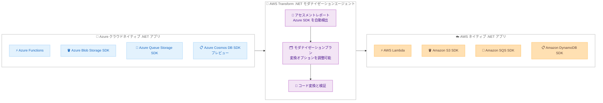

# AWS Transform - Azure から AWS へのクラウドネイティブコード変換

**リリース日**: 2026 年 10 月 16 日
**サービス**: AWS Transform
**機能**: Azure SDK から AWS SDK へのアプリケーションコード変換 (一般提供開始)

📊 [このアップデートのインフォグラフィックを見る](https://takech9203.github.io/aws-news-summary/20261016-aws-transform-azure-to-aws-code-conversion.html)

## 概要

AWS Transform において、Azure SDK から AWS SDK へのアプリケーションコード変換機能が一般提供 (GA) になりました。Microsoft Azure 上で稼働するクラウドネイティブな .NET アプリケーションを、AWS へ移行するための加速されたパスが提供されます。AWS Transform の .NET モダナイゼーションエージェントが Azure サービスを利用するコードを特定し、同等の AWS サービスを利用するコードへ自動変換します。例えば、Azure Cosmos DB を使用する Azure Functions のサーバーレス関数を、Amazon DynamoDB を使用する AWS Lambda 関数へ変換できます。

AWS Transform は提出されたソースコード内の Azure SDK を検出し、変換オプションをアセスメントレポートとモダナイゼーションプランに提示します。ユーザーは提示されたオプションをそのまま受け入れることも、モダナイゼーション実行前に好みに応じて調整することも可能です。その後、AWS Transform は特定した Azure サービスコードを同等の AWS SDK 呼び出しへ変換し、変更が変換後のコードに正しく組み込まれていることを検証します。

本機能は、Azure Functions から AWS Lambda、Azure Blob Storage から Amazon S3、Azure Queue Storage から Amazon SQS への変換をサポートし、Azure Cosmos DB から Amazon DynamoDB への変換はプレビューとして利用可能です。マルチクラウド環境の統合や Azure から AWS への移行を検討している企業の開発チーム、移行プロジェクトを支援する SIer にとって、移行工数を大幅に削減できるアップデートです。

**アップデート前の課題**

Azure 上のクラウドネイティブ .NET アプリケーションを AWS へ移行する際、以下の課題がありました。

- Azure SDK (Azure.Storage.Blobs、Microsoft.Azure.Cosmos など) を利用するコードを、AWS SDK へ手作業で書き換える必要があった
- Azure Functions のプログラミングモデルを AWS Lambda のモデルへ変換するには、両クラウドのサービス仕様に精通したエンジニアによる設計と実装が必要だった
- ソースコード内のどこで Azure サービスが利用されているかの調査 (アセスメント) 自体に多くの時間がかかっていた

**アップデート後の改善**

今回のアップデートにより、以下が可能になりました。

- AWS Transform がソースコード内の Azure SDK を自動検出し、アセスメントレポートとモダナイゼーションプランで変換オプションを提示
- Azure Functions、Azure Blob Storage、Azure Queue Storage のコードを、それぞれ AWS Lambda、Amazon S3、Amazon SQS の同等コードへ自動変換 (Azure Cosmos DB から Amazon DynamoDB はプレビュー)
- 変換後のコードに変更が組み込まれていることをエージェントが検証し、変換できなかったコードは TODO コメント、スタブコード、Next Steps ファイルで明示

## アーキテクチャ図



AWS Transform の .NET モダナイゼーションエージェントが Azure SDK を検出し、アセスメント、プラン調整、変換・検証のステップを経て、同等の AWS サービスを利用するコードへ変換する流れを示しています。

## サービスアップデートの詳細

### 主要機能

1. **Azure SDK の自動検出とアセスメント**
   - 提出されたソースコードから Azure SDK の利用箇所を自動的に検出
   - 検出結果と変換オプションをアセスメントレポートとモダナイゼーションプランとして提示
   - 対象となるモダンな .NET アプリケーションでは、クラウドネイティブコード変換が自動的に実行される

2. **変換オプションのカスタマイズ**
   - エージェントチャットでの指示、モダナイゼーションプランの編集、ステアリングドキュメントの提供により変換動作を制御可能
   - 一部または全部のサービスコード変換のオプトアウト
   - 変数名や命名規則の指定、コメントの詳細度の調整
   - デフォルトの変換先の変更も可能 (例: Azure Blob Storage のコードを Amazon S3 ではなく Amazon DynamoDB を使うよう指示)

3. **変換と検証**
   - 特定された Azure サービスコードを同等の AWS SDK 呼び出しへ変換
   - 変更が変換後のコードに組み込まれていることを検証
   - 変換できないコードは TODO コメント、スタブコード、または生成される Next Steps のマークダウンファイルに明記

## 技術仕様

### サポートされる変換マッピング

| サービスカテゴリ | 変換元 (Azure) | 変換先 (AWS) | コード変換の詳細 |
|------|------|------|------|
| サーバーレス関数 | Azure Functions | AWS Lambda | Azure Functions を AWS Lambda 関数として書き換え |
| オブジェクトストレージ | Azure Blob Storage | Amazon S3 | Azure.Storage.Blobs SDK コード → Amazon.S3 SDK コード |
| メッセージキュー | Azure Queue Storage | Amazon SQS | Azure.Storage.Queues SDK コード → Amazon.SQS SDK コード |
| NoSQL データベース (プレビュー) | Azure Cosmos DB | Amazon DynamoDB | Microsoft.Azure.Cosmos SDK コード → Amazon.DynamoDBv2 SDK コード |

### 変換対象の範囲

| 項目 | 詳細 |
|------|------|
| 対象 | アプリケーションコードのみ (クラウドインフラストラクチャの移行は対象外) |
| 対象言語 / プラットフォーム | モダンな .NET アプリケーション |
| 上記以外のクラウドサービス | AWS Transform custom、または Kiro などの AI コードコンパニオンの利用を検討 |

## 設定方法

### 前提条件

1. AWS Transform が利用可能なリージョンでのセットアップ (ワークスペースの作成など)
2. 変換対象となる Azure SDK を利用したモダンな .NET アプリケーションのソースコード
3. ソースコードリポジトリへの接続または Amazon S3 経由でのコードのアップロード

### 手順

#### ステップ 1: ジョブの作成とソースコードの提出

AWS Transform で .NET モダナイゼーションのジョブを作成し、Azure SDK を利用する .NET アプリケーションのソースコードを提出します。エージェントがコードを分析し、Azure SDK の利用箇所を自動検出します。

#### ステップ 2: アセスメントレポートとモダナイゼーションプランの確認

エージェントが生成するアセスメントレポートで検出された Azure サービスと変換オプションを確認します。モダナイゼーションプランを編集するか、エージェントチャットで指示することで、変換のオプトアウトや変換先の変更などのカスタマイズが可能です。

#### ステップ 3: モダナイゼーションの実行と結果の確認

モダナイゼーションを実行すると、エージェントが Azure サービスコードを同等の AWS SDK 呼び出しへ変換し、変更の組み込みを検証します。変換できなかった箇所は TODO コメント、スタブコード、Next Steps ファイルで示されるため、内容を確認して残作業を完了させます。

## メリット

### ビジネス面

- **移行期間の短縮**: Azure から AWS への .NET アプリケーション移行で最も工数のかかる SDK コードの書き換えを自動化し、移行プロジェクトを加速できる
- **移行コストの削減**: 両クラウドの仕様に精通した専門エンジニアによる手作業の書き換え工数を削減できる
- **移行リスクの低減**: アセスメントレポートにより変換範囲を事前に把握でき、計画的な移行判断が可能になる

### 技術面

- **自動検出と検証**: Azure SDK の利用箇所の検出から変換、変換結果の検証までをエージェントが一貫して実行する
- **柔軟なカスタマイズ**: チャット指示、プラン編集、ステアリングドキュメントにより、変換先サービスや命名規則まで制御できる
- **残作業の可視化**: 変換できないコードが TODO コメントや Next Steps ファイルで明示され、手作業が必要な箇所を見落としにくい

## デメリット・制約事項

### 制限事項

- 変換対象はアプリケーションコードのみで、クラウドインフラストラクチャ (リソース自体やデータ) の移行は対象外
- サポートされる変換は Azure Functions、Azure Blob Storage、Azure Queue Storage、Azure Cosmos DB (プレビュー) の 4 つのサービスに限定される
- Azure Cosmos DB から Amazon DynamoDB への変換はプレビュー段階であり、本番利用には注意が必要
- 利用可能なリージョンは 8 リージョンに限定される

### 考慮すべき点

- 変換できないコードは TODO コメントやスタブコードとして残るため、変換後に手動での対応と十分なテストが必要
- Azure Cosmos DB と Amazon DynamoDB のようにデータモデルや整合性モデルが異なるサービス間の変換では、アプリケーションの動作検証が特に重要
- 対象外の Azure サービスを利用している場合は、AWS Transform custom や Kiro などでの対応を別途検討する必要がある

## ユースケース

### ユースケース 1: Azure Functions ベースのサーバーレスアプリケーションの AWS 移行

**シナリオ**: Azure Functions と Azure Cosmos DB で構築されたサーバーレス API を、全社的なクラウド戦略の変更に伴い AWS へ移行する。

**実装例**:
```text
1. AWS Transform にソースコードを提出
2. アセスメントレポートで Azure Functions と Cosmos DB SDK の検出結果を確認
3. モダナイゼーションプランで Lambda + DynamoDB への変換を承認して実行
4. 変換後のコードと Next Steps ファイルを確認し、残作業とテストを実施
```

**効果**: サーバーレス関数とデータアクセス層の書き換えを自動化し、移行工数を大幅に削減できる。

### ユースケース 2: マルチクラウド環境の AWS への統合

**シナリオ**: 買収した企業が Azure 上で運用していた .NET アプリケーション群 (Blob Storage、Queue Storage を利用) を、自社標準の AWS 環境へ統合する。

**実装例**:
```text
1. 各アプリケーションを AWS Transform で順次アセスメント
2. Azure.Storage.Blobs → Amazon.S3、Azure.Storage.Queues → Amazon.SQS の変換を実行
3. 社内の命名規則をステアリングドキュメントで指定し、コード品質を統一
```

**効果**: 複数アプリケーションの移行を標準化されたプロセスで進められ、統合後の運用を AWS に一本化できる。

### ユースケース 3: 変換先サービスをカスタマイズした移行

**シナリオ**: Azure Blob Storage を小さな JSON ドキュメントの保存に使用しており、AWS 移行時には Amazon S3 ではなく Amazon DynamoDB へ格納先を変更したい。

**実装例**:
```text
1. アセスメント後、エージェントチャットで「Azure Blob Storage のコードは
   Amazon S3 ではなく Amazon DynamoDB を使うように変換」と指示
2. モダナイゼーションプランに反映された変換先を確認して実行
```

**効果**: デフォルトのマッピングに縛られず、移行を機にアーキテクチャの最適化まで同時に実現できる。

## 料金

AWS Transform の料金はエージェント分 (agent minute) 単位で、エージェントが実際にコードの計画・推論・分析・変更を行っている時間に対して 1 分あたり 0.035 USD が課金されます。ローカルマシンでのビルドやテストの待機時間は課金対象外です。

AWS マネージドの .NET モダナイゼーション (AWS/dotnet-modernization) には月あたり最大 50,000 エージェント分の無料枠があり、標準的なワークロードの変換は追加費用なしで実行できる想定です (未使用分の翌月繰り越しは不可)。

### 料金例

| 使用量 | 月額料金 (概算) |
|--------|------------------|
| .NET ソリューション約 50 万行の変換 (約 25,000 エージェント分) | 0 USD (月間無料枠内) |
| 無料枠超過分 | 0.035 USD / エージェント分 |

最新の料金は [AWS Transform 料金ページ](https://aws.amazon.com/transform/pricing/) を確認してください。

## 利用可能リージョン

AWS Transform は以下の 8 リージョンで利用可能です。

- 米国東部 (バージニア北部)
- アジアパシフィック (ムンバイ、東京、ソウル、シドニー)
- カナダ (中部)
- 欧州 (フランクフルト、ロンドン)

## 関連サービス・機能

- **AWS Lambda**: Azure Functions の変換先となるサーバーレスコンピューティングサービス
- **Amazon S3**: Azure Blob Storage の変換先となるオブジェクトストレージサービス
- **Amazon SQS**: Azure Queue Storage の変換先となるフルマネージドメッセージキューイングサービス
- **Amazon DynamoDB**: Azure Cosmos DB の変換先となるフルマネージド NoSQL データベース (変換はプレビュー)
- **AWS Transform custom**: 本機能の対象外のクラウドサービスコードを変換する場合に利用できるカスタム変換エージェント
- **Kiro**: AWS が提供する AI 搭載 IDE。対象外サービスのコード変換の補完手段として利用可能

## 参考リンク

- 📊 [インフォグラフィック](https://takech9203.github.io/aws-news-summary/20261016-aws-transform-azure-to-aws-code-conversion.html)
- [公式発表 (What's New)](https://aws.amazon.com/about-aws/whats-new/2026/10/aws-transform-azure-to-aws-code-conversion/)
- [ドキュメント: Convert cloud-native code to AWS services](https://docs.aws.amazon.com/transform/latest/userguide/dotnet-azure-to-aws.html)
- [料金ページ](https://aws.amazon.com/transform/pricing/)

## まとめ

Azure SDK から AWS SDK へのコード変換が AWS Transform で GA となり、Azure 上のクラウドネイティブ .NET アプリケーションを AWS へ移行する際の最大の障壁であったコード書き換えを自動化できるようになりました。Azure からの移行やマルチクラウド統合を検討している場合は、まずアセスメントレポートで変換可能範囲を確認し、小規模なアプリケーションから試行することを推奨します。Azure Cosmos DB の変換はプレビューのため、本番適用時は十分な検証を行ってください。
