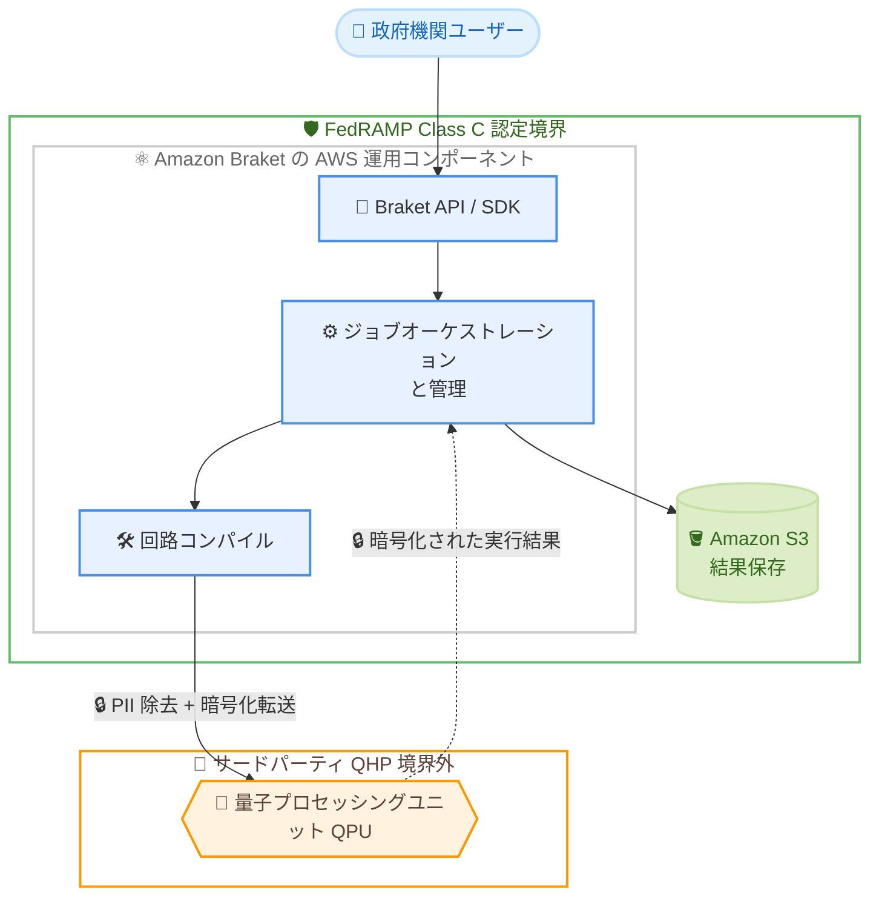

# Amazon Braket - FedRAMP Class C 対応

**リリース日**: 2026 年 10 月 16 日
**サービス**: Amazon Braket
**機能**: FedRAMP Class C スコープへの追加

📊 [このアップデートのインフォグラフィックを見る](https://takech9203.github.io/aws-news-summary/20261016-braket-fedramp-class-c.html)

## 概要

Amazon Braket が、Braket を利用可能な AWS US リージョンにおいて FedRAMP Class C のスコープに含まれるようになりました。FedRAMP (Federal Risk and Authorization Management Program) は、クラウド製品・サービスのセキュリティ評価、認証、継続的モニタリングに対する標準的なアプローチを提供する米国政府全体のプログラムです。今回の対応により、米国政府機関およびその関連組織は、認定された境界内で量子コンピューティングの実験・活用を進められるようになります。

Braket の AWS 運用コンポーネント、具体的には API と SDK、ジョブオーケストレーションと管理、コンパイル、Amazon S3 への結果保存は、FedRAMP 認定境界内に含まれます。一方、実際の量子ワークロードはサードパーティの量子ハードウェアプロバイダー (QHP) 上で実行されるため認定境界外となりますが、QHP に送信されるデータは、個人を特定できる情報 (PII) の除去、転送時および保存時の暗号化、AWS 標準のデータ保持・削除ポリシーへの準拠といった AWS のプライバシー/セキュリティ要件を満たすことが求められます。

なお、AWS の FedRAMP コンプライアンスページによると、FedRAMP の 2026 年統合ルール (CR26) により用語が変更されており、Class C は従来の Moderate ベースライン、Class D は従来の High ベースラインに相当します。AWS US East-West リージョンは Class C で認定されています。

**アップデート前の課題**

FedRAMP 準拠が必須の環境では、Braket の利用に制約がありました。

- 米国政府機関や政府向けサービスを提供する組織は、FedRAMP 認定境界外のサービスである Braket を公式ワークロードで利用することが困難だった
- 量子コンピューティングの検証・研究を行う際に、コンプライアンス要件との整合性を個別に評価する必要があった
- 量子ワークロードに対する公的セクターでの採用に、コンプライアンス面のハードルが存在した

**アップデート後の改善**

今回のアップデートにより、以下が可能になりました。

- 政府機関および政府向け組織が、FedRAMP Class C 認定境界内で Braket の AWS 運用コンポーネントを利用可能になった
- API、SDK、ジョブオーケストレーション、コンパイル、S3 への結果保存が認定境界内で提供されるため、コンプライアンス評価が容易になった
- QHP に送信されるデータについても、PII 除去や暗号化などの AWS セキュリティ要件が適用されることが明確化され、リスク評価の透明性が向上した

## アーキテクチャ図



FedRAMP Class C 認定境界内に Braket の AWS 運用コンポーネント (API/SDK、ジョブオーケストレーション、コンパイル、S3 への結果保存) が含まれ、量子ワークロードの実行のみが境界外のサードパーティ QHP で行われる構成を示しています。QHP へのデータ送信時には PII 除去と暗号化が適用されます。

## サービスアップデートの詳細

### 主要機能

1. **FedRAMP Class C 認定境界内での Braket 運用コンポーネントの提供**
   - Braket API および SDK が認定境界内に含まれる
   - 量子タスク/ジョブのオーケストレーションと管理が認定境界内で実行される
   - 量子回路のコンパイル処理が認定境界内で実行される
   - 実行結果の Amazon S3 への保存が認定境界内で行われる

2. **サードパーティ QHP に対するセキュリティ要件の適用**
   - 量子ワークロード自体は境界外の QHP ハードウェアで実行される
   - QHP に送信されるデータはすべての PII が除去 (匿名化) される。Braket 開発者ガイドによると、回路の処理に必要なコンテンツのみが送信され、AWS アカウント情報は送信されない
   - データは転送時および保存時に暗号化され、処理時のみ復号される
   - QHP は回路処理以外の目的でコンテンツを保存・使用することを許可されていない
   - AWS 標準のデータ保持・削除ポリシーに準拠する

3. **FedRAMP 用語の変更 (CR26) への対応**
   - FedRAMP の 2026 年統合ルール (CR26) により、「FedRAMP Authorized」は「FedRAMP Certified」に名称変更
   - Class C は従来の Moderate ベースライン、Class D は従来の High ベースラインに相当
   - AWS US East-West リージョンは Class C、AWS GovCloud (US) は Class D で認定

## 技術仕様

### FedRAMP 認定境界の内訳

| コンポーネント | 認定境界 | 備考 |
|------|------|------|
| Braket API / SDK | 境界内 | FedRAMP Class C 認定 |
| ジョブオーケストレーション・管理 | 境界内 | FedRAMP Class C 認定 |
| 回路コンパイル | 境界内 | FedRAMP Class C 認定 |
| Amazon S3 への結果保存 | 境界内 | FedRAMP Class C 認定 |
| 量子ワークロード実行 (QHP) | 境界外 | PII 除去、暗号化などの AWS 要件を適用 |

### QHP に適用されるセキュリティ対策

| 項目 | 詳細 |
|------|------|
| 匿名化 | 回路処理に必要なコンテンツのみ送信。AWS アカウント情報は非送信 |
| 暗号化 | 保存時・転送時に暗号化。処理時のみ復号 |
| データ利用制限 | QHP は回路処理以外の目的でのコンテンツ保存・利用が不可 |
| 監査 | ネットワークセキュリティ、アクセス制御、データ保護、物理セキュリティの基準を満たすことを定期的に監査 |
| データ保持 | Braket は 90 日後に量子タスク ID と関連メタデータを自動削除 (S3 内の結果は保持) |

## 設定方法

### 前提条件

1. AWS アカウントを保有し、Amazon Braket が利用可能な US リージョンを使用していること
2. FedRAMP 要件が適用されるワークロードの場合、組織のコンプライアンス担当者による境界の確認を実施すること
3. 結果保存用の Amazon S3 バケットが用意されていること

### 手順

#### ステップ 1: コンプライアンス対象サービスの確認

AWS Services in Scope by Compliance Program ページで、Amazon Braket が FedRAMP のスコープに含まれていることを確認します。

- [AWS Services in Scope by Compliance Program](https://aws.amazon.com/compliance/services-in-scope/)
- [FedRAMP Marketplace](https://marketplace.fedramp.gov/)

#### ステップ 2: コンプライアンスレポートの取得

```bash
# AWS Artifact で利用可能なレポートの一覧を取得
aws artifact list-reports --region us-east-1
```

AWS Artifact から FedRAMP 関連のコンプライアンスアーティファクトをセルフサービスで取得できます。政府機関の担当者は、FedRAMP PMO を通じて完全な認証パッケージをリクエストすることも可能です。

#### ステップ 3: FedRAMP 対応リージョンで Braket を利用

```bash
# 利用可能なデバイスの一覧を確認 (例: バージニア北部リージョン)
aws braket search-devices --filters '[]' --region us-east-1
```

FedRAMP Class C スコープのリージョン (us-east-1、us-west-1、us-west-2) で Braket のデバイスを確認し、量子タスクを実行します。QPU の物理的な所在地と利用可能リージョンは、Braket コンソールの Device Details セクションで確認できます。

## メリット

### ビジネス面

- **公的セクターでの採用加速**: 米国政府機関および政府向けサービスを提供する組織が、認定境界内で量子コンピューティングの検証・活用を開始できる
- **コンプライアンス評価の簡素化**: AWS 運用コンポーネントが FedRAMP Class C 認定境界内にあるため、調達・認可プロセスの負担が軽減される
- **追加コストなし**: AWS の FedRAMP コンプライアンスページによると、FedRAMP 準拠は AWS サービスへの追加コストなしで提供される

### 技術面

- **明確な境界定義**: API/SDK、オーケストレーション、コンパイル、S3 保存という境界内コンポーネントが明示され、リスク評価が容易
- **QHP へのデータ保護**: PII 除去、転送時/保存時の暗号化、処理目的外のデータ利用禁止が適用され、境界外実行のリスクが低減される
- **既存の AWS セキュリティサービスとの統合**: AWS CloudTrail によるログ記録、IAM によるアクセス制御など、既存のセキュリティ運用をそのまま適用できる

## デメリット・制約事項

### 制限事項

- 量子ワークロードの実行自体はサードパーティ QHP 上で行われ、FedRAMP 認定境界外である
- 対象は Braket が利用可能な AWS US リージョン (バージニア北部、北カリフォルニア、オレゴン) に限られる
- Class C は従来の Moderate ベースライン相当であり、High ベースライン (Class D) 相当の要件を持つワークロードには適用できない

### 考慮すべき点

- 境界外の QHP で処理されるデータの取り扱いについて、組織のセキュリティポリシーとの整合性を確認する必要がある
- Braket は 90 日後に量子タスク ID とメタデータを自動削除するため、長期間の参照が必要な場合はタスク ID などの記録を別途保存しておく必要がある
- 機密情報をタグや名前などの自由入力フィールドに入力しないという AWS の一般的なデータ保護推奨事項に従う必要がある

## ユースケース

### ユースケース 1: 政府機関による量子アルゴリズム研究

**シナリオ**: 米国連邦機関の研究部門が、最適化問題に対する量子アルゴリズムの有効性を FedRAMP 準拠環境で検証したい。

**実装例**:
```python
from braket.aws import AwsDevice
from braket.circuits import Circuit

# FedRAMP Class C スコープのリージョンでデバイスを指定
device = AwsDevice("arn:aws:braket:::device/quantum-simulator/amazon/sv1")

# 量子回路を作成して実行
circuit = Circuit().h(0).cnot(0, 1)
task = device.run(circuit, shots=1000)
print(task.result().measurement_counts)
```

**効果**: 認定境界内の API、オーケストレーション、S3 保存を通じて、コンプライアンス要件を満たしながら量子アルゴリズムの研究を実施できる。

### ユースケース 2: 政府向け SIer によるコンプライアンス評価

**シナリオ**: 政府機関向けにクラウドソリューションを提供する SIer が、量子コンピューティングを含む提案のコンプライアンス評価資料を作成する。

**実装例**:
```bash
# AWS Artifact からコンプライアンスレポートを取得し、
# FedRAMP Marketplace で認定状況を確認して提案資料に反映
aws artifact list-reports
```

**効果**: AWS Artifact と FedRAMP Marketplace の公式情報に基づき、認定境界と QHP のデータ保護要件を明示した提案が可能になる。

### ユースケース 3: 規制産業における量子古典ハイブリッドワークロードの検証

**シナリオ**: 政府要件に準拠する必要がある組織が、Braket Hybrid Jobs を用いて量子古典ハイブリッドアルゴリズムを検証する。

**実装例**:
```python
from braket.aws import AwsQuantumJob

# ジョブオーケストレーション (認定境界内) を利用してハイブリッドジョブを実行
job = AwsQuantumJob.create(
    device="arn:aws:braket:::device/quantum-simulator/amazon/sv1",
    source_module="algorithm_script.py",
)
```

**効果**: ジョブオーケストレーションと管理が認定境界内で行われるため、ハイブリッドワークロードについても一貫したコンプライアンス評価が可能になる。

## 料金

今回のアップデートによる料金変更はありません。AWS の FedRAMP コンプライアンスページによると、FedRAMP 準拠は AWS サービスの追加コストなしで提供されます。Amazon Braket の利用料金は、従来どおりシミュレーター/QPU の利用時間やタスク/ショット数に基づいて課金されます。詳細は [Amazon Braket 料金ページ](https://aws.amazon.com/braket/pricing/) を参照してください。

## 利用可能リージョン

FedRAMP Class C のスコープは、Braket が利用可能な以下の AWS US リージョンです。

- 米国東部 (バージニア北部) / us-east-1
- 米国西部 (北カリフォルニア) / us-west-1
- 米国西部 (オレゴン) / us-west-2

## 関連サービス・機能

- **Amazon S3**: 量子タスクの実行結果が保存される。結果保存は FedRAMP 認定境界内で行われる
- **AWS Artifact**: FedRAMP を含むコンプライアンスレポートをセルフサービスで取得できるポータル
- **AWS CloudTrail**: Braket の API 呼び出しとユーザーアクティビティのログ記録に使用
- **AWS IAM / IAM Identity Center**: Braket リソースへの最小権限アクセス制御に使用

## 参考リンク

- 📊 [インフォグラフィック](https://takech9203.github.io/aws-news-summary/20261016-braket-fedramp-class-c.html)
- [公式発表 (What's New)](https://aws.amazon.com/about-aws/whats-new/2026/10/braket-fedramp-class-c/)
- [AWS FedRAMP コンプライアンスプログラム](https://aws.amazon.com/compliance/fedramp/)
- [AWS Services in Scope by Compliance Program](https://aws.amazon.com/compliance/services-in-scope/)
- [Amazon Braket のセキュリティ (開発者ガイド)](https://docs.aws.amazon.com/braket/latest/developerguide/security.html)
- [Amazon Braket ハードウェアプロバイダーのセキュリティ (開発者ガイド)](https://docs.aws.amazon.com/braket/latest/developerguide/third-party-security.html)
- [Amazon Braket のコンプライアンス検証 (開発者ガイド)](https://docs.aws.amazon.com/braket/latest/developerguide/compliance-validation.html)
- [Amazon Braket 製品ページ](https://aws.amazon.com/braket/)
- [Amazon Braket 料金ページ](https://aws.amazon.com/braket/pricing/)

## まとめ

Amazon Braket が FedRAMP Class C (従来の Moderate ベースライン相当) のスコープに含まれたことで、米国政府機関およびその関連組織は、認定境界内で量子コンピューティングの検証・活用を開始できるようになりました。量子ワークロード自体は境界外のサードパーティ QHP で実行されますが、PII 除去や暗号化などの AWS セキュリティ要件が適用されます。FedRAMP 準拠が求められる組織は、AWS Artifact や FedRAMP Marketplace で認定状況を確認した上で、量子コンピューティングの PoC 計画を検討することを推奨します。
