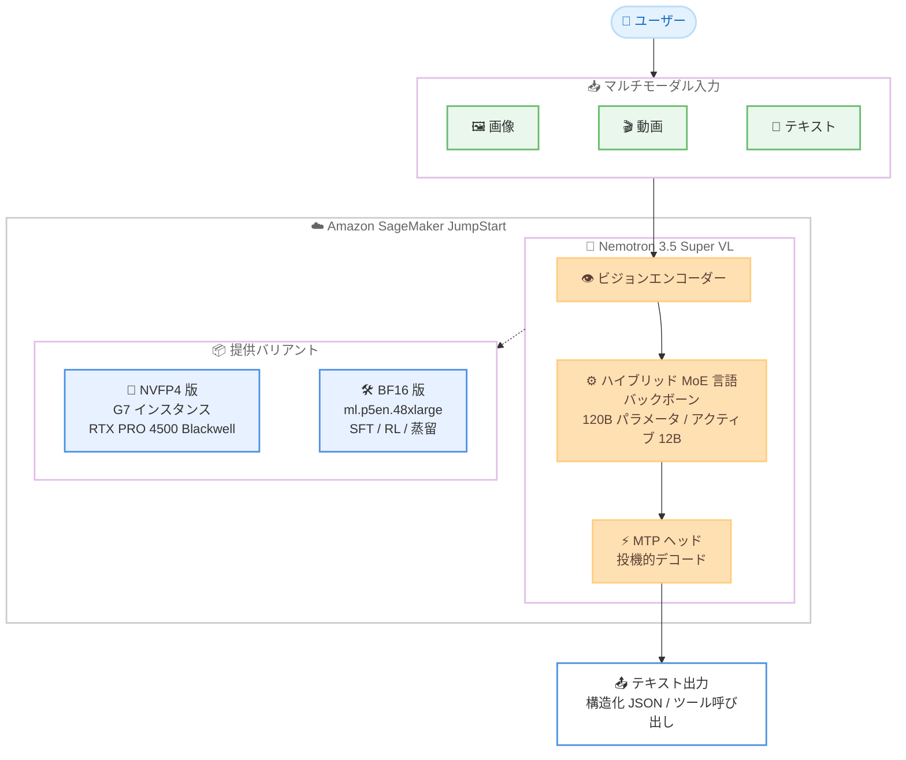

# Amazon SageMaker JumpStart - NVIDIA Nemotron 3.5 Super VL モデルの提供開始

**リリース日**: 2026 年 10 月 16 日
**サービス**: Amazon SageMaker JumpStart
**機能**: NVIDIA Nemotron 3.5 Super VL ビジョン言語モデルの提供

📊 [このアップデートのインフォグラフィックを見る](https://takech9203.github.io/aws-news-summary/20261016-nvidia-nemotron-3.5-super-vl-on-sagemaker-jumpstart.html)

## 概要

NVIDIA の Nemotron 3.5 Super VL が Amazon SageMaker JumpStart で利用可能になりました。このモデルは Nemotron 3.5 ファミリーのビジョン言語モデル (VLM) であり、画像、動画、テキストを入力として受け取り、テキストを生成します。これにより、お客様は AWS インフラストラクチャ上でマルチモーダル AI ソリューションをデプロイできます。

Nemotron 3.5 Super VL は、ドキュメントインテリジェンス、GUI 理解、動画質問応答、マルチモーダルエージェントアプリケーション向けに設計されています。120B パラメータのハイブリッド Mixture-of-Experts (MoE) 言語バックボーン (アクティブパラメータは 12B) とビジョンエンコーダーを組み合わせ、最大 100 万トークンのコンテキスト長をサポートします。また、テキスト生成を高速化する投機的デコード用の Multi-Token Prediction (MTP) ヘッドを内蔵し、リクエストごとに推論 (reasoning) の有効 / 無効を設定できます。

SageMaker JumpStart では 2 つのバリアントが提供されます。NVIDIA RTX PRO 4500 Blackwell Server Edition GPU を搭載した G7 インスタンス向けに最適化された NVFP4 版と、SFT、強化学習、蒸留、ドメイン適応などのカスタマイズに利用できる ml.p5en.48xlarge 向けの BF16 リファレンスウェイト版です。

**アップデート前の課題**

- SageMaker JumpStart で利用できる Nemotron 3.5 ファミリーのモデルはテキスト中心であり、画像や動画を扱うマルチモーダルユースケースには別のモデルや仕組みが必要だった
- ドキュメント、チャート、GUI、動画といった視覚情報とテキストを組み合わせたエージェントワークフローを、単一のオープンモデルで構築することが難しかった
- 長大なドキュメントや動画を扱うには、コンテキスト長の制約が課題となるケースがあった

**アップデート後の改善**

- 画像、動画、テキストを入力できるビジョン言語モデルを SageMaker JumpStart から数クリックでデプロイできるようになった
- 最大 100 万トークンのコンテキスト長により、大規模なドキュメントや長時間の動画を含むユースケースに対応できるようになった
- NVFP4 版による最適化された推論と、BF16 版によるファインチューニングなどのカスタマイズを用途に応じて選択できるようになった

## アーキテクチャ図



Nemotron 3.5 Super VL は、ビジョンエンコーダーで画像や動画を処理し、ハイブリッド MoE 言語バックボーンと MTP ヘッドによる投機的デコードでテキストを生成します。推論最適化向けの NVFP4 版とカスタマイズ向けの BF16 版の 2 つのバリアントから選択できます。

## サービスアップデートの詳細

### 主要機能

1. **マルチモーダル入力対応**
   - 画像、動画、テキストを入力として受け取り、テキストを生成
   - ドキュメントインテリジェンス、GUI 理解、動画質問応答、マルチモーダルエージェントアプリケーション向けに設計
   - 画像、動画、ドキュメント、チャート、GUI データによるマルチモーダル教師ありファインチューニングと、GRPO 強化学習によるポストトレーニングを実施

2. **大規模かつ効率的なモデルアーキテクチャ**
   - 120B パラメータのハイブリッド Mixture-of-Experts (MoE) 言語バックボーンとビジョンエンコーダーの組み合わせ
   - アクティブパラメータは 12B で、パラメータ規模に対して効率的な推論を実現
   - 最大 100 万トークンのコンテキスト長をサポート

3. **高速なテキスト生成と設定可能な推論**
   - 投機的デコード用の Multi-Token Prediction (MTP) ヘッドを内蔵し、テキスト生成を高速化
   - リクエストごとに推論 (reasoning) の有効 / 無効を設定可能
   - 構造化 JSON 出力とツール呼び出しに対応し、エンタープライズエージェントワークフローに適合

4. **多言語サポート**
   - 英語、フランス語、スペイン語、ドイツ語、日本語、ヒンディー語、韓国語、中国語を含む 10 言語をサポート

5. **用途に応じた 2 つのバリアント**
   - NVFP4 版: NVIDIA RTX PRO 4500 Blackwell Server Edition GPU を搭載した G7 インスタンスでの最適化された推論向け
   - BF16 リファレンスウェイト版: ml.p5en.48xlarge での SFT、強化学習、蒸留、ドメイン適応などのカスタマイズ向け

## 技術仕様

### モデル仕様

| 項目 | 詳細 |
|------|------|
| モデル名 | NVIDIA Nemotron 3.5 Super VL |
| モデルタイプ | ビジョン言語モデル (VLM) |
| 入力モダリティ | 画像、動画、テキスト |
| 出力モダリティ | テキスト (構造化 JSON 出力、ツール呼び出しに対応) |
| アーキテクチャ | ハイブリッド MoE 言語バックボーン + ビジョンエンコーダー |
| 総パラメータ数 | 120B (アクティブパラメータ 12B) |
| コンテキスト長 | 最大 100 万トークン |
| 高速化機構 | Multi-Token Prediction (MTP) ヘッドによる投機的デコード |
| 推論 (reasoning) | リクエストごとに設定可能 |
| 対応言語 | 英語、フランス語、スペイン語、ドイツ語、日本語、ヒンディー語、韓国語、中国語を含む 10 言語 |
| ポストトレーニング | マルチモーダル SFT (画像、動画、ドキュメント、チャート、GUI データ) + GRPO 強化学習 |

### 提供バリアント

| バリアント | 推奨インスタンス | 用途 |
|------------|------------------|------|
| NVFP4 | G7 インスタンス (NVIDIA RTX PRO 4500 Blackwell Server Edition GPU) | 最適化された推論 |
| BF16 リファレンスウェイト | ml.p5en.48xlarge | SFT、強化学習、蒸留、ドメイン適応などのカスタマイズ |

## 設定方法

### 前提条件

1. AWS アカウントと SageMaker AI を利用できる IAM 権限
2. Amazon SageMaker Studio のセットアップ、または SageMaker Python SDK を利用できる環境
3. デプロイ先インスタンス (G7 または ml.p5en.48xlarge) のサービスクォータ

### 手順

#### ステップ 1: SageMaker JumpStart モデルカタログでモデルを検索

SageMaker コンソールから SageMaker JumpStart のモデルカタログを開き、「Nemotron 3.5 Super VL」を検索します。モデルカードから詳細情報とデプロイオプションを確認できます。

#### ステップ 2: モデルをデプロイ

コンソールから数クリックでデプロイするか、SageMaker Python SDK を使用してデプロイします。

```python
from sagemaker.jumpstart.model import JumpStartModel

# JumpStart モデル ID を指定してモデルを作成
# (実際のモデル ID は SageMaker JumpStart のモデルカタログで確認してください)
model = JumpStartModel(model_id="<nemotron-3-5-super-vl-model-id>")

# エンドポイントにデプロイ
predictor = model.deploy()
```

SageMaker Python SDK の `JumpStartModel` クラスでモデルを指定し、`deploy()` で推論エンドポイントを作成しています。

#### ステップ 3: 推論リクエストの送信

デプロイしたエンドポイントに対して、画像、動画、テキストを含むマルチモーダルな入力を送信し、テキスト出力を取得します。リクエストごとに推論 (reasoning) の有効 / 無効を設定できます。

## メリット

### ビジネス面

- **マルチモーダル AI の迅速な導入**: SageMaker JumpStart から数クリックでデプロイできるため、ドキュメント処理や動画解析などのマルチモーダルユースケースを短期間で立ち上げられる
- **エージェントワークフローへの適合**: 構造化 JSON 出力とツール呼び出しに対応しており、エンタープライズのエージェントアプリケーションに組み込みやすい
- **多言語対応**: 日本語を含む 10 言語をサポートし、グローバルおよび国内のユースケースに適用できる

### 技術面

- **効率的な推論**: 総パラメータ 120B に対しアクティブパラメータ 12B の MoE 構成と、MTP ヘッドによる投機的デコードにより、高速なテキスト生成が期待できる
- **長大なコンテキスト**: 最大 100 万トークンのコンテキスト長により、大量のドキュメントや長い動画コンテンツを扱える
- **カスタマイズの柔軟性**: BF16 リファレンスウェイト版を使用して、SFT、強化学習、蒸留、ドメイン適応といったカスタマイズが可能

## デメリット・制約事項

### 制限事項

- 出力はテキストのみであり、画像や動画の生成には対応していない
- NVFP4 版の推論には G7 インスタンス、BF16 版のカスタマイズには ml.p5en.48xlarge が推奨されており、利用にはこれらのインスタンスのクォータ確保が必要
- 公式発表では利用可能リージョンが明示されていないため、利用予定のリージョンでモデルと対象インスタンスが利用可能か確認が必要

### 考慮すべき点

- 推論エンドポイントは稼働時間に応じて課金されるため、利用パターンに応じたエンドポイント管理 (スケーリングや停止) が必要
- 大規模なコンテキストを利用する場合、レイテンシーとコストへの影響を事前に検証することが望ましい
- カスタマイズ (SFT、RL、蒸留など) を行う場合は、学習データの準備と評価プロセスの設計が必要

## ユースケース

### ユースケース 1: ドキュメントインテリジェンス

**シナリオ**: 請求書、契約書、帳票などのスキャン画像や PDF から情報を抽出し、業務システムに連携したい。

**実装例**:
```
1. SageMaker JumpStart から NVFP4 版をデプロイ
2. ドキュメント画像とプロンプトをエンドポイントに送信
3. 構造化 JSON 出力で項目を抽出し、後続システムに連携
```

**効果**: ドキュメント、チャート、GUI データでポストトレーニングされたモデルにより、視覚的なドキュメントからの構造化データ抽出を単一モデルで実現できる。

### ユースケース 2: 動画質問応答

**シナリオ**: 製品説明動画や会議録画などの動画コンテンツに対して、内容の要約や質問応答を行いたい。

**実装例**:
```
1. 動画とテキストの質問をエンドポイントに送信
2. 最大 100 万トークンのコンテキストを活用して長い動画を処理
3. 回答テキストをアプリケーションに表示
```

**効果**: 動画の内容を理解した質問応答や要約が可能になり、動画アーカイブの活用度が向上する。

### ユースケース 3: GUI 理解を活用したマルチモーダルエージェント

**シナリオ**: アプリケーション画面のスクリーンショットを理解し、操作手順の案内や自動化を行うエージェントを構築したい。

**実装例**:
```
1. 画面キャプチャとタスク指示をモデルに入力
2. ツール呼び出しと構造化 JSON 出力で次のアクションを決定
3. リクエストごとに推論を有効化し、複雑なタスクの精度を向上
```

**効果**: GUI 理解とツール呼び出しに対応したモデルにより、画面操作を伴うエージェントワークフローを構築できる。

## 料金

SageMaker JumpStart のモデルデプロイでは、推論エンドポイントに使用するインスタンス (本モデルの場合は G7 インスタンスまたは ml.p5en.48xlarge) の稼働時間に応じた SageMaker AI の料金が発生します。詳細は [Amazon SageMaker AI の料金ページ](https://aws.amazon.com/sagemaker-ai/pricing/) を参照してください。

## 利用可能リージョン

公式発表では利用可能リージョンは明示されていません。SageMaker JumpStart のモデルカタログで、利用予定のリージョンにおけるモデルおよび対象インスタンス (G7、ml.p5en.48xlarge) の提供状況を確認してください。

## 関連サービス・機能

- **Amazon SageMaker JumpStart**: 基盤モデルのカタログからモデルを検索し、数クリックでデプロイできる機能。本モデルの提供基盤
- **Amazon SageMaker AI 推論エンドポイント**: デプロイしたモデルをホストし、リアルタイム推論を提供
- **Amazon SageMaker Studio**: モデルの検索、デプロイ、カスタマイズを行う統合開発環境
- **Amazon EC2 G7 / P5en インスタンス**: 本モデルの推論およびカスタマイズに使用される GPU インスタンス

## 参考リンク

- 📊 [インフォグラフィック](https://takech9203.github.io/aws-news-summary/20261016-nvidia-nemotron-3.5-super-vl-on-sagemaker-jumpstart.html)
- [公式発表 (What's New)](https://aws.amazon.com/about-aws/whats-new/2026/01/nvidia-nemotron-3.5-super-vl-on-sagemaker-jumpstart/)
- [Amazon SageMaker JumpStart ドキュメント](https://docs.aws.amazon.com/sagemaker/latest/dg/studio-jumpstart.html)
- [Amazon SageMaker AI 料金ページ](https://aws.amazon.com/sagemaker-ai/pricing/)

## まとめ

NVIDIA Nemotron 3.5 Super VL の SageMaker JumpStart 提供により、画像、動画、テキストを扱うマルチモーダル AI ソリューションを AWS 上で容易にデプロイできるようになりました。最大 100 万トークンのコンテキスト長、構造化 JSON 出力、ツール呼び出し、日本語を含む 10 言語対応など、エンタープライズエージェントワークフローに適した特徴を備えています。マルチモーダルなユースケースを検討している場合は、SageMaker JumpStart のモデルカタログから NVFP4 版での推論検証を開始し、必要に応じて BF16 版でのカスタマイズを検討することを推奨します。
