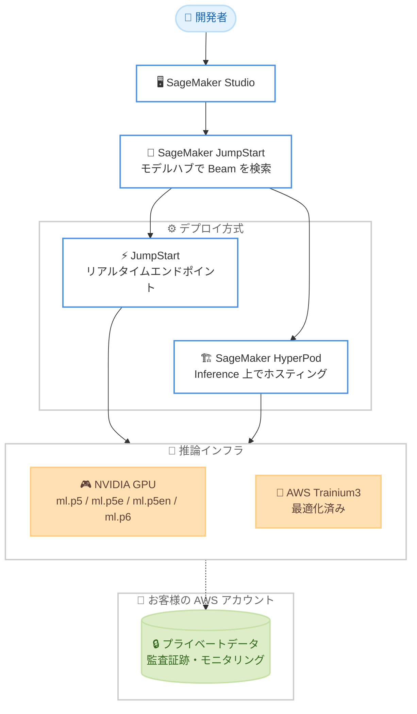

# Amazon SageMaker JumpStart - Reflection 社の Beam モデルが利用可能に (AWS Trainium 対応)

**リリース日**: 2026 年 10 月 16 日
**サービス**: Amazon SageMaker JumpStart / Amazon SageMaker AI / AWS Trainium
**機能**: Reflection 社のオープンウェイトモデル Beam の提供開始

📊 [このアップデートのインフォグラフィックを見る](https://takech9203.github.io/aws-news-summary/20261016-reflection-beam-on-sagemaker-jumpstart-and-aws-trainium.html)

## 概要

米国の AI 企業 Reflection が提供する初のオープンウェイトモデル「Beam」が、Amazon SageMaker AI のモデルハブである Amazon SageMaker JumpStart で利用可能になりました。Reflection によると、Beam は同クラスのオープンウェイトモデルの中でフロンティア水準の性能を持ち、推論 (reasoning)、コーディング、エージェント系ベンチマークで高い性能を発揮します。お客様はデータとインフラストラクチャの管理権を保持したまま、高度なコーディングエージェントや自動化ワークフローを構築できます。

Beam は Apache 2.0 ライセンスで公開されており、モデルの中身を検査・カスタマイズした上で、自社の AWS アカウント内で実行できます。データはプライベートに保たれ、AWS の既存のセキュリティ・コンプライアンス機能で保護されます。さらに、Beam は AWS Trainium3 向けに移植・最適化されており、初日から高性能かつコスト効率の高いデプロイ・スケーリングの選択肢が提供されます。

AWS/Beam launch blog によると、Beam 1.0 は総パラメータ数 5,010 億、トークンあたりのアクティブパラメータ数 230 億のスパース Mixture-of-Experts (MoE) モデルで、実効コンテキスト長は 100 万トークンとされています。

**アップデート前の課題**

- フロンティア級の AI モデルの多くはプロプライエタリな API 経由でのみ利用可能で、モデルの重みやパイプラインに対する可視性・制御性が限られていた
- 機密性の高いデータを扱う組織では、外部 API にデータを送信することがセキュリティ・コンプライアンス上の障壁となっていた
- オープンウェイトモデルを本番規模で運用するには、サービングインフラの構築・運用に大きな労力が必要だった

**アップデート後の改善**

- フロンティア水準のオープンウェイトモデルを自社の AWS アカウント内で実行でき、データとインフラストラクチャを完全に管理下に置ける
- SageMaker AI に組み込まれた統制、監査証跡、モニタリングをそのまま利用し、本番需要に合わせてスケールできる
- Apache 2.0 ライセンスによりモデルの検査・カスタマイズ (ビジネスへの適応) が可能
- AWS Trainium3 向けの最適化により、コスト効率の高いデプロイ選択肢が初日から利用できる

## アーキテクチャ図



SageMaker JumpStart から Beam をデプロイする際の選択肢を示しています。リアルタイムエンドポイントまたは SageMaker HyperPod Inference 上でホスティングし、NVIDIA GPU インスタンスまたは AWS Trainium3 を推論基盤として利用できます。すべてお客様自身の AWS アカウント内で実行されます。

## サービスアップデートの詳細

### 主要機能

1. **フロンティア水準のオープンウェイトモデル**
   - Reflection 初のオープンウェイトモデルで、推論、コーディング、エージェント系ベンチマークで高い性能を発揮 (Reflection 発表による)
   - 総パラメータ数 5,010 億、アクティブパラメータ数 230 億のスパース MoE アーキテクチャ
   - 実効コンテキスト長は 100 万トークン (Reflection 発表による)
   - BF16、FP8、NVFP4 の 3 種類のチェックポイントバリアントを提供

2. **SageMaker JumpStart からの簡単なデプロイ**
   - Amazon SageMaker Studio 内の JumpStart で「Beam」を検索してデプロイ可能
   - 既存の SageMaker AI 上の他モデルと並行して運用でき、本番需要に合わせてスケール
   - SageMaker AI の統制、監査証跡、モニタリングがすべてのデプロイに組み込み済み
   - SageMaker HyperPod Inference 上でのホスティング (AWS 管理コンテナ、または SGLang / vLLM による自己管理サービング) にも対応

3. **AWS Trainium3 への移植・最適化**
   - Beam は AWS Trainium3 向けに移植・最適化済み
   - 高性能かつコスト効率の高いデプロイ・スケーリングの選択肢を初日から提供

4. **Apache 2.0 ライセンスによるオープン性**
   - モデルの重みは Hugging Face 上で Apache 2.0 ライセンスで公開
   - モデルの検査・カスタマイズが可能で、自社ビジネスへの適応ができる
   - 自社 AWS アカウント内での実行によりデータのプライバシーと管理権を確保

## 技術仕様

### モデル仕様

| 項目 | 詳細 |
|------|------|
| モデル名 | Beam 1.0 |
| 提供元 | Reflection (米国) |
| アーキテクチャ | スパース Mixture-of-Experts (MoE) |
| 総パラメータ数 | 5,010 億 |
| アクティブパラメータ数 | 230 億 / トークン |
| 実効コンテキスト長 | 100 万トークン (Reflection 発表による) |
| チェックポイント | BF16 / FP8 / NVFP4 |
| ライセンス | Apache 2.0 |

### 推奨インスタンスタイプ (launch blog による)

| バリアント | インスタンスタイプ |
|------------|--------------------|
| FP8 | ml.p5.48xlarge (H100)、ml.p5e.48xlarge / ml.p5en.48xlarge (H200) |
| NVFP4 | ml.p6-b200.48xlarge (B200) |
| BF16 | メモリフットプリントが最大。十分な GPU メモリ合計を持つマルチノード構成が必要 |

このほか、What's New によると AWS Trainium3 向けにも移植・最適化されています。

## 設定方法

### 前提条件

1. AWS アカウントと、IAM、ネットワーク、ストレージに関する適切な権限
2. モデル利用条件への同意
3. 対象インスタンスタイプのサービスクォータと容量の確保
4. (CLI/SDK でのデプロイの場合) AWS CLI と Python 3.11 以上

### 手順

#### ステップ 1: SageMaker Studio で Beam を検索

Amazon SageMaker Studio を開き、SageMaker JumpStart で「Beam」を検索します。モデルカードから数クリックでエンドポイントをデプロイできます。

#### ステップ 2: サンプルコードでデプロイ (CLI の場合)

```bash
git clone https://github.com/aws-samples/sagemaker-genai-hosting-examples.git
cd sagemaker-genai-hosting-examples/01-models/ReflectionAI/Beam-1.0-501B-A23B-NVFP4/
python3 -m venv .venv && source .venv/bin/activate
python -m pip install -r requirements.txt
python jumpstart_real_time.py --variant fp8 --endpoint-name reflection-beam-fp8-smoke
```

AWS 公式サンプルリポジトリを取得し、Python 仮想環境を作成して依存関係をインストールした後、JumpStart リアルタイムエンドポイントとして Beam (FP8 バリアント) をデプロイします。スクリプトはテストリクエストを送信して応答を表示し、リソースをクリーンアップします。バリアントは `bf16`、`fp8`、`nvfp4` (デフォルト) から選択できます。

#### ステップ 3: SageMaker HyperPod Inference でのデプロイ (オプション)

```bash
cd sagemaker-genai-hosting-examples/SageMakerHyperpod/reflection-beam/
cp config/deployment.env.example config/deployment.env
cp config/release.env.example config/release.env
python hyperpod_tool.py --config config/deployment.env --config config/release.env validate sglang
python hyperpod_tool.py --config config/deployment.env --config config/release.env deploy sglang --timeout-seconds 1800
```

HyperPod クラスター上に SGLang サービングで Beam をデプロイします。`sglang` の代わりに `vllm` や `jumpstart` を指定することもできます。設定ファイルを検証した上でデプロイを実行し、`smoke` サブコマンドでヘルスチェックと短いテストリクエストを実行できます (推奨初期サンプリング設定: temperature 1.0、top-p 0.7)。

## メリット

### ビジネス面

- **データ主権の確保**: モデルを自社 AWS アカウント内で実行するため、データが外部に出ることなく、既存の AWS セキュリティ・コンプライアンス機能で保護される
- **ベンダーロックインの回避**: Apache 2.0 ライセンスのオープンウェイトモデルであり、API 経由の「借用」ではなくモデル自体を管理・適応できる
- **ミッションクリティカルな用途への適用**: 公共機関や規制業種でも、クライアント固有のセキュリティと統制の下で高度な AI をデプロイできる (Accenture Federal Services のコメントによる)

### 技術面

- **運用の一貫性**: 既に SageMaker AI で利用中の他モデルと並行して運用でき、同じ統制、監査証跡、モニタリングを利用できる
- **コスト効率の選択肢**: AWS Trainium3 向け最適化により、GPU 以外の高性能・低コストな推論基盤を初日から選択できる
- **柔軟なサービング方式**: JumpStart のマネージドエンドポイントから、HyperPod 上での SGLang / vLLM による完全な自己管理サービングまで、要件に応じて選択できる

## デメリット・制約事項

### 制限事項

- 初期提供リージョンは米国東部 (バージニア北部) と米国東部 (オハイオ) の 2 リージョンのみで、東京リージョンでは利用できない
- 5,010 億パラメータの大規模モデルであり、ml.p5 / ml.p6 系などの大型インスタンスが必要となる (BF16 はマルチノード構成が必要)
- 大型 GPU インスタンスのサービスクォータと容量の確保が前提となる

### 考慮すべき点

- 大型インスタンスを常時稼働させるとコストが高額になるため、検証後は不要なエンドポイントを削除するなどコスト管理が重要
- ベンチマーク性能に関する記述は Reflection 社の発表に基づくため、自社ユースケースでの評価を実施することが推奨される
- チェックポイントバリアント (BF16 / FP8 / NVFP4) により必要なインスタンスタイプと精度特性が異なるため、要件に応じた選定が必要

## ユースケース

### ユースケース 1: ソフトウェア開発の自動化 (コーディングエージェント)

**シナリオ**: エンジニアリングチームが、ソフトウェアの issue 解決、コードの生成・レビュー、定型的な運用作業の自動化を社内環境で実現したい。

**実装例**:
```
1. SageMaker JumpStart から Beam をリアルタイムエンドポイントとしてデプロイ
2. 社内の CI/CD パイプラインや issue トラッカーからエンドポイントを呼び出し
3. コードレビューコメントの生成、修正パッチの提案、運用タスクの自動化を実行
```

**効果**: ソースコードを外部 API に送信することなく、フロンティア水準のコーディング支援を社内インフラ上で利用できる。

### ユースケース 2: 多段階ツール連携による複雑なワークフロー自動化

**シナリオ**: 多数のステップとツールにまたがる複雑な業務ワークフロー (データ収集、分析、レポート生成など) をエージェントで自動化したい。

**実装例**:
```
1. HyperPod Inference 上に Beam をデプロイし、OpenAI 互換インターフェイス経由で接続
2. エージェントフレームワークから Beam をツール呼び出し可能な推論エンジンとして利用
3. 100 万トークンの実効コンテキストを活かし、長大なドキュメントや履歴を扱うワークフローを構築
```

**効果**: 長いコンテキストを要する多段階ワークフローを、自社管理の推論基盤上で安定して実行できる。

### ユースケース 3: 規制業種・公共機関でのセキュアな AI 活用

**シナリオ**: 政府機関や金融機関が、データを自社環境から出さずに高度な数学・科学的推論や文書処理を行いたい。

**実装例**:
```
1. 自社 AWS アカウント内の VPC に閉じた構成で Beam エンドポイントをデプロイ
2. モデルの重み、データ、パイプラインを完全に可視化・監査可能な状態で運用
3. 必要に応じて Apache 2.0 ライセンスの下でモデルをミッション要件に合わせてカスタマイズ
```

**効果**: モデルのオープン性とマネージドインフラの組み合わせにより、クライアント固有のセキュリティ要件を満たしながら高度な AI を展開できる。

## 料金

Beam 自体のモデル利用に関する個別の料金は発表されていません。SageMaker AI のエンドポイントで使用するインスタンス (ml.p5 / ml.p5e / ml.p5en / ml.p6 系など) の稼働時間に応じた SageMaker AI の標準料金が発生します。大型 GPU インスタンスは高額なため、検証後は不要なリソースを削除してください。詳細は [Amazon SageMaker AI 料金ページ](https://aws.amazon.com/sagemaker/ai/pricing/) を参照してください。

## 利用可能リージョン

Amazon SageMaker JumpStart での初期提供リージョンは以下の 2 リージョンです。

- 米国東部 (バージニア北部) - us-east-1
- 米国東部 (オハイオ) - us-east-2

## 関連サービス・機能

- **Amazon SageMaker JumpStart**: 事前学習済みモデルのハブ。Beam を数クリックでデプロイ可能
- **Amazon SageMaker HyperPod**: 大規模モデルの学習・推論向けクラスター。Inference 機能で Beam のホスティングに対応
- **AWS Trainium3**: AWS 設計の機械学習アクセラレータ。Beam が移植・最適化されており、コスト効率の高い推論基盤として利用可能
- **Amazon Bedrock**: マネージド API 経由で基盤モデルを利用するサービス。モデルの重みを直接管理したい場合は SageMaker JumpStart、API 利用で十分な場合は Bedrock という使い分けが可能

## 参考リンク

- 📊 [インフォグラフィック](https://takech9203.github.io/aws-news-summary/20261016-reflection-beam-on-sagemaker-jumpstart-and-aws-trainium.html)
- [公式発表 (What's New)](https://aws.amazon.com/about-aws/whats-new/2026/01/reflection-beam-on-sagemaker-jumpstart-and-aws-trainium/)
- [AWS Blog: Introducing Reflection Beam, an open weight model for agentic coding on AWS](https://aws.amazon.com/blogs/machine-learning/introducing-reflection-beam-an-open-weight-model-for-agentic-coding-on-aws/)
- [SageMaker AI ドキュメント](https://docs.aws.amazon.com/sagemaker/)
- [SageMaker JumpStart ドキュメント](https://docs.aws.amazon.com/sagemaker/latest/dg/studio-jumpstart.html)
- [サンプルコード (GitHub)](https://github.com/aws-samples/sagemaker-genai-hosting-examples)

## まとめ

フロンティア水準のオープンウェイトモデル Beam が SageMaker JumpStart で利用可能になり、データとインフラストラクチャを自社管理下に置いたままエージェント型コーディングや複雑なワークフロー自動化を実現できるようになりました。AWS Trainium3 への最適化によりコスト効率の高い選択肢も用意されています。コーディングエージェントの内製化やセキュアな AI 活用を検討している場合は、まず us-east-1 / us-east-2 で JumpStart からデプロイし、自社ユースケースでの性能とコストを評価することを推奨します。
