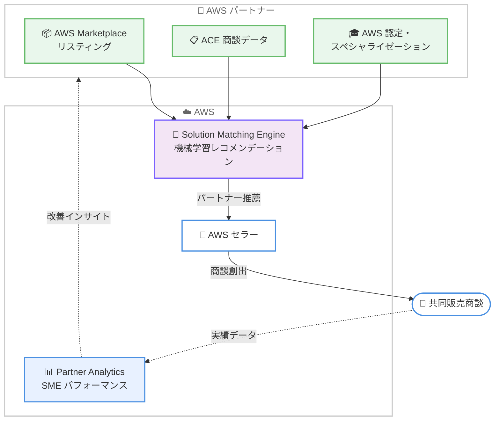

# AWS Partner Central - Solution Matching Engine パフォーマンスインサイト

**リリース日**: 2026 年 10 月 17 日
**サービス**: AWS Partner Central
**機能**: Solution Matching Engine (SME) パフォーマンスインサイト

📊 [このアップデートのインフォグラフィックを見る](https://takech9203.github.io/aws-news-summary/20261017-solution-matching-engine-performance.html)

## 概要

AWS Partner Central の Partner Analytics に、Solution Matching Engine (SME) のパフォーマンスを可視化する新しいセクションが追加されました。SME は、AWS のセラーが各アカウントや商談に最適なパートナーおよび AWS Marketplace リスティングを発見するための機械学習ベースのレコメンデーションシステムです。今回のアップデートにより、パートナーは SME が自社の共同販売 (co-sell) パイプラインにどの程度貢献しているかを定量的に把握できるようになります。

新しい「Solution Matching Engine performance」セクションでは、レコメンデーション数、SME 起因の商談数、AWS 起点の商談に占める割合、ストール率 (停滞率)、SME に起因するパイプライン金額などの指標を確認できます。さらに、レコメンデーションタイプや AWS Marketplace リスティングによるフィルタリング、リージョン・業界・セグメント別の上位顧客プロファイルの分析も可能です。

本機能は、APN Customer Engagements (ACE) の利用資格を持つすべてのパートナーが対象で、Partner Analytics 配下の「Opportunity pipeline analysis」ページから利用できます。

**アップデート前の課題**

- 以前は SME が自社の co-sell パイプラインにどの程度貢献しているかを定量的に確認する手段がなかった
- SME のレコメンデーションが商談にどれだけつながったかを把握できず、リスティング改善の効果測定が困難だった
- どのリージョン・業界・セグメントの顧客に自社ソリューションが推薦されているかが見えなかった

**アップデート後の改善**

- SME のレコメンデーション数、SME 起因の商談数、パイプライン金額などを Partner Analytics 上で確認できるようになった
- レコメンデーションタイプや AWS Marketplace リスティング単位でのフィルタリングにより、リスティングごとの効果を分析できるようになった
- リージョン・業界・セグメント別の上位顧客プロファイルを把握し、リスティングや商談情報の改善ポイントを特定できるようになった

## アーキテクチャ図



パートナーのリスティング情報や ACE 商談データをもとに SME が AWS セラーへレコメンデーションを提供し、その成果が Partner Analytics の新しいパフォーマンスセクションでパートナーにフィードバックされる流れを示しています。

## サービスアップデートの詳細

### 主要機能

1. **SME パフォーマンス指標の可視化**
   - レコメンデーション数: SME が AWS セラーに自社を推薦した回数
   - SME 起因の商談数: レコメンデーションから実際に創出された商談数
   - AWS 起点商談に占める割合: AWS 起点 (AWS-originated) の商談のうち SME に起因する割合
   - ストール率: SME 起因の商談が停滞している割合
   - SME 起因のパイプライン金額: SME が貢献したパイプラインの規模

2. **フィルタリング機能**
   - レコメンデーションタイプによる絞り込み
   - AWS Marketplace リスティング単位での絞り込み
   - リスティングごとの SME パフォーマンス比較が可能

3. **顧客プロファイル分析**
   - リージョン別の上位顧客プロファイル
   - 業界別の上位顧客プロファイル
   - セグメント別の上位顧客プロファイル
   - どのような顧客層に自社ソリューションが推薦されているかを把握可能

## 技術仕様

### Solution Matching Engine の仕組み

SME は 2025 年に導入された機械学習ベースのレコメンデーションシステムで、以下のデータソースを活用して AWS セラーに最適なパートナーとリスティングを推薦します。

| データソース | 内容 |
|------|------|
| リスティング詳細 | 解決する顧客課題、ユースケース、統合されている AWS サービス |
| 検証済みの専門性 | AWS スペシャライゼーション、AWS 認定資格 |
| 顧客エンゲージメントシグナル | ACE レコードの商談ステージと成果 |

### 利用条件

| 項目 | 詳細 |
|------|------|
| 対象パートナー | APN Customer Engagements (ACE) の利用資格を持つすべてのパートナー |
| 表示場所 | AWS Partner Central > Partner Analytics > Opportunity pipeline analysis ページ |
| 対象リスティング | AWS Marketplace のソフトウェア製品およびコンサルティングパートナーのプロフェッショナルサービス |

## 設定方法

### 前提条件

1. AWS Partner Central のアカウントを保有していること
2. APN Customer Engagements (ACE) の利用資格を持っていること
3. Partner Analytics へのアクセス権限を持つユーザーロールが割り当てられていること

### 手順

#### ステップ 1: Partner Central にサインイン

AWS Partner Central (https://partnercentral.awspartner.com/) にサインインします。Partner Analytics へのアクセス権限を持つロールでのサインインが必要です。

#### ステップ 2: Opportunity pipeline analysis ページへ移動

Partner Analytics メニューから「Opportunity pipeline analysis」ページを開きます。このページ内に新しい「Solution Matching Engine performance」セクションが表示されます。

#### ステップ 3: 指標の確認とフィルタリング

レコメンデーション数、SME 起因の商談数、ストール率などの指標を確認します。レコメンデーションタイプや AWS Marketplace リスティングでフィルタリングし、リージョン・業界・セグメント別の上位顧客プロファイルを分析します。

## メリット

### ビジネス面

- **co-sell 戦略の効果測定**: SME 経由で創出された商談とパイプライン金額を定量的に把握でき、AWS との共同販売戦略の ROI を評価できる
- **リスティング改善の優先順位付け**: リスティングごとのパフォーマンスを比較し、どのリスティングを改善すべきかをデータに基づいて判断できる
- **ターゲット市場の把握**: リージョン・業界・セグメント別の顧客プロファイルから、自社ソリューションが刺さる市場を特定できる

### 技術面

- **追加設定不要**: ACE 利用資格を持つパートナーであれば、Partner Analytics 上で自動的に利用可能
- **既存ワークフローとの統合**: 既存の Opportunity pipeline analysis ページ内に統合されており、他のパイプライン指標と合わせて分析できる
- **フィードバックループの確立**: リスティング改善 → SME での可視性向上 → 商談増加という改善サイクルをデータで回せる

## デメリット・制約事項

### 制限事項

- APN Customer Engagements (ACE) の利用資格を持つパートナーのみが対象
- SME の対象は AWS Marketplace に掲載されたリスティングであり、Marketplace 未掲載のソリューションは分析対象外
- 表示される指標の種類は AWS が提供する範囲に限られ、カスタム指標の定義はできない

### 考慮すべき点

- SME のレコメンデーション品質は、リスティング情報や ACE 商談データの正確性・鮮度に依存するため、日頃からのデータメンテナンスが重要
- ストール率が高い場合、商談情報の更新漏れか実際の停滞かを切り分ける運用が必要
- インサイトを活かすには、リスティング内容の改善 (顧客課題、ユースケース、統合 AWS サービスの明記) まで実施する必要がある

## ユースケース

### ユースケース 1: Marketplace リスティングの改善効果の検証

**シナリオ**: ISV パートナーがリスティングの説明文やユースケース記載を刷新し、SME 上での可視性向上を狙う。

**実装例**:
```
1. 改善前の SME パフォーマンス指標 (レコメンデーション数、SME 起因商談数) を記録
2. リスティングの顧客課題・ユースケース・統合 AWS サービスを具体的に記述し直す
3. 一定期間後に Partner Analytics で同指標を再確認し、改善効果を比較
```

**効果**: リスティング改善の効果をレコメンデーション数や商談数の変化として定量的に検証できる。

### ユースケース 2: 重点市場の特定と営業リソース配分

**シナリオ**: コンサルティングパートナーが、どのリージョン・業界で自社サービスが AWS セラーに推薦されているかを把握し、営業リソースを最適配分したい。

**実装例**:
```
1. SME パフォーマンスセクションで上位顧客プロファイルをリージョン・業界・セグメント別に確認
2. 推薦が多いが商談化率が低い市場を特定
3. 該当市場向けの事例やスペシャライゼーション取得を強化
```

**効果**: データに基づいた市場選定により、AWS との co-sell 活動の成約率向上が期待できる。

### ユースケース 3: 停滞商談の改善による co-sell パイプラインの健全化

**シナリオ**: パートナーの SME 起因商談のストール率が高く、パイプラインの健全性に課題がある。

**実装例**:
```
1. ストール率とリスティング別フィルタで停滞が多いリスティングを特定
2. ACE レコードの商談ステージ、次のアクション、収益情報を最新化
3. CRM 連携でデータ更新を定常運用化し、ストール率の推移をモニタリング
```

**効果**: 商談データの鮮度向上により SME のレコメンデーション品質も向上し、AWS セラーからの信頼と推薦機会の増加につながる。

## 料金

AWS Partner Central および Partner Analytics の利用に追加料金は発生しません。本機能は APN Customer Engagements (ACE) の利用資格を持つパートナーに無料で提供されます。

## 利用可能リージョン

AWS Partner Central はグローバルに提供されるサービスであり、ACE 利用資格を持つすべてのパートナーが利用できます。

## 関連サービス・機能

- **AWS Marketplace**: SME のレコメンデーション対象となるリスティングを掲載するマーケットプレイス。リスティングの品質が SME での可視性に直結する
- **APN Customer Engagements (ACE)**: AWS との共同販売商談を管理する仕組み。商談データが SME の学習シグナルおよび本機能の分析対象となる
- **AI-assisted product listing**: 2026 年 6 月に発表された Partner Central の機能。Web サイトや PDF などからリスティング内容を生成・改善でき、SME での可視性向上に活用できる

## 参考リンク

- 📊 [インフォグラフィック](https://takech9203.github.io/aws-news-summary/20261017-solution-matching-engine-performance.html)
- [公式発表 (What's New)](https://aws.amazon.com/about-aws/whats-new/2026/10/solution-matching-engine-performance)
- [AWS Blog: Solution Matching Engine: Your Gateway to AWS Sellers](https://aws.amazon.com/blogs/apn/solution-matching-engine-your-gateway-to-aws-sellers/)
- [AWS Partner Central](https://partnercentral.awspartner.com/)

## まとめ

AWS Partner Central の Partner Analytics に Solution Matching Engine のパフォーマンス指標が追加され、パートナーは SME が co-sell パイプラインにもたらす貢献を定量的に把握できるようになりました。ACE 利用資格を持つパートナーは、まず Opportunity pipeline analysis ページで自社の SME 指標を確認し、レコメンデーション数や商談化率が低いリスティングの情報改善と ACE 商談データの最新化から着手することを推奨します。
