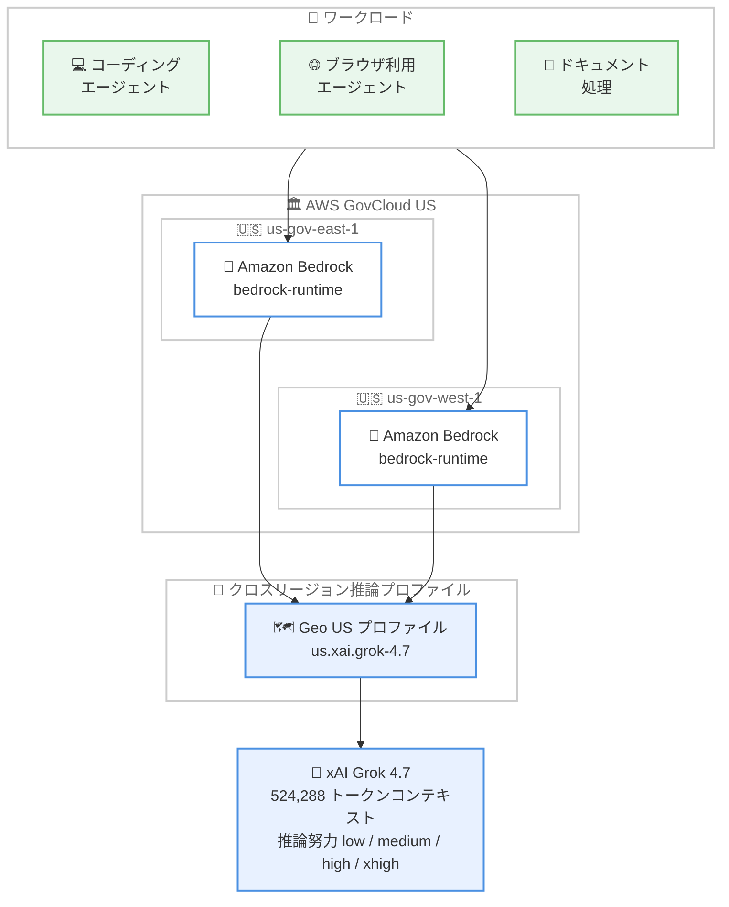

# Amazon Bedrock - Grok 4.7 が AWS GovCloud (US) で利用可能に

**リリース日**: 2026 年 10 月 19 日
**サービス**: Amazon Bedrock
**機能**: xAI Grok 4.7 の AWS GovCloud (US) 対応

📊 [このアップデートのインフォグラフィックを見る](https://takech9203.github.io/aws-news-summary/20261019-amazon-bedrock-grok-4-7-govcloud.html)

## 概要

Amazon Bedrock において、xAI のフロンティアモデル Grok 4.7 が AWS GovCloud (US) で利用可能になった。Grok 4.7 はコーディング、エージェントタスク、ナレッジワーク向けに構築されたモデルであり、GovCloud (US) の Amazon Bedrock コンソールまたは対応する Bedrock API から利用できる。

Grok 4.7 は前世代の Grok 4.6 をベースに、混在ドキュメントの処理精度の向上、計画立案とエラー回復を含むリポジトリ規模のコーディングの信頼性向上、フォーム入力やポータル操作を行うブラウザ利用エージェントの強化が図られている。524,288 トークンのコンテキストウィンドウ (入出力で共有) を持ち、テキストと画像の入力、設定可能な推論努力レベル (low / medium / high / xhigh) をサポートする。

政府機関や規制産業など、AWS GovCloud (US) でのワークロード実行を要件とする組織にとって、商用リージョンと同等のフロンティアモデルをコンプライアンス境界内で利用できるようになった点が今回のポイントである。

**アップデート前の課題**

- 以前は Grok 4.7 は商用リージョン (米国 Geo および Global のクロスリージョン推論) でのみ提供されており、AWS GovCloud (US) では利用できなかった
- 以前は GovCloud を利用する政府機関や規制産業の組織が、コーディングエージェントや長時間実行エージェント向けの最新フロンティアモデルを選択しにくかった
- 以前は GovCloud 環境で Grok 系モデルを使うワークロードの設計やモデル比較検証ができなかった

**アップデート後の改善**

- 今回のアップデートにより、us-gov-east-1 と us-gov-west-1 の両 GovCloud リージョンから Grok 4.7 を呼び出せるようになった
- 今回のアップデートにより、GovCloud のコンプライアンス要件を満たしながら、リポジトリ規模のコーディングやブラウザ利用エージェントなどの高度なエージェントワークロードを構築できるようになった
- 今回のアップデートにより、GovCloud の Bedrock コンソールおよび Converse / Invoke / Responses / Chat Completions の各 API から商用リージョンと同じモデル体験を利用できるようになった

## アーキテクチャ図



AWS GovCloud (US) の 2 リージョンから、米国 Geo クロスリージョン推論プロファイル `us.xai.grok-4.7` を指定して Grok 4.7 を呼び出す構成を示している。

## サービスアップデートの詳細

### 主要機能

1. **AWS GovCloud (US) での Grok 4.7 提供**
   - us-gov-east-1 (AWS GovCloud 米国東部) と us-gov-west-1 (AWS GovCloud 米国西部) で利用可能
   - Geo (US) クロスリージョン推論プロファイル `us.xai.grok-4.7` を指定して呼び出す (In-Region 推論と Global プロファイルは非対応)
   - GovCloud の Bedrock コンソール (console.amazonaws-us-gov.com/bedrock/) からもアクセスできる

2. **コーディングとエージェントタスクの強化 (Grok 4.6 からの改善)**
   - 混在ドキュメント (複数形式の文書が混在するケース) の処理が向上
   - 計画立案とエラー回復を含む、リポジトリ規模のコーディングの信頼性が向上
   - フォーム入力やポータルナビゲーションを行うブラウザ利用エージェントが強化
   - 第三者機関 Artificial Analysis の測定では、Intelligence Index が 44 から 46、Coding Agent Index が 47 から 56 に向上し、ハルシネーション率は 34% から 29% に低下

3. **大規模コンテキストと設定可能な推論努力レベル**
   - 524,288 トークンのコンテキストウィンドウ (入力と出力で共有)
   - 推論 (Reasoning) はデフォルトで有効。`low` / `medium` / `high` (デフォルト) / `xhigh` の 4 段階で推論努力を設定可能
   - テキストと画像の入力、テキスト出力、クライアントサイドのツール呼び出しに対応

4. **Bedrock 機能との統合**
   - Responses / Chat Completions / Converse / Invoke の各 API に対応 (bedrock-runtime エンドポイント)
   - 暗黙的プロンプトキャッシュ、Guardrails、構造化出力 (JSON Schema)、レスポンスストリーミング、モデル呼び出しログに対応
   - Standard に加えて Priority / Flex のサービスティアに対応 (Responses / Chat Completions / Invoke のみ。Converse は Standard のみ)

## 技術仕様

### モデル仕様

| 項目 | 詳細 |
|------|------|
| プロバイダー | xAI |
| ベースモデル ID | `xai.grok-4.7` |
| Geo 推論プロファイル ID | `us.xai.grok-4.7` (GovCloud ではこちらを使用) |
| Global 推論プロファイル ID | `global.xai.grok-4.7` (商用リージョンのみ、GovCloud 非対応) |
| コンテキストウィンドウ | 524,288 トークン (入出力で共有) |
| 最大出力トークン | 524,288 - 入力トークン数 |
| 入力モダリティ | テキスト、画像 |
| 出力モダリティ | テキスト |
| 推論努力レベル | low / medium / high (デフォルト) / xhigh |
| 対応 API | Responses、Chat Completions、Converse、Invoke |
| モデルリリース日 | 2026 年 9 月 28 日 |
| EOL | 2027 年 9 月 28 日より前にはならない (レガシー期間は最低 6 か月) |

### 対応機能

| 対応 | 非対応 |
|------|--------|
| レスポンスストリーミング | サーバーサイドツール利用 |
| 暗黙的プロンプトキャッシュ | 明示的プロンプトキャッシュ |
| Guardrails | インテリジェントプロンプトルーティング |
| 構造化出力 (JSON Schema) | Count tokens API |
| クライアントサイドツール呼び出し | In-Region 推論 |
| モデル呼び出しログ、Flows、プロンプト管理 | - |

### IAM 権限の注意点

- IAM ポリシーでは、使用する推論プロファイルを個別に指定する必要がある
- bedrock-runtime エンドポイントでは、デフォルトプロジェクト (`arn:aws:bedrock:{region}:{account-id}:project/default`) への `bedrock:InvokeModel` 権限も必要
- Bedrock API キー (ベアラートークン) 認証を使用する場合は `bedrock:CallWithBearerToken` も必要

## 設定方法

### 前提条件

1. AWS GovCloud (US) アカウントを保有していること
2. us-gov-east-1 または us-gov-west-1 の Amazon Bedrock コンソールで Grok 4.7 が利用可能であることを確認していること
3. IAM ポリシーで推論プロファイル `us.xai.grok-4.7` に対する `bedrock:InvokeModel` 権限を付与していること

### 手順

#### ステップ 1: モデルの利用可否を確認

GovCloud の Amazon Bedrock コンソールでモデルカタログを開き、Grok 4.7 が表示されることを確認する。

#### ステップ 2: Converse API で呼び出し (boto3)

```python
import boto3

client = boto3.client("bedrock-runtime", region_name="us-gov-west-1")

response = client.converse(
    modelId="us.xai.grok-4.7",
    messages=[
        {"role": "user", "content": [{"text": "Amazon Bedrock の特徴を説明してください。"}]}
    ]
)
print(response)
```

boto3 の `converse` API で、GovCloud リージョンのエンドポイントに対して Geo 推論プロファイル `us.xai.grok-4.7` をモデル ID に指定して推論リクエストを送信している。認証は SigV4 署名で行われる。

#### ステップ 3: 推論努力レベルの設定 (Responses API)

```python
from openai import OpenAI

client = OpenAI()  # OPENAI_BASE_URL に Bedrock の /openai/v1 パスを設定

response = client.responses.create(
    model="us.xai.grok-4.7",
    reasoning={"effort": "high"},
    include=["reasoning.encrypted_content"],
    input="量子もつれをわかりやすく説明してください。"
)
print(response.output_text)
```

OpenAI SDK 互換の Responses API で `reasoning` パラメータに推論努力レベルを指定している。推論内容は暗号化されて返却され、マルチターン会話で引き継ぐことができる。Converse API を使う場合は `additionalModelRequestFields` で指定する。なお、本番環境では長期 API キーではなく、IAM ベースの短期トークンの使用が推奨されている。

## メリット

### ビジネス面

- **コンプライアンス要件との両立**: GovCloud を利用する政府機関、防衛関連、規制産業の組織が、コンプライアンス境界内でフロンティアモデルを利用できる
- **ナレッジワークの高度化**: ドキュメント生成や専門職 (法務、臨床、エンジニアリングなど) 向けベンチマークでの性能向上が報告されており、専門業務の支援に活用できる
- **コスト制御の選択肢**: Standard / Priority / Flex のサービスティアと推論努力レベルの組み合わせで、ワークロードの要件に応じたコスト最適化が可能

### 技術面

- **長時間実行エージェントの信頼性**: 自己検証を行いながらタスクを進める動作により、長いエージェント実行で初期のエラーが波及しにくい
- **大規模コンテキストの有効活用**: 524,288 トークンのコンテキストウィンドウを長時間タスクで効果的に使用できる
- **既存 Bedrock 機能との統合**: Guardrails、暗黙的プロンプトキャッシュ、構造化出力、CloudWatch への呼び出しログなど、既存のガバナンス機構をそのまま適用できる

## デメリット・制約事項

### 制限事項

- GovCloud では Geo (US) クロスリージョン推論プロファイルのみ対応で、In-Region 推論や Global プロファイルは利用できない
- Converse API は Standard ティアのみ対応で、`priority` や `flex` を指定するとバリデーションエラーになる
- サーバーサイドツール利用、明示的プロンプトキャッシュ、インテリジェントプロンプトルーティング、Count tokens API は非対応
- アプリケーション推論プロファイルは Invoke / Converse API のみ対応 (Responses / Chat Completions は非対応)

### 考慮すべき点

- Grok 4.6 と比較してタスクあたりの出力トークン数が約 2 倍 (約 38,000 から約 81,000) に増加したという測定結果があり、推論努力レベルとあわせてコストへの影響を事前に評価すること
- クロスリージョン推論のルーティング先はソースリージョンに依存するため、データ所在地要件が厳格な場合は `GetInferenceProfile` API でルーティング設定を確認すること
- IAM ポリシーは推論プロファイルを個別に指定する必要があるため、既存ポリシーの更新が必要になる場合がある

## ユースケース

### ユースケース 1: 政府系システムのコーディングエージェント

**シナリオ**: GovCloud 上でシステムを運用する政府機関の開発チームが、大規模リポジトリの改修を支援するコーディングエージェントを構築したい。

**実装例**:
```
1. us-gov-west-1 の Bedrock で us.xai.grok-4.7 を指定
2. エージェントフレームワークにクライアントサイドツール (ファイル操作、テスト実行) を定義
3. 推論努力レベルを high に設定し、計画立案とエラー回復を伴うタスクを実行
4. CloudWatch の呼び出しログで監査証跡を保持
```

**効果**: コンプライアンス境界内で、リポジトリ規模の計画的なコード変更を自動化できる。

### ユースケース 2: 行政ポータルの操作を自動化するブラウザ利用エージェント

**シナリオ**: 規制産業の企業が、申請フォームの入力やポータルナビゲーションを伴う定型業務を GovCloud 内で自動化したい。

**実装例**:
```
1. ブラウザ操作ツールをクライアントサイドツールとして定義
2. Converse API で us.xai.grok-4.7 を呼び出し、フォーム入力手順を実行
3. Guardrails で入出力の機密情報をフィルタリング
```

**効果**: 強化されたブラウザ利用エージェント能力により、ポータル操作を伴う業務の自動化精度が向上する。

### ユースケース 3: 混在ドキュメントの分析とレポート生成

**シナリオ**: 契約書、技術仕様書、スプレッドシートなど形式が混在する大量の文書を分析し、構造化されたレポートを生成したい。

**実装例**:
```
1. 524,288 トークンのコンテキストに複数ドキュメントを投入
2. 構造化出力 (JSON Schema) で分析結果のスキーマを定義
3. 非緊急のバッチ処理は Flex ティア (Invoke API) で実行しコストを 50% 削減
```

**効果**: 混在ドキュメント処理の向上と大規模コンテキストにより、文書横断の分析を一度のリクエストで完結できる。

## 料金

Grok 4.7 のオンデマンド料金 (Standard ティア、100 万トークンあたり) は以下のとおり。

| 推論オプション | 入力 | 出力 | キャッシュ読み取り |
|----------------|------|------|--------------------|
| Geo CRIS (`us.xai.grok-4.7`) | 2.20 USD | 6.60 USD | 0.55 USD |
| Global CRIS (`global.xai.grok-4.7`) | 2.00 USD | 6.00 USD | 0.50 USD |

- **Priority ティア**: Standard 料金の 1.75 倍 (75% プレミアム)
- **Flex ティア**: Standard 料金の 0.5 倍 (50% 割引)
- Priority / Flex は Responses / Chat Completions / Invoke API のみ対応。Converse API は Standard のみ
- 推論努力レベルが高いほど消費トークンが増えるため、コストレバーとして考慮すること

最新の料金は [Amazon Bedrock 料金ページ](https://aws.amazon.com/bedrock/pricing/) を参照。

## 利用可能リージョン

今回の発表で以下の AWS GovCloud (US) リージョンが追加された。

- **us-gov-east-1 (AWS GovCloud 米国東部)** - Geo (US) クロスリージョン推論
- **us-gov-west-1 (AWS GovCloud 米国西部)** - Geo (US) クロスリージョン推論

商用リージョンでは、米国 4 リージョンとカナダ 2 リージョンが Geo (US) プロファイルに対応するほか、東京・大阪を含む多数のリージョンから Global クロスリージョン推論プロファイル (`global.xai.grok-4.7`) で利用できる。詳細は [モデルのリージョン対応表](https://docs.aws.amazon.com/bedrock/latest/userguide/models-region-compatibility.html) を参照。

## 関連サービス・機能

- **Amazon Bedrock Guardrails**: Grok 4.7 の入出力に対してコンテンツフィルタリングや機密情報マスキングを適用できる
- **Amazon Bedrock クロスリージョン推論**: GovCloud では Geo (US) プロファイルを使用する。ルーティング先は `GetInferenceProfile` API で確認できる
- **Amazon CloudWatch**: モデル呼び出しログにより、GovCloud 環境での監査要件に対応した呼び出し記録を保持できる
- **AWS IAM**: 推論プロファイル単位の権限制御と、短期トークンによる本番運用時の認証に使用する

## 参考リンク

- 📊 [インフォグラフィック](https://takech9203.github.io/aws-news-summary/20261019-amazon-bedrock-grok-4-7-govcloud.html)
- [公式発表 (What's New)](https://aws.amazon.com/about-aws/whats-new/2026/10/amazon-bedrock-grok-4-7-govcloud/)
- [AWS Blog: Grok 4.7 is now available on Amazon Bedrock](https://aws.amazon.com/blogs/machine-learning/grok-4-7-is-now-available-on-amazon-bedrock/)
- [モデルカード: xAI Grok 4.7](https://docs.aws.amazon.com/bedrock/latest/userguide/model-card-xai-grok-4-7.html)
- [モデルのリージョン対応表](https://docs.aws.amazon.com/bedrock/latest/userguide/models-region-compatibility.html)
- [Amazon Bedrock 料金ページ](https://aws.amazon.com/bedrock/pricing/)

## まとめ

xAI のフロンティアモデル Grok 4.7 が AWS GovCloud (US) の 2 リージョンで利用可能になり、政府機関や規制産業の組織もコンプライアンス境界内でコーディングエージェントや長時間実行エージェントを構築できるようになった。GovCloud では Geo (US) クロスリージョン推論プロファイル `us.xai.grok-4.7` を使用する点と、Grok 4.6 比で出力トークンが増加する傾向がある点に留意し、推論努力レベルとサービスティアを組み合わせた小規模な検証から始めることを推奨する。
