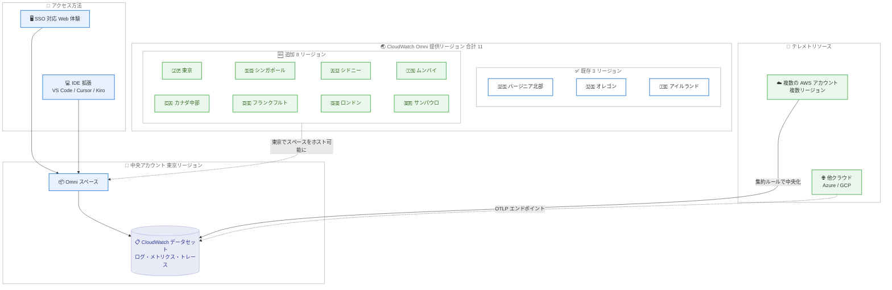

# Amazon CloudWatch - CloudWatch Omni が追加 8 リージョンで利用可能に (東京リージョン対応)

**リリース日**: 2026 年 10 月 19 日
**サービス**: Amazon CloudWatch
**機能**: Amazon CloudWatch Omni のリージョン拡大

📊 [このアップデートのインフォグラフィックを見る](https://takech9203.github.io/aws-news-summary/20261019-amazon-cloudwatch-omni-8-regions.html)

## 概要

Amazon CloudWatch Omni が、新たに 8 つの AWS リージョンで利用可能になった。追加されたのは、カナダ (中部)、アジアパシフィック (ムンバイ)、アジアパシフィック (シンガポール)、アジアパシフィック (シドニー)、**アジアパシフィック (東京)**、欧州 (フランクフルト)、欧州 (ロンドン)、南米 (サンパウロ) の 8 リージョンである。これまでの米国東部 (バージニア北部)、米国西部 (オレゴン)、欧州 (アイルランド) と合わせて、合計 11 リージョンで利用できるようになった。

CloudWatch Omni は、チームとアプリケーションを中心に構成された AI ファーストのオブザーバビリティ体験であり、アプリケーションと AI エージェントを単一の場所で観測・トラブルシューティングできる。OpenTelemetry の相互運用性と CloudWatch のスケール・信頼性を融合しており、SSO 対応のスタンドアロン Web 体験と、ローカルの IDE 拡張 (VS Code、Cursor、Kiro) の両方で利用できる。

**日本のユーザーにとって、東京リージョンで Omni のスペースをホストできるようになった点が今回の最大のポイントである。** データレジデンシーやレイテンシーの観点から国内リージョンでの利用を待っていたチームが、CloudWatch Omni の導入を本格的に検討できるようになった。

**アップデート前の課題**

- 以前は CloudWatch Omni の提供リージョンが米国東部 (バージニア北部)、米国西部 (オレゴン)、欧州 (アイルランド) の 3 リージョンに限られていた
- 以前は東京リージョンを含むアジアパシフィックのリージョンでスペースをホストできず、日本国内にデータを保持する要件があるワークロードでは利用が難しかった
- 以前は日本やアジアのユーザーが Omni を利用する場合、地理的に離れたリージョンにスペースを作成する必要があり、レイテンシー面で不利だった

**アップデート後の改善**

- 今回のアップデートにより、東京リージョンを含む 8 リージョンが追加され、合計 11 リージョンで Omni のスペースをホストできるようになった
- 今回のアップデートにより、日本国内のリージョンでテレメトリの集約と分析を完結させる構成を取れるようになった
- 今回のアップデートにより、アジアパシフィック (東京、シンガポール、シドニー、ムンバイ) の各拠点に近いリージョンでスペースを作成でき、操作時のレイテンシーを低減できるようになった

## アーキテクチャ図



今回の拡大により東京を含む 8 リージョンが追加され、東京リージョンの中央アカウントにスペースをホストし、複数アカウント・他クラウドのテレメトリを集約する構成が可能になったことを示している。

## サービスアップデートの詳細

### 主要機能

1. **8 リージョンへの提供拡大**
   - カナダ (中部)、アジアパシフィック (ムンバイ)、アジアパシフィック (シンガポール)、アジアパシフィック (シドニー)、アジアパシフィック (東京)、欧州 (フランクフルト)、欧州 (ロンドン)、南米 (サンパウロ) が追加された
   - 既存の米国東部 (バージニア北部)、米国西部 (オレゴン)、欧州 (アイルランド) と合わせて合計 11 リージョンで利用可能
   - 東京リージョンでスペースをホストできるため、日本国内でのデータ保持要件に対応しやすくなった

2. **マルチアカウント・マルチクラウドの一元可視化 (全リージョン共通)**
   - 中央アカウントにスペースを作成し、複数の AWS アカウント・リージョンのテレメトリを横断的に表示できる
   - Azure や GCP など他クラウドで実行されるワークロードも、OpenTelemetry で計装して OTLP エンドポイントに送信することで観測対象にできる
   - サービスの自動検出、依存関係のマッピング、ゴールデンメトリクスの自動表示に対応する

3. **AI による操作と根本原因調査 (全リージョン共通)**
   - チャット、ポイント & クリック操作、Agent Toolkit for AWS 経由の外部ツールでテレメトリを操作できる
   - AWS DevOps Agent による根本原因分析を開始できる

4. **AI エージェント向けオブザーバビリティ (全リージョン共通)**
   - LangGraph、CrewAI、OpenAI Agents SDK、Vercel AI SDK、Strands などのフレームワークに対応した評価駆動のエージェント観測体験を提供する
   - VS Code、Cursor、Kiro 向けの無料の CloudWatch Omni 拡張により、ローカルでエージェントの計装・デバッグ・評価が可能

## 技術仕様

### 提供リージョン一覧

| 区分 | リージョン |
|------|-----------|
| 既存 (2026 年 9 月 GA 時) | 米国東部 (バージニア北部)、米国西部 (オレゴン)、欧州 (アイルランド) |
| 今回追加 (2026 年 10 月) | カナダ (中部)、アジアパシフィック (ムンバイ)、アジアパシフィック (シンガポール)、アジアパシフィック (シドニー)、アジアパシフィック (東京)、欧州 (フランクフルト)、欧州 (ロンドン)、南米 (サンパウロ) |

### CloudWatch Omni の構成要素 (再掲)

| 項目 | 詳細 |
|------|------|
| ドメイン | 組織のエントリーポイント。サインイン URL と ID プロバイダー連携を提供 |
| スペース | 作業単位。ホストするアカウント・リージョンのテレメトリへのアクセスとアクセス制御の境界 |
| 対応 IDE | VS Code、Cursor、Kiro (拡張機能は無料) |
| 対応エージェントフレームワーク | LangGraph、CrewAI、OpenAI Agents SDK、Vercel AI SDK、Strands など |
| 対応他クラウド | Azure、GCP (OpenTelemetry 計装 + OTLP エンドポイント) |

## 設定方法

### 前提条件

1. 今回追加されたリージョンを含む、CloudWatch Omni 提供リージョンのいずれかを利用できること
2. ドメインのセットアップに使用する ID プロバイダー (SSO) を用意していること
3. 複数アカウント・リージョンを観測する場合、CloudWatch の集約ルールを設定できる権限があること

### 手順

#### ステップ 1: 東京リージョンで Omni スペースを作成

CloudWatch コンソールでリージョンとしてアジアパシフィック (東京) を選択し、Omni のスペースを作成する。ドメイン名を設定すると組織専用のサインイン URL が発行される。

#### ステップ 2: SSO のセットアップとサインイン

発行されたドメイン URL に ID プロバイダーを接続し、既存の ID でスタンドアロンの Web 体験にサインインする。AWS マネジメントコンソールへのサインインは不要である。

#### ステップ 3: テレメトリの集約

既に CloudWatch に送信しているテレメトリは再設定なしで Omni に表示される。複数アカウント・リージョンを横断する場合は、CloudWatch の集約ルールで東京リージョンの中央アカウントにテレメトリを集約する。他クラウドのワークロードは OpenTelemetry で計装し、OTLP エンドポイントに送信する。

#### ステップ 4: IDE 拡張のインストール (エージェント開発者向け)

```bash
# VS Code の場合、Marketplace から拡張機能をインストールする
# 拡張機能 ID: AmazonWebServices.amazon-cloudwatch-omni
code --install-extension AmazonWebServices.amazon-cloudwatch-omni
```

VS Code、Cursor、Kiro に無料の CloudWatch Omni 拡張をインストールすると、ローカルでエージェントの計装・デバッグ・評価ができる。

## メリット

### ビジネス面

- **データレジデンシー要件への対応**: 東京リージョンでスペースをホストできるため、日本国内にデータを保持する要件があるワークロードでも Omni の導入を検討しやすくなった
- **グローバル展開企業での採用拡大**: 北米・欧州・アジア・南米の主要リージョンをカバーし、各拠点に近いリージョンでの運用が可能になった
- **ツール統合の推進**: これまでリージョン制約で見送っていたチームも、アプリケーション監視・マルチクラウド可視化・AI エージェント評価の統合を進められる

### 技術面

- **レイテンシーの低減**: 日本やアジアのユーザーが地理的に近いリージョンのスペースを利用でき、Web 体験や IDE 拡張の操作レイテンシーが改善する
- **テレメトリ転送の最適化**: 東京リージョンのワークロードのテレメトリを同一リージョン内で集約・分析でき、リージョン間データ転送を抑えられる
- **既存資産との互換性**: 既存の CloudWatch のメトリクス・アラーム・ダッシュボード・API はそのまま動作し、計装の変更も不要

## デメリット・制約事項

### 制限事項

- 提供リージョンは 11 リージョンであり、大阪リージョンなど上記以外のリージョンでは引き続きスペースをホストできない
- スペースは 1 つのアカウント・リージョンにマッピングされるため、複数アカウント・リージョンの横断観測には CloudWatch の集約ルールによる中央化設定が別途必要

### 考慮すべき点

- インジェスト・ストレージ・分析の従量課金が発生するため、テレメトリ量の多い環境では事前にコスト試算を行うことを推奨する。リージョンごとに料金が異なる場合があるため、料金ページで東京リージョンの単価を確認すること
- ドメインのサインイン URL は AWS コンソール外のエンドポイントとなるため、組織のセキュリティポリシー (アクセス制御、監査) との整合を確認する必要がある

## ユースケース

### ユースケース 1: 日本国内で完結するオブザーバビリティ基盤

**シナリオ**: 東京リージョンで複数アカウントのワークロードを運用する企業が、データレジデンシーの観点から国内リージョンでの監視基盤統合を求めている。

**実装例**:
```
1. 東京リージョンの中央アカウントに Omni ドメインとスペースを作成
2. CloudWatch の集約ルールで各アカウントのテレメトリを東京リージョンに中央化
3. アプリケーションマップで依存関係とゴールデンメトリクスを確認
4. アラートを Slack または Amazon SNS で通知
```

**効果**: テレメトリの保持と分析を日本国内で完結させつつ、SSO 対応の単一のオブザーバビリティ体験を実現できる。

### ユースケース 2: アジアパシフィック全域のマルチリージョン監視

**シナリオ**: 東京・シンガポール・シドニー・ムンバイにワークロードを展開する企業が、リージョンごとに分散した監視を統合したい。

**実装例**:
```
1. 東京リージョンに中央スペースを作成
2. 集約ルールで各リージョンのテレメトリを東京に集約
3. 他クラウド Azure / GCP のワークロードは OTLP エンドポイントに送信
4. 単一のアプリケーションマップでリージョン横断の依存関係を可視化
```

**効果**: アジアパシフィック全域のワークロードを単一のスペースで観測でき、障害の影響範囲特定が高速化する。

### ユースケース 3: 国内チームによる AI エージェントの評価駆動開発

**シナリオ**: 日本の開発チームが Strands や LangGraph で構築した AI エージェントを、国内リージョンで本番運用しながら品質評価したい。

**実装例**:
```
1. VS Code / Cursor / Kiro に CloudWatch Omni 拡張をインストール
2. エージェントを計装し、プロンプト・モデル呼び出し・ツール呼び出しをトレース
3. 東京リージョンのスペースで本番トレースと評価スコアを継続監視
4. 修正後はエクスペリメントでリリース前に品質を検証
```

**効果**: ローカル開発から東京リージョンでの本番監視まで、一貫した評価駆動開発ワークフローを低レイテンシーで利用できる。

## 料金

CloudWatch Omni の料金は「インジェスト」「ストレージ」「分析」の 3 つのディメンションで構成される従量課金である。リージョン拡大自体による追加料金はないが、リージョンごとに単価が異なる場合があるため、東京リージョンの単価は料金ページで確認すること。

参考として、米国東部 (バージニア北部) ではログ・メトリクスのインジェストが 0.50 USD/GB、ストレージが 0.030 USD/GB - 月、ログ・トレースのクエリが 0.005 USD/スキャン GB である。Omni を有効化すると、30 日間有効な 1,000 USD の無料トライアルクレジットが自動適用される (OpenTelemetry インジェストのみ対象、1 AWS Organization あたり 10 アカウントまで)。

詳細は [CloudWatch Omni 料金ページ](https://aws.amazon.com/cloudwatch/omni/pricing/) を参照。

## 利用可能リージョン

以下の 11 リージョンで利用可能 (太字が今回追加)。

- 米国東部 (バージニア北部)
- 米国西部 (オレゴン)
- 欧州 (アイルランド)
- **カナダ (中部)**
- **アジアパシフィック (ムンバイ)**
- **アジアパシフィック (シンガポール)**
- **アジアパシフィック (シドニー)**
- **アジアパシフィック (東京)**
- **欧州 (フランクフルト)**
- **欧州 (ロンドン)**
- **南米 (サンパウロ)**

IDE 拡張によるローカルでのエージェント開発は AWS アカウント不要で利用できる。

## 関連サービス・機能

- **Amazon CloudWatch**: Omni は CloudWatch 上に構築されたインターフェイスであり、既存のメトリクス・ログ・アラーム・ダッシュボードをそのまま活用する
- **AWS DevOps Agent**: アラート発報時の根本原因調査を担う AI エージェント。Omni から調査を開始できる
- **OpenTelemetry**: Omni の基盤となるテレメトリ標準。OTLP エンドポイント経由で Azure や GCP のワークロードも観測できる
- **Kiro**: AWS が提供する AI 搭載 IDE。CloudWatch Omni 拡張に対応し、ローカルでのエージェント開発・評価に利用できる

## 参考リンク

- 📊 [インフォグラフィック](https://takech9203.github.io/aws-news-summary/20261019-amazon-cloudwatch-omni-8-regions.html)
- [公式発表 (What's New)](https://aws.amazon.com/about-aws/whats-new/2026/10/amazon-cloudwatch-omni-8-regions/)
- [AWS Blog: Introducing Amazon CloudWatch Omni: collaborative AI-powered observability for your applications](https://aws.amazon.com/blogs/aws/introducing-amazon-cloudwatch-omni-collaborative-ai-powered-observability-for-your-applications/)
- [AWS Blog: Introducing Amazon CloudWatch Omni: AI-powered observability for generative AI and agentic workloads](https://aws.amazon.com/blogs/aws/introducing-amazon-cloudwatch-omni-ai-powered-observability-for-generative-ai-and-agentic-workloads/)
- [製品ページ](https://aws.amazon.com/cloudwatch/omni/)
- [ドキュメント](https://docs.aws.amazon.com/AmazonCloudWatch/latest/monitoring/cloudwatch-omni.html)
- [料金ページ](https://aws.amazon.com/cloudwatch/omni/pricing/)
- [VS Code 拡張機能](https://marketplace.visualstudio.com/items?itemName=AmazonWebServices.amazon-cloudwatch-omni)
- [GA 時のレポート (2026 年 9 月 23 日)](./2026-09-23-amazon-cloudwatch-omni-ai.md)

## まとめ

Amazon CloudWatch Omni が東京リージョンを含む 8 リージョンに拡大し、合計 11 リージョンで利用可能になった。日本のユーザーはデータレジデンシーと低レイテンシーの両面で導入のハードルが下がったため、無料トライアルクレジットを利用して東京リージョンにスペースを作成し、自動検出されるアプリケーションマップと AI による調査体験を評価することを推奨する。AI エージェントを開発しているチームは、AWS アカウント不要の IDE 拡張から評価駆動開発ワークフローを試すことができる。
