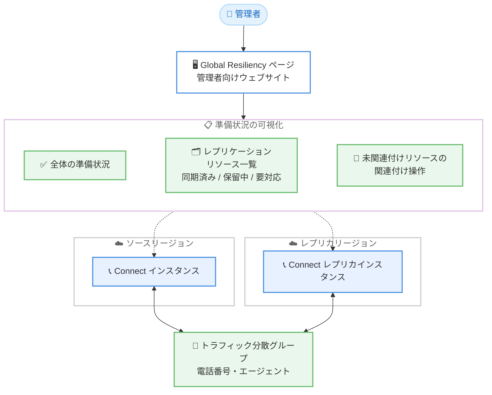

# Amazon Connect - Customer Global Resiliency のリージョン切り替え準備状況の可視化

**リリース日**: 2026 年 10 月 19 日
**サービス**: Amazon Connect
**機能**: Customer Global Resiliency の Global Resiliency ページによる準備状況の可視化

📊 [このアップデートのインフォグラフィックを見る](https://takech9203.github.io/aws-news-summary/20261019-amazon-connect-global-resiliency-readiness-overview.html)

## 概要

Amazon Connect Customer Global Resiliency において、管理者向けウェブサイトに新しい Global Resiliency ページが追加されました。このページにより、ビジネスユーザーや管理者は、リンクされたリージョン間でのリージョン切り替え (Region switch) の準備状況を 1 か所で確認できるようになります。

Global Resiliency は、Amazon Connect インスタンスを別のリージョンに複製し、トラフィック分散グループ (Traffic Distribution Group) を通じて電話番号やエージェントのトラフィックをリージョン間で分散・切り替えできる機能です。今回のアップデートでは、リージョン切り替えに対する全体的な準備状況 (readiness status) の表示に加えて、Global Resiliency がネイティブにレプリケーションするリソースの一覧が提供され、どのリソースタイプが同期済み (in sync) か、同期保留中 (pending) か、対応が必要 (needs action) かを確認できます。

さらに、トラフィック分散グループに関連付けられていない電話番号やユーザーといった設定上のギャップが検出された場合、管理者はこのページから直接、対象リソースの関連付けを行うことができます。これにより、コンタクトセンターの運用チームは、障害発生前の平常時からレジリエンシー態勢を継続的に点検し、インスタンスがリージョン切り替えに備えられていることを確認できます。

**アップデート前の課題**

- リージョン切り替えの準備状況を一元的に確認する画面がなく、レプリケーション対象リソースの同期状態を個別に確認する必要があった
- 電話番号やユーザーがトラフィック分散グループに関連付けられていないといった設定漏れに気づきにくく、切り替え時に初めて問題が発覚するリスクがあった
- 設定ギャップを修正するには、該当するリソースの管理画面や API を個別に操作する必要があった

**アップデート後の改善**

- Global Resiliency ページで、リージョン切り替えの全体的な準備状況を 1 か所で確認できるようになった
- ネイティブにレプリケーションされるリソースごとに、同期済み・同期保留中・要対応のステータスを一覧で把握できるようになった
- トラフィック分散グループに未関連付けの電話番号やユーザーなどの影響を受けるリソースを、同じページから直接関連付けて修正できるようになった

## アーキテクチャ図



管理者は Global Resiliency ページから、リンクされた 2 つのリージョンにまたがるリソースの同期状態と切り替え準備状況を一元的に確認し、設定ギャップをその場で修正できます。

## サービスアップデートの詳細

### 主要機能

1. **全体的な準備状況の表示**
   - リージョン切り替えに対するインスタンス全体の readiness ステータスを表示
   - 障害発生時だけでなく、平常時にいつでもレジリエンシー態勢を確認可能
   - 定期的なフェイルオーバーテストや監査の起点として活用できる

2. **レプリケーション対象リソースのステータス一覧**
   - Global Resiliency がネイティブにレプリケーションするリソースを一覧表示
   - 各リソースタイプについて、同期済み (in sync)・同期保留中 (pending)・要対応 (needs action) のステータスを確認可能
   - どのリソースが切り替えの阻害要因になっているかを即座に特定できる

3. **影響を受けるリソースの直接修正**
   - トラフィック分散グループに関連付けられていない電話番号やユーザーなどを検出
   - 検出された未関連付けリソースを、Global Resiliency ページから直接関連付け可能
   - 個別の管理画面や API 操作に移動することなく、設定ギャップを解消できる

## 技術仕様

### Global Resiliency の基本構成要素

| 項目 | 詳細 |
|------|------|
| レプリカインスタンス | ReplicateInstance API などで別リージョンに作成する Connect インスタンスの複製 |
| トラフィック分散グループ | 異なるリージョンの Connect インスタンスをリンクするリソース。電話番号を関連付け、トラフィックを 10% 刻みで分散可能 |
| 準備状況ステータス | 同期済み (in sync)・同期保留中 (pending)・要対応 (needs action) の 3 区分でリソースを表示 |
| 利用画面 | Amazon Connect 管理者向けウェブサイトの Global Resiliency ページ |

### 前提となるドメイン形式

2021 年 3 月 31 日より前に作成されたインスタンスで `https://{instance-alias}.awsapps.com/connect/` 形式のドメインを使用している場合、Global Resiliency を正しく構成できません。`https://{instance-alias}.my.connect.aws/` 形式へのドメイン更新が必要です。

## 設定方法

### 前提条件

1. Amazon Connect Customer Global Resiliency が有効化されたインスタンスであること (利用には Amazon Connect の Solutions Architect または Technical Account Manager への連絡が必要)
2. インスタンスのドメインが `https://{instance-alias}.my.connect.aws/` 形式であること
3. Global Resiliency がサポートされるリージョンペアでインスタンスを運用していること

### 手順

#### ステップ 1: レプリカインスタンスとトラフィック分散グループの作成

```bash
# 既存インスタンスのレプリカを別リージョンに作成
aws connect replicate-instance \
  --instance-id <インスタンス ID> \
  --replica-region us-west-2 \
  --replica-alias <レプリカのエイリアス>

# トラフィック分散グループを作成
aws connect create-traffic-distribution-group \
  --name my-tdg \
  --instance-id <インスタンス ARN>
```

ReplicateInstance API で既存インスタンスの複製を別リージョンに作成し、CreateTrafficDistributionGroup API で 2 つのリージョンのインスタンスをリンクするトラフィック分散グループを作成します。

#### ステップ 2: 電話番号とユーザーの関連付け

```bash
# 電話番号をトラフィック分散グループに割り当て
aws connect update-phone-number \
  --phone-number-id <電話番号 ID> \
  --target-arn <トラフィック分散グループ ARN>
```

UpdatePhoneNumber API で電話番号をトラフィック分散グループに割り当てます。ユーザー (エージェント) についても同様に関連付けを行います。

#### ステップ 3: Global Resiliency ページで準備状況を確認

Amazon Connect 管理者向けウェブサイトにログインし、Global Resiliency ページを開きます。全体の準備状況と各リソースタイプのステータスを確認し、「要対応」と表示されたリソース (トラフィック分散グループ未関連付けの電話番号やユーザーなど) があれば、このページから直接関連付けを行います。

## メリット

### ビジネス面

- **ダウンタイムリスクの低減**: リージョン切り替えの阻害要因を平常時に発見・解消できるため、実際の障害時に切り替えが失敗するリスクを低減できる
- **運用負荷の削減**: 準備状況の確認が 1 か所に集約され、監査やフェイルオーバーテスト前の点検作業が効率化される
- **非技術者にも分かりやすい可視化**: ビジネスユーザーや管理者が API を使わずに、管理画面上でレジリエンシー態勢を把握できる

### 技術面

- **同期状態の透明性**: レプリケーション対象リソースごとの同期状態 (in sync / pending / needs action) が明確になり、問題の切り分けが容易になる
- **設定ギャップのその場での修正**: 未関連付けの電話番号やユーザーを検出し、同じページから関連付けまで完結できる
- **継続的なレジリエンシー点検**: いつでも準備状況を確認できるため、月次のフェイルオーバーテストなど定期的な検証プロセスに組み込みやすい

## デメリット・制約事項

### 制限事項

- Global Resiliency の利用には、Amazon Connect の Solutions Architect または Technical Account Manager への連絡によるアクセス付与が必要
- レプリカを作成できるリージョンの組み合わせは固定されている (バージニア北部とオレゴン、フランクフルトとロンドン、東京と大阪)
- 旧形式ドメイン (`awsapps.com/connect`) のインスタンスでは Global Resiliency を構成できず、ドメイン更新が必要

### 考慮すべき点

- 本ページはネイティブにレプリケーションされるリソースの状態を表示するものであり、Lambda 関数や外部連携などレプリケーション対象外のリソースについては別途リージョン間での整合性確保が必要
- 準備状況の可視化に加えて、実際のリージョン切り替え手順 (トラフィック分散の更新) の定期的なテストは引き続き重要

## ユースケース

### ユースケース 1: 障害発生前の定期点検

**シナリオ**: 金融機関のコンタクトセンターで、月次のレジリエンシー点検を実施している。従来は複数の画面と API でリソースの同期状態を個別に確認していた。

**実装例**:
```
1. Global Resiliency ページを開き、全体の準備状況を確認
2. 「要対応」のリソースタイプを特定
3. 未関連付けの電話番号・ユーザーをページ上で関連付け
4. 全リソースが「同期済み」になったことを確認し、点検記録に残す
```

**効果**: 点検作業が 1 画面に集約され、確認漏れによる切り替え失敗のリスクを低減できる。

### ユースケース 2: 新規リソース追加後の整合性確認

**シナリオ**: コンタクトセンターの拡張に伴い、新しい電話番号の取得とエージェントの追加を行った。これらが DR 構成に正しく組み込まれているかを確認したい。

**実装例**:
```
1. 電話番号の取得とユーザー作成後、Global Resiliency ページを確認
2. トラフィック分散グループに未関連付けのリソースが「要対応」として表示される
3. ページ上から該当リソースをトラフィック分散グループに関連付け
```

**効果**: リソース追加のたびに発生しがちな DR 構成への組み込み漏れを、早期に検出・修正できる。

### ユースケース 3: フェイルオーバーテスト前の事前チェック

**シナリオ**: 月次のフェイルオーバーテストの実施前に、リージョン切り替えが成功する状態にあるかを確認したい。

**実装例**:
```
1. テスト実施前に Global Resiliency ページで全体の準備状況を確認
2. 同期保留中のリソースがあれば同期完了を待つ
3. すべて同期済みであることを確認してから UpdateTrafficDistribution でトラフィックを切り替え
```

**効果**: テスト当日の手戻りを防ぎ、切り替え手順の検証に集中できる。

## 料金

今回の発表には、本機能に関する追加料金の記載はありません。Amazon Connect の料金は従量課金制であり、詳細は [Amazon Connect の料金ページ](https://aws.amazon.com/connect/pricing/) を参照してください。

## 利用可能リージョン

Amazon Connect Customer Global Resiliency がサポートされるすべての AWS リージョンで利用可能です。ドキュメントによると、Global Resiliency は以下のリージョンで作成されたインスタンスで利用できます。

- 米国東部 (バージニア北部) - 米国西部 (オレゴン) のペア
- 欧州 (フランクフルト) - 欧州 (ロンドン) のペア
- アジアパシフィック (東京) - アジアパシフィック (大阪) のペア

## 関連サービス・機能

- **Amazon Connect トラフィック分散グループ**: 異なるリージョンの Connect インスタンスをリンクし、電話番号のトラフィックを 10% 刻みで分散する機能。本アップデートで未関連付けリソースの検出・修正対象となる
- **Amazon Connect エージェントワークスペース**: エージェントが利用する統合ワークスペース。リージョン切り替え時にはエージェントのサインイン先も切り替わるため、準備状況の確認が重要
- **Amazon Route 53 Application Recovery Controller**: AWS 全般のマルチリージョン切り替えを管理するサービス。Connect 以外のワークロードを含めた DR 戦略で併用を検討できる

## 参考リンク

- 📊 [インフォグラフィック](https://takech9203.github.io/aws-news-summary/20261019-amazon-connect-global-resiliency-readiness-overview.html)
- [公式発表 (What's New)](https://aws.amazon.com/about-aws/whats-new/2026/10/amazon-connect-global-resiliency-readiness-overview)
- [ドキュメント: Get started with Connect Customer Global Resiliency](https://docs.aws.amazon.com/connect/latest/adminguide/get-started-connect-global-resiliency.html)
- [料金ページ](https://aws.amazon.com/connect/pricing/)

## まとめ

Amazon Connect Customer Global Resiliency の新しい Global Resiliency ページにより、リージョン切り替えの準備状況を管理画面上で一元的に可視化し、設定ギャップをその場で修正できるようになりました。マルチリージョン構成で Amazon Connect を運用しているチームは、月次のフェイルオーバーテストや定期点検のプロセスに本ページでの確認を組み込むことを推奨します。
