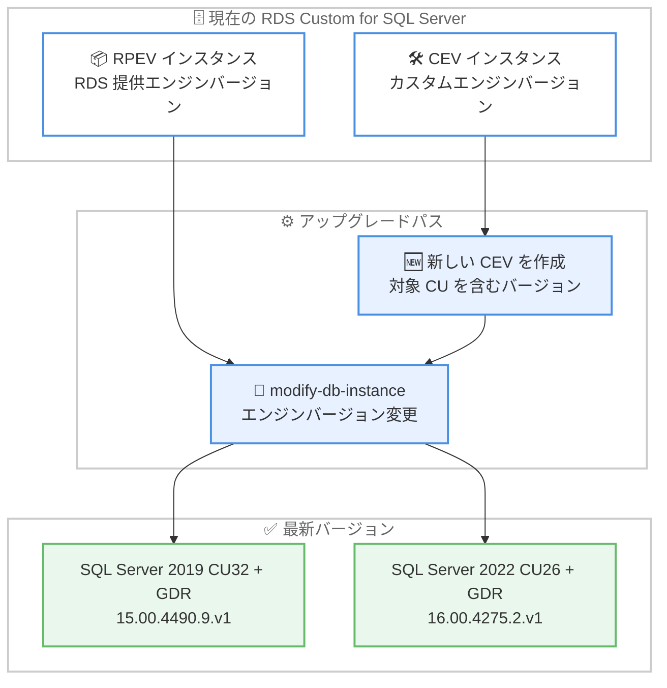

# Amazon RDS Custom for SQL Server - 最新の累積更新プログラム CU と GDR 更新プログラムのサポート

**リリース日**: 2026 年 10 月 19 日
**サービス**: Amazon RDS Custom for SQL Server
**機能**: Microsoft SQL Server の最新 Cumulative Update (CU) および General Distribution Release (GDR) 更新プログラムのサポート

📊 [このアップデートのインフォグラフィックを見る](https://takech9203.github.io/aws-news-summary/20261019-amazon-rds-custom-supports-latest-cumulative-update-gdr-microsoft-sql-server.html)

## 概要

Amazon RDS Custom for SQL Server が、Microsoft SQL Server の最新の累積更新プログラム (CU) および General Distribution Release (GDR) 更新プログラムをサポートしました。今回サポートされたのは、SQL Server 2019 向けの CU32 + GDR (KB5122772、RDS バージョン 15.00.4490.9.v1) と、SQL Server 2022 向けの CU26 + GDR (KB5122768、RDS バージョン 16.00.4275.2.v1) です。

CU には Microsoft が提供するセキュリティパッチ、バグ修正、エンジン改善が含まれており、GDR はセキュリティ関連の修正を提供します。RDS Custom for SQL Server のインスタンスは、Amazon RDS マネジメントコンソール、AWS SDK、または AWS CLI を使用して、これらの推奨更新プログラムを含む新しいエンジンバージョンへアップグレードできます。

RDS Custom は、ホスト OS やデータベース環境へのアクセスを必要とするアプリケーション向けのマネージドデータベースサービスであり、サードパーティエージェントの導入やカスタム設定が可能です。レガシーアプリケーションやカスタマイズ要件のある SQL Server ワークロードを運用しながら、最新のセキュリティ修正を適用したいユーザーにとって重要なアップデートです。

**アップデート前の課題**

- RDS Custom for SQL Server では SQL Server 2019 CU32 + GDR および SQL Server 2022 CU26 + GDR に対応するエンジンバージョンが提供されておらず、最新のセキュリティ修正やバグ修正を RDS のアップグレード機能で適用できなかった
- カスタムエンジンバージョン (CEV) を利用している場合、実行中のインスタンスへ CU を直接適用するとサポート境界 (サポートペリメータ) の外となりエラー `SP-S3006` が報告されるため、新しいバージョンの提供を待つ必要があった
- 最新の修正を適用できない期間は、既知の脆弱性や不具合への対応が遅れるリスクがあった

**アップデート後の改善**

- SQL Server 2019 CU32 + GDR (RDS バージョン 15.00.4490.9.v1) および SQL Server 2022 CU26 + GDR (RDS バージョン 16.00.4275.2.v1) へのアップグレードが可能になった
- マネジメントコンソール、AWS SDK、AWS CLI のいずれからも、即時またはメンテナンスウィンドウでの適用を選択してアップグレードできる
- Multi-AZ 構成ではローリングアップグレードが実行されるため、ダウンタイムをフェイルオーバー時間のみに抑えて最新の修正を適用できる

## アーキテクチャ図



RPEV を利用するインスタンスは `modify-db-instance` で直接アップグレードできます。CEV を利用するインスタンスは、対象の CU を含む新しい CEV を作成してからインスタンスを新バージョンへ変更する 2 段階のプロセスが必要です。

## サービスアップデートの詳細

### 主要機能

1. **SQL Server 2019 CU32 + GDR のサポート**
   - KB5122772 に対応する更新プログラムを含む
   - RDS バージョンは 15.00.4490.9.v1
   - セキュリティパッチ、バグ修正、エンジン改善を含む (修正内容の詳細は Microsoft の KB ドキュメントを参照)

2. **SQL Server 2022 CU26 + GDR のサポート**
   - KB5122768 に対応する更新プログラムを含む
   - RDS バージョンは 16.00.4275.2.v1
   - セキュリティパッチ、バグ修正、エンジン改善を含む (修正内容の詳細は Microsoft の KB ドキュメントを参照)

3. **複数のアップグレード手段**
   - Amazon RDS マネジメントコンソールから対象バージョンを選択してアップグレード
   - AWS CLI の `modify-db-instance` コマンドや RDS API の `ModifyDBInstance` によるアップグレード
   - 即時適用 (`--apply-immediately`) またはメンテナンスウィンドウでの適用 (`--no-apply-immediately`) を選択可能

4. **Multi-AZ 構成でのローリングアップグレード**
   - スタンバイインスタンスを先にアップグレードし、フェイルオーバー後に新しいスタンバイをアップグレード
   - ダウンタイムはフェイルオーバーにかかる時間のみに最小化される

## 技術仕様

### サポートされるバージョン

| SQL Server バージョン | 更新プログラム | KB 番号 | RDS バージョン |
|------|------|------|------|
| SQL Server 2019 | CU32 + GDR | KB5122772 | 15.00.4490.9.v1 |
| SQL Server 2022 | CU26 + GDR | KB5122768 | 16.00.4275.2.v1 |

### RPEV と CEV のアップグレード方式

| 項目 | RPEV (RDS 提供エンジンバージョン) | CEV (カスタムエンジンバージョン) |
|------|------|------|
| 内容 | 最新の OS パッチと SQL Server CU を含む AWS 提供バージョン | ユーザーが用意したメディアに基づくカスタムバージョン |
| アップグレード方法 | インスタンスのエンジンバージョンを直接変更 | 対象バージョンの新しい CEV を作成後、インスタンスを変更する 2 段階 |
| 注意事項 | - | 実行中インスタンスへの CU の直接適用は不可 (サポート境界外となりエラー `SP-S3006` が発生) |

## 設定方法

### 前提条件

1. Amazon RDS Custom for SQL Server の DB インスタンスが稼働していること
2. アップグレード対象のバージョンが現在のバージョンより新しいこと (アップグレードは不可逆であり、ダウングレードはできない)
3. 本番環境への適用前に、非本番環境で後方互換性の問題がないことをテストすること

### 手順

#### ステップ 1: 利用可能なターゲットバージョンの確認

```bash
aws rds describe-db-engine-versions \
    --engine custom-sqlserver-se \
    --engine-version 15.00.4430.1.v1 \
    --query "DBEngineVersions[*].ValidUpgradeTarget[*].{EngineVersion:EngineVersion}" \
    --output table
```

現在のエンジンバージョンから有効なアップグレードターゲットの一覧を表示します。`--engine` にはエディションに応じて `custom-sqlserver-se` などを指定し、`--engine-version` には現在のバージョンを指定します。出力に `15.00.4490.9.v1` や `16.00.4275.2.v1` が含まれていることを確認します。

#### ステップ 2: DB インスタンスのアップグレード

```bash
aws rds modify-db-instance \
    --db-instance-identifier my-custom-sqlserver-instance \
    --engine-version 16.00.4275.2.v1 \
    --region ap-northeast-1 \
    --no-apply-immediately
```

DB インスタンスのエンジンバージョンを変更してアップグレードを実行します。`--no-apply-immediately` を指定すると次のメンテナンスウィンドウで適用され、即時に適用する場合は `--apply-immediately` を指定します。SQL Server 2019 から 2022 へのメジャーバージョンアップグレードを行う場合は `--allow-major-version-upgrade` パラメータの指定が必要です。

#### ステップ 3: CEV 利用時のアップグレード

CEV を利用しているインスタンスでは、まず対象の CU を含む新しい CEV を作成し、その後インスタンスを新しい CEV へ変更します。実行中のインスタンスへ CU を直接適用すると、サポート境界の外となりエラー `SP-S3006` が報告されるため、必ず新しい CEV を作成する手順に従います。

#### ステップ 4: データベース互換性レベルの確認

```sql
ALTER DATABASE customeracct SET COMPATIBILITY_LEVEL = 160
```

アップグレード後も既存データベースの互換性レベルは元のまま維持されます (例: SQL Server 2019 から 2022 へアップグレードした場合、既存データベースは互換性レベル 150 のまま)。新しいエンジンの動作を利用する場合は、`ALTER DATABASE` コマンドで互換性レベルを変更します。

## メリット

### ビジネス面

- **セキュリティリスクの低減**: GDR に含まれるセキュリティ修正を適用することで、既知の脆弱性への暴露期間を短縮できる
- **コンプライアンス対応**: 最新パッチの適用を求めるセキュリティポリシーや監査要件に、マネージドな手順で対応できる
- **運用負荷の軽減**: パッチ適用済みバージョンへの切り替えを RDS の標準的なアップグレード手順で実施でき、手動パッチ作業を削減できる

### 技術面

- **最新の修正の取り込み**: CU に含まれるバグ修正とエンジン改善により、SQL Server の安定性とパフォーマンスを維持できる
- **柔軟な適用タイミング**: 即時適用とメンテナンスウィンドウ適用を選択でき、業務影響をコントロールしやすい
- **Multi-AZ でのダウンタイム最小化**: ローリングアップグレードにより、ダウンタイムをフェイルオーバー時間のみに抑えられる

## デメリット・制約事項

### 制限事項

- メジャー・マイナーを問わずエンジンバージョンのアップグレードは不可逆であり、古いバージョンへ戻すことはできない
- カスタム DB オプショングループおよびカスタムパラメータグループはアップグレードでサポートされない
- インスタンスに追加でアタッチしたストレージボリュームは、アップグレード後に再アタッチされない
- CEV では実行中インスタンスへの CU の直接適用 (インプレース適用) はサポートされず、サポート境界外となる

### 考慮すべき点

- 後方互換性の問題を避けるため、本番環境への適用前に非本番環境でアプリケーションのテストを行うことが推奨される
- CU に含まれる修正内容の詳細は Microsoft の KB5122772 および KB5122768 のドキュメントで事前に確認する
- Single-AZ 構成ではアップグレード中にダウンタイムが発生するため、適用タイミングを計画する必要がある

## ユースケース

### ユースケース 1: セキュリティパッチの定期適用

**シナリオ**: セキュリティポリシーにより、データベースエンジンへ最新のセキュリティ修正を四半期ごとに適用することが義務付けられている企業

**実装例**:
```bash
# 利用可能なターゲットバージョンを確認し、メンテナンスウィンドウで適用
aws rds modify-db-instance \
    --db-instance-identifier prod-sqlserver-2022 \
    --engine-version 16.00.4275.2.v1 \
    --no-apply-immediately
```

**効果**: GDR のセキュリティ修正を計画的なメンテナンスウィンドウ内で適用でき、監査要件を満たしながら業務影響を最小化できる

### ユースケース 2: Multi-AZ 構成の本番環境を停止時間最小でアップグレード

**シナリオ**: 24 時間稼働の基幹システムで SQL Server 2019 を Multi-AZ 構成で運用しており、長時間の停止が許容されない環境

**実装例**:
```bash
aws rds modify-db-instance \
    --db-instance-identifier prod-sqlserver-2019-maz \
    --engine-version 15.00.4490.9.v1 \
    --apply-immediately
```

**効果**: スタンバイから順にアップグレードするローリング方式により、ダウンタイムはフェイルオーバー時間のみとなり、サービス影響を最小限に抑えて CU32 + GDR を適用できる

### ユースケース 3: CEV 運用環境での計画的なパッチ適用

**シナリオ**: サードパーティエージェントや独自設定を含む CEV で SQL Server 2022 を運用しており、最新 CU を安全に適用したいチーム

**実装例**:
```
1. SQL Server 2022 CU26 + GDR を含むインストールメディアで新しい CEV を作成
2. 非本番インスタンスを新 CEV へ変更して動作検証
3. 本番インスタンスを modify-db-instance で新 CEV へ変更
```

**効果**: インプレース適用によるサポート境界外エラー `SP-S3006` を回避しつつ、検証済みの新 CEV へ段階的に移行できる

## 料金

このアップデートによる追加料金はありません。Amazon RDS Custom for SQL Server の通常の料金体系 (インスタンス料金、ストレージ料金、ライセンス料金など) が適用されます。新しいエンジンバージョンへのアップグレード自体に費用は発生しません。

## 利用可能リージョン

発表では対象リージョンの明記はありません。Amazon RDS Custom for SQL Server が利用可能なリージョンについては、[リージョン別の利用可能状況](https://docs.aws.amazon.com/AmazonRDS/latest/UserGuide/Concepts.RDS_Fea_Regions_DB-eng.Feature.RDSCustom.html)を参照してください。

## 関連サービス・機能

- **Amazon RDS for SQL Server**: OS アクセスが不要な場合の標準的なマネージド SQL Server。CU の提供はこちらにも順次行われる
- **カスタムエンジンバージョン (CEV)**: 独自のインストールメディアや設定を含むエンジンバージョンを作成する RDS Custom の機能。CU 適用時は新しい CEV の作成が必要
- **Amazon RDS Multi-AZ 配置**: ローリングアップグレードによりアップグレード時のダウンタイムをフェイルオーバー時間のみに短縮できる高可用性構成

## 参考リンク

- 📊 [インフォグラフィック](https://takech9203.github.io/aws-news-summary/20261019-amazon-rds-custom-supports-latest-cumulative-update-gdr-microsoft-sql-server.html)
- [公式発表 (What's New)](https://aws.amazon.com/about-aws/whats-new/2026/10/amazon-rds-custom-supports-latest-cumulative-update-gdr-microsoft-sql-server/)
- [AWS Blog: Performing a minor version upgrade for Amazon RDS Custom for SQL Server CEV with Multi-AZ](https://aws.amazon.com/blogs/database/performing-a-minor-version-upgrade-for-amazon-rds-custom-for-sql-server-cev-with-multi-az/)
- [ドキュメント: Upgrading an Amazon RDS Custom for SQL Server DB instance](https://docs.aws.amazon.com/AmazonRDS/latest/UserGuide/custom-upgrading-sqlserver.html)
- [Amazon RDS Custom 製品ページ](https://aws.amazon.com/rds/custom/)
- [料金ページ](https://aws.amazon.com/rds/custom/pricing/)

## まとめ

Amazon RDS Custom for SQL Server で SQL Server 2019 CU32 + GDR および SQL Server 2022 CU26 + GDR に対応するエンジンバージョンが利用可能になり、最新のセキュリティ修正とバグ修正を RDS の標準的なアップグレード手順で適用できるようになりました。セキュリティリスク低減の観点から、非本番環境でのテストを経て早期の適用を推奨します。CEV を利用している場合は、インプレース適用ではなく新しい CEV を作成する手順に従ってください。
