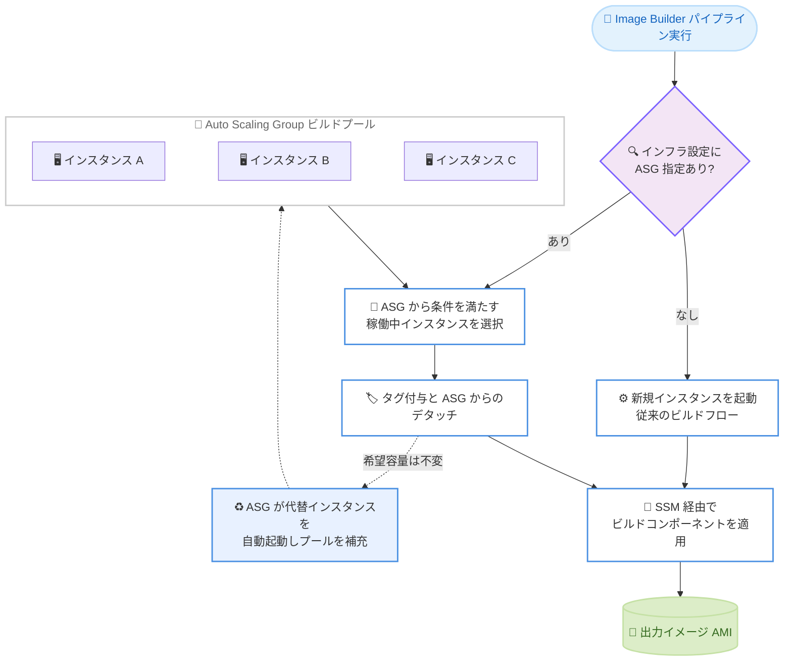

# EC2 Image Builder - Auto Scaling Group 連携による高速イメージビルド

**リリース日**: 2026 年 10 月 19 日
**サービス**: EC2 Image Builder
**機能**: Auto Scaling Group の既存インスタンスを利用したイメージビルド (Parent Instance)

📊 [このアップデートのインフォグラフィックを見る](https://takech9203.github.io/aws-news-summary/20261019-ec2-image-builder-asg-faster-builds.html)

## 概要

EC2 Image Builder が、Amazon EC2 Auto Scaling Group (ASG) 内で既に稼働中のインスタンスを利用してイメージをビルドする機能をサポートしました。インフラストラクチャ設定に ASG を指定すると、Image Builder はビルドのたびに新しいインスタンスを起動する代わりに、ASG から稼働中のインスタンスを 1 台選択してビルドコンポーネントを適用し、イメージを作成します。インスタンスの起動とブートストラップにかかる時間が不要になるため、ビルド時間を短縮できます。

ASG はインスタンスがビルドに使用されるたびにプールを自動的に補充するため、次回以降のパイプライン実行に備えてウォームなインスタンスプールを常に維持できます。ゴールデン AMI を頻繁にビルドする組織や、CI/CD パイプラインでイメージビルドの所要時間がボトルネックになっている組織にとって有用なアップデートです。

本機能は完全にオプトインであり、既存のパイプラインには影響しません。ASG を設定していないパイプラインは、従来どおりの標準的なインスタンス起動プロセスを継続します。

**アップデート前の課題**

- 以前はビルドのたびに新しい EC2 インスタンスを起動する必要があり、インスタンスの起動と SSM Agent の登録 (ブートストラップ) を待つ時間がビルド時間に含まれていた
- イメージビルドを頻繁に実行する環境では、起動待ち時間の累積がパイプライン全体のスループットを低下させていた
- 事前にウォームアップしたインスタンスプールをビルドに活用する仕組みがなかった

**アップデート後の改善**

- ASG 内の稼働中インスタンスをそのままビルドに使用できるようになり、インスタンス起動とブートストラップの待ち時間を排除できる
- ASG がプールを自動補充するため、連続的なパイプライン実行でも常にビルド可能なインスタンスを確保できる
- 完全オプトインのため、既存パイプラインへの影響なく段階的に導入できる

## アーキテクチャ図



ASG を指定したパイプラインでは、Image Builder が稼働中インスタンスを選択してタグ付与とデタッチを行い、SSM 経由でビルドを実行します。ASG の希望容量は変わらないため、代替インスタンスが自動起動されてプールが補充されます。

## サービスアップデートの詳細

### 主要機能

1. **ASG からの稼働中インスタンスの選択**
   - インフラストラクチャ設定の `parentInstance` に ASG 名を指定すると、Image Builder はビルド時に ASG 内のインスタンスをランダムに 1 台選択する (インスタンスの指定は不可)
   - 選択条件は「`InService` 状態であること」「SSM Agent が Systems Manager でオンラインであること」「イメージと同じプラットフォームとアーキテクチャで動作していること」の 3 点
   - コンテナビルドの場合、コンテナレシピのインスタンス設定でイメージが指定されているときのみアーキテクチャを比較する

2. **タグ付与とデタッチによるプール管理**
   - ビルド開始前に、Image Builder は対象インスタンスへ `Name` (Build instance for イメージ名)、`CreatedBy` (EC2 Image Builder)、`Ec2ImageBuilderArn`、およびインフラストラクチャ設定のリソースタグを付与し、ASG からデタッチする
   - ASG の希望容量は変更されないため、ASG が代替インスタンスを自動起動してプールを補充する。デタッチされたインスタンスは ASG に戻らない
   - 本機能が適用されるのはビルドフェーズのみ。テストインスタンスは従来どおりインフラストラクチャ設定とレシピの設定で起動される

3. **容量待機タイムアウト (capacityWaitTimeoutSeconds)**
   - 条件を満たすインスタンスがない場合、Image Builder は `capacityWaitTimeoutSeconds` (最大 1 時間) まで待機し、利用可能にならなければビルドは失敗する
   - 新規インスタンス起動へのフォールバックは行われない。値が 0 または未指定の場合は即座に失敗する
   - チェック間隔は最初の 5 分間が約 15 秒ごと、その後は約 45 秒ごと

4. **ビルド後のインスタンス保持 (terminateInstanceOnCompletion)**
   - 今回の API 更新で追加された `terminateInstanceOnCompletion` を `false` に設定すると、ビルド成功後もインスタンスを保持できる
   - AMI ビルドでは `CreateImage` ステップがイメージ作成前にインスタンスを停止するため、保持されたインスタンスはビルド後に `stopped` 状態となる

## 技術仕様

### ビルドインスタンスに適用される設定

稼働中のインスタンスを使用するため、ビルドインスタンスは ASG の起動テンプレートの設定を維持します。以下の設定は適用されません。変更が必要な場合は ASG の起動テンプレートを更新します。

| 設定ソース | 適用されない設定 |
|------|------|
| インフラストラクチャ設定 | インスタンスタイプ、インスタンスプロファイル、サブネット、セキュリティグループ、キーペア、プレイスメント、インスタンスメタデータオプション |
| イメージレシピ | ベースイメージ、ブロックデバイスマッピング、ユーザーデータ (出力 AMI はインスタンス自身のボリュームから作成される) |
| コンテナレシピ | インスタンス設定 |

### 前提条件 (要件)

| 項目 | 詳細 |
|------|------|
| ASG の配置 | インフラストラクチャ設定と同じ AWS アカウントおよびリージョンに存在すること |
| プラットフォーム | ASG のインスタンスがイメージと同じプラットフォームとアーキテクチャで動作していること |
| SSM Agent | ASG のインスタンスに SSM Agent がインストールされ、Systems Manager でオンラインであること (AmazonSSMManagedInstanceCore ポリシーなどを含むインスタンスプロファイルと Systems Manager へのネットワークアクセスが必要) |
| インスタンスプロファイル | ASG の起動テンプレートに、Image Builder とビルドコンポーネントに必要な権限を持つインスタンスプロファイルを設定すること |
| コンテナビルド | インスタンス上で Docker が稼働していること |
| 実行ロール | パイプラインに ASG を利用できる実行ロールを指定すること (サービスリンクロールには ASG の権限がない) |

### API 変更履歴

| 日付 | サービス | 変更内容 |
|------|----------|----------|
| 2026/10/14 | [imagebuilder](https://awsapichanges.com/archive/changes/fca45a-imagebuilder.html) | 4 updated api methods - `CreateInfrastructureConfiguration`、`UpdateInfrastructureConfiguration`、`GetInfrastructureConfiguration`、`GetImage` に `parentInstance` (autoScalingGroup の name と capacityWaitTimeoutSeconds) および `terminateInstanceOnCompletion` が追加 |

### 実行ロールに必要な権限

EC2ImageBuilderExecutionPolicy マネージドポリシーに加えて、以下の権限が必要です。

```json
{
    "Version": "2012-10-17",
    "Statement": [
        {
            "Sid": "TagInstanceInASG",
            "Effect": "Allow",
            "Action": [
                "ec2:CreateTags",
                "ec2:DeleteTags"
            ],
            "Resource": "arn:aws:ec2:*:*:instance/*",
            "Condition": {
                "StringEquals": {
                    "ec2:ResourceTag/aws:autoscaling:groupName": "my-build-pool"
                }
            }
        },
        {
            "Sid": "DescribeASG",
            "Effect": "Allow",
            "Action": "autoscaling:DescribeAutoScalingGroups",
            "Resource": "*"
        },
        {
            "Sid": "DetachFromASG",
            "Effect": "Allow",
            "Action": "autoscaling:DetachInstances",
            "Resource": "arn:aws:autoscaling:*:*:autoScalingGroup:*:autoScalingGroupName/my-build-pool"
        }
    ]
}
```

ポリシーを自作する代わりに、`EC2ImageBuilderParentInstanceASGRoleTemplate` ロールテンプレートから必要な権限を持つロールを作成することもできます (コンソールの「Create new role with required permission」または AWS CLI の `acquire-role` コマンド)。なお、このロールテンプレートは AWS GovCloud (US) リージョンおよび中国リージョンでは利用できません。

## 設定方法

### 前提条件

1. ビルド用のインスタンスプールとなる ASG を、インフラストラクチャ設定と同じアカウント・リージョンに作成済みであること
2. ASG の起動テンプレートに SSM Agent とビルドに必要な権限を持つインスタンスプロファイルが設定されていること
3. パイプラインに EC2ImageBuilderExecutionPolicy と ASG 操作権限を持つ実行ロールを指定できること

### 手順

#### ステップ 1: ASG の起動テンプレートにインスタンスプロファイルを設定

```bash
# 起動テンプレートの新バージョンを作成し IAM インスタンスプロファイルを設定
aws ec2 create-launch-template-version \
    --launch-template-name my-build-pool-template \
    --source-version 1 \
    --launch-template-data '{"IamInstanceProfile":{"Name":"EC2InstanceProfileForImageBuilder"}}'

# 稼働中のインスタンスを新しい設定に置き換えるためインスタンスリフレッシュを開始
aws autoscaling start-instance-refresh \
    --auto-scaling-group-name my-build-pool
```

起動テンプレートに Image Builder とコンポーネントが必要とする権限を持つインスタンスプロファイルを設定し、インスタンスリフレッシュで稼働中のインスタンスを新しい設定に置き換えています。新しいインスタンスプロファイルは新規起動インスタンスにのみ適用されるため、リフレッシュが必要です。

#### ステップ 2: 実行ロールを作成

```bash
# ロールテンプレートから ASG 連携に必要な権限を持つロールを作成
aws iam acquire-role \
    --template-arn arn:aws:iam::aws:role-template/imagebuilder.amazonaws.com/EC2ImageBuilderParentInstanceASGRoleTemplate:3 \
    --replacement-values \
    'AutoScalingGroupName={Values=[my-build-pool]},RoleNameSuffix={Values=[my-build-pool]}'
```

ロールテンプレートを使用して、EC2ImageBuilderExecutionPolicy と ASG 操作権限 (DescribeAutoScalingGroups、DetachInstances、インスタンスへのタグ操作) を持つ実行ロール `EC2ImageBuilderParentInstanceASG-my-build-pool` を作成しています。

#### ステップ 3: インフラストラクチャ設定に ASG を指定

```bash
# parentInstance に ASG 名と容量待機タイムアウトを指定してインフラストラクチャ設定を作成
aws imagebuilder create-infrastructure-configuration \
    --name my-asg-infra-config \
    --instance-profile-name EC2InstanceProfileForImageBuilder \
    --parent-instance '{"autoScalingGroup":{"name":"my-build-pool","capacityWaitTimeoutSeconds":600}}'
```

`parentInstance` パラメータで ASG 名を指定し、利用可能なインスタンスがない場合に最大 600 秒待機するように設定しています。既存のインフラストラクチャ設定に追加する場合は `update-infrastructure-configuration` を使用します。

#### ステップ 4: パイプラインに実行ロールを設定して実行

```bash
# パイプラインに実行ロールを設定
aws imagebuilder update-image-pipeline \
    --image-pipeline-arn arn:aws:imagebuilder:ap-northeast-1:123456789012:image-pipeline/my-pipeline \
    --image-recipe-arn arn:aws:imagebuilder:ap-northeast-1:123456789012:image-recipe/my-recipe/1.0.0 \
    --infrastructure-configuration-arn arn:aws:imagebuilder:ap-northeast-1:123456789012:infrastructure-configuration/my-asg-infra-config \
    --execution-role arn:aws:iam::123456789012:role/EC2ImageBuilderParentInstanceASG-my-build-pool

# パイプラインを実行
aws imagebuilder start-image-pipeline-execution \
    --image-pipeline-arn arn:aws:imagebuilder:ap-northeast-1:123456789012:image-pipeline/my-pipeline
```

パイプラインに ASG 対応のインフラストラクチャ設定と実行ロールを関連付けてから実行しています。Image Builder は ASG から条件を満たすインスタンスを選択し、ビルドコンポーネントを適用してイメージを作成します。

## メリット

### ビジネス面

- **ビルド時間の短縮**: インスタンスの起動とブートストラップにかかる時間が不要になり、イメージの提供リードタイムを短縮できる
- **追加コストなし**: 本機能自体に追加料金はなく、全リージョンで利用可能
- **既存環境への影響なし**: 完全オプトインのため、リスクなく段階的に導入できる

### 技術面

- **ウォームプールの活用**: ASG が常にビルド可能なインスタンスプールを維持し、連続的なパイプライン実行にも対応できる
- **自動補充**: デタッチ後も ASG の希望容量が維持されるため、代替インスタンスが自動的に起動されプールが枯渇しない
- **インスタンス保持オプション**: `terminateInstanceOnCompletion` によりビルド後のインスタンスを保持してデバッグや再利用に活用できる

## デメリット・制約事項

### 制限事項

- インスタンスはランダムに選択され、どのインスタンスがビルドに使われるかは指定できない (特定インスタンスを使う場合は `LaunchInstance` ステップアクションの `parentInstanceId` 入力を使用)
- 利用可能なインスタンスがない場合、新規起動へのフォールバックは行われずビルドは失敗する (待機は最大 1 時間)
- 本機能が適用されるのはビルドフェーズのみで、テストインスタンスは従来どおり起動される
- ASG はインフラストラクチャ設定と同じアカウント・リージョンに存在する必要がある
- ロールテンプレート `EC2ImageBuilderParentInstanceASGRoleTemplate` は AWS GovCloud (US) リージョンと中国リージョンでは利用できない

### 考慮すべき点

- ビルドインスタンスは ASG の起動テンプレートの設定 (インスタンスタイプ、サブネット、インスタンスプロファイルなど) を維持するため、インフラストラクチャ設定やレシピの該当項目は適用されない。出力 AMI もインスタンス自身のボリュームから作成される
- ビルドプール用の ASG はインスタンスを常時稼働させるため、その EC2 利用料金が発生する。プールサイズとビルド頻度のバランスを検討する必要がある
- サービスリンクロールでは ASG を操作できないため、実行ロールの指定が必須となる
- ビルドのたびにインスタンスがデタッチされ代替が起動されるため、ASG のスケーリングアクティビティやモニタリングへの影響を確認しておく

## ユースケース

### ユースケース 1: ゴールデン AMI パイプラインの高速化

**シナリオ**: セキュリティパッチ適用のため、毎日複数のゴールデン AMI をビルドしている。インスタンス起動と SSM Agent 登録の待ち時間がビルド時間の大きな割合を占めている。

**実装例**:
```
1. ベース AMI を起動する ASG (希望容量 2〜3 台) をビルドプールとして作成
2. インフラストラクチャ設定の parentInstance に ASG を指定
3. 既存の日次パイプラインのインフラストラクチャ設定を差し替え
```

**効果**: 起動とブートストラップの待ち時間が排除され、日次のイメージ提供サイクルが短縮される。

### ユースケース 2: CI/CD パイプラインでの頻繁なイメージビルド

**シナリオ**: アプリケーションのリリースごとに AMI をビルドする CI/CD パイプラインがあり、1 日に何度もビルドが実行される。ビルド時間がデプロイ全体のボトルネックになっている。

**実装例**:
```
1. ビルド頻度に合わせた希望容量の ASG を作成 (消費されると自動補充)
2. capacityWaitTimeoutSeconds を設定し、同時実行時の待機を許容
3. パイプラインの実行ロールに ASG 操作権限を付与
```

**効果**: 連続するビルドでも常にウォームなインスタンスが利用でき、リリースのリードタイムが安定して短縮される。

### ユースケース 3: ビルド失敗時のデバッグ効率化

**シナリオ**: ビルドコンポーネントの開発中で、ビルド結果の検証やトラブルシューティングのためにビルド後のインスタンスを確認したい。

**実装例**:
```
1. インフラストラクチャ設定で terminateInstanceOnCompletion を false に設定
2. ビルド完了後、stopped 状態のインスタンスを起動して内容を確認
3. 確認後は手動でインスタンスを終了 (ボリューム料金と稼働中の料金が発生)
```

**効果**: ビルド成果物の検証やコンポーネントのデバッグが実機で行えるようになり、開発サイクルが効率化される。

## 料金

本機能に追加料金はありません。EC2 Image Builder 自体は無料で、ビルドに使用する EC2 インスタンス、EBS ボリューム、作成されたイメージの保存などの基盤リソースに対して通常の料金が発生します。

ASG のビルドプールとして常時稼働させるインスタンスの EC2 利用料金が発生する点に注意が必要です。また、`terminateInstanceOnCompletion` を `false` にして保持したインスタンスは、終了するまでボリューム料金 (および起動中はインスタンス料金) が発生します。

## 利用可能リージョン

すべての AWS リージョンで利用可能です (AWS GovCloud (US) を含む)。ただし、実行ロール作成用のロールテンプレートは AWS GovCloud (US) リージョンと中国リージョンでは利用できないため、これらのリージョンでは実行ロールのポリシーを手動で作成する必要があります。

## 関連サービス・機能

- **Amazon EC2 Auto Scaling**: ビルドプールとなるインスタンス群を管理し、デタッチ後の自動補充を担う。起動テンプレートでビルドインスタンスの設定を制御する
- **AWS Systems Manager**: Image Builder はビルドコンポーネントを Systems Manager 経由で実行するため、ASG のインスタンスで SSM Agent がオンラインである必要がある
- **AWS IAM**: 実行ロールに ASG 操作権限が必要。`EC2ImageBuilderParentInstanceASGRoleTemplate` ロールテンプレートで必要な権限を持つロールを作成できる

## 参考リンク

- 📊 [インフォグラフィック](https://takech9203.github.io/aws-news-summary/20261019-ec2-image-builder-asg-faster-builds.html)
- [公式発表 (What's New)](https://aws.amazon.com/about-aws/whats-new/2026/10/ec2-image-builder-asg-faster-builds/)
- [ドキュメント: Build on an instance from an Auto Scaling group](https://docs.aws.amazon.com/imagebuilder/latest/userguide/infra-config-parent-instance.html)
- [API リファレンス: ParentInstanceConfiguration](https://docs.aws.amazon.com/imagebuilder/latest/APIReference/API_ParentInstanceConfiguration.html)
- [EC2 Image Builder 料金](https://aws.amazon.com/image-builder/pricing/)

## まとめ

EC2 Image Builder が ASG の稼働中インスタンスを利用したビルドに対応し、インスタンス起動とブートストラップの待ち時間を排除してイメージビルドを高速化できるようになりました。完全オプトインで既存パイプラインに影響しないため、イメージビルドの頻度が高い環境ではまず 1 つのパイプラインで効果を検証することを推奨します。導入時は ASG の起動テンプレートへのインスタンスプロファイル設定と、実行ロールへの ASG 操作権限の付与を忘れずに行ってください。
