# Amazon GuardDuty - Runtime Monitoring 向けオプション脅威検出ルール

**リリース日**: 2026 年 10 月 19 日
**サービス**: Amazon GuardDuty
**機能**: Runtime Monitoring 向けオプション脅威検出ルール (Custom Detection Rules)

📊 [このアップデートのインフォグラフィックを見る](https://takech9203.github.io/aws-news-summary/20261019-guardduty-runtime-optional-detection-rules.html)

## 概要

Amazon GuardDuty が、Runtime Monitoring 向けのオプション脅威検出ルールのサポートを発表しました。50 を超える事前構築済みルールを任意に有効化することで、「ある環境では日常的な操作だが、別の環境では侵害の兆候となる」プロセス・ファイル・ネットワークアクティビティ (例: sudoers ファイルの変更、監査ログの無効化) をランタイムレベルで検出できるようになります。

対象リソースは Amazon EC2 インスタンス、Amazon EKS、Amazon ECS (EC2 および AWS Fargate 上で実行) です。検出は MITRE ATT&CK の戦術 (永続化、権限昇格、実行、防御回避、探索、持ち出し、コマンド & コントロール) にマッピングされた 13 の検出結果タイプをカバーし、今回 4 つの検出結果タイプが新たに追加されました。各ルールはドライランモードで有効化して検出効果を事前評価できるため、誤検知の多いルールを本番検出に入れる前に見極めることが可能です。

セキュリティチームは「このアカウントではこの操作は発生しないはず」という環境固有の前提を、GuardDuty が構築・保守するマネージドルールとして簡単に検出ロジック化できます。従来の GuardDuty 検出結果が「どの環境でも疑わしいアクティビティ」を対象とするのに対し、本機能は「特定の環境でのみ疑わしいアクティビティ」を補完的にカバーします。

**アップデート前の課題**

- GuardDuty Runtime Monitoring の検出は、どの環境でも疑わしいと判断できるアクティビティに限定されており、環境固有の「想定外の操作」(sudoers 変更、監査ログ無効化など) は検出対象外だった
- 環境固有のランタイム検出を実現するには、サードパーティ製 EDR や独自のエージェント・ログ分析基盤を別途構築・運用する必要があった
- 新しい検出ロジックを本番環境に投入する際、誤検知の量を事前に見積もる手段がなく、アラート疲れのリスクがあった

**アップデート後の改善**

- 50 を超える事前構築済みルールから、自社環境で「発生しないはず」のアクティビティに対応するルールを選択して有効化できるようになった
- EC2、EKS、ECS (EC2/Fargate) にわたるランタイムアクティビティを、追加のツール導入なしに GuardDuty だけで検出できるようになった
- ドライランモードにより、検出結果を生成せず CloudWatch メトリクスでシグナル量を事前評価してから本番 (ライブ) 検出へ移行できるようになった
- 組織設定により、委任された GuardDuty 管理者アカウントからメンバーアカウントへルールを一括適用できるようになった

## アーキテクチャ図

```mermaid
flowchart TD
    subgraph Workloads["🖥️ 対象ワークロード"]
        direction LR
        EC2["💻 EC2 インスタンス"]
        EKS["☸️ Amazon EKS"]
        ECS["📦 Amazon ECS<br/>EC2 / Fargate"]
        EC2 ~~~ EKS ~~~ ECS
    end

    subgraph GD["🛡️ Amazon GuardDuty"]
        RM["📡 Runtime Monitoring<br/>プロセス / ファイル / ネットワーク"]
        Rules["📚 オプション検出ルール<br/>50 超のマネージドルール"]
        Mode{"⚙️ 実行モード"}
    end

    subgraph Outputs["📤 出力先"]
        CW["📈 CloudWatch メトリクス<br/>シグナル量の評価"]
        Finding["🚨 検出結果<br/>13 タイプ / MITRE ATT&CK"]
        EB["⚡ EventBridge /<br/>Security Hub / S3"]
    end

    Workloads --> RM
    RM --> Rules
    Rules --> Mode
    Mode -.->|ドライラン<br/>14 日で期限切れ| CW
    Mode -->|ライブ| Finding
    Finding --> EB

    classDef layer fill:none,stroke:#CCCCCC,stroke-width:2px,color:#666666
    classDef compute fill:#FFE0B2,stroke:#FFCC80,stroke-width:2px,color:#5D4037
    classDef internal fill:#E8F1FF,stroke:#4A90E2,stroke-width:2px,color:#333333
    classDef decision fill:#F3E5F5,stroke:#7B61FF,stroke-width:2px,color:#333333
    classDef warning fill:#FFF3E0,stroke:#FF9800,stroke-width:2px,color:#333333
    classDef error fill:#FFEBEE,stroke:#F44336,stroke-width:2px,color:#333333

    class Workloads,GD,Outputs layer
    class EC2,EKS,ECS compute
    class RM,Rules,CW,EB internal
    class Mode decision
    class Finding error
```



Runtime Monitoring のエージェントが収集したランタイムアクティビティを、有効化したオプション検出ルールが評価します。ドライランモードでは CloudWatch メトリクスのみを出力し、ライブモードでは検出結果を生成して EventBridge や Security Hub に連携します。

## サービスアップデートの詳細

### 主要機能

1. **50 超の事前構築済み検出ルール**
   - GuardDuty が構築・保守するマネージドルールのライブラリから、必要なルールを選択して有効化
   - sudoers ファイルの変更や監査ログの無効化など、環境によっては侵害の兆候となるプロセス・ファイル・ネットワークアクティビティを検出
   - 各ルールは MITRE ATT&CK や AWS Threat Technique Catalog の脅威テクニック語彙で説明され、名前・重要度・データソース・戦術・テクニック・サービスでフィルタリング可能

2. **MITRE ATT&CK 戦術にマッピングされた 13 の検出結果タイプ**
   - 永続化 (Persistence)、権限昇格 (Privilege Escalation)、実行 (Execution)、防御回避 (Defense Evasion)、探索 (Discovery)、持ち出し (Exfiltration)、コマンド & コントロール (Command and Control) の各戦術をカバー
   - 今回新たに 4 つの検出結果タイプを追加。
     - `CommandAndControl:Runtime/SuspiciousCommand`
     - `CredentialAccess:Runtime/SensitiveFileRead`
     - `Discovery:Runtime/SensitiveFileRead`
     - `Exfiltration:Runtime/SuspiciousCommand`

3. **ドライランモードによる事前評価**
   - ルールをドライランモードで有効化すると、検出結果を生成せずに CloudWatch メトリクスのみを出力
   - 本番検出を有効化する前にシグナル量とルールの挙動を評価でき、アラート疲れを防止
   - ドライランの関連付けは作成から 14 日で自動的に期限切れとなり、ルールは無効状態に戻る (ライブモードに期限はない)

4. **マルチアカウント環境での一元管理**
   - 委任された GuardDuty 管理者アカウントが、組織設定 (Organization Configuration) を使ってメンバーアカウントへルールを一括適用
   - 包含リスト・除外リストで適用対象アカウントを制御でき、後から組織に参加したアカウントにも自動適用

## 技術仕様

### 機能の構成要素

| 項目 | 詳細 |
|------|------|
| ルール (Rule) | GuardDuty が所有・保守する事前構築済み検出。1 ルールが 1 つの脅威テクニックを対象 |
| 関連付け (Association) | ルールとアカウントのリンク。実行モード (ライブ / ドライラン) を記録。関連付けのないルールは評価されない |
| ライブモード | ルールがマッチすると検出結果を生成。EventBridge、Security Hub、S3 (設定時) へエクスポート |
| ドライランモード | 検出結果を生成せず CloudWatch メトリクスのみ出力。14 日で自動期限切れ |
| 対象リソース | EC2 インスタンス、EKS、ECS (EC2 / Fargate)。プラットフォームごとに最小エージェントバージョン要件あり |
| 検出対象 | ランタイムのプロセス・ファイル・ネットワークアクティビティ |

### API変更履歴

| 日付 | サービス | 変更内容 |
|------|----------|----------|
| 2026/10/14 | [guardduty](https://awsapichanges.com/archive/changes/fca45a-guardduty.html) | 3 updated api methods - Custom Detection Rule の Runtime Monitoring サポートを追加。`GetCustomDetectionRule` / `ListCustomDetectionRules` に `DataSource: RuntimeMonitoring` と `RuntimeMonitoringDetails` (プラットフォームごとの最小エージェントバージョン) を追加、`GetFindings` のレスポンスに `CustomDetectionRuleName` を追加 |

### ルールのステータス

| ステータス | 説明 |
|------|------|
| Live | ライブモードで関連付けられており、検出結果を生成 |
| Dry run | ドライランモードで関連付けられており、CloudWatch メトリクスのみ出力 |
| Disabled | 関連付けがなく、評価されない |

## 設定方法

### 前提条件

1. GuardDuty が有効化されていること
2. GuardDuty Runtime Monitoring が有効化され、対象リソース (EC2 / EKS / ECS) にセキュリティエージェントが導入されていること
3. ルールごとに定義された最小エージェントバージョン要件を満たしていること

### 手順

#### ステップ1: 利用可能なルールの一覧表示

```bash
aws guardduty list-custom-detection-rules \
    --filters Name=dataSource,Values=RuntimeMonitoring
```

利用可能な Custom Detection Rules の一覧を取得し、データソースが Runtime Monitoring のルールに絞り込みます。重要度 (severity) や MITRE ATT&CK の戦術 (tactic) でのフィルタリングも可能です。コンソールの場合は、GuardDuty コンソールのナビゲーションペインから [Custom Detection Rules] を選択します。

#### ステップ2: ドライランモードでルールを有効化

```bash
aws guardduty create-custom-detection-rule-association \
    --rule-id <rule-id> \
    --mode DRY_RUN
```

指定したルールをドライランモードでアカウントに関連付けます。この状態ではルールがイベントにマッチしても検出結果は生成されず、CloudWatch メトリクスのみが出力されるため、シグナル量を安全に評価できます。ドライランの関連付けは 14 日で期限切れになる点に注意してください。

#### ステップ3: ライブモードへ切り替え

```bash
aws guardduty update-custom-detection-rule-association \
    --rule-id <rule-id> \
    --mode LIVE
```

ドライランで評価した結果、誤検知が許容範囲であれば、関連付けをライブモードに更新して本番の脅威検出を開始します。以降、ルールがマッチすると GuardDuty の検出結果が生成され、EventBridge や Security Hub に連携されます。不要になったルールは `delete-custom-detection-rule-association` で無効化できます。

## メリット

### ビジネス面

- **追加ツール不要のランタイム防御強化**: 環境固有の侵害兆候の検出をサードパーティ EDR なしで実現でき、ツール導入・運用コストを削減できる
- **アラート疲れの防止**: ドライランモードで事前にシグナル量を評価できるため、誤検知の多いルールによる運用負荷の増大を回避できる
- **コンプライアンス・監査対応**: 監査ログの無効化や機密ファイルの読み取りといった内部統制上重要なアクティビティを継続的に監視できる

### 技術面

- **マネージドルール**: ルールは GuardDuty が構築・保守するため、検出ロジックの作成やメンテナンスが不要
- **MITRE ATT&CK との整合**: 検出結果が戦術・テクニックにマッピングされており、既存の脅威分析フレームワークやセキュリティ運用プロセスに統合しやすい
- **幅広いコンピューティング環境のカバー**: EC2、EKS、ECS (EC2 / Fargate) を単一の仕組みで横断的に監視できる
- **組織全体への一括展開**: 委任管理者アカウントから組織設定でメンバーアカウントにルールを適用でき、大規模環境でも運用がスケールする

## デメリット・制約事項

### 制限事項

- ルールはオプトイン方式であり、関連付けを作成しない限り評価されない (デフォルトでは無効)
- ドライランの関連付けは 14 日で自動的に期限切れとなり、再評価には新しい関連付けの作成が必要
- ドライランのメトリクスはルールがイベントにマッチした場合のみ出力されるため、マッチしないルールの動作確認はできない
- ルールごとにプラットフォーム別の最小エージェントバージョン要件があり、古いエージェントでは検出できない場合がある

### 考慮すべき点

- 「どの環境でも疑わしい」アクティビティ向けの標準検出とは異なり、これらのルールは環境によっては正常な運用操作を検出するため、自社の運用実態に合わせたルール選定が重要
- ライブモードで有効化する前に、ドライランで誤検知の量を評価するワークフローを運用プロセスに組み込むことを推奨
- Runtime Monitoring 自体の有効化とエージェント導入が前提となるため、未導入の環境では先にエージェント展開の計画が必要

## ユースケース

### ユースケース1: 本番サーバーにおける権限昇格の兆候検出

**シナリオ**: 本番環境の EC2 インスタンスでは sudoers ファイルの変更は発生しないはずだが、開発環境では日常的に発生する。本番アカウントのみでこの操作を侵害兆候として検出したい。

**実装例**:
```bash
# 本番アカウントで sudoers 変更検出ルールをドライラン評価後、ライブ化
aws guardduty create-custom-detection-rule-association \
    --rule-id <sudoers-rule-id> \
    --mode LIVE
```

**効果**: 本番環境での想定外の権限昇格操作を即座に検出し、インシデント対応を早期に開始できる。開発アカウントではルールを無効のままにすることで誤検知を回避できる。

### ユースケース2: コンテナ環境での防御回避の検出

**シナリオ**: EKS / ECS 上のコンテナワークロードで、攻撃者が痕跡を消すために監査ログを無効化する操作を検出したい。

**実装例**:
```bash
# 防御回避の戦術に該当するルールを抽出して一括有効化
for RULE in $(aws guardduty list-custom-detection-rules \
    --filters Name=tactic,Values="Defense Evasion" \
    --query 'Rules[].RuleId' --output text); do
  aws guardduty create-custom-detection-rule-association \
      --rule-id "$RULE" --mode DRY_RUN
done
```

**効果**: MITRE ATT&CK の防御回避戦術に対応する検出を一括導入し、コンテナ環境における攻撃の初期段階を可視化できる。

### ユースケース3: 組織全体へのルール一括展開

**シナリオ**: AWS Organizations 配下の数十アカウントに対し、セキュリティチームが選定したランタイム検出ルールを一括適用し、新規参加アカウントにも自動適用したい。

**実装例**:
```
GuardDuty 委任管理者アカウントで組織設定を作成し、
包含リスト / 除外リストで対象アカウントを指定。
GuardDuty が各アカウントの関連付けを自動作成し、
後から組織に参加したアカウントにも適用される。
```

**効果**: アカウントごとの個別設定が不要になり、組織全体で一貫したランタイム脅威検出ポリシーを維持できる。

## 料金

本アップデートの発表では、オプション検出ルールに関する追加料金の記載はありません。Runtime Monitoring の利用には GuardDuty Runtime Monitoring の料金が適用されます。最新の料金体系は [Amazon GuardDuty 料金ページ](https://aws.amazon.com/guardduty/pricing/)を確認してください。

## 利用可能リージョン

すべての AWS 商用リージョンおよび AWS GovCloud (US) リージョンで利用可能です。

## 関連サービス・機能

- **GuardDuty Runtime Monitoring**: 本機能の基盤。EC2 / EKS / ECS のランタイムアクティビティをセキュリティエージェントで収集する
- **Amazon CloudWatch**: ドライランモードのメトリクス出力先。ルールのシグナル量評価に使用する
- **Amazon EventBridge / AWS Security Hub**: ライブモードで生成された検出結果の連携先。自動対応ワークフローや統合的なセキュリティ管理に活用できる
- **AWS Organizations**: 委任された GuardDuty 管理者アカウントによる組織全体へのルール一括適用を実現する

## 参考リンク

- 📊 [インフォグラフィック](https://takech9203.github.io/aws-news-summary/20261019-guardduty-runtime-optional-detection-rules.html)
- [公式発表 (What's New)](https://aws.amazon.com/about-aws/whats-new/2026/10/guardduty-runtime-optional-detection-rules/)
- [ドキュメント: Custom Detection Rules in GuardDuty](https://docs.aws.amazon.com/guardduty/latest/ug/custom-detection-rules.html)
- [ドキュメント: Managing Custom Detection Rules](https://docs.aws.amazon.com/guardduty/latest/ug/custom-detection-rules-managing.html)
- [API 変更履歴 (awsapichanges.com)](https://awsapichanges.com/archive/changes/fca45a-guardduty.html)
- [料金ページ](https://aws.amazon.com/guardduty/pricing/)

## まとめ

Amazon GuardDuty の Runtime Monitoring に、環境固有の侵害兆候を検出する 50 超のオプションルールが追加され、EC2 / EKS / ECS にわたるランタイム防御を追加ツールなしで強化できるようになりました。ドライランモードで誤検知の量を事前評価できるため、まずは自社環境で「発生しないはず」の操作に対応するルールをドライランで有効化し、評価結果をもとにライブモードへ移行することを推奨します。
