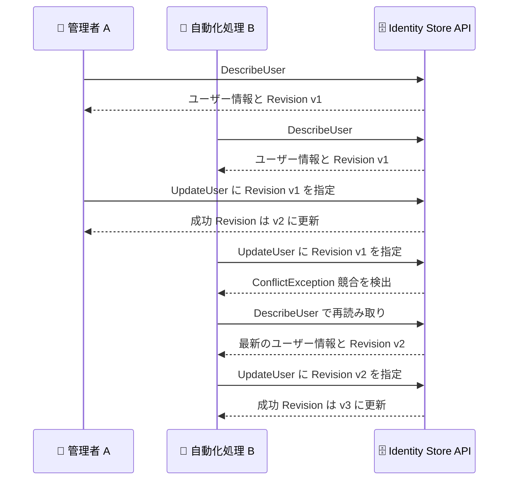

# AWS IAM Identity Center - アイデンティティストアにおけるユーザー・グループの楽観的ロック対応

**リリース日**: 2026 年 10 月 19 日
**サービス**: AWS IAM Identity Center
**機能**: アイデンティティストア (Identity Store) のユーザーおよびグループに対する楽観的ロック (Optimistic Locking)

📊 [このアップデートのインフォグラフィックを見る](https://takech9203.github.io/aws-news-summary/20261019-iam-identity-store-optimistic-locking.html)

## 概要

AWS IAM Identity Center のアイデンティティストアが、ユーザーとグループに対する楽観的ロックをサポートしました。これにより、最後に読み取った時点からユーザーまたはグループが変更されていない場合にのみ、更新や削除のリクエストが成功するように制御できます。複数の管理者や自動化処理が同じユーザー・グループを同時に編集する環境において、一方の書き込みがもう一方の書き込みを意図せず上書きしてしまう問題を防止できます。

各ユーザーとグループには Revision 値が付与され、属性が変更されるたびにこの値が変化します。SCIM プロビジョニング、Active Directory 同期、マネジメントコンソールからの変更など、変更経路を問わず Revision は更新されます。Create、Describe、Update、List の各オペレーションは現在の Revision を返却し、`UpdateUser`、`UpdateGroup`、`DeleteUser`、`DeleteGroup` の呼び出し時に Revision を指定することで条件付きリクエストを実行できます。Revision が一致しない場合は `ConflictException` が返されるため、ワークフロー側で最新の状態を再読み取りしてリトライする設計が可能になります。

Revision の指定はオプションであり、指定しない場合は従来どおりの動作となるため、既存のインテグレーションへの影響はありません。アイデンティティ管理を自動化しているユーザーや、複数の管理チームが同一のアイデンティティストアを運用している組織にとって、データ整合性を高める重要なアップデートです。

**アップデート前の課題**

- 複数の管理者や自動化ツールが同じユーザー・グループを同時に更新した場合、後から実行された書き込みが先の変更を暗黙的に上書きしてしまう可能性があった
- SCIM プロビジョニングや Active Directory 同期とカスタム自動化が並行して動作する環境で、更新の競合を API レベルで検出する手段がなかった
- 競合を避けるためには、アプリケーション側で独自の排他制御やロック機構を実装する必要があった

**アップデート後の改善**

- Revision 値を用いた条件付きリクエストにより、読み取り時点から変更がない場合にのみ更新・削除が成功するようになった
- 競合発生時は `ConflictException` が返されるため、再読み取りとリトライによる安全な競合解決フローを実装できるようになった
- Revision の指定はオプションのため、既存のワークフローを変更することなく段階的に導入できる

## アーキテクチャ図



複数のクライアントが同一ユーザーを同時に更新しようとした場合の楽観的ロックの動作を示しています。Revision が一致しないリクエストは `ConflictException` で拒否され、再読み取り後のリトライにより安全に更新が完了します。

## サービスアップデートの詳細

### 主要機能

1. **Revision 値による変更追跡**
   - すべてのユーザーとグループに Revision 値が付与される
   - 属性が変更されるたびに Revision が変化する
   - SCIM プロビジョニング、Active Directory 同期、コンソール操作など、あらゆる変更経路で Revision が更新される

2. **条件付き更新・削除リクエスト**
   - `UpdateUser`、`UpdateGroup`、`DeleteUser`、`DeleteGroup` で Revision を指定可能
   - 指定した Revision が現在の値と一致する場合にのみリクエストが成功する
   - 不一致の場合は `ConflictException` が返され、意図しない上書きを防止できる

3. **Revision の取得手段**
   - Create、Describe、Update、List の各オペレーションが現在の Revision を返却する
   - 更新成功時のレスポンスから新しい Revision を取得し、後続の操作に利用できる

4. **後方互換性の維持**
   - Revision の指定はオプションであり、省略した場合は従来どおりの動作となる
   - 既存のインテグレーションやスクリプトは変更なしで動作し続ける

## 技術仕様

### 楽観的ロックの仕様

| 項目 | 詳細 |
|------|------|
| 対象リソース | アイデンティティストアのユーザーおよびグループ |
| Revision を返す操作 | Create、Describe、Update、List 系オペレーション |
| Revision を指定できる操作 | `UpdateUser`、`UpdateGroup`、`DeleteUser`、`DeleteGroup` |
| 競合時の動作 | `ConflictException` を返却 |
| Revision の指定 | オプション (省略時は従来の動作) |
| 対応エンドポイント | Identity Store API のみ (SCIM エンドポイントは非対応) |
| グループメンバーシップ操作 | Revision の指定不可。メンバーシップ変更はユーザー・グループの Revision を変化させない |
| 追加料金 | なし |

### 条件付きリクエストの流れ

```text
1. DescribeUser / DescribeGroup で現在の Revision を取得
2. UpdateUser / UpdateGroup / DeleteUser / DeleteGroup に Revision を指定して実行
3. Revision が一致 → リクエスト成功、新しい Revision が返却される
4. Revision が不一致 → ConflictException が返却される
5. 競合時は再読み取りして最新の Revision と属性値で再実行
```

## 設定方法

### 前提条件

1. AWS IAM Identity Center が有効化されていること
2. アイデンティティストアの ID (`IdentityStoreId`) を把握していること
3. `identitystore` API を呼び出す IAM 権限 (例: `identitystore:DescribeUser`、`identitystore:UpdateUser`) があること

### 手順

#### ステップ 1: 現在の Revision を取得する

```bash
aws identitystore describe-user \
  --identity-store-id d-1234567890 \
  --user-id "94482488-3041-7026-18f3-example"
```

対象ユーザーの属性情報を取得します。レスポンスに現在の Revision 値が含まれるため、この値を控えておきます。

#### ステップ 2: Revision を指定して条件付き更新を実行する

```bash
aws identitystore update-user \
  --identity-store-id d-1234567890 \
  --user-id "94482488-3041-7026-18f3-example" \
  --operations '[{"AttributePath": "title", "AttributeValue": "Senior Engineer"}]' \
  --revision "<ステップ 1 で取得した Revision>"
```

取得した Revision を指定してユーザー属性を更新します。読み取り時点から対象ユーザーが変更されていればリクエストは `ConflictException` で失敗し、意図しない上書きを防止できます。

#### ステップ 3: 競合発生時のリトライ処理を実装する

```text
ConflictException を受信した場合。
1. DescribeUser で最新の属性と Revision を再取得
2. 取得した最新状態を基に更新内容を再評価
3. 新しい Revision を指定して更新を再実行
```

自動化ワークフローには上記のリトライロジックを組み込みます。競合を検出した際に最新状態を確認してから更新することで、他の変更を失わずに安全な運用が可能になります。

## メリット

### ビジネス面

- **データ整合性の向上**: 複数チームや自動化処理によるアイデンティティ情報の変更が互いに上書きされるリスクを排除し、監査性と信頼性を高められる
- **運用リスクの低減**: 意図しない属性の巻き戻りや削除事故を防止し、アクセス管理の正確性を維持できる
- **追加コスト不要**: 追加料金なしで利用でき、既存環境への導入障壁が低い

### 技術面

- **API レベルの競合検出**: アプリケーション側で独自の排他制御を実装することなく、Identity Store API の標準機能として競合を検出できる
- **安全なリトライ設計**: `ConflictException` を契機とした再読み取りとリトライのパターンにより、冪等で堅牢な自動化を実装できる
- **後方互換性**: Revision の指定はオプションのため、既存コードを変更せずに段階的に採用できる

## デメリット・制約事項

### 制限事項

- 条件付きリクエストは Identity Store API 経由でのみ利用可能で、SCIM エンドポイントでは利用できない
- グループメンバーシップ操作 (メンバーの追加・削除) は Revision を受け付けず、メンバーシップの変更はユーザーやグループの Revision を変化させない
- 楽観的ロックの対象は `UpdateUser`、`UpdateGroup`、`DeleteUser`、`DeleteGroup` に限られる

### 考慮すべき点

- SCIM プロビジョニングや Active Directory 同期による変更でも Revision が変化するため、外部 IdP と連携している環境では競合が発生しやすくなる可能性があり、リトライ処理の実装が重要になる
- Revision を省略したリクエストは従来どおり無条件で成功するため、楽観的ロックの効果を得るにはすべての更新経路で Revision を指定する運用が望ましい
- 競合が頻発するワークロードでは、リトライ回数の上限やバックオフ戦略を設計しておく必要がある

## ユースケース

### ユースケース 1: 複数管理者による同時運用での上書き防止

**シナリオ**: 複数の IT 管理者が同じアイデンティティストアのユーザー情報をコンソールや CLI から更新しており、変更の競合によって属性が意図せず巻き戻る事象が発生している。

**実装例**:
```bash
# 更新前に必ず最新の Revision を取得
aws identitystore describe-user \
  --identity-store-id d-1234567890 \
  --user-id "<ユーザー ID>"

# 取得した Revision を指定して更新
aws identitystore update-user \
  --identity-store-id d-1234567890 \
  --user-id "<ユーザー ID>" \
  --operations '[{"AttributePath": "displayName", "AttributeValue": "New Name"}]' \
  --revision "<取得した Revision>"
```

**効果**: 他の管理者が先に変更していた場合はリクエストが失敗するため、最新状態を確認したうえで更新でき、変更の上書き事故を防止できる。

### ユースケース 2: SCIM 同期と並行する自動化パイプラインの保護

**シナリオ**: 外部 IdP からの SCIM プロビジョニングが稼働している環境で、社内の自動化パイプラインが追加の属性更新を行っており、同期処理との競合が懸念される。

**実装例**:
```text
自動化パイプラインの処理フロー。
1. DescribeUser で属性と Revision を取得
2. Revision を指定して UpdateUser を実行
3. ConflictException 発生時は指数バックオフで再読み取りとリトライ
4. 最大リトライ回数を超えた場合はアラートを送信
```

**効果**: SCIM 同期が直前にユーザーを変更していた場合でも、自動化側が古い状態に基づいて上書きすることを防ぎ、両者の変更を安全に共存させられる。

### ユースケース 3: 安全なユーザー・グループ削除の実装

**シナリオ**: 退職者のオフボーディング処理でユーザーを削除する際、削除判断の根拠とした情報が削除実行時点まで変わっていないことを保証したい。

**実装例**:
```bash
# 削除対象の状態と Revision を確認
aws identitystore describe-user \
  --identity-store-id d-1234567890 \
  --user-id "<ユーザー ID>"

# 確認した Revision を指定して削除
aws identitystore delete-user \
  --identity-store-id d-1234567890 \
  --user-id "<ユーザー ID>" \
  --revision "<確認した Revision>"
```

**効果**: 確認後にユーザー情報が変更されていた場合は削除が失敗するため、最新状態を再確認してから削除を判断でき、誤削除のリスクを低減できる。

## 料金

本機能は追加料金なしで利用できます。AWS IAM Identity Center 自体も追加料金なしで利用可能です。

## 利用可能リージョン

AWS IAM Identity Center が利用可能なすべての AWS リージョンで利用できます。

## 関連サービス・機能

- **AWS IAM Identity Center**: 本機能が属するサービス。AWS アカウントやアプリケーションへのシングルサインオンとアイデンティティ管理を提供する
- **Identity Store API**: ユーザー・グループの作成、参照、更新、削除を行う API。今回のアップデートで条件付きリクエストに対応した
- **SCIM プロビジョニング**: 外部 IdP からユーザー・グループを同期する仕組み。SCIM による変更も Revision を更新するが、SCIM エンドポイント自体は条件付きリクエストに非対応
- **AWS Managed Microsoft AD / AD Connector**: Active Directory 同期による変更も Revision の更新対象となる

## 参考リンク

- 📊 [インフォグラフィック](https://takech9203.github.io/aws-news-summary/20261019-iam-identity-store-optimistic-locking.html)
- [公式発表 (What's New)](https://aws.amazon.com/about-aws/whats-new/2026/10/iam-identity-store-optimistic-locking/)
- [UpdateUser API リファレンス](https://docs.aws.amazon.com/singlesignon/latest/IdentityStoreAPIReference/API_UpdateUser.html)
- [AWS IAM Identity Center ドキュメント](https://docs.aws.amazon.com/singlesignon/latest/userguide/what-is.html)

## まとめ

IAM Identity Center のアイデンティティストアが楽観的ロックに対応し、ユーザー・グループの更新・削除における同時変更の競合を API レベルで検出できるようになりました。Revision の指定はオプションで後方互換性が維持されているため、既存環境への影響なく導入できます。複数の管理者や自動化処理がアイデンティティ情報を変更している環境では、更新・削除リクエストに Revision を指定し、`ConflictException` に対するリトライ処理を組み込むことを推奨します。
