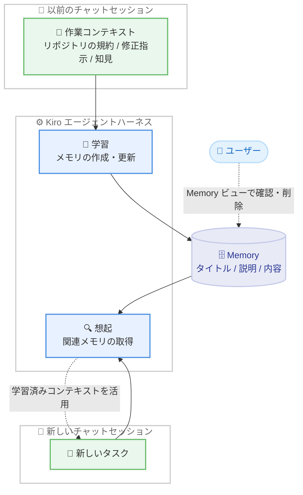

# Kiro - チャットセッションをまたぐ Memory 機能の一般提供開始

**リリース日**: 2026 年 10 月 19 日
**サービス**: Kiro (IDE 1.4.0)
**機能**: Memory Across Chat Sessions

📊 [このアップデートのインフォグラフィックを見る](https://takech9203.github.io/aws-news-summary/20261019-kiro-changelog-2026-10-19.html)

## 概要

2026 年 10 月 19 日、Kiro IDE 1.4.0 がリリースされ、Memory 機能がすべての Kiro IDE ユーザーに提供されました。Memory は、リポジトリのコマンドや規約、ユーザーからの修正指示、デバッグで得られた知見、すでに不採用と判断したアプローチ、ユーザーの作業スタイルといった有用なコンテキストを、チャットセッションをまたいで保持する機能です。関連するコンテキストが再び必要になった場面で、Kiro が後続の作業の中でそれを活用できます。

Memory は、コンテキストを組み立ててエージェントを実行するシステムである Kiro エージェントハーネスの一部として動作します。「作業の中からどの情報を保持する価値があるか判断する」「目の前のタスクに関連するメモリを見つける」という 2 つの課題を解決します。各メモリはタイトル、説明、内容を持つレコードであり、過去の会話のコピーではありません。

本リリースには Memory のほか、長い Markdown Review ドキュメントでの検索 (find) の信頼性向上、Cancel を無視するサインイン画面の修正、Ubuntu 24.04 で `.deb` パッケージからインストールした後に Kiro が起動しない問題の修正も含まれています。

**アップデート前の課題**

- 以前はチャットセッションを終了すると、リポジトリの規約や修正指示などのコンテキストが引き継がれず、新しいセッションのたびに説明し直す必要があった
- 以前はデバッグで判明した知見や不採用と判断したアプローチが記録されず、後続セッションで同じ調査を繰り返すおそれがあった
- 恒常的なルールを引き継ぐには、Steering ファイルとしてユーザー自身が明示的に記述する必要があった

**アップデート後の改善**

- 今回のアップデートにより、Kiro が作業から有用なコンテキストを自動的に学習し、後続のセッションで想起できるようになった
- アクティビティバーの Memories アイコンから Memory ビューを開き、Kiro が記憶している内容の確認、検索、削除ができるようになった
- チャット上でメモリへのアクセスや変更が可視化され、`Kiro Agent: Memory` 設定でメモリの使用・学習の方法を制御できるようになった

## アーキテクチャ図



エージェントハーネスが現在のセッションから有用なコンテキストを学習してメモリとして保存し、後続のセッションで関連するメモリを想起してタスクに活用する流れを示しています。

## サービスアップデートの詳細

### 主要機能

1. **セッションをまたぐコンテキストの保持 (Memory)**
   - リポジトリのコマンドや規約、修正指示、デバッグの知見、不採用と判断したアプローチ、ユーザーの作業スタイルなどを記憶する
   - 各メモリはタイトル、説明、内容を持つレコードとして保存される (会話のコピーではない)
   - 後続のセッションで、作業中のリクエストに関連するメモリを Kiro が自動的に想起する

2. **Memory ビューによる記憶内容の管理**
   - アクティビティバーの Memories アイコンから Memory ビューを開き、グローバルメモリと、現在のウィンドウで開いているリポジトリにスコープされたメモリを一覧できる
   - 各メモリはタイトル、作成からの経過時間、1 行のサマリー、タイプ (Preference、Fact など)、適用場所 (Global またはリポジトリ名) を表示する
   - 検索ボックスやタイプ・場所によるフィルタリング、行の選択によるエディタタブでの内容確認、右クリックまたはタブからの削除に対応する

3. **チャット上でのメモリ操作の可視化**
   - Kiro がメモリを使用すると、チャットに `Memory accessed`、`Memory created`、`Memory updated` などの折りたたみ可能なエントリが表示される
   - タイトルにカーソルを合わせるとメモリのタイプとサマリーを確認でき、選択するとメモリを開ける
   - 想起されたメモリはコンテキストを消費し、チャット入力欄の Context Usage に Memory の行として表示される

4. **`Kiro Agent: Memory` 設定によるアクセスレベル制御**
   - メモリの使用と学習の方法を 4 段階のアクセスレベルで制御できる
   - `Use only` を選択すると、Kiro は既存のメモリを変更せずに読み取り専用で使用する
   - 信頼していないワークスペースでは、チャットからのメモリの追加・変更・削除はできない (読み取りは可能)

5. **その他の改善と修正 (IDE 1.4.0)**
   - Markdown Review の検索改善: ドキュメントの更新時に現在のマッチを保持し、非表示の数式テキストや図のコントロールを無視し、マッチが多数あるドキュメントにも対応。コメントは更新をまたいで対象の文章にアンカーされたまま維持される
   - サインインが完了しない場合に「We will take you to your default web browser to sign in」画面が Cancel を無視する問題を修正。Cancel でサインイン開始画面に戻り、キャンセルした試行が再試行を妨げなくなった
   - Ubuntu 24.04 以降で `.deb` パッケージからインストールした後に Kiro が起動しない問題を修正

## 技術仕様

### Memory のアクセスレベル

| アクセスレベル | 動作 |
|------|------|
| Use and learn | メモリを使用し、権限に従って変更できる。メモリの作成・更新を自動的に行う (デフォルト) |
| Use but don't learn | メモリを使用し、ユーザーが依頼した場合のみ権限に従って変更する。自動的な作成・更新は行わない |
| Use only | 既存のメモリを使用するが、依頼されても作成・更新・削除は行わない (読み取り専用) |
| Off | メモリを使用せず、変更もしない |

### 設定の適用タイミングとスコープ

| 項目 | 詳細 |
|------|------|
| 設定スコープ | ユーザー設定のみ有効。ワークスペース設定に値を記述しても効果はない |
| オン / オフ、`Use only` への切り替え | 新しいセッションから適用される。「Memory settings updated. The change applies to new sessions.」の通知と Start new session アクションが表示される |
| `Use and learn` と `Use but don't learn` 間の切り替え | 開いているローカルセッションに即時反映される |
| ワークスペーストラスト | 信頼していないワークスペースでは、チャットからのメモリの追加・変更・削除は不可 (読み取りは可能) |
| メモリの構成要素 | タイトル、説明、内容。タイプ (Preference、Fact、Other) と場所 (Global またはリポジトリ) を持つ |

## 設定方法

### 前提条件

1. Kiro IDE 1.4.0 以降がインストールされていること
2. Kiro にサインインしていること
3. メモリを変更する場合は、対象のワークスペースを信頼していること

### 手順

#### ステップ 1: Memory ビューを開く

アクティビティバーの Memories アイコンを選択して Memory ビューを開きます。グローバルメモリと、現在のウィンドウで開いているリポジトリにスコープされたメモリが一覧表示されます。

#### ステップ 2: アクセスレベルを設定する

Memory ビューの設定ギアを選択すると、設定画面が `Kiro Agent: Memory` 設定を表示した状態で開きます。`Use and learn` (デフォルト)、`Use but don't learn`、`Use only`、`Off` の中からアクセスレベルを選択します。オン / オフや `Use only` への切り替えは新しいセッションから適用されます。

#### ステップ 3: 記憶内容を確認・管理する

Memory ビューの検索ボックスでタイトルやサマリーをフィルタリングし、行を選択してエディタタブで内容を確認します。不要なメモリは行の右クリックまたはタブの Delete ボタンから削除します (削除前に確認ダイアログが表示されます)。チャットでは `Memory accessed` などのエントリから、セッション中のメモリ操作を確認できます。

## メリット

### ビジネス面

- **オンボーディングの効率化**: リポジトリ固有のコマンドや規約を Kiro が記憶するため、セッションごとの説明が不要になり、作業の立ち上がりが速くなる
- **作業の継続性向上**: コンテキストの再構築に費やす時間が減り、タスクの継続に集中できる
- **ガバナンスの確保**: アクセスレベル設定とワークスペーストラストにより、組織のポリシーに応じてメモリの学習・変更を制御できる

### 技術面

- **デバッグ知見の再利用**: 「統合テストの前にローカルデータベースのシードが必要」といった知見を記録し、後続セッションで原因調査を繰り返さずに済む
- **不採用アプローチの記録**: すでに検討して不採用とした方法を記憶するため、同じ提案の繰り返しを避けられる
- **透明性の高い動作**: チャット上でメモリへのアクセス・作成・更新が可視化され、Context Usage でコンテキスト消費量も確認できる

## デメリット・制約事項

### 制限事項

- Memory 設定はユーザー設定のみ有効で、ワークスペース設定では制御できない
- 信頼していないワークスペースでは、チャットからメモリを追加・変更・削除できない (読み取りは可能)
- オン / オフや `Use only` への切り替えは新しいセッションからの適用となり、既存セッションには反映されない

### 考慮すべき点

- 想起されたメモリはコンテキストを消費するため、Context Usage で使用状況を確認するとよい
- 常に一貫して適用すべきルールは、Memory ではなく Steering に明示的に記述することが推奨されている
- `Use only` でも Memory ビューからの削除は可能だが、メモリ内容の修正をチャットで依頼できるのは `Use and learn` または `Use but don't learn` のときのみ

## ユースケース

### ユースケース 1: リポジトリ固有の手順の自動想起

**シナリオ**: 統合テストがローカルデータベースのシード後にしか成功しないリポジトリで、毎回テスト失敗の原因調査から始まってしまう。

**実装例**:
```text
1. デバッグセッション中に Kiro が「シード前は統合テストが失敗する」ことを学習
2. メモリ seed-db-before-integration-tests が作成される
3. 後続セッションでテスト実行を依頼すると、チャットに
   Memory accessed (1) が表示され、シードを先に実行する
```

**効果**: 原因の再調査が不要になり、テスト実行までの手戻りが削減される。

### ユースケース 2: コーディング規約・修正指示の継続適用

**シナリオ**: レビューのたびに「このプロジェクトではこの命名規則を使う」「このライブラリは使わない」といった同じ指摘を Kiro に伝え直している。

**実装例**:
```text
1. アクセスレベルを Use and learn (デフォルト) のままにする
2. チャットで規約や修正指示を伝えると、Kiro がメモリとして学習
3. Memory ビューで Preference タイプのメモリとして内容を確認
```

**効果**: セッションをまたいで修正指示が反映され、同じ指摘の繰り返しが減る。

### ユースケース 3: 読み取り専用運用による安定したコンテキスト利用

**シナリオ**: チームで検証済みの知見だけを Kiro に使わせたいが、日々の作業で意図しないメモリが自動的に追加されることは避けたい。

**実装例**:
```text
1. 必要なメモリが蓄積された段階で、Kiro Agent: Memory 設定を
   Use only に変更
2. 新しいセッションから、Kiro は既存メモリを読み取り専用で使用
3. 不要になったメモリは Memory ビューから手動で削除
```

**効果**: 検証済みのコンテキストのみを安定して活用でき、メモリの意図しない変更を防止できる。

## 利用可能リージョン

グローバル (Kiro はグローバルに提供されるサービスです)

## 関連サービス・機能

- **Steering**: ユーザーが明示的に記述するルールとガイダンス。常に適用すべきルールは Memory ではなく Steering に記述することが推奨される
- **Compaction**: 長いセッションをコンテキスト上限内に収めるための古い会話履歴の要約。Memory と併用してコンテキストを管理できる
- **Knowledge bases (CLI)**: ユーザーが選択してインデックス化する参照資料。Memory が学習したコンテキストを補完する
- **Markdown Review**: 本リリースで検索の信頼性が向上した、Markdown ドキュメントのレビュー機能

## 参考リンク

- 📊 [インフォグラフィック](https://takech9203.github.io/aws-news-summary/20261019-kiro-changelog-2026-10-19.html)
- [Kiro Changelog - Memory Across Chat Sessions](https://kiro.dev/changelog/ide/1-4)
- [Kiro Changelog](https://kiro.dev/changelog/)
- [ドキュメント - Memory](https://kiro.dev/docs/memory/)

## まとめ

Kiro IDE 1.4.0 で Memory 機能がすべてのユーザーに提供され、リポジトリの規約や修正指示、デバッグの知見をセッションをまたいで活用できるようになりました。デフォルトの `Use and learn` で自動学習が有効になるため、まずは Memory ビューで記憶内容を確認し、チームのポリシーに合わせて `Kiro Agent: Memory` 設定のアクセスレベルを選択することを推奨します。常に適用すべきルールは引き続き Steering に記述し、Memory と役割を分担させるのが効果的です。
