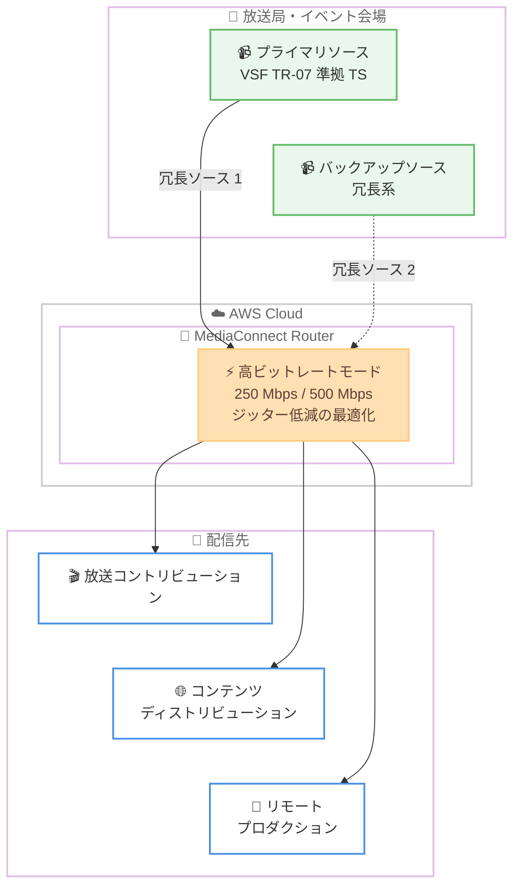

# AWS Elemental MediaConnect - Router 高ビットレートモードのサポート

**リリース日**: 2026 年 10 月 19 日
**サービス**: AWS Elemental MediaConnect
**機能**: MediaConnect Router High Bitrate Mode

📊 [このアップデートのインフォグラフィックを見る](https://takech9203.github.io/aws-news-summary/20261019-mediaconnect-router-high-bitrate.html)

## 概要

AWS Elemental MediaConnect Router が高ビットレートモードをサポートしました。新たに 250 Mbps と 500 Mbps の 2 つのティアが追加され、プロフェッショナルな放送事業者が品質や信頼性を損なうことなく、高価値コンテンツをクラウド経由で伝送できるようになります。

今回のアップデートにより、VSF TR-07 準拠のトランスポートストリーム配信といった業界標準のワークフローが実現可能になります。放送コントリビューション (素材伝送)、コンテンツディストリビューション、リモートプロダクションなど、高品質な映像伝送が求められる現場での活用が想定されています。

高ビットレートモードでは、信頼性確保のために最大 2 つの冗長ソースをサポートするほか、ジッターを低減するデータプレーンの最適化も含まれており、高ビットレート伝送時の安定性が強化されています。

**アップデート前の課題**

高ビットレートの放送品質コンテンツをクラウドでルーティングする際に、以下の課題がありました。

- MediaConnect Router の従来のビットレート上限では、JPEG XS などの軽圧縮コーデックを用いた高品質なメザニンレベルのコンテンツ伝送が困難だった
- VSF TR-07 準拠の高ビットレートなトランスポートストリーム配信ワークフローをルーター経由で実現できなかった
- 高価値コンテンツの伝送では、品質 (ビットレート) と信頼性 (冗長性) の両立が求められるが、選択肢が限られていた

**アップデート後の改善**

今回のアップデートにより、以下が可能になりました。

- 250 Mbps および 500 Mbps の 2 つの高ビットレートティアを選択でき、放送品質の高価値コンテンツをルーティングできるようになった
- VSF TR-07 準拠のトランスポートストリーム配信など、業界標準ワークフローに対応した
- 最大 2 つの冗長ソースによる高い信頼性と、ジッターを低減するデータプレーン最適化により、安定した高ビットレート伝送が実現した

## アーキテクチャ図

最大 2 つの冗長ソースから高ビットレートのトランスポートストリームを MediaConnect Router で受信し、放送コントリビューション、コンテンツディストリビューション、リモートプロダクションなどの配信先へルーティングする構成を示しています。

## サービスアップデートの詳細

### 主要機能

1. **高ビットレートティアの追加**
   - 250 Mbps と 500 Mbps の 2 つの新しいティアを提供
   - プロフェッショナルな放送事業者による高価値コンテンツの伝送を想定
   - 品質と信頼性を両立した高ビットレート伝送が可能

2. **業界標準ワークフローへの対応**
   - VSF TR-07 準拠のトランスポートストリーム配信をサポート
   - VSF TR-07 は Video Services Forum が策定した、JPEG XS を MPEG-2 トランスポートストリームで伝送するための業界標準仕様
   - 放送コントリビューション、コンテンツディストリビューション、リモートプロダクションのワークフローに対応

3. **冗長性と安定性の強化**
   - 信頼性確保のため、最大 2 つの冗長ソースをサポート
   - ジッターを低減するデータプレーンの最適化を実装
   - 高ビットレート伝送時でも安定した映像品質を維持

## 技術仕様

### 高ビットレートモードの仕様

| 項目 | 詳細 |
|------|------|
| 新ティア | 250 Mbps、500 Mbps の 2 種類 |
| 対応標準 | VSF TR-07 準拠のトランスポートストリーム配信 |
| 冗長ソース | 最大 2 つの冗長ソースをサポート |
| データプレーン | ジッターを低減する最適化を実装 |
| 主な用途 | 放送コントリビューション、コンテンツディストリビューション、リモートプロダクション |

## 設定方法

### 前提条件

1. AWS アカウントと AWS Elemental MediaConnect へのアクセス権限
2. MediaConnect Router リソースを作成・管理する IAM 権限
3. 高ビットレート伝送に対応したソース機器 (VSF TR-07 準拠のエンコーダーなど) とネットワーク帯域

### 手順

#### ステップ 1: MediaConnect Router の入力を作成

マネジメントコンソールまたは API を使用して、MediaConnect Router の入力を作成し、高ビットレートのティア (250 Mbps または 500 Mbps) を選択します。

#### ステップ 2: 冗長ソースの設定

信頼性を高めるため、最大 2 つの冗長ソースを設定します。プライマリとバックアップのソースを登録することで、片系に障害が発生した場合でも伝送を継続できます。

#### ステップ 3: 出力とルーティングの設定

ルーターの出力を作成し、配信先 (コントリビューション先やリモートプロダクション拠点など) へのルーティングを設定します。

詳細な設定手順は [AWS Elemental MediaConnect ユーザーガイド](https://docs.aws.amazon.com/mediaconnect/latest/ug/what-is.html) を参照してください。

## メリット

### ビジネス面

- **高価値コンテンツのクラウド伝送**: スポーツ中継やライブイベントなどのプレミアムコンテンツを、品質を妥協することなくクラウド経由で伝送可能
- **専用線やオンプレミス機器への依存低減**: 従来は専用インフラが必要だった高ビットレート伝送をマネージドサービスで実現
- **ワークフローの柔軟性向上**: リモートプロダクションなど、地理的に分散した制作体制を支援

### 技術面

- **業界標準への準拠**: VSF TR-07 準拠により、既存の放送機器・ワークフローとの互換性を確保
- **冗長構成による高信頼性**: 最大 2 つの冗長ソースにより、単一障害点を排除
- **伝送品質の向上**: データプレーンの最適化によるジッター低減で、高ビットレートでも安定した伝送を実現

## デメリット・制約事項

### 制限事項

- 高ビットレートモードで選択できるティアは 250 Mbps と 500 Mbps の 2 種類
- 冗長ソースは最大 2 つまでのサポート
- 公式発表では利用可能リージョンが明記されていないため、利用前に対象リージョンの確認が必要

### 考慮すべき点

- 高ビットレート伝送にはオンプレミス側にも十分なネットワーク帯域が必要
- 高ビットレートティアの利用により料金が変わる可能性があるため、事前に [料金ページ](https://aws.amazon.com/mediaconnect/pricing/) での確認を推奨
- VSF TR-07 ワークフローを利用する場合、対応するエンコーダー・デコーダー機器が必要

## ユースケース

### ユースケース 1: スポーツ中継の放送コントリビューション

**シナリオ**: スタジアムから放送局へ、JPEG XS で軽圧縮した高品質な中継映像を伝送したい。

**実装例**: VSF TR-07 準拠のエンコーダーでスタジアムの映像を圧縮し、500 Mbps ティアの MediaConnect Router 入力へ冗長 2 系統で送信。放送局側の受信拠点へルーティングする。

**効果**: 専用線に依存せず、放送品質の映像をクラウド経由で信頼性高く伝送できる。

### ユースケース 2: リモートプロダクション

**シナリオ**: イベント会場のカメラ映像を遠隔地の制作スタジオへ伝送し、スイッチングや編集をリモートで実施したい。

**実装例**: 会場からの複数ソースを 250 Mbps ティアの高ビットレートモードで MediaConnect Router に集約し、制作スタジオへルーティング。冗長ソースにより回線障害時も伝送を継続する。

**効果**: 制作要員や機材の現地派遣を削減しながら、高品質な素材でのリモート制作が可能になる。

### ユースケース 3: 系列局・パートナーへのコンテンツディストリビューション

**シナリオ**: 高価値なライブコンテンツを複数の系列局やパートナーへ高品質のまま配信したい。

**実装例**: MediaConnect Router の高ビットレートモードでソースを受信し、ルーターの出力から複数の配信先へルーティングする。

**効果**: 1 つの高品質ソースを複数拠点へ効率的に配信でき、配信網の構築・運用コストを削減できる。

## 料金

公式発表では高ビットレートモードの具体的な料金は示されていません。MediaConnect Router の料金はティアや使用量に応じて課金されるため、最新の料金体系は [MediaConnect 料金ページ](https://aws.amazon.com/mediaconnect/pricing/) を確認してください。

## 利用可能リージョン

公式発表では利用可能リージョンが明記されていません。最新の対応状況は [AWS Elemental MediaConnect 製品ページ](https://aws.amazon.com/mediaconnect/) および公式ドキュメントで確認してください。

## 関連サービス・機能

- **AWS Elemental MediaLive**: MediaConnect で伝送した映像のライブエンコードに利用可能
- **AWS Elemental MediaConnect Flow**: ポイントツーポイントの映像伝送機能。Router はより柔軟なルーティングを提供
- **AWS Elemental MediaConnect Gateway**: オンプレミスとクラウド間の映像伝送を仲介するコンポーネント

## 参考リンク

- 📊 [インフォグラフィック](https://takech9203.github.io/aws-news-summary/20261019-mediaconnect-router-high-bitrate.html)
- [公式発表 (What's New)](https://aws.amazon.com/about-aws/whats-new/2026/10/mediaconnect-router-high-bitrate/)
- [AWS Blog: Build redundant live video workflows with AWS Elemental MediaConnect Router](https://aws.amazon.com/blogs/media/build-redundant-live-video-workflows-with-aws-elemental-mediaconnect-router/)
- [AWS Elemental MediaConnect 製品ページ](https://aws.amazon.com/mediaconnect/)
- [AWS Elemental MediaConnect ドキュメント](https://docs.aws.amazon.com/mediaconnect/latest/ug/what-is.html)
- [料金ページ](https://aws.amazon.com/mediaconnect/pricing/)

## まとめ

MediaConnect Router の高ビットレートモード (250 Mbps / 500 Mbps) により、VSF TR-07 準拠の業界標準ワークフローをクラウドで実現できるようになりました。放送コントリビューションやリモートプロダクションで高品質な映像伝送を検討している場合は、冗長ソース構成と合わせて本機能の活用を検討することを推奨します。
