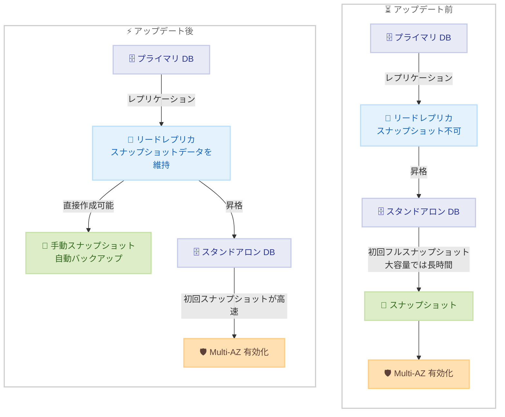

# Amazon RDS for SQL Server - リードレプリカ上での DB スナップショット作成サポート

**リリース日**: 2026 年 10 月 19 日
**サービス**: Amazon RDS for SQL Server
**機能**: リードレプリカインスタンス上での DB スナップショット作成および自動バックアップ

📊 [このアップデートのインフォグラフィックを見る](https://takech9203.github.io/aws-news-summary/20261019-rds-sqlserver-supports-snapshots-on-read-replicas.html)

## 概要

Amazon RDS for SQL Server が、リードレプリカインスタンス上で直接 DB スナップショットを作成できるようになりました。これまでスナップショットの作成はスタンドアロンインスタンスとプライマリ DB インスタンスに限定されており、リードレプリカのスナップショットを取得するには、事前にレプリカをスタンドアロンインスタンスへ昇格させる必要がありました。今回のアップデートにより、昇格なしでリードレプリカの手動スナップショット作成、自動バックアップの有効化、削除時の自動バックアップ保持が可能になります。

本アップデートの大きな価値は、ディザスタリカバリ (DR) ワークフローの短縮と予測可能性の向上にあります。従来、昇格したリードレプリカで Multi-AZ 配置を有効化するには、初回フルスナップショットの完了を待つ必要があり、io2 ストレージで最大 64 TiB といった大容量構成では長い時間を要していました。今回のアップデートにより、RDS はリードレプリカのライフサイクル全体を通じてスナップショットデータを維持するため、昇格後の最初のスナップショットが大幅に高速化され、Multi-AZ 有効化までの時間を短縮し、DR のタイムラインをより予測しやすくなります。

リージョン内レプリカとクロスリージョンレプリカの両方に対応しており、大規模な SQL Server ワークロードを運用し、リードレプリカを DR 戦略に組み込んでいるユーザーにとって重要なアップデートです。

**アップデート前の課題**

- リードレプリカのスナップショットを取得するには、レプリカをスタンドアロンインスタンスへ昇格させる必要があった
- 昇格後に Multi-AZ 配置を有効化する際、初回フルスナップショットの完了を待つ必要があり、大容量ストレージ (io2 で最大 64 TiB) では長時間を要した
- 初回スナップショットの所要時間が読めないため、DR の復旧タイムラインの見積もりが困難だった

**アップデート後の改善**

- 昇格せずにリードレプリカ上で直接、手動スナップショットの作成と自動バックアップの有効化が可能になった
- RDS がリードレプリカのライフサイクル全体でスナップショットデータを維持するため、昇格後の最初のスナップショットが高速に完了するようになった
- Multi-AZ 有効化までの時間が短縮され、DR タイムラインの予測可能性が向上した
- リードレプリカ削除時に自動バックアップを保持できるようになった

## アーキテクチャ図



アップデート前はリードレプリカの昇格後に初回フルスナップショットの完了を待つ必要がありましたが、アップデート後はレプリカがライフサイクル全体でスナップショットデータを維持するため、昇格後のスナップショットが高速化され、Multi-AZ 有効化までの時間が短縮されます。

## サービスアップデートの詳細

### 主要機能

1. **リードレプリカ上での手動スナップショット作成**
   - 昇格を行わずに、リードレプリカの手動 DB スナップショットを直接作成できる
   - リードレプリカのスナップショットから、他の DB スナップショットと同様に新しい DB インスタンスを復元できる
   - リージョン内レプリカとクロスリージョンレプリカの両方で利用可能

2. **リードレプリカの自動バックアップ**
   - リードレプリカのバックアップ保持期間を 0 以外に設定することで、ソースインスタンスとは独立して自動バックアップを有効化できる
   - リードレプリカ削除時に自動バックアップを保持するオプションを利用できる

3. **昇格後の Multi-AZ 有効化の高速化**
   - RDS がリードレプリカのライフサイクル全体を通じてスナップショットデータを維持する
   - 昇格後の最初のスナップショットが高速に完了するため、Multi-AZ 配置への変更に要する時間を短縮できる
   - DR の復旧タイムラインをより予測しやすくなる

## 技術仕様

### 対応範囲と制限

| 項目 | 詳細 |
|------|------|
| 対象エンジン | Amazon RDS for SQL Server (Enterprise Edition のみ。リードレプリカ自体が EE 限定) |
| 対象バージョン | リードレプリカをサポートするすべての SQL Server バージョン (2016-2025) |
| レプリカ種別 | リージョン内レプリカ、クロスリージョンレプリカの両方 |
| 手動スナップショット | サポート |
| 自動バックアップ | サポート (保持期間を 0 以外に設定) |
| 削除時のバックアップ保持 | サポート |
| ポイントインタイムリカバリ (PITR) | リードレプリカからの PITR は**非サポート**。手動スナップショットまたは自動バックアップのスナップショットから復元する |
| 利用可能リージョン | RDS for SQL Server のリードレプリカが利用可能なすべてのリージョン (AWS GovCloud (US) を含む) |

### リードレプリカの前提条件 (参考)

| 項目 | 詳細 |
|------|------|
| エディション | SQL Server Enterprise Edition (EE) |
| インスタンスクラス | 4 vCPU 以上の DB インスタンスクラス |
| ソースの自動バックアップ | ソース DB インスタンスでバックアップ保持期間を 0 以外に設定 |
| レプリカ数 | 1 つのソースから最大 15 個 |

## 設定方法

### 前提条件

1. Amazon RDS for SQL Server Enterprise Edition でリードレプリカが作成済みであること
2. RDS の操作に必要な IAM 権限 (例: `rds:CreateDBSnapshot`、`rds:ModifyDBInstance`) があること
3. AWS CLI または AWS マネジメントコンソールが利用可能であること

### 手順

#### ステップ 1: リードレプリカの手動スナップショットを作成する

```bash
aws rds create-db-snapshot \
  --db-instance-identifier my-sqlserver-replica \
  --db-snapshot-identifier my-replica-snapshot-20261019
```

リードレプリカインスタンスを指定して手動 DB スナップショットを作成します。従来はこの操作の前にレプリカの昇格が必要でしたが、今回のアップデートにより昇格なしで直接実行できます。

#### ステップ 2: リードレプリカの自動バックアップを有効化する

```bash
aws rds modify-db-instance \
  --db-instance-identifier my-sqlserver-replica \
  --backup-retention-period 7 \
  --apply-immediately
```

リードレプリカのバックアップ保持期間を 7 日に設定し、自動バックアップを有効化します。保持期間を 0 以外に設定することで、ソースインスタンスとは独立してレプリカの自動バックアップが取得されます。

#### ステップ 3: スナップショットから新しい DB インスタンスを復元する

```bash
aws rds restore-db-instance-from-db-snapshot \
  --db-instance-identifier my-restored-instance \
  --db-snapshot-identifier my-replica-snapshot-20261019
```

リードレプリカから取得したスナップショットを使用して、新しい DB インスタンスを復元します。他の DB スナップショットからの復元と同じ手順で実行できます。

#### ステップ 4: 昇格後に Multi-AZ を有効化する (DR シナリオ)

```bash
# リードレプリカを昇格
aws rds promote-read-replica \
  --db-instance-identifier my-sqlserver-replica

# 昇格完了後に Multi-AZ 配置へ変更
aws rds modify-db-instance \
  --db-instance-identifier my-sqlserver-replica \
  --multi-az \
  --apply-immediately
```

DR 発動時にリードレプリカをスタンドアロンインスタンスへ昇格し、Multi-AZ 配置へ変更します。レプリカのライフサイクル全体でスナップショットデータが維持されているため、昇格後の初回スナップショットが高速に完了し、Multi-AZ 有効化までの時間が短縮されます。

## メリット

### ビジネス面

- **DR タイムラインの予測可能性向上**: 昇格後の初回スナップショットが高速化されることで、復旧時間の見積もりが立てやすくなり、RTO 目標の達成が容易になる
- **運用工数の削減**: レプリカのバックアップ取得のためだけに昇格やソースインスタンスへの依存を考慮する必要がなくなる
- **コンプライアンス対応の強化**: レプリカ単位で独立したバックアップを保持でき、バックアップポリシーの柔軟な設計が可能になる

### 技術面

- **昇格不要のスナップショット取得**: リードレプリカのまま手動スナップショットと自動バックアップを利用でき、レプリケーション構成を維持したままバックアップを確保できる
- **大容量ストレージでの高速化**: io2 で最大 64 TiB といった大容量構成でも、昇格後の初回スナップショットがフルスナップショットの待ち時間なしで完了する
- **クロスリージョン対応**: クロスリージョンレプリカでも利用できるため、リージョン障害を想定した DR 構成でも効果を発揮する

## デメリット・制約事項

### 制限事項

- リードレプリカからのポイントインタイムリカバリ (PITR) はサポートされない。復元には手動スナップショットまたは自動バックアップのスナップショットを使用する必要がある
- リードレプリカ自体が SQL Server Enterprise Edition (EE) 限定の機能であるため、Standard Edition などでは利用できない
- リードレプリカは 4 vCPU 以上のインスタンスクラスでのみ作成可能

### 考慮すべき点

- レプリカで自動バックアップを有効化するとバックアップストレージの使用量が増加するため、バックアップストレージ料金への影響を考慮する必要がある
- AWS GovCloud (US-East) と AWS GovCloud (US-West) 間のレプリケーションは可能だが、GovCloud リージョンと商用リージョンをまたぐレプリケーションはできない
- 復旧要件として PITR が必須の場合は、ソース (プライマリ) インスタンスの自動バックアップを引き続き利用する設計が必要

## ユースケース

### ユースケース 1: 大容量データベースの DR における Multi-AZ 化の迅速化

**シナリオ**: io2 ストレージで数十 TiB 規模の SQL Server データベースを運用しており、クロスリージョンリードレプリカを DR サイトとして配置している。リージョン障害時にはレプリカを昇格して Multi-AZ 化するが、初回フルスナップショットの待ち時間が長く、RTO の見積もりが困難だった。

**実装例**:
```bash
# 平常時: レプリカの自動バックアップを有効化してスナップショットデータを維持
aws rds modify-db-instance \
  --db-instance-identifier dr-replica \
  --backup-retention-period 7 \
  --apply-immediately

# DR 発動時: 昇格して Multi-AZ 化
aws rds promote-read-replica --db-instance-identifier dr-replica
aws rds modify-db-instance --db-instance-identifier dr-replica \
  --multi-az --apply-immediately
```

**効果**: 昇格後の初回スナップショットが高速に完了するため、Multi-AZ 有効化までの時間が短縮され、DR の復旧タイムラインを予測可能な形で計画できる。

### ユースケース 2: 本番環境に影響を与えない検証環境の払い出し

**シナリオ**: 本番のプライマリインスタンスに負荷をかけずに、最新に近いデータで検証用・分析用の DB インスタンスを定期的に払い出したい。

**実装例**:
```bash
# リードレプリカから直接スナップショットを作成
aws rds create-db-snapshot \
  --db-instance-identifier reporting-replica \
  --db-snapshot-identifier test-env-snapshot

# スナップショットから検証用インスタンスを復元
aws rds restore-db-instance-from-db-snapshot \
  --db-instance-identifier test-instance \
  --db-snapshot-identifier test-env-snapshot
```

**効果**: 昇格操作やプライマリへの依存なしに検証環境を複製でき、本番ワークロードへの影響を最小限に抑えながら環境払い出しを自動化できる。

### ユースケース 3: レプリカ廃止時のバックアップ保持によるデータ保全

**シナリオ**: 読み取り負荷の変動に応じてリードレプリカを増減させる運用をしており、レプリカ削除後も一定期間はその時点のデータを復元できるようにしておきたい。

**実装例**:
```bash
# 自動バックアップを保持したままリードレプリカを削除
aws rds delete-db-instance \
  --db-instance-identifier scale-in-replica \
  --skip-final-snapshot \
  --no-delete-automated-backups
```

**効果**: レプリカ削除後も保持期間内であれば自動バックアップのスナップショットから復元でき、スケールイン運用とデータ保全を両立できる。

## 料金

本機能自体に追加料金はありません。リードレプリカのスナップショットと自動バックアップには、通常の Amazon RDS バックアップストレージ料金が適用されます。レプリカで自動バックアップを有効化した場合、保持するバックアップ量に応じてバックアップストレージの使用量が増加する点に注意してください。

詳細は [Amazon RDS for SQL Server 料金ページ](https://aws.amazon.com/rds/sqlserver/pricing/)を参照してください。

## 利用可能リージョン

Amazon RDS for SQL Server のリードレプリカが利用可能なすべての AWS リージョンで利用できます。AWS GovCloud (US) リージョンも含まれます。

## 関連サービス・機能

- **Amazon RDS リードレプリカ**: ソース DB インスタンスから非同期レプリケーションされる読み取り専用インスタンス。今回のアップデートでスナップショット作成に対応した
- **Amazon RDS Multi-AZ 配置**: 複数のアベイラビリティーゾーンにスタンバイを配置する高可用性構成。昇格後の Multi-AZ 化が高速になった
- **Amazon RDS 自動バックアップ**: 保持期間 (1-35 日) に基づく自動スナップショットとトランザクションログの取得。リードレプリカでも有効化できるようになった (ただしレプリカからの PITR は非対応)
- **Amazon EBS io2 ボリューム**: RDS で最大 64 TiB をサポートする高性能ストレージ。大容量構成ほど本アップデートの時間短縮効果が大きい

## 参考リンク

- 📊 [インフォグラフィック](https://takech9203.github.io/aws-news-summary/20261019-rds-sqlserver-supports-snapshots-on-read-replicas.html)
- [公式発表 (What's New)](https://aws.amazon.com/about-aws/whats-new/2026/10/rds-sqlserver-supports-snapshots-on-read-replicas)
- [ドキュメント: Working with read replicas for Microsoft SQL Server in Amazon RDS](https://docs.aws.amazon.com/AmazonRDS/latest/UserGuide/SQLServer.ReadReplicas.html)
- [Amazon RDS for SQL Server 製品ページ](https://aws.amazon.com/rds/sqlserver/)
- [料金ページ](https://aws.amazon.com/rds/sqlserver/pricing/)

## まとめ

Amazon RDS for SQL Server のリードレプリカで、昇格なしの手動スナップショット作成と自動バックアップが可能になり、昇格後の Multi-AZ 有効化も高速化されました。大容量ストレージを使用する SQL Server ワークロードでリードレプリカを DR 戦略に組み込んでいる場合、復旧タイムラインの予測可能性が大きく向上します。該当する環境では、レプリカの自動バックアップ有効化と DR 手順の見直しを検討することを推奨します。なお、リードレプリカからの PITR は引き続き非サポートである点に留意してください。
