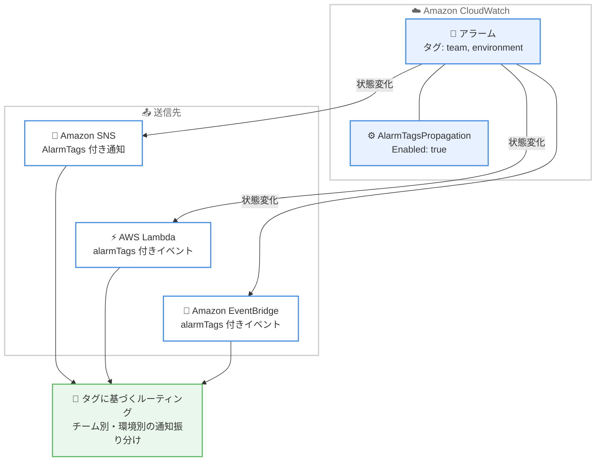

# Amazon CloudWatch - アラームアクションペイロードへのタグ付与サポート

**リリース日**: 2026 年 10 月 20 日
**サービス**: Amazon CloudWatch
**機能**: アラームアクションペイロードおよび EventBridge イベントへのアラームタグの付与

📊 [このアップデートのインフォグラフィックを見る](https://takech9203.github.io/aws-news-summary/20261020-amazon-cloudwatch-tags-on-alarm-actions-payload.html)

## 概要

Amazon CloudWatch は、アラームの状態変化時に送信されるアクションペイロードおよび Amazon EventBridge イベントに、アラームのタグを含める機能を発表しました。team、environment、cost center などのタグをペイロードに直接含めることで、追加のタグ参照 API 呼び出しを行うことなく、通知のルーティング、フィルタリング、コンテキスト付与が可能になります。

本機能は、多数のアラームを共有の通知パイプラインで処理している組織に特に有効です。アラームの状態変化メッセージから担当チーム、環境、サービスを直接特定できるため、通知処理の簡素化とレイテンシーの削減が期待できます。対象となる送信先は Amazon SNS 通知、AWS Lambda 関数の呼び出し、EventBridge へのアラーム状態変化イベントの 3 種類です。

設定はデフォルトで無効になっており、アラームごとに有効化できます。すべてのタグを含める、指定したタグキーのみを含める、指定したタグキーを除くすべてのタグを含める、の 3 つの方式から選択可能です。メトリクスアラーム、複合アラーム、ログアラームのすべてのアラーム種別でサポートされます。

**アップデート前の課題**

- アラーム通知を受け取った Lambda 関数などの処理側で、担当チームや環境を特定するには、イベントごとに `ListTagsForResource` API を呼び出してタグを照会する必要があった
- タグ照会のための追加 API 呼び出しにより、通知処理のレイテンシーが増加し、API スロットリングのリスクもあった
- 通知ペイロードのみではアラームの帰属情報が不足するため、共有通知パイプラインでのルーティングロジックが複雑になっていた

**アップデート後の改善**

- アラームのタグがペイロードに直接含まれるため、追加のタグ照会なしで通知のルーティングやフィルタリングが可能になった
- EventBridge のイベントパターンでタグに基づくフィルタリングが容易になった (EventBridge ではキーと値のペア形式でタグが含まれる)
- 含めるタグをすべて、特定キーのみ、特定キー以外から選択でき、機密性の高いタグをペイロードから除外できるようになった

## アーキテクチャ図



タグ伝播を有効化したアラームが状態変化した際、タグ情報を含むペイロードが各送信先へ配信され、受信側で追加のタグ照会なしにルーティングできる流れを示しています。

## サービスアップデートの詳細

### 主要機能

1. **アクションペイロードへのタグの付与**
   - アラームの状態変化時に送信されるペイロードに、アラームのタグを含めることが可能
   - 対象送信先は Amazon SNS 通知、AWS Lambda 関数呼び出し、EventBridge へのアラーム状態変化イベント
   - CloudWatch はデフォルトでアラーム状態変化イベントを EventBridge に送信するため、アラームにアクションを設定していなくても、設定したタグはイベントに含まれる
   - Amazon SNS の場合、HTTP/HTTPS やメールプロトコルのサブスクライバーに配信される通知メッセージにもタグが含まれる

2. **柔軟なタグ選択オプション**
   - **すべてのタグ**: アラームのすべてのタグを含める (後から追加したタグも自動的に含まれる)
   - **含めるタグキーの指定 (IncludedTagKeys)**: 指定したキーのみを含める。後から追加したタグを含めるには、キーをリストに追加する必要がある
   - **除外するタグキーの指定 (ExcludedTagKeys)**: 指定したキーを除くすべてのタグを含める。後から追加したタグも、除外リストにない限り含まれる
   - 機密性の高いタグをペイロードから除外する用途にも利用可能

3. **タグ取得ステータスの通知**
   - 各ペイロードにステータスフィールドが含まれる (Amazon SNS では `AlarmTagsStatus`、Lambda と EventBridge では `alarmTagsStatus`)
   - `SUCCESS`: タグが取得され、キーフィルターが適用された状態 (フィルターによりすべて除外された場合は空リスト)
   - `NO_TAGS`: アラームにタグが存在しない
   - `TRUNCATED`: ペイロードのサイズ制限内に収めるため一部のタグが省略された
   - `FAILURE`: 通知送信時にタグを取得できなかった (通知やイベント自体はタグなしで配信される)

4. **全アラーム種別のサポート**
   - メトリクスアラーム (`PutMetricAlarm`)、複合アラーム (`PutCompositeAlarm`)、ログアラーム (`PutLogAlarm`) のすべてに対応
   - 各通知やイベントには、状態変化時点でのアラームのタグが反映される (アラーム作成後のタグ変更も反映)

## 技術仕様

### タグ付与の仕様

| 項目 | 詳細 |
|------|------|
| 対象アラーム種別 | メトリクスアラーム、複合アラーム、ログアラーム |
| 対象送信先 | Amazon SNS、AWS Lambda、Amazon EventBridge |
| 非対象アクション | Systems Manager OpsItems、Incident Manager インシデント、EC2 アクション、EC2 Auto Scaling / Application Auto Scaling アクション、CloudWatch investigations |
| タグの表現形式 | SNS と Lambda はキーと値のオブジェクトのリスト、EventBridge はイベントパターンフィルタリングを容易にするキーと値のペア |
| キーリストの上限 | 含める / 除外するリストはそれぞれ 1〜50 個のタグキー、各キーは 1〜128 文字 |
| 予約タグ | `aws:` で始まるタグキーは AWS 予約のため伝播されない |
| デフォルト設定 | 無効 (アラームごとに有効化) |

### API 変更履歴

| 日付 | サービス | 変更内容 |
|------|----------|----------|
| 2026/10/19 | [Amazon CloudWatch](https://awsapichanges.com/archive/changes/626f4f-monitoring.html) | 5 updated api methods - `PutMetricAlarm`、`PutCompositeAlarm`、`PutLogAlarm` に `ActionConfiguration` を追加。アラームのタグを通知とアラーム状態変化イベントに含めることが可能に |

### 必要な権限

アラームの作成・更新時にタグ伝播を有効化するプリンシパルには、対象アラームに対する `cloudwatch:ListTagsForResource` 権限が必要です。また、`cloudwatch:AlarmTagsPropagationEnabled` 条件キーにより、プリンシパルによるタグ伝播の有効化を制御できます。

```json
{
  "Version": "2012-10-17",
  "Statement": [
    {
      "Effect": "Deny",
      "Action": [
        "cloudwatch:PutMetricAlarm",
        "cloudwatch:PutCompositeAlarm"
      ],
      "Resource": "*",
      "Condition": {
        "Bool": {
          "cloudwatch:AlarmTagsPropagationEnabled": "true"
        }
      }
    }
  ]
}
```

上記は条件キーを使用してタグ伝播の有効化を禁止するポリシー例です。

## 設定方法

### 前提条件

1. Amazon CloudWatch アラーム (メトリクス、複合、またはログアラーム) が作成済み、または新規作成すること
2. 操作するプリンシパルが対象アラームに対する `cloudwatch:ListTagsForResource` 権限を持つこと
3. ルーティングに使用するタグ (team、environment など) がアラームに付与されていること

### 手順

#### ステップ 1: コンソールでタグ伝播を有効化

1. [CloudWatch コンソール](https://console.aws.amazon.com/cloudwatch/) でアラームの作成または編集を開始する
2. [Add alarm details] ステップのタグエディター配下で [Include this alarm's tags in action and event payloads] を選択する
3. [All tags] (すべてのタグ) または [Select tags] (タグキーを指定) を選択する
4. [Select tags] を選択した場合、[Include tags] (指定キーのみ含める) または [Exclude tags] (指定キーを除外する) を選択し、タグキーを入力する
5. [Preview and create] で設定内容を確認し、アラームを保存する

設定内容は、アラーム詳細ページの [Tags] タブで確認できます。ウィザードを使用せずに変更する場合は [Manage tags] を選択します。

#### ステップ 2: API / CLI でタグ伝播を有効化

```bash
aws cloudwatch put-metric-alarm \
  --alarm-name "high-cpu-alarm" \
  --metric-name CPUUtilization \
  --namespace AWS/EC2 \
  --statistic Average \
  --period 300 \
  --threshold 80 \
  --comparison-operator GreaterThanThreshold \
  --evaluation-periods 2 \
  --alarm-actions "arn:aws:sns:ap-northeast-1:123456789012:ops-topic" \
  --tags Key=team,Value=platform Key=environment,Value=production \
  --action-configuration '{"AlarmTagsPropagation": {"Enabled": true, "IncludedTagKeys": ["team", "environment"]}}'
```

メトリクスアラームを作成し、`ActionConfiguration` 内の `AlarmTagsPropagation` で `Enabled` を `true` に設定しています。`IncludedTagKeys` により、team と environment のタグキーのみをペイロードに含めます。すべてのタグを含める場合は `IncludedTagKeys` と `ExcludedTagKeys` の両方を省略します (両者は同時指定不可)。

#### ステップ 3: 設定の確認

```bash
aws cloudwatch describe-alarms \
  --alarm-names "high-cpu-alarm" \
  --query 'MetricAlarms[0].ActionConfiguration'
```

`DescribeAlarms` API により、アラームに設定された `ActionConfiguration` (タグ伝播の有効化状態とキーフィルター) を確認しています。

## メリット

### ビジネス面

- **運用効率の向上**: 通知メッセージから担当チームや環境を直接特定できるため、アラート対応のトリアージが迅速化する
- **組織的なアラート管理**: team、cost center などのタグを活用した組織横断の通知パイプラインを、シンプルな構成で実現できる
- **ガバナンスの強化**: IAM 条件キーによりタグ伝播の有効化を統制でき、機密タグの除外設定と合わせて情報の露出を管理できる

### 技術面

- **追加 API 呼び出しの排除**: 受信側での `ListTagsForResource` 呼び出しが不要になり、処理のレイテンシーと API スロットリングのリスクが低減する
- **EventBridge イベントパターンの活用**: EventBridge ではタグがキーと値のペア形式で含まれるため、イベントパターンによるタグベースのフィルタリングとルーティングが容易になる
- **最新タグの自動反映**: 各通知には状態変化時点のタグが反映されるため、アラーム作成後のタグ変更にも追従する

## デメリット・制約事項

### 制限事項

- Systems Manager OpsItems、Incident Manager インシデント、EC2 アクション、EC2 Auto Scaling / Application Auto Scaling アクション、CloudWatch investigations にはタグが付与されない
- `aws:` で始まる予約タグキーは伝播されない
- 含める / 除外するタグキーリストはそれぞれ 1〜50 個、各キーは 1〜128 文字の制限がある
- ペイロードのサイズ制限を超える場合、一部のタグが省略され、ステータスが `TRUNCATED` になる
- 中東 (UAE) および中東 (バーレーン) リージョンでは利用できない

### 考慮すべき点

- タグ取得に失敗した場合 (`FAILURE`)、通知自体はタグなしで配信されるため、受信側はタグが存在しない場合の処理を実装しておく必要がある
- `IncludedTagKeys` を使用する場合、後から追加したタグを含めるには、キーをリストに明示的に追加する必要がある
- タグには組織情報が含まれる場合があるため、SNS のメールや HTTP/HTTPS サブスクライバーに配信される点を考慮し、機密タグは除外リストで管理することが望ましい

## ユースケース

### ユースケース 1: タグに基づくチーム別通知ルーティング

**シナリオ**: 数百のアラームを単一の SNS トピックと Lambda 関数で処理しており、team タグに応じて Slack の各チームチャンネルへ通知を振り分けたい。

**実装例**:
```python
def lambda_handler(event, context):
    # ペイロードから直接タグを取得 (ListTagsForResource の呼び出しが不要)
    tags = {t["key"]: t["value"] for t in event.get("alarmTags", [])}
    status = event.get("alarmTagsStatus")

    if status == "SUCCESS" and "team" in tags:
        channel = TEAM_CHANNELS.get(tags["team"], "#ops-default")
    else:
        channel = "#ops-default"

    post_to_slack(channel, event)
```

**効果**: タグ照会のための追加 API 呼び出しが不要になり、通知処理のレイテンシーとスロットリングのリスクが低減する。ルーティングロジックもシンプルになる。

### ユースケース 2: EventBridge イベントパターンによる環境別フィルタリング

**シナリオ**: production 環境のアラームのみをインシデント管理システムに連携し、開発環境のアラームは別の低優先度キューに送りたい。

**実装例**:
```json
{
  "source": ["aws.cloudwatch"],
  "detail-type": ["CloudWatch Alarm State Change"],
  "detail": {
    "alarmTags": {
      "environment": ["production"]
    },
    "state": {
      "value": ["ALARM"]
    }
  }
}
```

**効果**: EventBridge ではタグがキーと値のペア形式で含まれるため、イベントパターンのみで環境別のルーティングが完結し、中間処理用の Lambda 関数が不要になる。

### ユースケース 3: コストセンター情報を含むメール通知

**シナリオ**: アラーム通知メールに cost-center タグを含め、受信者がどの部門のリソースで問題が発生したかを即座に把握できるようにしたい。一方で、内部管理用の機密タグは通知に含めたくない。

**実装例**:
```bash
aws cloudwatch put-metric-alarm \
  --alarm-name "billing-sensitive-alarm" \
  --metric-name CPUUtilization \
  --namespace AWS/EC2 \
  --statistic Average \
  --period 300 \
  --threshold 80 \
  --comparison-operator GreaterThanThreshold \
  --evaluation-periods 2 \
  --alarm-actions "arn:aws:sns:ap-northeast-1:123456789012:email-topic" \
  --tags Key=cost-center,Value=cc-1024 Key=internal-note,Value=confidential \
  --action-configuration '{"AlarmTagsPropagation": {"Enabled": true, "ExcludedTagKeys": ["internal-note"]}}'
```

**効果**: SNS 経由のメール通知に cost-center などの有用なタグが含まれる一方、`ExcludedTagKeys` により機密タグの露出を防止できる。

## 料金

What's New ページおよびドキュメントに本機能固有の追加料金に関する記載はありません。CloudWatch アラーム、Amazon SNS、AWS Lambda、Amazon EventBridge の標準料金が適用されます。詳細は [Amazon CloudWatch 料金ページ](https://aws.amazon.com/cloudwatch/pricing/) を参照してください。

## 利用可能リージョン

中東 (UAE) および中東 (バーレーン) を除く、Amazon CloudWatch が利用可能なすべての AWS リージョンで利用できます。

## 関連サービス・機能

- **Amazon SNS**: アラーム状態変化の通知先。タグを含むメッセージが HTTP/HTTPS やメールのサブスクライバーにも配信される
- **AWS Lambda**: アラームから直接呼び出される関数。イベントペイロードの `alarmTags` を使用してタグベースの処理が可能
- **Amazon EventBridge**: アラーム状態変化イベントの送信先。イベントパターンでタグによるフィルタリングとルーティングが可能
- **AWS Identity and Access Management (IAM)**: `cloudwatch:AlarmTagsPropagationEnabled` 条件キーによりタグ伝播の有効化を統制可能

## 参考リンク

- 📊 [インフォグラフィック](https://takech9203.github.io/aws-news-summary/20261020-amazon-cloudwatch-tags-on-alarm-actions-payload.html)
- [公式発表 (What's New)](https://aws.amazon.com/about-aws/whats-new/2026/10/amazon-cloudwatch-tags-on-alarm-actions-payload)
- [ドキュメント: Alarm tags in action payloads](https://docs.aws.amazon.com/AmazonCloudWatch/latest/monitoring/alarm-tags-in-notifications.html)
- [API リファレンス: PutMetricAlarm](https://docs.aws.amazon.com/AmazonCloudWatch/latest/APIReference/API_PutMetricAlarm.html)
- [料金ページ](https://aws.amazon.com/cloudwatch/pricing/)

## まとめ

CloudWatch アラームのタグをアクションペイロードと EventBridge イベントに直接含められるようになり、共有通知パイプラインでのタグベースのルーティングやフィルタリングが追加の API 呼び出しなしで実現できます。多数のアラームを集約処理している環境では、受信側の `ListTagsForResource` 呼び出しを本機能に置き換えることで、処理の簡素化とレイテンシー削減が期待できるため、通知パイプラインの見直しを推奨します。
