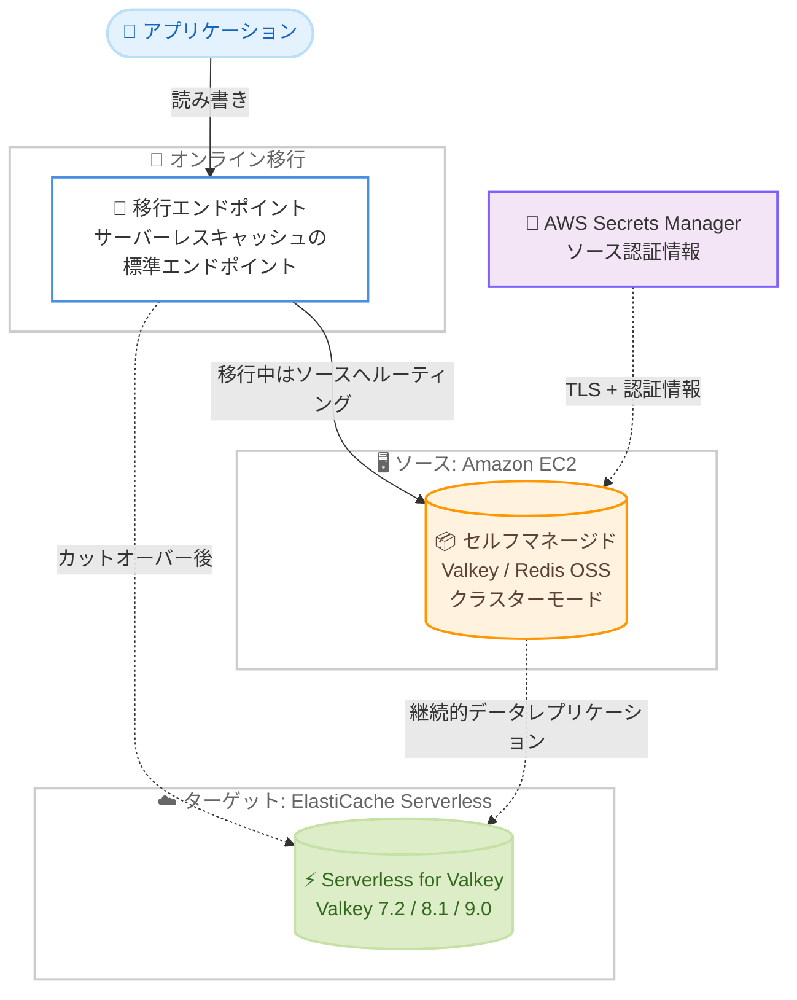

# Amazon ElastiCache - Serverless for Valkey のゼロダウンタイムオンライン移行サポート

**リリース日**: 2026 年 10 月 20 日
**サービス**: Amazon ElastiCache
**機能**: Amazon ElastiCache Serverless for Valkey のオンライン移行 (ゼロダウンタイム)

📊 [このアップデートのインフォグラフィックを見る](https://takech9203.github.io/aws-news-summary/20261020-amazon-elasticache-serverless-valkey-online-migration.html)

## 概要

Amazon ElastiCache Serverless for Valkey が、Amazon EC2 上で稼働するセルフマネージドの Valkey / Redis OSS クラスターからのゼロダウンタイムのオンライン移行をサポートしました。ここでの「ゼロダウンタイム」とは、ElastiCache SLA が可用性を測定するのと同じ方法で測定した場合に、移行中にクライアントへエラーを一切返さないことを意味します。カットオーバー中もアプリケーションは読み書きを継続でき、サードパーティのレプリケーションツールやメンテナンスウィンドウは不要です。

移行は「移行の準備」「データ同期の開始」「カットオーバーの完了」という 3 つの API 駆動のフェーズで制御します。アプリケーションは ElastiCache が提供する移行エンドポイントに接続するだけでよく、移行エンドポイントはサーバーレスキャッシュの標準エンドポイントそのものであるため、カットオーバー後も接続先を変更する必要がありません。移行中、ElastiCache はアプリケーションのリクエストをソースキャッシュにルーティングしながら、ターゲットキャッシュへデータを継続的にレプリケートします。

EC2 上でセルフマネージドの Valkey / Redis OSS を運用しており、運用負荷の軽減や自動スケーリングを求めて ElastiCache Serverless への移行を検討しているユーザーにとって、移行の最大の障壁であったダウンタイムとツール整備の問題を解消するアップデートです。

**アップデート前の課題**

- 以前は、セルフマネージドの Valkey / Redis OSS から ElastiCache Serverless へ移行する場合、スナップショットからのリストアなどオフラインの手段が中心であり、切り替え時にダウンタイムが発生していた
- 以前は、ダウンタイムを避けるにはサードパーティのレプリケーションツールや独自のデュアルライト実装を用意する必要があった
- 以前は、カットオーバー時にアプリケーションの接続先エンドポイントを切り替える作業と、その際の書き込み停止期間の調整が必要だった

**アップデート後の改善**

- 今回のアップデートにより、EC2 上のセルフマネージド Valkey 7.2〜8.1 / Redis OSS 4.0〜7.2 (クラスターモード) から、クライアントにエラーを返さずに ElastiCache Serverless for Valkey へ移行できるようになった
- 今回のアップデートにより、移行エンドポイント経由でトラフィックを流したままデータ同期とカットオーバーが完了するため、サードパーティツールやメンテナンスウィンドウが不要になった
- 今回のアップデートにより、Redis OSS 4.0 などの古いバージョンから Valkey 9.0 へ直接移行できるようになった
- 今回のアップデートにより、カットオーバーを手動または自動 (データ同期完了後) から選択できるようになった

## アーキテクチャ図



アプリケーションは移行エンドポイントに接続したまま、移行中はソースキャッシュへルーティングされ、バックグラウンドでターゲットへデータがレプリケートされます。カットオーバー後は同じエンドポイントがターゲットのサーバーレスキャッシュを指すため、接続先の変更は不要です。

## サービスアップデートの詳細

### 主要機能

1. **ゼロダウンタイムのオンライン移行**
   - ElastiCache SLA と同じ方法で可用性を測定し、移行中にクライアントへエラーを返さない
   - カットオーバー中もアプリケーションは読み書きを継続できる
   - サードパーティのレプリケーションツールやメンテナンスウィンドウが不要

2. **3 ステップの移行フロー**
   - **移行の準備 (PrepareMigration)**: ソースの要件検証と移行インフラのプロビジョニングを行い、移行エンドポイントを返す
   - **データ同期の開始 (StartMigration)**: ソースからターゲットへ全シャードの継続的レプリケーションを開始する
   - **カットオーバーの完了 (CompleteMigration)**: 次の完全同期ウィンドウでターゲットへ切り替える。手動 (デフォルト) または自動カットオーバーを選択可能
   - 各ステップの遷移はキャッシュの Events タブにイベントとして記録され、失敗時には理由が表示される

3. **移行エンドポイント**
   - サーバーレスキャッシュの標準エンドポイントがそのまま移行エンドポイントになるため、カットオーバー後の接続先変更が不要
   - 移行中は ElastiCache がリクエストをソースキャッシュへプロキシする
   - データ同期は途中で停止 (StopMigration) でき、その間もソースキャッシュ経由でアプリケーションへの提供が継続される

4. **セキュアなソース接続**
   - TLS による転送時暗号化と認証でソースに接続 (SourceTlsMode: none / verify-ca)
   - ソースの認証情報は AWS Secrets Manager のシークレットから読み取る

5. **幅広いバージョンサポート**
   - ソース: EC2 上のクラスターモードの Redis OSS 4.0〜7.2、Valkey 7.2〜8.1
   - ターゲット: Valkey 7.2 / 8.1 / 9.0 (古い Redis OSS から Valkey 9.0 へ直接移行可能)
   - ソースバージョンはターゲットバージョン以下である必要がある

## 技術仕様

### 移行の要件

| 項目 | 詳細 |
|------|------|
| ソースエンジン | Valkey 7.2〜8.1 または Redis OSS 4.0〜7.2 (クラスターモード必須) |
| ソース環境 | Amazon EC2 上のセルフマネージドキャッシュ (ElastiCache マネージドキャッシュ、Amazon MemoryDB はソース不可) |
| ソース規模 | ノードあたり最大 32 GB (used_memory)、最大 166 シャード |
| ソースの条件 | ハッシュスロットが全範囲をカバー、PSYNC / REPLCONF コマンドが有効、移行中のリシャーディング禁止 |
| ターゲット | 空の ElastiCache Serverless for Valkey キャッシュ (Valkey 7.2 / 8.1 / 9.0)、IPv4、パブリックエンドポイントなし |
| ネットワーク | ターゲットキャッシュの VPC からソースへプライベート到達可能であること |
| キー名の長さ | 最大 4 KiB (ElastiCache Serverless の制限) |

### 移行のステート

| ステート | 意味 |
|------|------|
| preparing | ソースの検証と移行インフラのプロビジョニング中 |
| ready-to-sync | 移行エンドポイントへのトラフィック切り替えとデータ同期開始が可能 |
| initiating-sync | 全シャードでレプリケーションを開始中 |
| syncing | データ同期が進行中 |
| cutting-over | ターゲットへのカットオーバーを完了処理中 |
| stopping | ユーザーのリクエストによりデータ同期を停止中 |

### API 変更履歴

| 日付 | サービス | 変更内容 |
|------|----------|----------|
| 2026/10/20 | [Amazon ElastiCache](https://awsapichanges.com/archive/changes/c13b91-elasticache.html) | 2 new 6 updated api methods - `PrepareMigration` と `StopMigration` を新規追加。`StartMigration` / `CompleteMigration` にサーバーレスキャッシュ対応 (`ServerlessCacheName`、`AutoCutover`、`ClearTargetCacheData`、`Force`) を追加。`CreateServerlessCache` / `DescribeServerlessCaches` などのレスポンスに `Migration` オブジェクト (Status、MigrationEndpoint、CutoverMode) を追加 |

### 新規 API の例

```json
{
  "PrepareMigration": {
    "ServerlessCacheName": "my-serverless-cache",
    "CustomerNodeEndpointList": [
      { "Address": "10.0.1.10", "Port": 6379 }
    ],
    "SourceAuthenticationConfiguration": {
      "SecretManagerConfig": {
        "SecretArn": "arn:aws:secretsmanager:ap-northeast-1:123456789012:secret:valkey-auth"
      }
    },
    "SourceTlsConfiguration": {
      "SourceTlsMode": "verify-ca",
      "SourceTlsCertificate": "-----BEGIN CERTIFICATE-----..."
    }
  }
}
```

## 設定方法

### 前提条件

1. ソースが EC2 上のクラスターモードの Valkey 7.2〜8.1 または Redis OSS 4.0〜7.2 であり、PSYNC / REPLCONF が有効であること
2. ターゲットの ElastiCache Serverless for Valkey キャッシュを事前に作成し、空かつパブリックエンドポイントなし (IPv4) であること
3. ターゲットキャッシュの VPC からソースへプライベートに到達でき、ソースのセキュリティグループが ElastiCache からのインバウンドを許可していること
4. ソースが認証を要求する場合、認証情報を AWS Secrets Manager に保存し、ElastiCache に読み取り権限を付与していること
5. ソースのプライマリノードに、移行中のフルシンク (プロセスフォーク) と本番トラフィックを同時にさばく CPU / メモリの余裕があること

### 手順

#### ステップ 1: 移行の準備

```bash
aws elasticache prepare-migration \
  --serverless-cache-name my-serverless-cache \
  --customer-node-endpoint-list "Address=10.0.1.10,Port=6379" \
  --source-authentication-configuration 'SecretManagerConfig={SecretArn=arn:aws:secretsmanager:ap-northeast-1:123456789012:secret:valkey-auth}' \
  --source-tls-configuration 'SourceTlsMode=verify-ca'
```

ソースキャッシュを移行要件に対して検証し、ソースから読み取る移行インフラをプロビジョニングして、移行エンドポイントを返します。要件を満たさない場合は準備ステップが失敗し、理由を示すイベントがキャッシュに記録されて、移行はロールバックされます。

#### ステップ 2: アプリケーションの切り替えとデータ同期の開始

```bash
aws elasticache start-migration \
  --serverless-cache-name my-serverless-cache \
  --auto-cutover
```

アプリケーションの接続先を移行エンドポイントに切り替えて、トラフィックが流れていることを確認したうえでデータ同期を開始します。`--auto-cutover` を指定すると、データ同期の完了後に自動でカットオーバーされます (デフォルトは手動カットオーバー)。ElastiCache はアプリケーションが切り替わったかを検知できないため、同期開始前に切り替えを完了させる必要があります。

#### ステップ 3: 移行状態の確認とカットオーバーの完了

```bash
# 移行状態と移行エンドポイントの確認
aws elasticache describe-serverless-caches \
  --serverless-cache-name my-serverless-cache \
  --query 'ServerlessCaches[0].Migration'

# 手動カットオーバーの場合
aws elasticache complete-migration \
  --serverless-cache-name my-serverless-cache
```

`describe-serverless-caches` で `Migration` オブジェクト (Status、MigrationEndpoint、CutoverMode) を確認し、手動カットオーバーを選択した場合は `complete-migration` を実行します。ElastiCache は次の完全同期ウィンドウでターゲットキャッシュへ切り替え、アプリケーションは同じエンドポイントのまま ElastiCache Serverless から提供されるようになります。

## メリット

### ビジネス面

- **ダウンタイムなしの移行**: 移行中もクライアントにエラーを返さないため、メンテナンスウィンドウの調整やサービス停止の告知が不要になり、移行プロジェクトのハードルが大幅に下がる
- **運用コストの削減**: EC2 上のセルフマネージド運用 (パッチ適用、スケーリング、障害対応) から、自動スケーリングする ElastiCache Serverless へ移行することで運用負荷を削減できる
- **180 日間の無料移行期間**: アカウントごとに最初の移行準備から 180 日間は移行機能を無料で利用でき、移行コストを抑えられる

### 技術面

- **アプリケーション変更が最小限**: 移行エンドポイントはサーバーレスキャッシュの標準エンドポイントであり、カットオーバー後の接続先変更が不要
- **バージョンアップグレードの同時実行**: Redis OSS 4.0 などの古いバージョンから Valkey 9.0 へ直接移行でき、移行とアップグレードを 1 回で完了できる
- **可観測性**: 各フェーズの遷移がイベントとして記録され、失敗時には理由が表示される。ターゲットキャッシュの標準メトリクス (BytesUsedForCache、CurrItems、NetworkBytesIn など) で進行状況を確認できる
- **セキュアな接続**: TLS による転送時暗号化と、AWS Secrets Manager による認証情報管理に対応

## デメリット・制約事項

### 制限事項

- ソースは EC2 上のクラスターモードのセルフマネージドキャッシュに限定される。クラスターモード無効のソース、ElastiCache マネージドキャッシュ、Amazon MemoryDB はソースにできない
- ソース規模はノードあたり最大 32 GB、最大 166 シャードまで
- 移行中はパイプラインがサポートされず、コマンドが直列化されるため、バッチ処理のレイテンシーが増加する (コネクションプールの拡大を検討)
- 移行中はリーダーエンドポイントを使用できない。トラフィックは移行エンドポイントに送る必要がある
- 移行エラーは永続的なものとして報告され、エラー発生後は移行を再開できない。終了するには強制完了 (Force) が必要
- カットオーバー後のロールバックはない。ソースに戻すにはアプリケーショントラフィックを自分で戻す必要がある
- 1 つのキャッシュは同時に 1 つの移行のターゲットにしかなれない

### 考慮すべき点

- 移行エンドポイント経由のトラフィックには ElastiCache Serverless のコマンドサポートが適用される。サポートされないコマンドは拒否されるため、FLUSH、CLUSTER 系、Pub/Sub 系コマンドの利用を事前に確認する
- 移行中にソースへ直接書き込みを行うとターゲットとの不整合が発生し、移行エラーになる。すべてのトラフィックを移行エンドポイント経由にする
- ソースにロード済みのスクリプトはレプリケートされないため、移行エンドポイント経由で `SCRIPT LOAD` を再実行する必要がある。Pub/Sub のサブスクリプションはカットオーバー時に切断され、再接続が必要
- データ同期を停止 (StopMigration) しても課金は止まらない。移行と課金を終了するのは CompleteMigration である
- 移行スループットはソースのシャード数に比例するため、少数シャードに高トラフィックが集中する構成では低トラフィック時間帯の移行を計画する
- ネットワーク経路、ソースの TLS 証明書、Secrets Manager の認証情報は移行完了まで変更しないこと。準備ステップが作成するセキュリティグループも削除しないこと

## ユースケース

### ユースケース 1: EC2 セルフマネージド Redis OSS からのマネージド移行

**シナリオ**: EC2 上で Redis OSS 7.0 のクラスターを自前運用しており、パッチ適用やスケーリングの運用負荷を削減するため ElastiCache Serverless for Valkey へ移行したい。ただし 24 時間 365 日稼働の EC サイトのセッションストアであり、ダウンタイムは許容できない。

**実装例**:
```bash
# 1. 空のターゲットキャッシュを作成
aws elasticache create-serverless-cache \
  --serverless-cache-name session-store \
  --engine valkey --major-engine-version 8

# 2. 移行を準備し、移行エンドポイントを取得
aws elasticache prepare-migration \
  --serverless-cache-name session-store \
  --customer-node-endpoint-list "Address=10.0.1.10,Port=6379" \
  --source-authentication-configuration 'SecretManagerConfig={SecretArn=arn:aws:secretsmanager:ap-northeast-1:123456789012:secret:redis-auth}'

# 3. アプリを移行エンドポイントへ切り替え後、同期開始 (手動カットオーバー)
aws elasticache start-migration --serverless-cache-name session-store
```

**効果**: セッションを失うことなく、エラーゼロでマネージドサービスへ移行できる。移行後は自動スケーリングにより容量管理が不要になる。

### ユースケース 2: 古い Redis OSS から Valkey 9.0 への直接アップグレード移行

**シナリオ**: EC2 上に Redis OSS 4.0 のレガシークラスターが残っており、段階的なバージョンアップを繰り返す手間をかけずに最新の Valkey 9.0 環境へ一気に移行したい。

**実装例**:
```bash
# ターゲットとして Valkey 9.0 のサーバーレスキャッシュを作成
aws elasticache create-serverless-cache \
  --serverless-cache-name legacy-modernize \
  --engine valkey --major-engine-version 9

# 以降、prepare-migration、start-migration、complete-migration を実行
```

**効果**: Redis OSS 4.0 から Valkey 9.0 へ中間バージョンを経由せずに直接移行でき、アップグレード作業を 1 回のオンライン移行に集約できる。

### ユースケース 3: 自動カットオーバーによる省力化移行

**シナリオ**: 複数のキャッシュクラスターを順次移行する計画で、各クラスターの同期完了を待ってカットオーバー操作を行う人的コストを削減したい。

**実装例**:
```bash
# AutoCutover を有効にして同期開始。同期完了後に自動で切り替わる
aws elasticache start-migration \
  --serverless-cache-name cache-01 \
  --auto-cutover

# 進行状況はイベントとメトリクスで監視
aws elasticache describe-events --source-type serverless-cache
```

**効果**: データ同期が完了した次の完全同期ウィンドウで自動的にカットオーバーされるため、オペレーターの待機が不要になる。完了はキャッシュ詳細ページのバナーとイベントで確認できる。

## 料金

移行機能は、AWS アカウントごとに最初の移行準備から 180 日間は無料で利用できます。無料期間の終了後は、移行がアクティブな間、移行ノードのノード時間単位で課金されます。

なお、ターゲットの ElastiCache Serverless キャッシュ自体は、無料期間中であっても標準のデータストレージ (GB-時間) と ECPU のレートで別途課金されます。データ同期を停止しても移行インフラの課金は継続されるため、移行を終了する場合は CompleteMigration を実行してください。

詳細は [ElastiCache 料金ページ](https://aws.amazon.com/elasticache/pricing/) を参照してください。

## 利用可能リージョン

すべての AWS 商用リージョン、中国リージョン、および AWS GovCloud (US) リージョンで利用可能です。

## 関連サービス・機能

- **Amazon ElastiCache Serverless**: 移行先となるサーバーレスキャッシュ。容量管理不要で、ワークロードに応じて自動スケーリングする
- **AWS Secrets Manager**: ソースキャッシュの認証情報を安全に保存し、移行時に ElastiCache が読み取る
- **Amazon EC2**: 移行元のセルフマネージド Valkey / Redis OSS クラスターが稼働する環境
- **Amazon CloudWatch**: 移行中のターゲットキャッシュのメトリクス (BytesUsedForCache、CurrItems、NetworkBytesIn など) とイベントによる監視
- **ElastiCache ノードベースクラスターへのオンライン移行**: ノードベース (プロビジョンド) クラスターへ移行する場合は、既存の別のオンライン移行フローを使用する

## 参考リンク

- 📊 [インフォグラフィック](https://takech9203.github.io/aws-news-summary/20261020-amazon-elasticache-serverless-valkey-online-migration.html)
- [公式発表 (What's New)](https://aws.amazon.com/about-aws/whats-new/2026/10/amazon-elasticache-serverless-valkey-online-migration/)
- [ドキュメント: Online migration to ElastiCache Serverless](https://docs.aws.amazon.com/AmazonElastiCache/latest/dg/migration-to-serverless.html)
- [ドキュメント: Prerequisites for online migration](https://docs.aws.amazon.com/AmazonElastiCache/latest/dg/migration-to-serverless-prerequisites.html)
- [ElastiCache SLA](https://aws.amazon.com/elasticache/sla/)
- [料金ページ](https://aws.amazon.com/elasticache/pricing/)
- [API 変更履歴 (awsapichanges.com)](https://awsapichanges.com/archive/changes/c13b91-elasticache.html)

## まとめ

ElastiCache Serverless for Valkey へのオンライン移行は、セルフマネージド環境からマネージドなサーバーレス環境への移行における最大の障壁であったダウンタイムとツール整備の問題を解消する重要なアップデートです。180 日間の無料移行期間が設定されているため、EC2 上で Valkey / Redis OSS を運用しているチームは、この期間内に前提条件 (クラスターモード、バージョン、ネットワーク到達性) を確認し、移行を計画することを推奨します。まずは検証環境で移行フローを試し、パイプライン利用時のレイテンシー増加やコマンド互換性への影響を確認してから本番移行に進むとよいでしょう。
