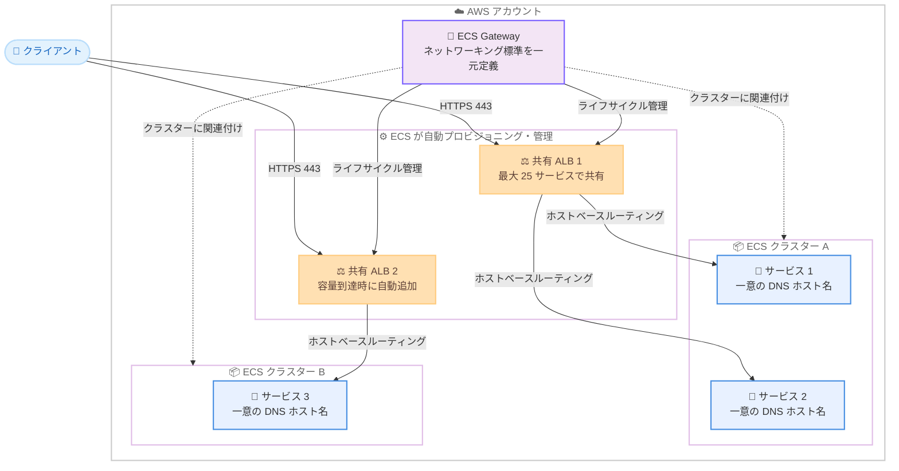

# Amazon ECS - Amazon ECS Gateway (マネージドイングレスソリューション)

**リリース日**: 2026 年 10 月 20 日
**サービス**: Amazon Elastic Container Service (Amazon ECS)
**機能**: Amazon ECS Gateway

📊 [このアップデートのインフォグラフィックを見る](https://takech9203.github.io/aws-news-summary/20261020-announcing-amazon-ecs-gateway.html)

## 概要

AWS は、ECS サービス向けのマネージドイングレスソリューションである Amazon ECS Gateway を発表しました。ECS Gateway は、Application Load Balancer (ALB) とその関連リソース (リスナー、ターゲットグループ、セキュリティグループ、証明書など) をユーザーの AWS アカウント内に動的にプロビジョニング・管理する新しいアカウントレベルのリソースです。これにより、コンテナアプリケーションのイングレスネットワーキング構成が大幅に簡素化されます。

ECS Gateway は、プラットフォームチームとアプリケーションチームの役割分担を明確にする設計になっています。プラットフォームチームはゲートウェイに組織のネットワーキング標準 (公開範囲、サブネット、WAF、アクセスログなど) を一度定義し、1 つ以上の ECS クラスターに関連付けます。アプリケーションチームは、サービスの作成・更新時にゲートウェイコネクタパラメータを追加してオプトインするだけで、ネットワーキングの専門知識なしにこれらの標準を継承できます。接続された各サービスには一意の HTTPS ホスト名が自動的に付与され、ホストベースルーティングにより最大 25 サービスで 1 つの ALB を共有してコストを最適化できます。

本機能は awsvpc ネットワークモードを使用する ECS サービスで、すべての起動タイプ (EC2、Fargate、ECS Managed Instances) に対応し、全 AWS 商用リージョンで追加料金なしで利用できます。

**アップデート前の課題**

ECS サービスを外部公開するためのイングレス構成には、多くの手動作業と専門知識が必要でした。

- サービスごとに ALB、リスナー、ターゲットグループ、セキュリティグループ、ACM 証明書を個別に設計・構築する必要があった
- 組織のネットワーキング標準 (公開範囲、WAF、ログ設定など) をサービス横断で一貫して適用する仕組みがなく、ガバナンスの維持が困難だった
- アプリケーションチームがロードバランサーやネットワーキングの専門知識を持つ必要があり、デプロイの速度が低下していた
- サービスごとに ALB を作成するとコストが増大し、ALB を手動で共有する場合はリスナールールや優先順位の管理が煩雑だった
- サービスの追加・削除に合わせたイングレスインフラのライフサイクル管理 (プロビジョニング・削除) を自前で行う必要があった

**アップデート後の改善**

今回のアップデートにより、イングレスインフラの管理が ECS に委任され、チーム間の責任分界が明確になりました。

- プラットフォームチームがゲートウェイにネットワーキング標準を一度定義するだけで、接続するすべてのサービスに自動適用されるようになった
- アプリケーションチームはゲートウェイコネクタパラメータを追加するだけでイングレスを利用でき、ネットワーキングリソースの構成が不要になった
- 最大 25 サービスで 1 つの ALB を共有でき、ホストベースルーティングと一意の DNS ホスト名により、インフラコストを削減しながらサービスごとのエンドポイントを維持できるようになった
- 最初のサービス接続時に ALB をプロビジョニングし、容量到達時に追加、不要になれば削除するというライフサイクル全体を ECS が自動管理するようになった
- プロビジョニングされたリソースはすべてユーザーのアカウント内に作成されるため、CloudWatch の標準 ALB メトリクスや ELB のターゲットヘルス情報でそのまま監視できる

## アーキテクチャ図



ECS Gateway は複数のクラスターに関連付けることができ、オプトインしたサービスに対して共有 ALB を自動プロビジョニングします。クライアントからの HTTPS リクエストは、各サービスの一意のホスト名に基づくホストベースルーティングで該当サービスにルーティングされます。

## サービスアップデートの詳細

### 主要機能

1. **一元的なネットワーキング標準の定義と継承**
   - プラットフォームチームがゲートウェイにネットワーキング (公開範囲、サブネット)、セキュリティ (セキュリティグループ、AWS WAF Web ACL)、運用 (アクセスログ、ロードバランサー容量上限) の設定を一度定義
   - ゲートウェイとクラスターの関連付けは多対多で、1 つのゲートウェイを複数クラスターに、1 つのクラスターに複数ゲートウェイを関連付け可能
   - アプリケーションチームはサービスにゲートウェイコネクタを追加するだけで標準を継承

2. **ALB とライフサイクルの完全自動管理**
   - ゲートウェイ作成時やクラスター関連付け時にはインフラをプロビジョニングせず、最初のサービス接続時に ALB、リスナー、セキュリティグループを作成
   - サービスの増加に応じて容量のある ALB を再利用し、容量到達時には新しい ALB を自動追加
   - 最後のサービスが切断された ALB は自動的に削除され、不要なコストの発生を防止

3. **ホストベースルーティングと一意の DNS ホスト名**
   - 接続された各サービスに `https://<unique-id>.ecs.<region>.on.aws` 形式の一意の HTTPS ホスト名を自動付与 (ドメインは AWS パーティションにより異なる)
   - 最大 25 サービスで 1 つの ALB を共有し、ホストベースルーティングで各サービスにトラフィックを振り分け
   - サービスごとに ACM 証明書、リスナールール、ターゲットグループ、サービス用セキュリティグループを自動作成

4. **透明性の高いインフラと標準的な監視**
   - すべてのリソースはユーザーのアカウント内に作成され、マネジメントコンソールや API から直接確認・管理が可能
   - 管理対象リソースには `AmazonECSManaged=true` タグと `aws:ecs:gateway-arn` システムタグが付与され、リソースの特定が容易
   - CloudWatch の標準 ALB メトリクス (ターゲットグループ単位・ロードバランサー単位) と ELB のターゲットヘルス情報で監視可能

## 技術仕様

### 主要コンセプト

| 概念 | 説明 |
|------|------|
| ゲートウェイ | イングレス設定を定義し、配下のインフラを管理するアカウントレベルのリソース。名前はアカウント・リージョン内で一意 |
| ゲートウェイ - クラスター関連付け | ゲートウェイをクラスター内のサービスから利用可能にするリンク。多対多の関係 |
| ゲートウェイコネクタ | サービス側のオプトインパラメータ。公開するコンテナポート名を指定し、アクセスタイプフィルタとヘルスチェックをオプションで設定可能 |
| ゲートウェイルート | サービスとゲートウェイの 1 つの接続を表すリソース。接続ステータス、サービスの URL、サービス固有リソースを報告 |

### 管理されるインフラ

| 分類 | リソース |
|------|----------|
| 共有インフラ | Application Load Balancer、リスナー、ロードバランサー用セキュリティグループ |
| サービス固有インフラ | ACM 証明書、DNS ホスト名、リスナールール、ターゲットグループ、サービス用セキュリティグループ |

### サービスクォータ

| 制限項目 | 値 |
|----------|-----|
| クラスターあたりの最大ゲートウェイ関連付け数 | 5 |
| ゲートウェイあたりの最大クラスター数 | 10,000 |
| サービスあたりの最大ゲートウェイコネクタ数 | 1 |
| ALB あたりの最大サービス数 | 25 |
| ゲートウェイあたりの最大 ALB 数 | 200 (maxAlbCount のデフォルトは 10) |

### API 変更履歴

| 日付 | サービス | 変更内容 |
|------|----------|----------|
| 2026/10/20 | [ecs](https://awsapichanges.com/archive/changes/c13b91-ecs.html) | 11 new 3 updated api methods - `CreateGateway`、`UpdateGateway`、`DeleteGateway`、`DescribeGateway`、`DescribeGatewayResources`、`ListGateways`、`AssociateGatewayWithCluster`、`DisassociateGatewayFromCluster`、`ListGatewayClusterAssociations`、`DescribeGatewayRoute`、`ListGatewayRoutes` の新規追加。`CreateService`、`UpdateService`、`DescribeServiceRevisions` にゲートウェイコネクタ関連のパラメータを追加 |

## 設定方法

### 前提条件

1. ECS がインフラをプロビジョニングするために引き受ける IAM ロール (インフラストラクチャロール) を用意していること
2. 対象の ECS サービスが awsvpc ネットワークモードを使用していること
3. ゲートウェイとクラスターが同一アカウント・同一 VPC 内にあり、ゲートウェイのサブネットがサービスの使用するすべてのアベイラビリティーゾーンをカバーしていること

### 手順

#### ステップ 1: ゲートウェイの作成

```bash
aws ecs create-gateway \
  --name my-team-gateway \
  --infrastructure-role-arn arn:aws:iam::123456789012:role/ECSGatewayRole \
  --configuration '{
    "HostSharedAlb": {
      "networkConfiguration": {
        "subnets": ["subnet-080779f9bd887757a", "subnet-0a1b2c3d4e5f67890"],
        "ipAddressType": "ipv4"
      },
      "scheme": "internet-facing"
    }
  }'
```

プラットフォームチームがゲートウェイを作成します。名前、インフラストラクチャロール、ロードバランシングスキーム (インターネット向けまたは VPC 内部)、サブネットなどを指定します。この時点ではインフラはプロビジョニングされません。なお、名前、スキーム、VPC、サブネット、IP アドレスタイプ、リスナーのプロトコルとポートは作成後に変更できません。

#### ステップ 2: ゲートウェイとクラスターの関連付け

```bash
aws ecs associate-gateway-with-cluster \
  --gateway my-team-gateway \
  --cluster arn:aws:ecs:us-east-1:123456789012:cluster/my-cluster
```

ゲートウェイを ECS クラスターに関連付け、そのクラスター内のサービスからゲートウェイを利用可能にします。関連付けは多対多で設定できます。

#### ステップ 3: サービスのオプトイン

```bash
aws ecs create-service \
  --cluster my-cluster \
  --service my-api-service \
  --task-definition my-api-service:1 \
  --gateway-connectors '[{
    "portName": "api",
    "filters": {"accessTypes": ["PUBLIC"]}
  }]'
```

アプリケーションチームがサービスの作成または更新時に `--gateway-connectors` パラメータを追加してオプトインします。トラフィックを受信するコンテナポート名を指定し、必要に応じてアクセスタイプフィルタやヘルスチェックを設定します。デプロイ時に ECS は互換性のあるすべてのゲートウェイにサービスを接続し、ACM 証明書、一意の DNS ホスト名、リスナールール、ターゲットグループ、セキュリティグループをプロビジョニングします。ルートが `ACTIVE` になると、一意の HTTPS エンドポイントでアクセス可能になります。

既存サービスを移行する場合は、既存のロードバランサー設定とゲートウェイの両方のイングレス経路を並行稼働させて検証し、問題がなければ旧設定を削除する段階的な移行が可能です。

## メリット

### ビジネス面

- **デプロイ速度の向上**: アプリケーションチームがネットワーキングの専門知識なしにサービスを公開できるため、リリースまでのリードタイムが短縮される
- **コスト最適化**: 最大 25 サービスで 1 つの ALB を共有でき、サービスごとに ALB を作成する場合と比較してインフラコストを大幅に削減できる
- **ガバナンスの強化**: プラットフォームチームが組織のネットワーキング・セキュリティ標準を一元的に定義・適用でき、サービス横断で一貫した統制を実現できる

### 技術面

- **運用負荷の削減**: ALB のプロビジョニング、容量に応じた追加、不要時の削除までライフサイクル全体を ECS が自動管理する
- **透明性の確保**: すべてのリソースがユーザーのアカウント内に作成され、タグ (`AmazonECSManaged`、`aws:ecs:gateway-arn`) により管理リソースを容易に特定できる
- **標準的な監視との統合**: CloudWatch の標準 ALB メトリクス (`HealthyHostCount`、`TargetResponseTime`、`HTTPCode_Target_5XX_Count` など) と ELB のターゲットヘルス情報をそのまま利用できる

## デメリット・制約事項

### 制限事項

- ゲートウェイは HTTPS (ポート 443) のみをサポートし、他のプロトコルやポートは利用できない
- awsvpc ネットワークモードが必須で、bridge、host、none モードのサービスは接続できない
- ゲートウェイとクラスターは同一アカウント内にある必要があり、クロスアカウント構成はサポートされない
- サービスあたりのゲートウェイコネクタは 1 つのみ (1 つのコネクタで複数ゲートウェイへの接続は可能)
- ECS Express Mode のサービスには対応していない
- 名前、タイプ、スキーム、リスナーポート・プロトコル、サブネット、IP アドレスタイプは作成後に変更できず、変更には新しいゲートウェイの作成とサービスの移行が必要

### 考慮すべき点

- サービスはゲートウェイを名前で選択できず、クラスターに関連付けられた互換性のあるすべてのゲートウェイ (アクセスタイプの一致、同一 VPC、サービスの全 AZ をカバー) に接続される
- ECS は ALB 間でサービスを再配置 (統合) しないため、サービスの削除後に部分的に使用された ALB が複数残る場合がある
- ECS の管理外で管理対象リソースを変更・削除した場合、ECS は自動修復せず、トラフィック停止やデプロイ失敗の原因となる
- `maxAlbCount` (デフォルト 10) に到達し ALB に空き容量がない場合、新しいサービスのデプロイは失敗する
- DNS ホスト名は自動生成される形式であり、カスタムドメインの設定については公式ドキュメントで確認が必要

## ユースケース

### ユースケース 1: プラットフォームチームによるマルチクラスター環境の統制

**シナリオ**: 複数の開発チームがそれぞれの ECS クラスターでマイクロサービスを運用しており、プラットフォームチームが組織全体のネットワーキング・セキュリティ標準 (WAF、アクセスログ、公開範囲) を統一的に適用したい。

**実装例**:
```bash
# WAF とアクセスログを設定したゲートウェイを作成し、複数クラスターに関連付け
aws ecs create-gateway --name org-standard-gateway \
  --infrastructure-role-arn arn:aws:iam::123456789012:role/ECSGatewayRole \
  --configuration '{"HostSharedAlb": {...}}'

aws ecs associate-gateway-with-cluster --gateway org-standard-gateway --cluster team-a-cluster
aws ecs associate-gateway-with-cluster --gateway org-standard-gateway --cluster team-b-cluster
```

**効果**: 全チームのサービスが同一のセキュリティ標準を自動的に継承し、ガバナンスを維持しながら各チームの自律的なデプロイが可能になる。

### ユースケース 2: 多数のマイクロサービスにおける ALB コストの最適化

**シナリオ**: 20 以上のマイクロサービスをそれぞれ独立した ALB で公開しており、ALB の時間課金が積み上がってコストが増大している。

**実装例**:
```bash
# 各サービスをゲートウェイにオプトインして ALB を共有
aws ecs update-service \
  --cluster my-cluster \
  --service service-01 \
  --gateway-connectors '[{"portName": "web"}]'
```

**効果**: 最大 25 サービスが 1 つの ALB を共有し、各サービスは一意のホスト名を維持したまま ALB の台数と時間課金を大幅に削減できる。

### ユースケース 3: 開発・検証環境のエフェメラルなサービス公開

**シナリオ**: 機能ブランチごとに検証用のサービスを頻繁に作成・削除しており、その都度ロードバランサーやターゲットグループを構成・削除する運用が負担になっている。

**実装例**:
```bash
# 検証用サービスの作成時にコネクタを追加するだけで HTTPS エンドポイントを取得
aws ecs create-service \
  --cluster dev-cluster \
  --service feature-branch-service \
  --task-definition feature-app:5 \
  --gateway-connectors '[{"portName": "app"}]'
```

**効果**: サービス作成と同時に HTTPS エンドポイントが自動付与され、サービス削除時にはルートと関連リソースが自動クリーンアップされるため、検証環境の運用負荷がほぼゼロになる。

## 料金

Amazon ECS Gateway 自体の利用に追加料金はかかりません。サービスがゲートウェイに接続した際にアカウント内にプロビジョニングされる基盤リソースに対してのみ、通常の料金が発生します。

- Application Load Balancer の時間料金および LCU 料金
- Amazon CloudWatch のログ・メトリクス料金 (アクセスログなどを有効化した場合)
- データ転送料金

25 サービスで 1 つの ALB を共有できるため、サービスごとに ALB を作成する構成と比較して ALB 料金を最大で約 1/25 に抑えられる可能性があります。

## 利用可能リージョン

すべての AWS 商用リージョンで利用可能です (東京・大阪リージョンを含む)。

## 関連サービス・機能

- **Elastic Load Balancing (ALB)**: ゲートウェイがプロビジョニング・管理する中核リソース。ホストベースルーティングとターゲットヘルス情報を提供
- **AWS Certificate Manager (ACM)**: 各サービスの一意の HTTPS ホスト名に対する証明書を自動発行・管理
- **AWS WAF**: ゲートウェイに Web ACL を設定することで、接続するすべてのサービスに Web アプリケーション保護を一括適用可能
- **Amazon CloudWatch**: 標準の ALB メトリクスによる監視とアラーム設定に利用
- **Amazon ECS Service Connect**: サービス間 (East-West) 通信を簡素化する既存機能。ECS Gateway は外部からのイングレス (North-South) 通信を担い、相互補完の関係

## 参考リンク

- 📊 [インフォグラフィック](https://takech9203.github.io/aws-news-summary/20261020-announcing-amazon-ecs-gateway.html)
- [公式発表 (What's New)](https://aws.amazon.com/about-aws/whats-new/2026/10/announcing-amazon-ecs-gateway/)
- [AWS News Blog - Introducing Amazon ECS Gateway](https://aws.amazon.com/blogs/aws/introducing-amazon-ecs-gateway-a-fully-managed-ingress-solution-for-ecs-services)
- [ドキュメント - Amazon ECS Gateway](https://docs.aws.amazon.com/AmazonECS/latest/developerguide/gateway-overview.html)
- [料金ページ - Elastic Load Balancing](https://aws.amazon.com/elasticloadbalancing/pricing/)

## まとめ

Amazon ECS Gateway は、ECS サービスのイングレスネットワーキングにおける「プラットフォームチームによる統制」と「アプリケーションチームの俊敏性」を両立させる重要なアップデートです。ALB の共有によるコスト最適化とライフサイクルの完全自動管理により、特に多数のマイクロサービスを運用する組織に大きな価値をもたらします。まずは開発環境のクラスターでゲートウェイを作成し、既存サービスの並行稼働による段階的な移行を検証することを推奨します。
