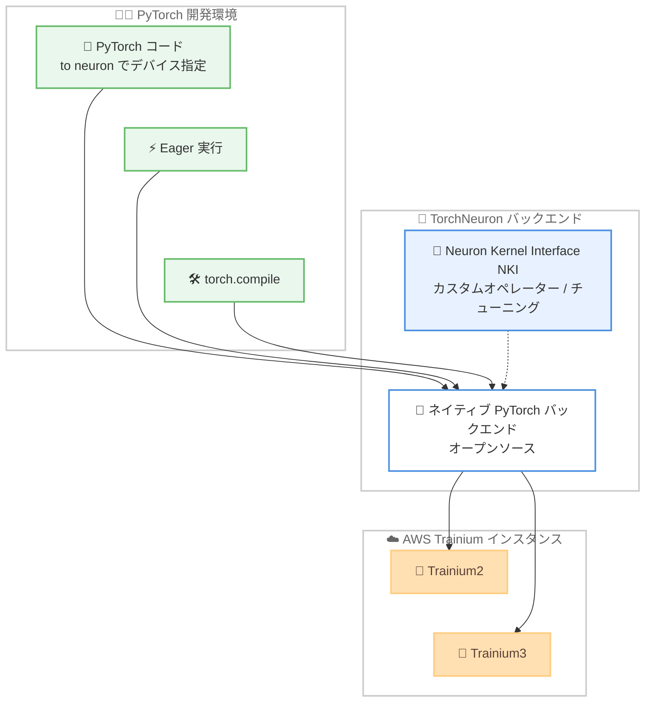

# AWS Trainium - TorchNeuron: ネイティブ PyTorch サポート (パブリックベータ)

**リリース日**: 2026 年 10 月 20 日
**サービス**: AWS Trainium / AWS Neuron
**機能**: TorchNeuron (AWS Trainium 向けオープンソースのネイティブ PyTorch バックエンド)

📊 [このアップデートのインフォグラフィックを見る](https://takech9203.github.io/aws-news-summary/20261020-aws-announce-native-pytorch-support-trainium.html)

## 概要

AWS は、AWS Trainium 向けのオープンソースのネイティブ PyTorch バックエンドである「TorchNeuron」のパブリックベータを発表しました。Trainium は、コスト効率に優れた高性能なトレーニングと推論のために設計された AWS の AI アクセラレータチップファミリーです。TorchNeuron により、AI サイエンティストや研究者は、PyTorch モデルを Trainium ハードウェア上でネイティブに構築・実験できるようになります。

TorchNeuron の最大の特徴は、既存の PyTorch コードを `.to('neuron')` に切り替えるだけで Trainium 上で実行できる点です。Eager 実行、`torch.compile`、標準の PyTorch API を含む完全な PyTorch 互換性が維持されるため、GPU 向けに書かれたワークフローや開発体験をほぼそのまま Trainium に持ち込めます。さらに、Neuron Kernel Interface (NKI) との統合により、カスタムオペレーターの実装やハードウェア固有のパフォーマンスチューニングも可能です。

対象ユーザーは、PyTorch を日常的に使用する AI サイエンティスト、研究者、ML エンジニアで、特に GPU から Trainium への移行コストを抑えつつ、コスト効率の高いトレーニング・推論基盤を検討しているチームに有用です。

**アップデート前の課題**

- 以前は、Trainium 上で PyTorch を利用する際にネイティブな Eager 実行が利用できず、PyTorch 本来のインタラクティブな開発・デバッグ体験が制限されていた
- GPU 向けに書かれた PyTorch コードを Trainium で動かすには、実行方式の違いを意識したコードの調整や検証が必要だった
- 研究・実験フェーズでの試行錯誤において、標準の PyTorch API との互換性のギャップが移行の障壁となっていた

**アップデート後の改善**

- 今回のアップデートにより、デバイス指定を `.to('neuron')` に切り替えるだけで PyTorch コードを Trainium 上で実行できるようになった
- Eager 実行、`torch.compile`、標準の PyTorch API を含む完全な PyTorch 互換性が維持され、使い慣れた開発体験のまま Trainium を活用できるようになった
- NKI との統合により、カスタムオペレーターの追加やハードウェア固有の最適化を PyTorch ワークフローの中で実現できるようになった

## アーキテクチャ図



PyTorch コードはデバイス指定を変更するだけで TorchNeuron バックエンドを経由して Trainium2 / Trainium3 インスタンス上で実行されます。NKI を通じてカスタムオペレーターやハードウェア固有の最適化も組み込めます。

## サービスアップデートの詳細

### 主要機能

1. **ネイティブ PyTorch バックエンド**
   - Trainium 向けのオープンソースのネイティブ PyTorch バックエンドとして提供
   - デバイス指定を `.to('neuron')` に切り替えるだけで PyTorch コードを Trainium 上で実行可能
   - GitHub (aws-neuron/torch-neuronx) でソースコードが公開されている

2. **完全な PyTorch 互換性**
   - Eager 実行をサポートし、インタラクティブな開発・デバッグが可能
   - `torch.compile` による最適化パスをサポート
   - 標準の PyTorch API との互換性を維持し、既存コード資産を活用可能

3. **Neuron Kernel Interface (NKI) との統合**
   - カスタムオペレーターの実装をサポート
   - Trainium ハードウェア固有のパフォーマンスチューニングが可能
   - 高度な最適化が必要なワークロードにも対応

## 技術仕様

### 主要な技術要素

| 項目 | 詳細 |
|------|------|
| 提供形態 | オープンソース (パブリックベータ) |
| 対応フレームワーク | PyTorch (Eager 実行、torch.compile、標準 API) |
| デバイス指定 | `.to('neuron')` |
| カスタマイズ | Neuron Kernel Interface (NKI) によるカスタムオペレーター / チューニング |
| 対応インスタンス | Amazon EC2 Trainium2 インスタンス、Trainium3 インスタンス |
| リポジトリ | [aws-neuron/torch-neuronx](https://github.com/aws-neuron/torch-neuronx) |

### 使用イメージ

```python
import torch

# デバイス指定を 'neuron' に切り替えるだけで Trainium 上で実行
device = torch.device("neuron")
model = MyModel().to(device)
inputs = inputs.to(device)

# Eager 実行や torch.compile をそのまま利用可能
compiled_model = torch.compile(model)
outputs = compiled_model(inputs)
```

## 設定方法

### 前提条件

1. AWS アカウントを保有していること
2. Amazon EC2 Trainium2 または Trainium3 インスタンスを利用できること
3. PyTorch ベースの開発環境があること

### 手順

#### ステップ 1: Trainium インスタンスの起動

```bash
# 例: Trainium インスタンスを起動 (インスタンスタイプやリージョンは要件に応じて選択)
aws ec2 run-instances \
  --instance-type trn2.48xlarge \
  --image-id <Neuron 対応 AMI の ID> \
  --key-name <キーペア名>
```

Trainium2 または Trainium3 ベースの EC2 インスタンスを起動します。Neuron SDK がセットアップされた AMI を使用すると環境構築が容易です。

#### ステップ 2: TorchNeuron の導入

GitHub リポジトリ ([aws-neuron/torch-neuronx](https://github.com/aws-neuron/torch-neuronx)) の手順に従って、TorchNeuron パブリックベータをインストールします。インストール手順の詳細はリポジトリのドキュメントを参照してください。

#### ステップ 3: PyTorch コードのデバイス指定を変更

```python
# 既存の PyTorch コードのデバイス指定を変更
model = model.to("neuron")
```

既存の PyTorch コードのデバイス指定を `neuron` に切り替えることで、Trainium 上でモデルを実行できます。

## メリット

### ビジネス面

- **移行コストの削減**: 既存の PyTorch コード資産をほぼそのまま活用でき、GPU から Trainium への移行に伴う書き換えコストを抑えられる
- **コスト効率の高い AI 基盤**: コスト効率に優れた Trainium アクセラレータを、使い慣れた PyTorch ワークフローから活用できる
- **オープンソースによる透明性**: バックエンドの実装が GitHub で公開されており、コミュニティによる改善や内部動作の確認が可能

### 技術面

- **ネイティブな開発体験**: Eager 実行により、Trainium 上でもインタラクティブな開発・デバッグが可能
- **標準 API との互換性**: `torch.compile` を含む標準の PyTorch API をサポートし、学習コストが低い
- **高度な最適化への対応**: NKI 統合により、カスタムオペレーターの実装やハードウェア固有のチューニングが可能

## デメリット・制約事項

### 制限事項

- パブリックベータであり、本番環境での利用には慎重な検証が必要
- 対応インスタンスは Trainium2 および Trainium3 インスタンスに限定される (第 1 世代 Trainium への言及はなし)
- 発表時点で利用可能リージョンの明記はなく、Trainium インスタンスが利用できるリージョンに依存する

### 考慮すべき点

- ベータ期間中は API や挙動が変更される可能性があるため、GitHub リポジトリの更新を継続的に確認することを推奨
- ワークロードによっては NKI によるチューニングが必要になる場合があり、その際は Neuron 固有の知識が求められる

## ユースケース

### ユースケース 1: 研究開発での迅速なモデル実験

**シナリオ**: AI 研究チームが新しいモデルアーキテクチャを試行錯誤しており、GPU クラスターのコストと空き状況が課題になっている。

**実装例**:
```python
device = torch.device("neuron")
model = ExperimentalModel().to(device)
# Eager 実行でステップごとにデバッグしながら実験
for batch in dataloader:
    loss = model(batch.to(device))
    loss.backward()
```

**効果**: 使い慣れた PyTorch の Eager 実行のまま Trainium 上で実験でき、コスト効率の高い研究開発サイクルを実現できる。

### ユースケース 2: 既存 PyTorch トレーニングパイプラインの Trainium 移行

**シナリオ**: GPU 向けに構築した PyTorch トレーニングパイプラインを、コスト最適化のために Trainium へ移行したい。

**実装例**:
```python
# 変更点はデバイス指定のみ
device = torch.device("neuron")  # 従来: torch.device("cuda")
model = model.to(device)
compiled = torch.compile(model)
```

**効果**: デバイス指定の切り替えを中心とした最小限の変更で移行でき、`torch.compile` による最適化も継続利用できる。

### ユースケース 3: NKI を用いたカスタムオペレーターの最適化

**シナリオ**: 独自のアテンション機構など、標準オペレーターでは性能要件を満たせない処理を Trainium 向けに最適化したい。

**実装例**:
```python
# NKI でカスタムカーネルを実装し、PyTorch オペレーターとして登録
# 詳細は aws-neuron/torch-neuronx リポジトリのドキュメントを参照
```

**効果**: PyTorch ワークフローを維持したまま、ハードウェア固有の最適化によりクリティカルな処理の性能を引き上げられる。

## 料金

TorchNeuron はオープンソースとして提供され、発表内に TorchNeuron 自体の追加料金に関する記載はありません。利用時は、実行基盤となる Amazon EC2 Trainium インスタンスの利用料金が適用されます。詳細は [Amazon EC2 の料金ページ](https://aws.amazon.com/ec2/pricing/) を参照してください。

## 利用可能リージョン

発表内に利用可能リージョンの明記はありません。Amazon EC2 Trainium2 / Trainium3 インスタンスが利用可能なリージョンでの利用が前提となります。

## 関連サービス・機能

- **AWS Neuron**: Trainium / Inferentia 向けの SDK。TorchNeuron は Neuron エコシステムの一部として提供される
- **Neuron Kernel Interface (NKI)**: カスタムオペレーターの実装とハードウェア固有の最適化を可能にするインターフェース
- **Amazon EC2 Trn インスタンス**: Trainium2 / Trainium3 アクセラレータを搭載した EC2 インスタンスファミリー

## 参考リンク

- 📊 [インフォグラフィック](https://takech9203.github.io/aws-news-summary/20261020-aws-announce-native-pytorch-support-trainium.html)
- [公式発表 (What's New)](https://aws.amazon.com/about-aws/whats-new/2026/10/aws-announce-native-pytorch-support-trainium)
- [TorchNeuron GitHub リポジトリ](https://github.com/aws-neuron/torch-neuronx)
- [AWS Neuron 製品ページ](https://aws.amazon.com/ai/machine-learning/neuron/)

## まとめ

TorchNeuron のパブリックベータにより、`.to('neuron')` への切り替えだけで PyTorch コードを Trainium 上でネイティブに実行できるようになり、GPU から Trainium への移行障壁が大きく下がりました。Eager 実行や `torch.compile` を含む完全な PyTorch 互換性と NKI による最適化の両立が特徴です。PyTorch ベースのトレーニング基盤のコスト最適化を検討しているチームは、GitHub リポジトリを確認し、ベータ版での検証を始めることを推奨します。
