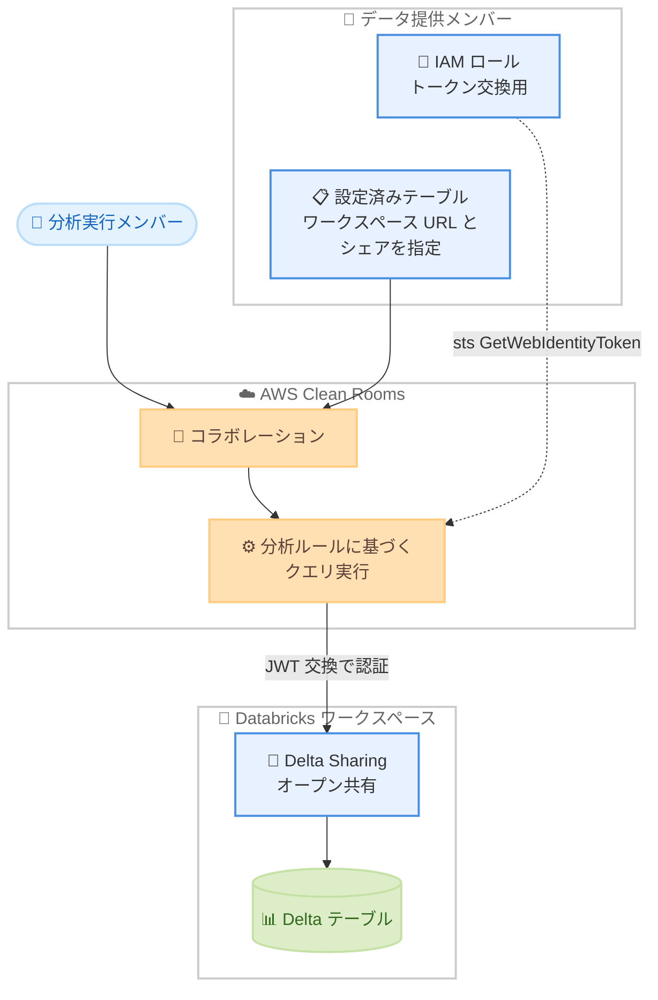

# AWS Clean Rooms - Databricks データソースのサポート

**リリース日**: 2026 年 10 月 20 日
**サービス**: AWS Clean Rooms
**機能**: Databricks をデータソースとして直接利用可能に

📊 [このアップデートのインフォグラフィックを見る](https://takech9203.github.io/aws-news-summary/20261020-aws-clean-rooms-supports-databricks.html)

## 概要

AWS Clean Rooms が、データソースとして Databricks をサポートしました。これまでの AWS Glue、Snowflake、Amazon Athena に加えて、Databricks が選択肢に加わります。コラボレーションのメンバーは、Databricks で管理しているデータを移動したり開示したりすることなく、安全に分析できるようになります。

本機能では、Delta Sharing オープンプロトコルを通じて共有された Databricks のテーブルを、コラボレーション内で直接クエリできます。テーブルを登録する際は、ワークスペース URL、スキーマ、テーブル名と Delta Sharing の共有 (シェア) を指定し、コラボレーションで利用可能にします。AWS Clean Rooms は JSON Web Token (JWT) の交換によって Databricks に接続するため、長期的なシークレットを保存する必要がありません。

Databricks 上に顧客データを保持する企業が、パートナー企業とプライバシーを保護しながらデータコラボレーションを行うケースに有効です。たとえば、Databricks に顧客データを持つ小売事業者が、メディアパートナーとキャンペーン効果測定を行う際に、S3 へのエクスポートを維持することなく、承認された分析を実行できます。

**アップデート前の課題**

- 以前は Databricks のデータを AWS Clean Rooms で利用するには、Amazon S3 へエクスポートまたはレプリケートする必要があった
- エクスポート用のデータパイプラインの構築・運用の作業が発生していた
- データのコピーが増えることで、ガバナンス対象が増加していた

**アップデート後の改善**

- Delta Sharing 経由で共有された Databricks のテーブルをコラボレーション内で直接クエリ可能になった
- S3 へのエクスポートやレプリケーションが不要になり、パイプラインの運用負荷が削減された
- ソースデータを移動・開示せずに分析できるため、データガバナンスがシンプルになった

## アーキテクチャ図



データ提供メンバーは Databricks のテーブルを Delta Sharing で共有し、AWS Clean Rooms は IAM ロールと JWT 交換により Databricks へ安全に接続します。分析実行メンバーは、ソースデータを移動することなく、分析ルールに基づいた承認済みのクエリを実行できます。

## サービスアップデートの詳細

### 主要機能

1. **Databricks テーブルへの直接クエリ**
   - Delta Sharing オープンプロトコルで共有されたテーブルをコラボレーション内で直接クエリできる
   - ソースデータの移動や開示は不要
   - 設定済みテーブルの作成時に AWS Clean Rooms がスキーマを自動推論し、クエリ実行者に公開する列名のみを指定すればよい

2. **シークレットレスな認証方式**
   - AWS Clean Rooms はユーザーのアカウントの IAM ロールを引き受け、一時的な認証情報を Databricks が信頼する JWT と交換して接続する
   - IAM のアウトバウンド ID フェデレーションを使用するため、長期的なシークレットの保存が不要
   - Databricks 側では OIDC フェデレーションを使用する Open タイプの受信者 (レシピエント) を作成し、フェデレーションポリシーで発行者・サブジェクト・オーディエンスを指定して信頼関係を構成する

3. **IP アクセスリストによる接続元の制限 (オプション)**
   - Databricks の受信者に IP アクセスリストを設定し、AWS Clean Rooms のエグレス IP アドレス範囲のみを許可することで、接続元を AWS Clean Rooms に限定できる

## 技術仕様

### 対応データソースの比較

| データソース | 特徴 |
|------|------|
| AWS Glue (S3) | AWS 内のデータレイクをそのまま利用 |
| Amazon Athena | Athena のビュー経由でデータを利用 |
| Snowflake | Snowflake 上のデータを移動せずに利用 |
| Databricks (今回追加) | Delta Sharing 経由で Databricks のテーブルを移動せずに利用 |

### Databricks 接続の構成要素

| 項目 | 詳細 |
|------|------|
| 共有プロトコル | Delta Sharing (Open Sharing) |
| 認証方式 | IAM アウトバウンド ID フェデレーションによる JWT 交換 |
| 必要な IAM 権限 | `sts:GetWebIdentityToken` を許可する IAM ロール |
| 登録時の指定項目 | ワークスペース URL、スキーマ、テーブル、Delta Sharing のシェア |
| スキーマ | AWS Clean Rooms が自動推論 (公開する列名のみ指定) |
| アクセス制限 | 受信者の IP アクセスリストで AWS Clean Rooms のエグレス IP 範囲を許可 (オプション) |

### Databricks 側のシェア作成例

```sql
CREATE SHARE my_share;
ALTER SHARE my_share ADD TABLE my_catalog.my_schema.my_table;
GRANT SELECT ON SHARE my_share TO RECIPIENT my_recipient;
```

## 設定方法

### 前提条件

1. Databricks のデータテーブルを読み取る権限が付与された AWS アカウントを保有していること
2. データテーブルが AWS Clean Rooms のサポートするデータ型を使用していること
3. データテーブルが Databricks ワークスペースに保存されていること
4. Databricks で Delta Sharing の有効化、シェアおよび受信者の作成を行う権限を保有していること

### 手順

#### ステップ 1: IAM ロールによるトークン交換の設定

1. IAM コンソールの [アカウント設定] で、アウトバウンド ID フェデレーションを有効化する
2. 生成されたトークン発行者 URL (例: `https://<uuid>.tokens.sts.global.api.aws`) を控える
3. `sts:GetWebIdentityToken` を許可する権限ポリシーと、コラボレーションメンバーシップのコンテキストでのみ AWS Clean Rooms がロールを引き受けられる信頼ポリシーを持つ IAM ロールを作成する

この設定により、AWS Clean Rooms が一時的な認証情報を JWT と交換して Databricks に接続できるようになります。

#### ステップ 2: Delta Sharing によるテーブルの共有

1. Databricks のメタストアで Delta Sharing (Open Sharing) を有効化する (メタストアレベルで 1 回のみ)
2. OIDC フェデレーションを使用する Open タイプの受信者を作成し、フェデレーションポリシーに発行者 (ステップ 1 の URL)、サブジェクトクレーム `sub`、サブジェクト (IAM ロールの ARN)、オーディエンス (ワークスペース URL) を設定する
3. SQL エディタでシェアを作成し、テーブルを追加して受信者にアクセスを許可する
4. 受信者の Delta Sharing エンドポイント URL を控える

Databricks 側で AWS アカウントを信頼する設定を行い、共有対象のテーブルを公開する手順です。

#### ステップ 3: 設定済みテーブルの作成とコラボレーションへの関連付け

AWS Clean Rooms コンソールで、ワークスペース URL、スキーマ、テーブルと Delta Sharing のシェアを指定して設定済みテーブルを作成し、分析ルールを設定してコラボレーションに関連付けます。コラボレーションの他のメンバーは、承認された分析のみを実行できます。

## メリット

### ビジネス面

- **パートナーコラボレーションの迅速化**: Databricks を利用する企業がデータ移行なしでクリーンルームコラボレーションに参加でき、プロジェクト開始までの期間を短縮できる
- **運用コストの削減**: S3 へのエクスポートパイプラインの構築・維持が不要になり、運用負荷とコストを削減できる
- **データガバナンスの簡素化**: データのコピーが増えないため、管理・統制すべきデータの範囲を最小限に保てる

### 技術面

- **シークレットレスな接続**: JWT 交換による認証で長期的なシークレットの保存・ローテーションが不要
- **オープンプロトコルの採用**: Delta Sharing という標準的なオープンプロトコルを使用するため、Databricks 側の既存の共有基盤を活用できる
- **スキーマの自動推論**: 設定済みテーブルの作成時にスキーマが自動推論され、公開する列の指定のみで済む

## デメリット・制約事項

### 制限事項

- データテーブルは AWS Clean Rooms のサポートするデータ型を使用している必要がある
- Databricks 側で Delta Sharing (Open Sharing) をメタストアレベルで有効化する必要がある
- IAM のアウトバウンド ID フェデレーションをアカウントで有効化する必要がある

### 考慮すべき点

- Databricks 側の設定 (受信者の作成、フェデレーションポリシー、シェアの管理) には Databricks の管理権限が必要となるため、組織内の Databricks 管理者との調整が必要
- 接続元を制限する場合は、AWS Clean Rooms のエグレス IP アドレス範囲を受信者の IP アクセスリストに追加する追加設定が必要
- クエリは Databricks 外の AWS Clean Rooms 上で実行されるため、既存の Databricks 側のクエリ監視とは別に AWS 側での利用状況の把握が必要

## ユースケース

### ユースケース 1: 小売事業者とメディアパートナーのキャンペーン効果測定

**シナリオ**: Databricks に顧客データを保持する小売事業者が、メディアパートナーと広告キャンペーンの効果測定を行いたい。従来は S3 へのエクスポートを維持する必要があった。

**実装例**:
```text
1. 小売事業者: Databricks で顧客データのテーブルを Delta Sharing で共有
2. 小売事業者: AWS Clean Rooms で設定済みテーブルを作成し、集計分析ルールを設定
3. メディアパートナー: コラボレーション内で広告接触データと照合する集計クエリを実行
```

**効果**: エクスポートパイプラインなしで、個々の顧客データを開示することなくキャンペーンのリーチやコンバージョンを測定できる。

### ユースケース 2: マルチプラットフォーム環境でのデータコラボレーション

**シナリオ**: コラボレーション参加企業がそれぞれ AWS Glue、Snowflake、Databricks と異なるデータ基盤を利用しており、共通の分析基盤でデータを突合したい。

**実装例**:
```text
1. 各メンバーが自社のデータ基盤 (Glue / Snowflake / Databricks) から設定済みテーブルを登録
2. コラボレーション内で分析ルールに基づいた横断クエリを実行
```

**効果**: 各社がデータを自社基盤に保持したまま、プラットフォームをまたいだセキュアな共同分析が可能になる。

### ユースケース 3: 金融機関間の不正検知のための共同分析

**シナリオ**: Databricks 上に取引データを持つ金融機関が、他の金融機関と不正パターンの共同分析を行いたいが、顧客の取引データそのものは開示できない。

**実装例**:
```text
1. 各金融機関が取引データのテーブルを Delta Sharing / 他のデータソース経由で登録
2. 分析ルールで集計クエリのみを許可し、個別レコードの参照を禁止
3. 承認された集計分析で不正の傾向を共同で把握
```

**効果**: 機密性の高い取引データを移動・開示せずに、業界横断での不正検知の精度を向上できる。

## 料金

本アップデートに関する追加料金の記載は公式発表にはありません。AWS Clean Rooms の標準料金が適用されます。詳細は [AWS Clean Rooms の料金ページ](https://aws.amazon.com/clean-rooms/pricing/) を参照してください。

なお、Databricks 側の Delta Sharing の利用に伴う費用については、Databricks の料金体系を確認してください。

## 利用可能リージョン

AWS Clean Rooms が利用可能なすべての AWS リージョンで利用できます。最新のリージョン一覧は [AWS リージョン表](https://docs.aws.amazon.com/general/latest/gr/clean-rooms.html#clean-rooms_region) を参照してください。

## 関連サービス・機能

- **AWS Clean Rooms**: 複数の企業がデータを移動・開示せずに共同分析できるクリーンルームサービス。本アップデートの対象サービス
- **AWS IAM (アウトバウンド ID フェデレーション)**: AWS Clean Rooms が Databricks との JWT 交換に使用する認証基盤
- **Amazon Athena / AWS Glue / Snowflake**: AWS Clean Rooms が既にサポートしている他のデータソース。Databricks が新たに加わった

## 参考リンク

- 📊 [インフォグラフィック](https://takech9203.github.io/aws-news-summary/20261020-aws-clean-rooms-supports-databricks.html)
- [公式発表 (What's New)](https://aws.amazon.com/about-aws/whats-new/2026/10/aws-clean-rooms-supports-databricks)
- [ドキュメント: Preparing data tables in Databricks](https://docs.aws.amazon.com/clean-rooms/latest/userguide/prepare-data-databricks.html)
- [AWS Clean Rooms 製品ページ](https://aws.amazon.com/clean-rooms/)
- [料金ページ](https://aws.amazon.com/clean-rooms/pricing/)

## まとめ

AWS Clean Rooms が Databricks をデータソースとしてサポートしたことで、Databricks 利用企業は S3 へのエクスポートなしにクリーンルームコラボレーションへ参加できるようになりました。Delta Sharing と JWT 交換によるシークレットレスな接続で、セキュリティと運用性を両立しています。Databricks にデータを保持しながらパートナー企業との共同分析を検討している場合は、IAM のアウトバウンド ID フェデレーションの有効化と Delta Sharing の設定から試すことを推奨します。
