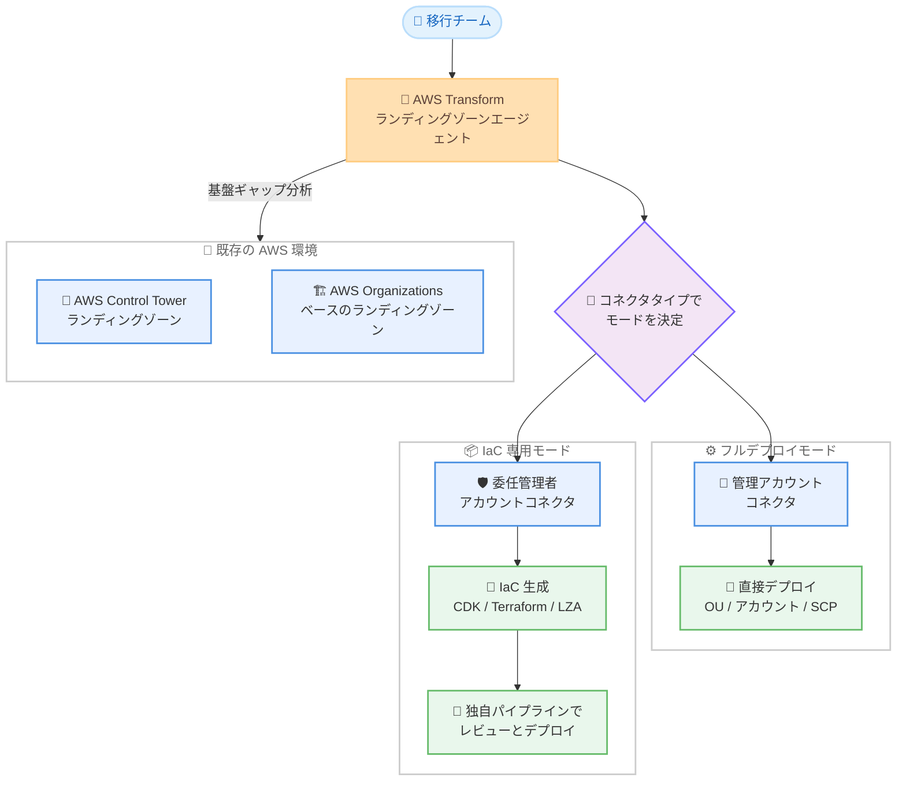

# AWS Transform - 既存ランディングゾーンのサポート拡大と IaC 専用モード

**リリース日**: 2026 年 10 月 20 日
**サービス**: AWS Transform for migrations
**機能**: 既存ランディングゾーン (AWS Control Tower / AWS Organizations ベース) のサポート拡大と IaC 専用モードの追加

📊 [このアップデートのインフォグラフィックを見る](https://takech9203.github.io/aws-news-summary/20261020-aws-transform-migrations-landing-zones.html)

## 概要

AWS Transform for migrations が、移行用ランディングゾーンを構築する際に利用できる既存 AWS 環境のサポートを拡大しました。AWS Control Tower で構築されたランディングゾーンに加えて、AWS Organizations のみで構築されたランディングゾーンにも対応します。AWS Transform は現在の環境を AWS ベストプラクティスと照合する基盤ギャップ分析を実行し、既存のターゲットアカウント上に不足しているランディングゾーン機能を追加構築するため、移行チームはより早く移行を開始できます。

あわせて、Infrastructure as Code (IaC) 専用モードが追加されました。このモードでは、AWS Transform が組織を分析し、推奨事項を生成したうえで、移行計画に合わせた IaC を AWS CDK、Terraform、Landing Zone Accelerator (LZA) の 3 つの形式で生成します。管理アカウントへの直接アクセスを AWS Transform に許可したくない組織は、委任管理者 (DA) アカウント経由で接続でき、独自のデプロイパイプラインを持つ組織はエージェントによる自動デプロイを行わずに IaC のみを受け取れます。

ランディングゾーンエージェントは、基盤セットアップ、組織単位 (OU) とアカウント構造、サービスコントロールポリシー (SCP)、移行計画とウェーブに合わせたワークロードアカウントの設計までをエンドツーエンドで支援します。大規模な移行プロジェクトを進めるエンタープライズ企業や、既存のガバナンス基盤を保持したまま移行基盤を整備したい組織に有効なアップデートです。

**アップデート前の課題**

- 既存のランディングゾーンがある環境 (ブラウンフィールド) では、AWS Transform のランディングゾーン構築機能を活用しにくく、ゼロからの構築や手動でのギャップ分析が必要だった
- ランディングゾーンのデプロイには管理アカウントへの直接アクセスを AWS Transform に許可する必要があり、セキュリティポリシー上それを許可できない組織では利用が難しかった
- LZA や Terraform、独自 CI/CD などの既存デプロイパイプラインを持つ組織は、エージェントによる直接デプロイと自社の変更管理プロセスを両立しにくかった

**アップデート後の改善**

- AWS Control Tower ベースと AWS Organizations ベースの両方の既存ランディングゾーンを検出し、ベストプラクティスとのギャップのみを推奨事項として提示できるようになった
- IaC 専用モードにより、委任管理者アカウント経由の読み取り権限のみで組織の分析と IaC 生成が可能になり、管理アカウントへの直接アクセス許可が不要になった
- 生成された IaC (AWS CDK / Terraform / LZA) を独自のパイプラインでレビュー・デプロイでき、既存の変更管理プロセスに組み込めるようになった

## アーキテクチャ図



AWS Transform のランディングゾーンエージェントは、既存環境 (Control Tower または Organizations ベース) のギャップ分析を行い、コネクタタイプに応じて直接デプロイまたは IaC 生成のいずれかのモードで動作します。

## サービスアップデートの詳細

### 主要機能

1. **既存ランディングゾーンのサポート拡大 (ブラウンフィールド対応)**
   - AWS Control Tower で構築されたランディングゾーンと、AWS Organizations のみで構築されたランディングゾーンの両方に対応
   - 既存の組織構造 (OU、アカウント、SCP) を検出し、AWS ベストプラクティスとの基盤ギャップ分析を実行
   - ギャップを埋めるために必要な変更のみを推奨するため、ゼロからの構築や手動でのギャップ分析が不要
   - 既存アカウントのメールアドレスからプラスアドレッシングの命名規則を推測し、同じパターンの継続を提案

2. **IaC 専用モード**
   - 組織の分析、推奨事項の生成、移行計画に合わせた IaC の生成までを実行し、インフラの直接デプロイは行わないモード
   - 委任管理者 (DA) アカウントのコネクタを使用する場合に有効となり、権限は組織に対する読み取り・記述系の操作に限定される
   - Control Tower が未初期化の組織では、Control Tower を初期化するための IaC アーティファクトを生成し、ユーザー側のパイプラインでレビュー・デプロイできる

3. **3 つの IaC 形式での出力**
   - **AWS CDK**: TypeScript プロジェクトとしてプログラマブルにデプロイ可能
   - **Terraform**: HCL テンプレートとしてランディングゾーンリソースを管理可能
   - **Landing Zone Accelerator (LZA)**: LZA Universal Configuration バージョン 1.1.0 に基づく YAML 設定ファイルを生成。ガバナンス、組織構造、ネットワークの設定が事前構成済み
   - ダウンロードしたファイルは SHA-256 チェックサムで改ざんの有無を検証可能

4. **ランディングゾーン設計のエンドツーエンド支援**
   - 基盤セットアップ: Control Tower、基盤 OU (Security、Infrastructure、Sandbox、Workloads など)、コアアカウント (Audit、Log Archive) の構成
   - ワークロードアカウント設計: 移行ウェーブ、ビジネスユニット、環境分離要件に基づく OU とアカウント構造の提案
   - SCP 管理: ベストプラクティスに基づく追加 SCP の推奨と、適用済み SCP とのギャップ確認

## 技術仕様

### 動作モードとコネクタタイプ

| 項目 | フルデプロイモード | IaC 専用モード |
|------|------|------|
| コネクタタイプ | 管理アカウント | 委任管理者 (DA) アカウント |
| 組織の分析・推奨事項の生成 | 対応 | 対応 |
| IaC アーティファクトの生成 | 対応 (直接デプロイとの選択可) | 対応 |
| 直接デプロイ | 対応 | 非対応 (Control Tower の技術的制約による) |
| 必要な権限 | Control Tower、Organizations、SCP、CloudFormation、Service Catalog、S3 などの管理権限 | 組織に対する読み取り・記述系操作のみ |

### 基盤ギャップ分析で確認される構造 (ベストプラクティス)

| コンポーネント | 種別 | 提供元 |
|------|------|------|
| Security OU (Audit / Log Archive アカウント) | OU / アカウント | AWS Control Tower ベースライン |
| Infrastructure OU (Network / Shared Services) | OU | AWS ベストプラクティスによる追加 |
| Sandbox OU | OU / アカウント | AWS ベストプラクティスによる追加 |
| Workloads OU | OU | AWS ベストプラクティスによる追加 (ワークロード設計フェーズで中身を構成) |

### 注意が必要な制約

| 項目 | 詳細 |
|------|------|
| ホームリージョン | コネクタのリージョンは Control Tower のホームリージョンかつ IAM Identity Center のリージョンと一致している必要がある |
| DA アカウントの SCP 制約 | Control Tower 管理下の既存 SCP の参照・変更は不可。Control Tower 管理外の新規 SCP の IaC 生成は可能 |
| LZA デプロイ | AWS Transform のアカウントと LZA インストールが同一の AWS Organization に属している必要がある |
| リソースタグ | 生成リソースには `CreatedBy: AWSTransform` と `ATWorkspace` タグが自動付与される |

## 設定方法

### 前提条件

1. AWS Transform for migrations のワークスペースが作成済みであること
2. AWS Organizations の管理アカウント、または委任管理者 (DA) アカウントへのコネクタを作成できること
3. コネクタのターゲットリージョンが Control Tower のホームリージョンおよび IAM Identity Center のリージョンと一致していること

### 手順

#### ステップ 1: コネクタの作成とモードの選択

AWS Transform のコネクタ設定で、管理アカウントまたは委任管理者アカウントのいずれかを接続先として指定します。管理アカウントを指定するとフルデプロイモード、委任管理者アカウントを指定すると IaC 専用モードで動作します。コネクタ作成時にターゲットリージョン (Control Tower のホームリージョン) を指定します。

#### ステップ 2: 基盤ギャップ分析の実行

ランディングゾーンエージェントが既存の組織構造を検出し、Control Tower の有無を確認します。既存のランディングゾーンがある場合は、ベストプラクティスとのギャップ (例: 「Security OU と Infrastructure OU はあるが Sandbox OU がない」) のみが報告されます。Control Tower が未導入の場合は、Control Tower ベースまたは Organizations のみの 2 つのアプローチから選択できます。

#### ステップ 3: ワークロードアカウント設計と SCP の適用

移行計画フェーズのウェーブプランやサーバーとアプリケーションのマッピングをもとに、Workloads OU 配下の OU とアカウント構造が提案されます。提案内容は適用前にレビュー・修正でき、適用後も繰り返し調整できます。あわせて、推奨される SCP を適用対象の OU を選んで設定します。

#### ステップ 4: デプロイまたは IaC のダウンロード

設計完了後、「Deploy for me」(直接デプロイ) または「I'll deploy on my own」(IaC 生成) を選択します。IaC を選択した場合は、AWS CDK、Terraform、LZA のいずれかの形式でアーティファクトをダウンロードし、以下のコマンドでチェックサムを検証したうえで独自パイプラインでデプロイします。

```bash
openssl dgst -sha256 -binary <file.zip> | base64
```

ダウンロードした IaC アーティファクトの SHA-256 ハッシュを生成し、AWS Transform が提供するチェックサムと比較してファイルの完全性を検証するコマンドです。なお、直接デプロイの場合、デプロイリクエストは AWS Transform の Approvals タブを通じて Admin ロールを持つ承認者の明示的な承認を経てから実行されます。

## メリット

### ビジネス面

- **移行開始までの期間短縮**: 既存環境のギャップ分析と不足機能の追加構築を自動化することで、通常数週間かかる手動の計画・設定作業を短縮し、移行をより早く開始できる
- **既存投資の活用**: すでに構築済みの Control Tower や Organizations ベースのランディングゾーンを作り直すことなく、そのまま移行基盤として活用できる
- **ガバナンス要件への適合**: 管理アカウントへのプログラマティックアクセスを制限するセキュリティポリシーを持つ組織でも、委任管理者アカウント経由で AWS Transform を利用できる

### 技術面

- **最小権限での分析**: IaC 専用モードでは権限が組織の読み取り・記述系操作に限定され、AWS Transform に付与する権限を最小化できる
- **既存パイプラインとの統合**: LZA、Terraform、CDK、独自 CI/CD など既存のデプロイパイプラインと変更管理プロセスに IaC を組み込める
- **ベストプラクティス準拠**: 基盤 OU 構造、SCP、アカウント設計が AWS ベストプラクティスに基づいて推奨されるため、設計品質を担保しやすい

## デメリット・制約事項

### 制限事項

- 委任管理者アカウントのコネクタでは直接デプロイができない (Control Tower のランディングゾーンを委任管理者アカウントからプロビジョニングできないという技術的制約による)
- 委任管理者アカウント経由では、Control Tower 管理下の既存 SCP の参照・変更ができない。変更が必要な場合は管理アカウントへのコネクタ再設定が必要
- デプロイ済みの OU やアカウントはランディングゾーンエージェントから削除できない (未デプロイの要素のみ削除可能)
- Security OU は Control Tower 管理のため、エージェント経由でアカウントや SCP を追加できない

### 考慮すべき点

- コネクタのリージョンが Control Tower のホームリージョンおよび IAM Identity Center のリージョンと一致していないと、Control Tower の初期化が失敗する
- LZA 形式でデプロイする場合、AWS Transform のアカウントと LZA インストールが同一の AWS Organization に属している必要がある
- 移行ウェーブ内のサーバーは同一アカウントに配置される設計原則があるため、アカウント分離要件によってはウェーブプランの見直しが必要になる場合がある

## ユースケース

### ユースケース 1: Control Tower 導入済み環境への移行基盤の追加構築

**シナリオ**: すでに AWS Control Tower でランディングゾーンを運用している企業が、VMware 環境からの大規模移行に向けてワークロードアカウントを整備したい。

**実装例**:
```text
1. 管理アカウントへのコネクタを作成し、フルデプロイモードで接続
2. 基盤ギャップ分析を実行し、不足している OU (例: Sandbox OU) のみ追加
3. 移行ウェーブに基づくワークロード OU とアカウント構造の提案を確認し、直接デプロイ
```

**効果**: 既存のランディングゾーンを作り直すことなく、ギャップのみを補完して移行基盤を短期間で整備できる。

### ユースケース 2: 管理アカウントへのアクセスを制限している企業での IaC 生成

**シナリオ**: セキュリティポリシーにより管理アカウントへのプログラマティックアクセスを許可できない金融機関が、AWS Transform の設計支援のみを活用したい。

**実装例**:
```text
1. 委任管理者アカウントを作成し、DA コネクタで接続 (IaC 専用モード)
2. 組織の分析と推奨事項の生成を実行
3. Terraform 形式で IaC を生成し、チェックサム検証後に社内の変更管理プロセスでレビュー
4. 社内 CI/CD パイプラインからデプロイ
```

**効果**: 管理アカウントへの権限付与なしで、ベストプラクティスに基づいた設計と IaC を入手し、既存の統制プロセスを維持したままデプロイできる。

### ユースケース 3: LZA を利用中の組織でのワークロードアカウント拡張

**シナリオ**: Landing Zone Accelerator on AWS でランディングゾーンを管理している組織が、移行ウェーブに合わせたワークロードアカウントの追加設計を効率化したい。

**実装例**:
```text
1. 移行計画フェーズのウェーブプランを AWS Transform に取り込み
2. ビジネスユニットと環境分離要件に基づく OU / アカウント構造の提案を確認
3. LZA Universal Configuration 形式の YAML を生成し、既存の LZA パイプラインでデプロイ
```

**効果**: 既存の LZA 運用を変更せずに、移行計画と整合したアカウント設計を自動生成し、設計工数を削減できる。

## 料金

本アップデートに関する追加料金の記載は公式発表にはありません。詳細は [AWS Transform の料金ページ](https://aws.amazon.com/transform/pricing/) を参照してください。

なお、ランディングゾーンとしてデプロイされる AWS Control Tower、AWS Organizations 配下の各アカウントで利用する AWS サービス (AWS Config、CloudTrail など) には、それぞれの標準料金が適用されます。

## 利用可能リージョン

AWS Transform for migrations がサポートするすべてのターゲット AWS リージョンで利用できます。最新のリージョン一覧は [サポート対象リージョンのドキュメント](https://docs.aws.amazon.com/transform/latest/userguide/transform-vmware-connect-target-account.html#transform-vmware-cta-supported-regions) を参照してください。

## 関連サービス・機能

- **AWS Transform for migrations**: VMware 環境などからの大規模移行をエージェント型 AI で支援するサービス。本アップデートの対象
- **AWS Control Tower**: マルチアカウント環境のガバナンスを提供するサービス。ランディングゾーンの基盤として利用され、既存環境のギャップ分析の対象となる
- **AWS Organizations**: マルチアカウント管理の基盤。Organizations のみで構築されたランディングゾーンも今回新たにサポート対象となった
- **Landing Zone Accelerator on AWS**: エンタープライズ向けランディングゾーン構築ソリューション。生成された LZA 設定ファイルを既存の LZA パイプラインでデプロイ可能
- **AWS CDK / Terraform**: IaC 専用モードで生成されるアーティファクトの出力形式

## 参考リンク

- 📊 [インフォグラフィック](https://takech9203.github.io/aws-news-summary/20261020-aws-transform-migrations-landing-zones.html)
- [公式発表 (What's New)](https://aws.amazon.com/about-aws/whats-new/2026/10/aws-transform-migrations-landing-zones/)
- [ドキュメント: Build landing zone (AWS Transform User Guide)](https://docs.aws.amazon.com/transform/latest/userguide/transform-vmware-landing-zone.html)
- [ドキュメント: サポート対象リージョン](https://docs.aws.amazon.com/transform/latest/userguide/transform-vmware-connect-target-account.html#transform-vmware-cta-supported-regions)
- [AWS Transform 製品ページ](https://aws.amazon.com/transform/)
- [料金ページ](https://aws.amazon.com/transform/pricing/)

## まとめ

AWS Transform for migrations が既存の Control Tower および Organizations ベースのランディングゾーンに対応し、基盤ギャップ分析によって不足分のみを補完できるようになりました。さらに IaC 専用モードにより、管理アカウントへの直接アクセスを許可できない組織や独自のデプロイパイプラインを持つ組織でも利用しやすくなっています。既存のランディングゾーンを保持したまま大規模移行を計画している場合は、委任管理者アカウント経由でのギャップ分析と IaC 生成から試すことを推奨します。
