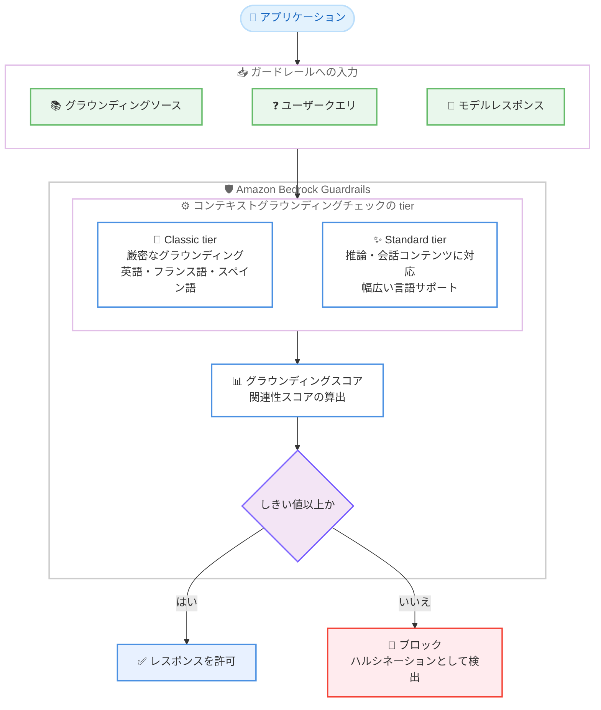

# Amazon Bedrock Guardrails - コンテキストグラウンディングチェックの Standard tier サポート

**リリース日**: 2026 年 10 月 20 日
**サービス**: Amazon Bedrock Guardrails
**機能**: Standard tier for contextual grounding checks

📊 [このアップデートのインフォグラフィックを見る](https://takech9203.github.io/aws-news-summary/20261020-bedrock-guardrails-grounding-standard.html)

## 概要

Amazon Bedrock Guardrails のコンテキストグラウンディングチェック (contextual grounding checks) が Standard tier をサポートしました。コンテキストグラウンディングチェックは、モデルのレスポンスが提供された参照ソース (グラウンディングソース) に基づいているか、およびユーザーのクエリに関連しているかを検証することで、ハルシネーション (幻覚) を検出・フィルタリングする機能です。

これまでコンテキストグラウンディングチェックは、参照ソースに記載された情報を厳密に再現しているかを評価する「厳密なグラウンディング」のみをサポートしており、要約、言い換え、Q&A といったユースケースに最適化されていました。今回の Standard tier により、推論 (reasoning) や会話的な内容を含むレスポンスの評価、同じ意味で表現が異なるレスポンスへの一貫したスコアリング、コンテンツフィルターや拒否トピックの Standard tier と同等の幅広い言語サポートが可能になりました。RAG ベースのチャットボットや会話型アプリケーションを構築するユーザーにとって、有効なレスポンスが過剰にブロックされる問題を軽減できるアップデートです。

**アップデート前の課題**

このアップデート以前は、以下の課題がありました。

- Classic tier の厳密なグラウンディングでは、参照ソースに明示されていない情報 (合理的な推論や会話的な言い回しを含む) がすべてグラウンディングスコアを低下させ、会話型アプリケーションで有効なレスポンスが過剰にブロックされることがあった
- 同じ意味でも表現が異なるレスポンスに対して、スコアのばらつきが生じることがあった
- 対応言語が英語、フランス語、スペイン語に限定されていた

**アップデート後の改善**

今回のアップデートにより、以下が可能になりました。

- 推論や会話的な内容を含むレスポンスを適切に評価できるようになり、要約や Q&A 以外の会話型ユースケースにもコンテキストグラウンディングチェックを適用できるようになった
- 同じ意味で表現が異なるレスポンスに対して、より一貫したスコアが返されるようになった
- コンテンツフィルターおよび拒否トピックの Standard tier と同じ幅広い言語をサポートするようになった
- ガードレールごとにコンソールまたは API で tier を選択でき、既存のガードレールは変更するまで Classic tier のまま維持されるため、段階的な移行が可能になった

## アーキテクチャ図



グラウンディングソース、ユーザークエリ、モデルレスポンスの 3 要素をガードレールに渡すと、選択した tier の評価ロジックでグラウンディングスコアと関連性スコアが算出され、しきい値を下回るレスポンスはハルシネーションとして検出・ブロックされます。

## サービスアップデートの詳細

### 主要機能

1. **推論・会話コンテンツを含むレスポンスのサポート**
   - Classic tier は厳密なグラウンディングのみを評価し、参照ソースに明示されていない情報 (合理的な推論や会話的な言い回しを含む) はスコアを低下させる
   - Standard tier は、参照ソースをもとに推論したレスポンスや、会話的な内容を含むレスポンスを適切に評価できる
   - RAG ベースのチャットボットなど、参照ソースを単に言い換えるのではなく、ソースをもとに推論・会話するアプリケーションに適している

2. **スコアリングの一貫性向上**
   - 同じ意味で表現が異なるレスポンスに対して、より一貫したスコアを返す
   - しきい値ベースのフィルタリングの予測可能性が向上する

3. **幅広い言語サポート**
   - コンテンツフィルターおよび拒否トピックの Standard tier と同じ言語セットをサポート
   - Classic tier の対応言語は英語、フランス語、スペイン語のみ

4. **ガードレール単位での tier 選択**
   - Amazon Bedrock コンソールまたは API (`CreateGuardrail` / `UpdateGuardrail`) でガードレールごとに tier を選択できる
   - 既存のガードレールは、変更するまで Classic tier のまま維持される
   - Standard tier の利用には、ガードレールプロファイルを使用したクロスリージョン推論の有効化が必要

## 技術仕様

### Classic tier と Standard tier の比較

| 項目 | Classic tier | Standard tier |
|------|--------------|---------------|
| グラウンディング評価 | 厳密なグラウンディングのみ | 推論・会話コンテンツを含むレスポンスに対応 |
| スコアの一貫性 | 表現の違いでばらつく場合がある | 同じ意味のレスポンスに一貫したスコア |
| 言語サポート | 英語、フランス語、スペイン語 | コンテンツフィルターの Standard tier と同等の幅広い言語 |
| クロスリージョン推論 | 不要 | 必須 (ガードレールプロファイルの指定が必要) |
| デフォルト | tier を指定しない場合は Classic tier | 明示的な指定が必要 |

### スコアとしきい値

| 項目 | 詳細 |
|------|------|
| グラウンディングスコア | レスポンスが参照ソースに事実として基づいているかを評価 |
| 関連性スコア | レスポンスがユーザークエリに関連しているかを評価 |
| しきい値の範囲 | 0 〜 0.99 (1 は全コンテンツをブロックするため無効) |
| 推奨開始値 | Standard tier の会話・推論ユースケースでは 0.7 が妥当な開始点 |
| 入力の上限 | グラウンディングソース 100,000 文字、クエリ 1,000 文字、レスポンス 5,000 文字 (両 tier 共通) |

### API 変更履歴

| 日付 | サービス | 変更内容 |
|------|----------|----------|
| 2026/10/20 | [bedrock](https://awsapichanges.com/archive/changes/c13b91-bedrock.html) | 3 updated api methods - コンテキストグラウンディングポリシーに tier オプションが追加され、会話・推論に対応した Standard tier を選択可能に |

### CreateGuardrail リクエストの設定例

```json
{
  "name": "my-grounding-guardrail",
  "blockedInputMessaging": "このリクエストには回答できません。",
  "blockedOutputsMessaging": "参照情報に基づかない回答のためブロックされました。",
  "contextualGroundingPolicyConfig": {
    "filtersConfig": [
      {
        "type": "GROUNDING",
        "threshold": 0.7,
        "action": "BLOCK",
        "enabled": true
      },
      {
        "type": "RELEVANCE",
        "threshold": 0.7,
        "action": "BLOCK",
        "enabled": true
      }
    ],
    "tierConfig": {
      "tierName": "STANDARD"
    }
  },
  "crossRegionConfig": {
    "guardrailProfileIdentifier": "us.guardrail.v1:0"
  }
}
```

`contextualGroundingPolicyConfig` 内の `tierConfig.tierName` に `STANDARD` を指定します。`tierConfig` を省略した場合は `CLASSIC` が使用されます。`STANDARD` tier の使用時は `crossRegionConfig` によるクロスリージョン推論の設定が必須です。

## 設定方法

### 前提条件

1. Amazon Bedrock Guardrails を利用できる IAM 権限があること
2. Standard tier の利用には、ガードレールでクロスリージョン推論 (ガードレールプロファイル) を有効化すること
3. Standard tier のコンテキストグラウンディングチェックに対応したリージョンを使用すること (非対応リージョンでは `ValidationException` で失敗する)

### 手順

#### ステップ 1: ガードレールの作成または更新で Standard tier を指定

```bash
aws bedrock create-guardrail \
  --name "my-grounding-guardrail" \
  --blocked-input-messaging "このリクエストには回答できません。" \
  --blocked-outputs-messaging "参照情報に基づかない回答のためブロックされました。" \
  --contextual-grounding-policy-config '{
    "filtersConfig": [
      {"type": "GROUNDING", "threshold": 0.7, "action": "BLOCK", "enabled": true},
      {"type": "RELEVANCE", "threshold": 0.7, "action": "BLOCK", "enabled": true}
    ],
    "tierConfig": {"tierName": "STANDARD"}
  }' \
  --cross-region-config '{"guardrailProfileIdentifier": "us.guardrail.v1:0"}' \
  --region us-east-1
```

グラウンディングと関連性のしきい値を 0.7 に設定し、`tierConfig` で Standard tier を指定したガードレールを作成します。Standard tier に必須のクロスリージョン推論は `--cross-region-config` でガードレールプロファイルを指定して有効化します。コンソールの場合は、ガードレール作成時の [Add contextual grounding check] ページで tier を選択します。

#### ステップ 2: ApplyGuardrail API でグラウンディングチェックを実行

```bash
aws bedrock-runtime apply-guardrail \
  --guardrail-identifier <guardrail-id> \
  --guardrail-version DRAFT \
  --source OUTPUT \
  --content '[
    {"text": {"text": "ロンドンは英国の首都です。東京は日本の首都です。", "qualifiers": ["grounding_source"]}},
    {"text": {"text": "日本の首都はどこですか?", "qualifiers": ["query"]}},
    {"text": {"text": "日本の首都は東京です。"}}
  ]' \
  --region us-east-1
```

`grounding_source` 修飾子で参照ソース、`query` 修飾子でユーザークエリをマークし、修飾子なしのコンテンツブロックで評価対象のモデルレスポンスを渡します。ApplyGuardrail API を使用すると、Amazon Bedrock 以外でホストされたモデルを含む任意の基盤モデルの出力にガードレールを適用できます。

#### ステップ 3: しきい値の再検証と段階的なロールアウト

Standard tier と Classic tier ではレスポンスの評価方法が異なるため、同じレスポンスでも tier によってスコアが変わる可能性があります。既存のガードレールの tier を変更する場合は、デプロイ前に自社データでグラウンディング・関連性のしきい値を再テストしてください。また、非クリティカルなワークロードから段階的にロールアウトすることが推奨されます。なお、`UpdateGuardrail` はポリシー設定全体を置き換えるため、Standard tier のガードレールを更新する際は `tierConfig` をリクエストに含める必要があります (省略すると Classic tier にリセットされます)。

## メリット

### ビジネス面

- **会話型 AI の品質向上**: RAG ベースのチャットボットで、推論や会話的な言い回しを含む有効なレスポンスが過剰にブロックされる問題を軽減し、ユーザー体験を損なわずにハルシネーション対策を実施できる
- **グローバル展開の加速**: 幅広い言語サポートにより、多言語アプリケーションでも一貫したハルシネーション検出を適用できる
- **追加コストなし**: 料金は両 tier で同一のため、コスト増なしで精度向上の恩恵を受けられる

### 技術面

- **評価の堅牢性**: 同じ意味で表現が異なるレスポンスに一貫したスコアが返されるため、しきい値ベースのフィルタリングの信頼性が向上する
- **段階的な移行**: 既存のガードレールは変更するまで Classic tier のまま維持されるため、自社のペースで検証・移行できる
- **モデル非依存**: ApplyGuardrail API により、Amazon Bedrock 以外でホストされたモデルを含む任意の基盤モデルに適用できる

## デメリット・制約事項

### 制限事項

- Standard tier のコンテキストグラウンディングチェックは 11 リージョンに限定されており、非対応リージョンで指定するとリクエストが `ValidationException` で失敗する
- Standard tier にはクロスリージョン推論 (ガードレールプロファイル) の有効化が必須であり、ガードレールの推論リクエストが同一地理内の他リージョンにルーティングされる点を考慮する必要がある
- グラウンディングソース 100,000 文字、クエリ 1,000 文字、レスポンス 5,000 文字の上限は両 tier で共通

### 考慮すべき点

- 両 tier でレスポンスの評価方法が異なるため、既存のしきい値をそのまま流用せず、tier 変更前に自社データで再テストが必要
- `UpdateGuardrail` でガードレールを更新する際に `tierConfig` を省略すると Classic tier にリセットされるため、更新リクエストには必ず `tierConfig` を含める必要がある
- データレジデンシー要件が厳しいワークロードでは、クロスリージョン推論の要件が制約になる可能性がある

## ユースケース

### ユースケース 1: RAG ベースの社内ナレッジチャットボット

**シナリオ**: 社内ドキュメントを参照ソースとする会話型チャットボットで、ドキュメントの内容を言い換えるだけでなく、複数の記載をもとに推論して回答する。Classic tier では推論を含む有効な回答がブロックされやすかった。

**実装例**:
```json
{
  "contextualGroundingPolicyConfig": {
    "filtersConfig": [
      {"type": "GROUNDING", "threshold": 0.7, "action": "BLOCK", "enabled": true},
      {"type": "RELEVANCE", "threshold": 0.7, "action": "BLOCK", "enabled": true}
    ],
    "tierConfig": {"tierName": "STANDARD"}
  }
}
```

**効果**: 推論や会話的な言い回しを含む有効な回答の過剰ブロックを抑えつつ、参照ソースに基づかないハルシネーションを検出できる。

### ユースケース 2: 多言語カスタマーサポートアシスタント

**シナリオ**: 日本語を含む複数言語でサポート FAQ を参照して回答するアシスタント。Classic tier は英語、フランス語、スペイン語のみの対応だったため、他言語ではグラウンディングチェックの精度に課題があった。

**実装例**:
```json
[
  {"text": {"text": "返品は購入後 30 日以内に可能です。送料はお客様負担となります。", "qualifiers": ["grounding_source"]}},
  {"text": {"text": "商品を返品できますか?", "qualifiers": ["query"]}},
  {"text": {"text": "はい、購入後 30 日以内であれば返品いただけます。その際の送料はお客様のご負担となります。"}}
]
```

**効果**: コンテンツフィルターの Standard tier と同等の幅広い言語で、グラウンディングと関連性の検証を適用できる。

### ユースケース 3: 検出のみモードでの段階的移行

**シナリオ**: Classic tier で運用中のガードレールを Standard tier に移行するにあたり、本番トラフィックへの影響を事前に評価したい。

**実装例**:
```json
{
  "contextualGroundingPolicyConfig": {
    "filtersConfig": [
      {"type": "GROUNDING", "threshold": 0.7, "action": "NONE", "enabled": true},
      {"type": "RELEVANCE", "threshold": 0.7, "action": "NONE", "enabled": true}
    ],
    "tierConfig": {"tierName": "STANDARD"}
  }
}
```

**効果**: `action: NONE` によりブロックせずに検出情報のみを取得し、Standard tier でのスコア分布を確認した上で、適切なしきい値を設定して本番に適用できる。

## 料金

料金は Classic tier と Standard tier で同一です。コンテキストグラウンディングチェックの料金は、処理されたテキスト量に基づいて課金されます。

詳細は [Amazon Bedrock の料金ページ](https://aws.amazon.com/bedrock/pricing/) を参照してください。

## 利用可能リージョン

Standard tier のコンテキストグラウンディングチェックは、以下の 11 リージョンで利用できます。

- 米国東部 (バージニア北部)
- 米国東部 (オハイオ)
- 米国西部 (北カリフォルニア)
- 米国西部 (オレゴン)
- 欧州 (フランクフルト)
- 欧州 (アイルランド)
- 欧州 (ミラノ)
- 欧州 (パリ)
- 欧州 (スペイン)
- 欧州 (ストックホルム)
- アジアパシフィック (東京)

上記以外のリージョンで Standard tier を指定したリクエストは、`ValidationException` で失敗します。

## 関連サービス・機能

- **Amazon Bedrock Knowledge Bases**: RAG アプリケーションの検索基盤。取得したドキュメントをグラウンディングソースとして、レスポンスのハルシネーションチェックに活用できる
- **ApplyGuardrail API**: モデル呼び出しと独立してガードレールを適用する API。Amazon Bedrock 以外でホストされたモデルを含む任意の基盤モデルにコンテキストグラウンディングチェックを適用できる
- **ガードレールのクロスリージョン推論**: Standard tier の利用に必須の機能。ガードレールプロファイルで定義されたリージョン間で推論リクエストをルーティングする
- **コンテンツフィルター・拒否トピックの Standard tier**: 先行して Standard tier が提供されていたポリシー。今回のアップデートでコンテキストグラウンディングチェックも同等の言語サポートに対応した

## 参考リンク

- 📊 [インフォグラフィック](https://takech9203.github.io/aws-news-summary/20261020-bedrock-guardrails-grounding-standard.html)
- [公式発表 (What's New)](https://aws.amazon.com/about-aws/whats-new/2026/10/bedrock-guardrails-grounding-standard/)
- [ドキュメント: Use contextual grounding check to filter hallucinations in responses](https://docs.aws.amazon.com/bedrock/latest/userguide/guardrails-contextual-grounding-check.html)
- [ドキュメント: Safeguard tiers for guardrails policies](https://docs.aws.amazon.com/bedrock/latest/userguide/guardrails-tiers.html)
- [Amazon Bedrock Guardrails 製品ページ](https://aws.amazon.com/bedrock/guardrails/)
- [料金ページ](https://aws.amazon.com/bedrock/pricing/)

## まとめ

Amazon Bedrock Guardrails のコンテキストグラウンディングチェックに Standard tier が追加され、推論や会話コンテンツを含むレスポンスの評価、一貫したスコアリング、幅広い言語サポートが追加料金なしで利用できるようになりました。会話型の RAG アプリケーションで有効なレスポンスの過剰ブロックに課題があった場合は、Standard tier への移行を検討することを推奨します。tier によってスコアの付き方が変わるため、まずは `action: NONE` の検出のみモードや非クリティカルなワークロードでしきい値を再検証した上で、段階的に本番へ適用するとよいでしょう。
