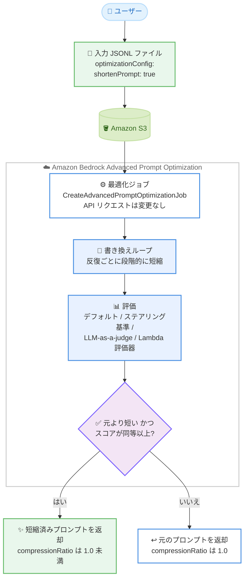

# Amazon Bedrock - Advanced Prompt Optimization のプロンプト短縮サポート

**リリース日**: 2026 年 10 月 20 日
**サービス**: Amazon Bedrock
**機能**: Advanced Prompt Optimization - プロンプト短縮 (Prompt Shortening)

📊 [このアップデートのインフォグラフィックを見る](https://takech9203.github.io/aws-news-summary/20261020-bedrock-prompt-optimization-shortening.html)

## 概要

Amazon Bedrock の Advanced Prompt Optimization が、プロンプト短縮 (prompt shortening) をサポートしました。Advanced Prompt Optimization は、ユーザー自身の評価基準に基づいて任意の Bedrock モデル向けにプロンプトをチューニングする機能です。今回のアップデートにより、最適化ジョブでオプションのプロンプト短縮設定を有効化できるようになりました。

プロンプト短縮を有効にすると、最適化エンジンは「元のプロンプトより短く、かつ評価スコアが元のプロンプトと同等以上」のプロンプトを探索します。両方の条件を満たす場合にのみ短縮されたプロンプトが返され、満たさない場合は元のプロンプトがそのまま返されます。この返却ロジックにより、短縮を有効にしても「元より長い」または「スコアが低い」プロンプトを受け取ることは決してありません。コスト重視またはレイテンシー制約のある大規模ワークロードを運用するユーザーに特に有用なアップデートです。

**アップデート前の課題**

これまでの Advanced Prompt Optimization は品質のみを最適化対象としており、プロンプト長に関する制約がありませんでした。

- 最適化後のプロンプトが元のプロンプトより長くなることが頻繁にあった
- プロンプトが長くなると入力トークンコストが増加していた
- レイテンシーに敏感な大規模ワークロードでは、長いプロンプトが最初のトークンまでの時間 (TTFT) を悪化させる可能性があった

**アップデート後の改善**

- プロンプトテンプレートごとに `shortenPrompt` 設定を有効化し、品質を維持したままプロンプトを短縮できるようになった
- 短縮されたプロンプトは「元より短い」かつ「評価スコアが同等以上」の場合のみ返されるため、品質と長さの両面で元のプロンプトより悪化しないことが保証される
- 結果に圧縮率 (compressionRatio) と最適化前後のトークン数が出力ファイルとコンソールの両方で報告され、削減効果を定量的に確認できるようになった
- システムデフォルト評価、ステアリング基準、カスタム LLM-as-a-judge、カスタム Lambda 評価器など、すべての評価方法と組み合わせて利用できる

## アーキテクチャ図



プロンプト短縮を有効にした最適化ジョブの処理フローです。短縮設定は入力 JSONL ファイル内に記述し、API リクエスト自体は変更不要です。最適化後のプロンプトは「元より短い」かつ「スコアが同等以上」の両条件を満たす場合のみ返却されます。

## サービスアップデートの詳細

### 主要機能

1. **プロンプトテンプレート単位の短縮設定**
   - 入力 JSONL ファイルの各テンプレート行に `optimizationConfig` オブジェクトを追加し、`shortenPrompt` を `true` に設定することで有効化する
   - デフォルトは無効で、フィールドの省略または `false` 設定で短縮はオフのまま
   - テンプレートごとの設定のため、同一ジョブ内で一部のテンプレートのみ短縮を有効化し、他は無効のままにできる
   - API リクエスト (`CreateAdvancedPromptOptimizationJob`) 自体は変更不要で、設定は `inputConfig.s3Uri` の入力ファイルから読み込まれる

2. **品質を保証する返却ロジック**
   - 短縮されたプロンプトが返却されるのは「元のプロンプトより短い」かつ「評価スコアが元と同等以上」の両条件を満たす場合のみ
   - いずれかの条件を満たさない場合は元のプロンプトが返却され、`compressionRatio` は 1.0 となる
   - この仕組みにより、短縮を有効にしても品質を犠牲にすることや、元より長いプロンプトを受け取ることがない

3. **段階的な短縮プロセス**
   - 短縮は書き換えループの中で段階的に行われ、各反復で現在のベスト候補よりわずかに短いプロンプトを目標とする
   - 一度に大幅に削るのではなく、反復を重ねてプロンプト長を徐々に減らしていく
   - 短縮対象はプロンプトテンプレートの長さであり、モデルが生成するレスポンスの長さは変更しない

4. **圧縮率とトークン数のレポート**
   - 短縮を有効にすると、結果の各モデルエントリに `compressionRatio`、`originalTokenCount`、`optimizedTokenCount` の 3 フィールドが追加される
   - 圧縮率は「最適化後トークン数 ÷ 元のトークン数」で定義され、例えば 0.7 は 30% のトークン削減を意味する
   - コンソールの結果ページでは、Summary tables タブに圧縮率とトークン数、Graphs タブにプロンプトテンプレート長のグラフが表示される

5. **すべての評価方法との互換性**
   - システムデフォルト評価、ステアリング基準、カスタム LLM-as-a-judge、カスタム Lambda 評価器のすべてで動作する
   - 短縮を有効にしても評価器が受け取る内容は変わらない (長さの測定は最適化エンジン内部で行われる)
   - 選択的最適化タグを使用している場合、短縮は書き換え可能なセクションにのみ適用され、`<advpo:exclude>` タグ内の内容は保持される

## 技術仕様

### 入力ファイルの設定フィールド

| 項目 | 詳細 |
|------|------|
| `optimizationConfig` | 最適化設定のコンテナオブジェクト (省略可) |
| `optimizationConfig.shortenPrompt` | ブール値。`true` でそのテンプレートの短縮を有効化。省略または `false` で無効 |
| 設定場所 | 入力 JSONL ファイルの各テンプレート行 (API リクエストではない) |
| デフォルト | 無効 (品質のみを最適化し、長さの制約なし) |

### 結果出力の追加フィールド

| フィールド | 説明 |
|------|------|
| `compressionRatio` | 最適化後トークン数 ÷ 元のトークン数。1.0 は元のプロンプトが返却されたことを示す |
| `originalTokenCount` | 元のプロンプトテンプレートのトークン数 |
| `optimizedTokenCount` | 最適化後のプロンプトテンプレートのトークン数 |

トークン数は変数値を代入する前のプロンプトテンプレートに対して測定され、テンプレート全体が対象です。選択的最適化タグを使用している場合、`<advpo:optimize>` と `<advpo:exclude>` のタグマーカー自体はカウントから除外されます。

### API 変更履歴

今回のアップデートに伴う API の変更はありません。短縮設定は Amazon S3 上の入力 JSONL ファイルに記述するため、`CreateAdvancedPromptOptimizationJob` の API リクエスト形式は変更されていません。

### 入力ファイルの設定例

```json
{
  "version": "bedrock-2026-05-14",
  "templateId": "customer-support-v1",
  "promptTemplate": "You are a customer support agent.\n\nProduct info:\n{{productInfo}}\n\nQuestion:\n{{customerQuestion}}\n\nProvide a helpful response.",
  "optimizationConfig": {
    "shortenPrompt": true
  },
  "steeringCriteria": ["PROFESSIONAL"],
  "evaluationSamples": [
    {
      "inputVariables": [
        {"productInfo": "Product: Sony WH-1000XM5. Battery: 30 hours."},
        {"customerQuestion": "How long does the battery last?"}
      ],
      "referenceResponse": "The battery lasts up to 30 hours on a single charge."
    }
  ]
}
```

## 設定方法

### 前提条件

1. Amazon Bedrock の Advanced Prompt Optimization が利用可能なリージョンであること
2. 入力データセット (JSONL 形式) と出力先の Amazon S3 バケットが準備されていること
3. 最適化ジョブの作成と S3 アクセスに必要な IAM 権限が設定されていること

### 手順

#### ステップ 1: 入力 JSONL ファイルに短縮設定を追加

短縮したいプロンプトテンプレートの行に `optimizationConfig` オブジェクトを追加し、`"shortenPrompt": true` を設定します。設定はテンプレート単位のため、同一ジョブ内で短縮の有効・無効をテンプレートごとに使い分けられます。

#### ステップ 2: 入力ファイルを Amazon S3 にアップロード

```python
import boto3
import json

s3 = boto3.client('s3', region_name='us-west-2')

record = {
    'version': 'bedrock-2026-05-14',
    'templateId': 'customer-support-v1',
    'promptTemplate': 'You are a customer support agent.\n\nQuestion:\n{{customerQuestion}}\n\nProvide a helpful response.',
    'optimizationConfig': {'shortenPrompt': True},
    'steeringCriteria': ['PROFESSIONAL'],
    'evaluationSamples': [
        {
            'inputVariables': [{'customerQuestion': 'How long does the battery last?'}],
            'referenceResponse': 'The battery lasts up to 30 hours on a single charge.'
        }
    ]
}

s3.put_object(
    Bucket='my-bucket',
    Key='input/dataset.jsonl',
    Body=json.dumps(record) + '\n'
)
```

短縮設定 (`shortenPrompt`) を含むレコードを JSONL 形式で S3 バケットにアップロードしています。短縮設定は API 呼び出しではなく、この入力ファイル内に記述する点が重要です。

#### ステップ 3: 最適化ジョブを作成

```bash
aws bedrock create-advanced-prompt-optimization-job \
    --job-name "my-optimization-job" \
    --model-configurations '[{"modelId": "us.anthropic.claude-sonnet-4-6"}]' \
    --input-config '{"s3Uri": "s3://my-bucket/input/dataset.jsonl"}' \
    --output-config '{"s3Uri": "s3://my-bucket/output/"}' \
    --region us-west-2
```

最適化ジョブを作成しています。コマンドは従来と同一で、短縮設定は `inputConfig.s3Uri` が指す入力ファイルから自動的に読み込まれます。

#### ステップ 4: 結果を確認

ジョブ完了後、出力ファイルまたはコンソールの結果ページで `compressionRatio`、`originalTokenCount`、`optimizedTokenCount` を確認します。圧縮率が 1.0 の場合は、短縮と品質の両条件を満たすプロンプトが見つからず、元のプロンプトが返却されたことを意味します。コンソールでは Summary tables タブと Graphs タブで削減効果を可視化できます。

## メリット

### ビジネス面

- **入力トークンコストの削減**: プロンプトテンプレートが短くなることで、呼び出しごとの入力トークン数が減り、大規模ワークロードでの推論コストを直接削減できる
- **品質劣化リスクなしの最適化**: 返却ロジックにより評価スコアが元と同等以上の場合のみ短縮版が採用されるため、コスト削減のために品質を犠牲にする心配がない
- **効果の定量的な把握**: 圧縮率とトークン数のレポートにより、コスト削減効果を数値で確認し、社内での投資判断や効果報告に活用できる

### 技術面

- **レイテンシーの改善**: 短いプロンプトは最初のトークンまでの時間 (TTFT) の短縮に寄与し、レイテンシーに敏感なアプリケーションの応答性を改善できる
- **既存ワークフローへの容易な統合**: API リクエストの変更が不要で、入力ファイルにフィールドを 1 つ追加するだけで有効化できる
- **柔軟な適用範囲の制御**: テンプレート単位の設定と選択的最適化タグの組み合わせにより、短縮を適用する範囲を細かく制御できる

## デメリット・制約事項

### 制限事項

- **正確なトークン予算の指定は不可**: 「500 トークンちょうどに最適化する」といった特定の長さを目標に指定することはできず、短縮はテンプレートごとにオン・オフのみ
- **セクション単位の圧縮制御は不可**: テンプレートに複数の `<advpo:optimize>` セクションがある場合、すべてが短縮対象となり、一部のセクションのみ短縮することはできない。圧縮率もテンプレート全体に対して報告される
- **短いプロンプトは圧縮されない場合がある**: すでに簡潔なプロンプトでは、両条件を満たす短縮版が見つからず圧縮率が 1.0 になることがある

### 考慮すべき点

- 短縮されたプロンプトは、元のプロンプトの構造や詳細度を保持しない可能性がある
- プロンプトの簡潔さと評価スコアの改善にはトレードオフが生じることがあり、圧縮率 1.0 で元のプロンプトが返却された場合は、評価方法やデータセットを見直して再実行する反復が必要になる場合がある
- 短縮されるのはプロンプトテンプレートであり、モデルのレスポンス長は変わらない (レスポンスの簡潔さはデフォルト評価の Expression Quality 基準が別途評価する)

## ユースケース

### ユースケース 1: 大規模カスタマーサポートボットの推論コスト削減

**シナリオ**: 1 日数百万件のリクエストを処理するカスタマーサポートボットで、長いシステムプロンプトによる入力トークンコストが課題となっている。

**実装例**:
```json
{
  "templateId": "support-bot-system-prompt",
  "promptTemplate": "...長大なサポートガイドライン...",
  "optimizationConfig": {"shortenPrompt": true},
  "steeringCriteria": ["PROFESSIONAL"]
}
```

**効果**: 回答品質を維持したままプロンプトを短縮できる。例えば圧縮率 0.7 を達成した場合、呼び出しごとのテンプレート部分の入力トークンが 30% 削減され、リクエスト量に比例してコスト削減効果が積み上がる。

### ユースケース 2: レイテンシー重視のリアルタイムアプリケーション

**シナリオ**: 対話型アシスタントなど、最初のトークンまでの時間 (TTFT) がユーザー体験を左右するアプリケーションで、プロンプトの長さが応答開始の遅延要因となっている。

**実装例**:
```json
{
  "templateId": "realtime-assistant",
  "promptTemplate": "...アシスタントの指示...",
  "optimizationConfig": {"shortenPrompt": true}
}
```

**効果**: 短縮されたプロンプトにより TTFT の改善が期待でき、評価スコアが保証されているため応答品質を損なわずにユーザー体験を改善できる。

### ユースケース 3: 法務・安全性要件のある部分を保護した短縮

**シナリオ**: プロンプト内に法的文言や安全性制約など、一字一句変更してはならないセクションが含まれるが、それ以外の部分は短縮したい。

**実装例**:
```text
<advpo:exclude>
以下の法的免責事項を必ずそのまま含めてください: ...
</advpo:exclude>

あなたはカスタマーサポートエージェントです。
...短縮対象の指示...
```

**効果**: `<advpo:exclude>` タグ内の内容は一切変更されずに保持され、書き換え可能な部分のみが短縮対象となる。コンプライアンス要件を守りながらコスト最適化を実現できる。

## 料金

プロンプト短縮機能自体の追加料金に関する個別の記載はなく、Advanced Prompt Optimization の利用料金は Amazon Bedrock の料金体系に従います。詳細は [Amazon Bedrock 料金ページ](https://aws.amazon.com/bedrock/pricing/) を参照してください。

なお、短縮されたプロンプトを本番ワークロードで利用することで、推論時の入力トークンコストを削減できます。例えば圧縮率 0.72 の場合、プロンプトテンプレート部分のトークンが 28% 削減されます。

## 利用可能リージョン

Advanced Prompt Optimization が提供されているすべての AWS リージョンで利用可能です。

## 関連サービス・機能

- **Amazon Bedrock Advanced Prompt Optimization**: 本機能の基盤となるプロンプト最適化機能。評価サンプルと評価方法に基づいてプロンプトを自動チューニングする
- **AWS Lambda**: カスタム Lambda 評価器として最適化の評価ロジックを独自実装でき、短縮機能と組み合わせて利用可能
- **Amazon S3**: 最適化ジョブの入力データセット (JSONL) と出力結果の保存先として使用

## 参考リンク

- 📊 [インフォグラフィック](https://takech9203.github.io/aws-news-summary/20261020-bedrock-prompt-optimization-shortening.html)
- [公式発表 (What's New)](https://aws.amazon.com/about-aws/whats-new/2026/10/bedrock-prompt-optimization-shortening/)
- [ドキュメント: Shorten prompts](https://docs.aws.amazon.com/bedrock/latest/userguide/advanced-prompt-optimization-shorten.html)
- [Amazon Bedrock 製品ページ](https://aws.amazon.com/bedrock/)
- [料金ページ](https://aws.amazon.com/bedrock/pricing/)

## まとめ

Amazon Bedrock の Advanced Prompt Optimization にプロンプト短縮機能が追加され、評価スコアを維持したまま入力トークンコストと TTFT を改善できるようになりました。「元より短く、かつスコアが同等以上」の場合のみ短縮版が返される設計のため、品質劣化のリスクなしに有効化を試せます。コスト重視またはレイテンシー制約のある Bedrock ワークロードを運用している場合は、入力ファイルに `shortenPrompt` を追加して最適化ジョブを実行し、圧縮率とトークン削減効果を確認することを推奨します。
