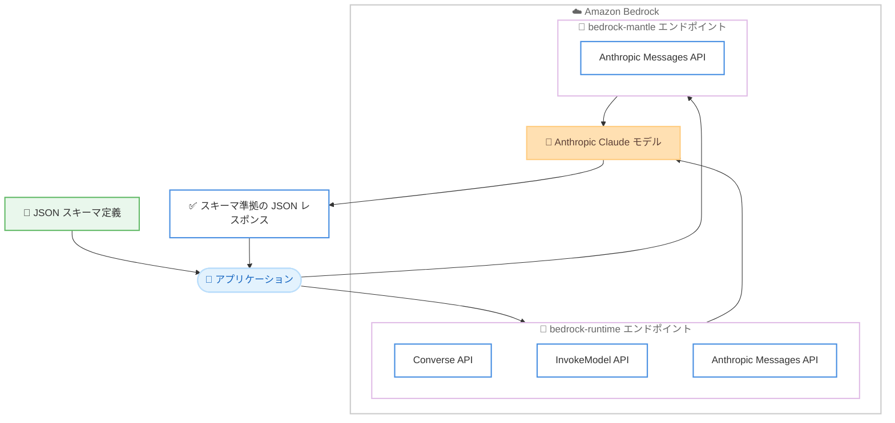

# Amazon Bedrock - Claude モデルの構造化出力 (Structured Outputs) サポート

**リリース日**: 2026 年 10 月 20 日
**サービス**: Amazon Bedrock
**機能**: Structured outputs for Claude models

📊 [このアップデートのインフォグラフィックを見る](https://takech9203.github.io/aws-news-summary/20261020-claude-structured-outputs-bedrock.html)

## 概要

Amazon Bedrock 上の Anthropic Claude モデルで、構造化出力 (Structured Outputs) が一般提供 (GA) されました。構造化出力を使用すると、ユーザーが定義した JSON スキーマに準拠した JSON レスポンスをモデルから確実に受け取ることができます。本機能は `bedrock-runtime` と `bedrock-mantle` の両方のエンドポイントで利用できます。

これまで LLM の出力を下流のシステムに連携する際は、出力が期待したフォーマットにならないケースに備えて、カスタムパース処理、リトライロジック、後処理を実装する必要がありました。構造化出力により、レスポンスは常にスキーマに準拠した有効な JSON となるため、これらの追加実装が不要になります。金融レポートからの項目抽出、臨床メモの電子カルテ (EHR) への変換、商品カタログのエンリッチ、契約書分析、サポートチケットのルーティングなど、出力の型安全性が求められる本番ワークロードに適しています。

**アップデート前の課題**

構造化出力の提供前は、以下の課題がありました。

- モデルの出力が常に有効な JSON になる保証がなく、パースエラーに備えた例外処理が必要だった
- スキーマ違反 (必須フィールドの欠落、型の不一致、余分なフィールドの追加) が発生した場合に備えて、検証とリトライのロジックを自前で実装する必要があった
- プロンプトで出力形式を指示しても、説明文などの余分なテキストが混入することがあり、後処理が必要だった

**アップデート後の改善**

今回のアップデートにより、以下が可能になりました。

- レスポンスが常に定義済みスキーマに準拠した有効な JSON となり、カスタムパース、リトライロジック、後処理が不要になった
- フィールドの型が強制され、必須フィールドが常に存在する型安全な結果を得られるようになった
- スキーマで定義したフィールドのみがレスポンスに含まれるため、大量処理ワークロードで出力トークン数と推論コストを削減できるようになった
- `strict: true` によるツール定義の厳密検証で、エージェントワークフローのツール呼び出しが不正な入力で失敗しなくなった

## アーキテクチャ図



アプリケーションが JSON スキーマをリクエストに含めて送信すると、`bedrock-runtime` または `bedrock-mantle` エンドポイント経由で Claude モデルが呼び出され、スキーマに準拠した JSON レスポンスが返却されます。

## サービスアップデートの詳細

### 主要機能

1. **JSON スキーマ出力フォーマット**
   - モデルのレスポンスを、定義した JSON スキーマに制約する仕組み
   - InvokeModel API では Anthropic ネイティブのリクエストボディの `output_config.format` にスキーマを JSON オブジェクトとして指定する
   - Converse API では `outputConfig.textFormat` を使用する
   - データ抽出、レポート生成、API レスポンスの生成に適している

2. **厳密なツール使用 (Strict tool use)**
   - ツール定義に `strict: true` を追加することで、ツール名と入力をスキーマに対して検証する仕組み
   - ツールの入力パラメータがスキーマと厳密に一致することを保証し、モデルがスキーマ外のフィールドを追加できなくなる
   - エージェントワークフロー、関数呼び出し、マルチステップの自動化に適している
   - JSON スキーマ出力フォーマットと独立して、または組み合わせて使用できる

3. **両エンドポイントでの提供**
   - `bedrock-runtime` エンドポイント: Converse API、InvokeModel API、Anthropic Messages API で利用可能
   - `bedrock-mantle` エンドポイント: Anthropic Messages API で利用可能。サーバーサイドツール、バックグラウンド推論、ステートフルな会話を使用するエージェントアプリケーション向け

## 技術仕様

### 対応モデルとエンドポイント

| 項目 | 詳細 |
|------|------|
| 対応モデルファミリー | Claude Sonnet、Opus、Haiku、Fable、Mythos の各ファミリー (モデルとエンドポイントによりサポート状況が異なる) |
| bedrock-runtime | Converse API、InvokeModel API、Anthropic Messages API |
| bedrock-mantle | Anthropic Messages API |
| 提供ステータス | 一般提供 (GA) |

各モデルが対応するエンドポイントと AWS リージョンは、Amazon Bedrock ユーザーガイドのモデルカードで確認できます。

### 構造化出力の 2 つのメカニズム

| メカニズム | 指定方法 | 主な用途 |
|-----------|---------|---------|
| JSON スキーマ出力フォーマット | `output_config.format` (InvokeModel) / `outputConfig.textFormat` (Converse) | データ抽出、レポート生成、API レスポンス |
| 厳密なツール使用 | ツール定義に `strict: true` | エージェントワークフロー、関数呼び出し、マルチステップ自動化 |

### リクエスト例 (InvokeModel API)

```json
{
  "anthropic_version": "bedrock-2023-05-31",
  "max_tokens": 512,
  "messages": [
    {"role": "user", "content": "顧客情報を含むテキスト..."}
  ],
  "output_config": {
    "format": {
      "type": "json_schema",
      "schema": {
        "type": "object",
        "properties": {
          "name": {"type": "string", "description": "顧客名"},
          "email": {"type": "string", "description": "メールアドレス"},
          "demo_requested": {"type": "boolean", "description": "デモ希望の有無"}
        },
        "required": ["name", "email", "demo_requested"],
        "additionalProperties": false
      }
    }
  }
}
```

スキーマは JSON 文字列ではなく JSON オブジェクトとして `output_config.format` に指定します。

## 設定方法

### 前提条件

1. Amazon Bedrock で対象の Claude モデルへのアクセスが有効化されていること
2. `bedrock-runtime` または `bedrock-mantle` エンドポイントを呼び出す IAM 権限があること
3. boto3 などの AWS SDK、または Anthropic SDK (bedrock-mantle 用) がインストールされていること

### 手順

#### ステップ 1: JSON スキーマの定義

```python
schema = {
    "type": "object",
    "properties": {
        "category": {"type": "string", "enum": ["billing", "technical", "account", "sales", "other"]},
        "priority": {"type": "string", "enum": ["low", "medium", "high", "urgent"]},
        "escalate": {"type": "boolean"}
    },
    "required": ["category", "priority", "escalate"],
    "additionalProperties": False
}
```

出力の構造を JSON スキーマとして定義します。`enum` を使用すると出力を固定のラベル集合に制限でき、分類タスクに有効です。`additionalProperties: false` と `required` の指定により、スキーマ外のフィールド追加と必須フィールドの欠落を防止します。

#### ステップ 2: InvokeModel API での呼び出し (bedrock-runtime)

```python
import boto3
import json

bedrock_runtime = boto3.client(service_name="bedrock-runtime", region_name="us-east-1")

response = bedrock_runtime.invoke_model(
    modelId="global.anthropic.claude-haiku-5-5",
    body=json.dumps({
        "anthropic_version": "bedrock-2023-05-31",
        "max_tokens": 512,
        "messages": [{"role": "user", "content": "このチケットを分類してください: ..."}],
        "output_config": {"format": {"type": "json_schema", "schema": schema}}
    })
)
```

boto3 の `invoke_model` で、リクエストボディの `output_config.format` にステップ 1 で定義したスキーマを指定してモデルを呼び出します。レスポンスはスキーマに準拠するため、追加の検証は不要です。

#### ステップ 3: レスポンスの処理

```python
body = json.loads(response["body"].read())

if body["stop_reason"] == "end_turn":
    result_text = next(b["text"] for b in body["content"] if b["type"] == "text")
    result = json.loads(result_text)
elif body["stop_reason"] == "max_tokens":
    print("レスポンスが途中で切れています。max_tokens を増やして再実行してください。")
```

レスポンスボディから `stop_reason` を確認した上でテキストブロックをパースします。`max_tokens` で打ち切られた場合は JSON が不完全になる可能性があるため、`stop_reason` の確認が推奨されます。

#### ステップ 4: 厳密なツール使用の設定 (bedrock-mantle)

```python
from anthropic import AnthropicBedrockMantle

client = AnthropicBedrockMantle(aws_region="us-east-1")

message = client.messages.create(
    model="anthropic.claude-sonnet-5",
    max_tokens=512,
    messages=[{"role": "user", "content": "サンフランシスコの天気は?"}],
    tools=[{
        "name": "get_weather",
        "description": "指定した場所の現在の天気を取得する",
        "strict": True,
        "input_schema": {
            "type": "object",
            "properties": {
                "location": {"type": "string"},
                "unit": {"type": "string", "enum": ["celsius", "fahrenheit"]}
            },
            "required": ["location", "unit"],
            "additionalProperties": False
        }
    }]
)
```

`bedrock-mantle` エンドポイントでは、Anthropic SDK の Messages API を使用します。ツール定義に `strict: True` を設定することで、ツール入力がスキーマと厳密に一致することが保証されます。

## メリット

### ビジネス面

- **開発工数の削減**: カスタムパース、リトライロジック、後処理、スキーマ検証コードの実装・保守が不要になり、アプリケーション開発を迅速化できる
- **推論コストの削減**: レスポンスにスキーマで定義したフィールドのみが含まれるため、大量処理ワークロードで出力トークン数と推論コストを削減できる
- **本番品質の信頼性**: スキーマ違反によるアプリケーション障害がなくなり、大規模な本番デプロイに対応できる

### 技術面

- **型安全性**: フィールドの型が強制され、必須フィールドが常に存在するため、下流システムとの統合が確実になる
- **エージェントの安定性**: `strict: true` によりツール呼び出しの引数が生成時に検証され、マルチステップのエージェントワークフローが不正な入力で失敗しなくなる
- **柔軟な利用形態**: JSON スキーマ出力フォーマットと厳密なツール使用を独立して、または組み合わせて使用できる

## デメリット・制約事項

### 制限事項

- モデルとエンドポイントによりサポート状況が異なるため、使用するモデルの対応エンドポイントとリージョンをモデルカードで確認する必要がある
- サポートされる JSON Schema の機能には制限があるため、公式ドキュメントで対応機能を確認する必要がある
- `max_tokens` に達してレスポンスが打ち切られた場合、JSON が不完全になる可能性があるため、`stop_reason` の確認が必要

### 考慮すべき点

- InvokeModel API (`output_config.format`) と Converse API (`outputConfig.textFormat`) でパラメータ名が異なるため、使用する API に合わせた実装が必要
- スキーマ設計自体の品質 (フィールドの説明、enum の網羅性など) が出力の精度に影響するため、スキーマの設計とテストは引き続き重要

## ユースケース

### ユースケース 1: ドキュメントからのデータ抽出

**シナリオ**: 請求書、契約書、メール、議事録などの非構造化ドキュメントから、データベースや CRM に取り込むための構造化データを抽出する。金融の決算レポートやコンプライアンス文書からの必須項目抽出、臨床メモの電子カルテへの変換などが該当する。

**実装例**:
```python
schema = {
    "type": "object",
    "properties": {
        "contract_parties": {"type": "array", "items": {"type": "string"}},
        "effective_date": {"type": "string"},
        "key_obligations": {"type": "array", "items": {"type": "string"}}
    },
    "required": ["contract_parties", "effective_date", "key_obligations"],
    "additionalProperties": False
}
# output_config.format にスキーマを指定して InvokeModel を呼び出す
```

**効果**: 抽出結果が常にスキーマに一致するため、検証コードなしでデータベースや CRM に直接ロードできる。

### ユースケース 2: サポートチケットの大規模分類・ルーティング

**シナリオ**: 大量のサポートチケットをカテゴリ、優先度、感情で分類してルーティングする。Claude Haiku 5.5 のような軽量モデルと組み合わせることで、高ボリュームの反復ワークロードをコスト効率よく処理する。

**実装例**:
```python
schema = {
    "type": "object",
    "properties": {
        "category": {"type": "string", "enum": ["billing", "technical", "account", "sales", "other"]},
        "priority": {"type": "string", "enum": ["low", "medium", "high", "urgent"]},
        "sentiment": {"type": "string", "enum": ["positive", "neutral", "negative"]},
        "escalate": {"type": "boolean"}
    },
    "required": ["category", "priority", "sentiment", "escalate"],
    "additionalProperties": False
}
```

**効果**: 意図、感情、エンティティが常にアプリケーションのデータモデルと一致し、ルーティング、モデレーション、評価のパイプラインを安定運用できる。

### ユースケース 3: エージェントの信頼性の高いツール呼び出し

**シナリオ**: 複数のツールを呼び出すマルチステップのエージェントワークフローで、ツール引数の形式不正による失敗を防止する。

**実装例**:
```python
tools = [{
    "name": "create_order",
    "description": "注文を作成する",
    "strict": True,
    "input_schema": {
        "type": "object",
        "properties": {
            "product_id": {"type": "string"},
            "quantity": {"type": "integer"}
        },
        "required": ["product_id", "quantity"],
        "additionalProperties": False
    }
}]
```

**効果**: ツール引数が生成時にスキーマ検証されるため、マルチステップのエージェント処理が不正な入力で中断されなくなる。

## 料金

構造化出力自体の追加料金は公式発表に記載されておらず、通常の Amazon Bedrock のモデル推論料金が適用されます。レスポンスにはスキーマで定義したフィールドのみが含まれるため、出力トークン数が減少し、大量処理ワークロードでは推論コストの削減につながる可能性があります。

詳細は [Amazon Bedrock の料金ページ](https://aws.amazon.com/bedrock/pricing/) を参照してください。

## 利用可能リージョン

Claude モデルが利用可能なすべてのリージョンで利用できます。モデルごとの対応リージョンは [Anthropic モデルのリージョン対応表](https://docs.aws.amazon.com/bedrock/latest/userguide/models-region-compatibility.html#model-regions-anthropic) を参照してください。

## 関連サービス・機能

- **Amazon Bedrock Converse API**: 統一インターフェースでモデルを呼び出す API。`outputConfig.textFormat` で構造化出力を利用できる
- **Amazon Bedrock InvokeModel API**: Anthropic ネイティブのリクエストボディでモデルを呼び出す API。`output_config.format` で構造化出力を利用できる
- **bedrock-mantle エンドポイント**: サーバーサイドツール、バックグラウンド推論、ステートフルな会話を使用するエージェントアプリケーション向けのエンドポイント。Anthropic Messages API で構造化出力を利用できる
- **Amazon Bedrock Agents / AgentCore**: エージェントワークフローにおいて、厳密なツール使用と組み合わせることでツール呼び出しの信頼性を向上できる

## 参考リンク

- 📊 [インフォグラフィック](https://takech9203.github.io/aws-news-summary/20261020-claude-structured-outputs-bedrock.html)
- [公式発表 (What's New)](https://aws.amazon.com/about-aws/whats-new/2026/10/claude-structured-outputs-bedrock/)
- [AWS Blog: Structured outputs for Anthropic Claude models on Amazon Bedrock](https://aws.amazon.com/blogs/machine-learning/structured-outputs-for-anthropic-claude-models-on-amazon-bedrock/)
- [ドキュメント: Structured outputs for Anthropic Claude models](https://docs.aws.amazon.com/bedrock/latest/userguide/claude-messages-structured-outputs.html)
- [リージョン対応表](https://docs.aws.amazon.com/bedrock/latest/userguide/models-region-compatibility.html#model-regions-anthropic)
- [料金ページ](https://aws.amazon.com/bedrock/pricing/)

## まとめ

Amazon Bedrock 上の Claude モデルで構造化出力が一般提供され、スキーマ準拠の JSON レスポンスを追加の検証コードなしで取得できるようになりました。データ抽出、分類、エージェントのツール呼び出しなど、LLM の出力を下流システムに連携するワークロードでは、カスタムパースやリトライロジックを削減できるため、既存実装の置き換えを検討することを推奨します。まずは対象モデルの対応エンドポイントをモデルカードで確認し、`output_config.format` または `strict: true` を用いた小規模な検証から始めるとよいでしょう。
