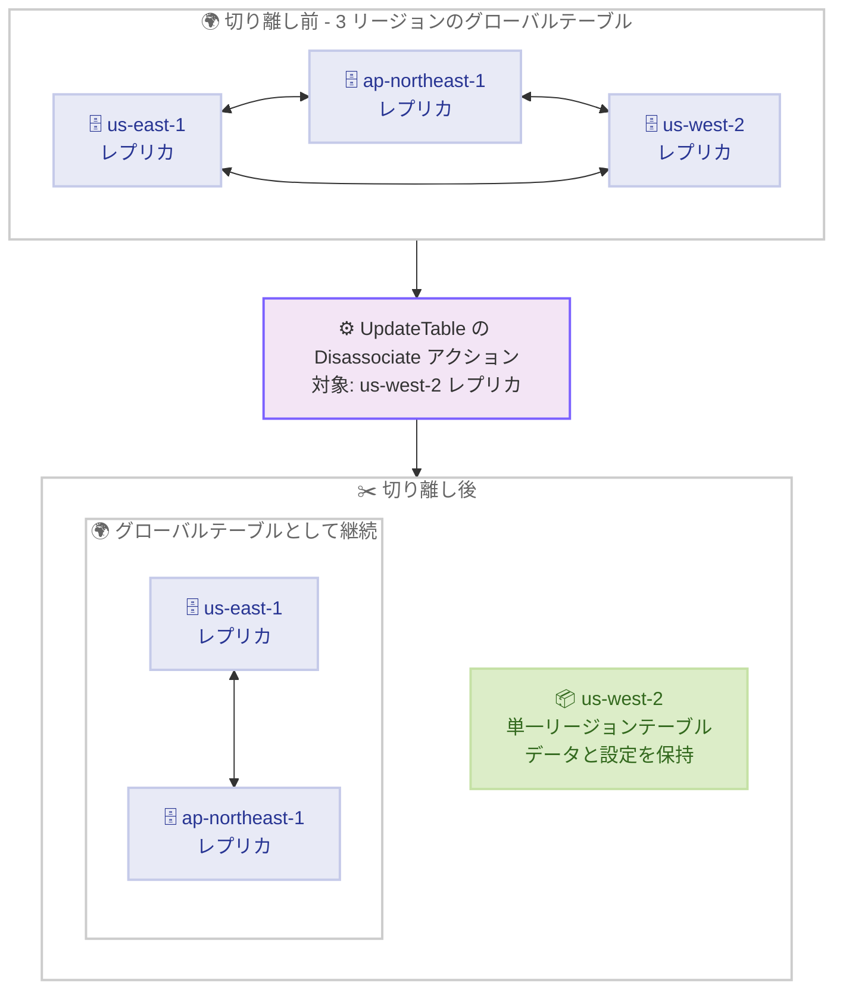

# Amazon DynamoDB - グローバルテーブルのレプリカ切り離し (Disassociate) サポート

**リリース日**: 2026 年 10 月 20 日
**サービス**: Amazon DynamoDB
**機能**: グローバルテーブルからのレプリカ切り離し (Disassociating replicas)

📊 [このアップデートのインフォグラフィックを見る](https://takech9203.github.io/aws-news-summary/20261020-dynamodb-global-tables-disassociate.html)

## 概要

Amazon DynamoDB グローバルテーブルで、テーブルやデータを削除することなくレプリカを切り離す (disassociate) ことが可能になりました。切り離しを行うと、そのレプリカへの / からのレプリケーションは停止しますが、テーブルは同じアカウント・同じリージョンの単一リージョンテーブルとして、テーブル名と ARN を保持したまま継続利用できます。

この機能により、マルチアカウントの共有グローバルテーブルに参加しているアカウントが、グローバルテーブルから離脱して自身のテーブルを独立して運用することや、特定リージョンへのレプリケーションを停止しつつ、そのリージョンのテーブルをローカルワークロード・検証・監査用に保持することが可能になります。代替テーブルの作成やデータのコピーは不要です。

本機能は、マルチリージョン結果整合性 (MREC) を使用する同一アカウントおよびマルチアカウントのグローバルテーブル (バージョン 2019.11.21) を対象に、すべての AWS リージョンで利用できます。コンソール、AWS CLI、DynamoDB API、AWS CloudFormation から操作可能です。

**アップデート前の課題**

- 以前は、グローバルテーブルからレプリカを除外するにはレプリカ自体を削除するしかなく、そのリージョンのテーブルとデータは失われた
- データを残したままレプリケーションを停止したい場合は、代替テーブルを作成してデータをエクスポート / コピーする作業が必要だった
- マルチアカウントの共有グローバルテーブルから特定のアカウントだけが離脱し、既存データを引き継いで独立運用する手段がなかった

**アップデート後の改善**

- レプリカを削除せずにレプリケーションのみを停止し、既存のテーブルを単一リージョンテーブルとしてそのまま利用できるようになった
- テーブル名・ARN・データに加え、インデックス、DynamoDB Streams、TTL、バックアップ、暗号化、課金モード、テーブルクラスなどの設定が維持されるため、移行作業が不要になった
- 切り離し保護 (disassociation protection) がデフォルトで有効化されており、誤操作による意図しない切り離しを防止できる

## アーキテクチャ図



3 リージョン構成のグローバルテーブルから us-west-2 のレプリカを切り離す例です。切り離されたテーブルは単一リージョンテーブルとなり、残りの 2 リージョンはグローバルテーブルとして継続します。

## サービスアップデートの詳細

### 主要機能

1. **レプリカの切り離し (Disassociate)**
   - `UpdateTable` API の `ReplicaUpdates` 配列に新しい `Disassociate` アクションを指定して実行する
   - 切り離されたレプリカは、同じアカウント・リージョンの単一リージョンテーブルになり、テーブル名と ARN を保持する
   - インデックス、DynamoDB Streams、TTL、バックアップ、暗号化、課金モード、テーブルクラスなどのテーブル設定は維持される (レプリケーション固有の設定とメトリクスは適用されなくなる)
   - レプリカが 3 つ以上ある場合、切り離したレプリカのみが単一リージョンテーブルになり、残りはグローバルテーブルとして継続する。レプリカが 2 つの場合は、両方のテーブルが単一リージョンテーブルになる (どちらのテーブルもデータも削除されない)

2. **切り離し保護 (Disassociation Protection)**
   - 各レプリカでデフォルトで有効になっており、誤操作による切り離しを防止する
   - 切り離しを実行する前に、保護を無効化して更新完了を待つ必要がある (保護を無効化してもレプリケーションは停止しない)
   - 削除保護 (deletion protection) とは独立した設定であり、削除保護を無効化しても切り離し保護は無効化されない

3. **レプリケーション停止境界による整合性確保**
   - 切り離しリクエストを受け付けると、DynamoDB はレプリケーション停止境界 (replication stop boundary) となる時点を設定する
   - 離脱するレプリカへの直接書き込みのうち、境界までのすべての書き込みが残りの全レプリカに配信されるまで待機する
   - 配信が完了できない場合、切り離しは完了せず、すべてのレプリカが元のグローバルテーブルに残る (安全側に倒れる設計)
   - 切り離しの最中および完了後も、テーブルは読み取り / 書き込みを継続して処理できる

4. **マルチアカウントグローバルテーブルのサポート**
   - 各アカウントは自分が所有するレプリカのみを切り離すことができる
   - 共有グローバルテーブルからの離脱後も、既存データを保持したまま独立運用が可能

## 技術仕様

### 対応範囲と要件

| 項目 | 詳細 |
|------|------|
| 対応する整合性モード | マルチリージョン結果整合性 (MREC) のみ。マルチリージョン強整合性 (MRSC) は非対応 |
| 対応バージョン | Global Tables version 2019.11.21 (Current)。2017.11.29 (Legacy) は非対応 |
| 対応構成 | 同一アカウントおよびマルチアカウントのグローバルテーブル |
| 実行場所 | レプリカが存在するリージョンかつ所有アカウントからリクエストする |
| 前提ステータス | 対象レプリカが `ACTIVE` であり、すべてのレプリカが到達可能であること |
| 同時実行制限 | グローバルテーブルごとにレプリカのライフサイクル操作は同時に 1 つのみ |
| ブロック条件 | いずれかのレプリカが `INACCESSIBLE_ENCRYPTION_CREDENTIALS`、`REPLICATION_NOT_AUTHORIZED`、`ARCHIVING`、`ARCHIVED` の場合は実行不可 |
| 時間制限 | 過去 24 時間以内に新しいレプリカ追加のソースとなったレプリカは切り離し不可 |
| 操作インターフェイス | AWS Management Console、AWS CLI、DynamoDB API、AWS CloudFormation |

### API変更履歴

| 日付 | サービス | 変更内容 |
|------|----------|----------|
| 2026/10/20 | [Amazon DynamoDB](https://awsapichanges.com/archive/changes/c13b91-dynamodb.html) | 6 updated api methods - `UpdateTable` の `ReplicaUpdates` に `Disassociate` アクションを追加。`CreateTable`、`DeleteTable`、`DescribeTable`、`RestoreTableFromBackup`、`RestoreTableToPointInTime`、`UpdateTable` のレスポンスに `DisassociationProtectionEnabled` を追加 |

### 必要な IAM 権限

切り離しには、対象レプリカのテーブル ARN に対して `dynamodb:UpdateTable` と `dynamodb:DisassociateTableReplica` の両方が必要です。`dynamodb:DisassociateTableReplica` は IAM 権限であり、独立した API オペレーションではありません。切り離し保護の変更には `dynamodb:UpdateTable`、保護状態の確認と完了のモニタリングには `dynamodb:DescribeTable` が必要です。

```json
{
    "Version": "2012-10-17",
    "Statement": [
        {
            "Effect": "Allow",
            "Action": [
                "dynamodb:UpdateTable",
                "dynamodb:DisassociateTableReplica",
                "dynamodb:DescribeTable"
            ],
            "Resource": "arn:aws:dynamodb:us-west-2:111122223333:table/Music"
        }
    ]
}
```

## 設定方法

### 前提条件

1. MREC を使用する Global Tables version 2019.11.21 (Current) のグローバルテーブルであること
2. 対象レプリカが `ACTIVE` で、すべてのレプリカが到達可能であること
3. 上記の IAM 権限とレプリケーションに必要な暗号化キーへのアクセスが維持されていること
4. 他のレプリカライフサイクル操作 (レプリカ作成や別の切り離し) が実行中でないこと

### 手順

#### ステップ 1: 切り離し保護を無効化する

```bash
aws dynamodb update-table \
    --table-name Music \
    --region us-west-2 \
    --no-disassociation-protection-enabled
```

対象レプリカのリージョンで、デフォルトで有効になっている切り離し保護を無効化します。レプリカを所有するアカウントの認証情報で実行します。

#### ステップ 2: 保護の無効化とテーブル状態を確認する

```bash
aws dynamodb describe-table \
    --table-name Music \
    --region us-west-2 \
    --query 'Table.{TableStatus:TableStatus,DisassociationProtectionEnabled:DisassociationProtectionEnabled,Replicas:Replicas}'
```

テーブルの状態を確認します。`TableStatus` が `ACTIVE` かつ `DisassociationProtectionEnabled` が `false` になるまで繰り返し実行します。フィールドが存在しない、または `true` の場合は次に進まないでください。

#### ステップ 3: Disassociate アクションを実行する

```bash
aws dynamodb update-table \
    --table-name Music \
    --region us-west-2 \
    --replica-updates '[{"Disassociate":{"RegionName":"us-west-2","DisassociationMode":"WAIT_FOR_REPLICATION"}}]'
```

`ReplicaUpdates` に `Disassociate` アクションを 1 つ指定して切り離しをリクエストします。ローカルリージョンを指定し、`DisassociationMode` に `WAIT_FOR_REPLICATION` を明示的に設定します。レスポンスが成功しても、操作自体は非同期で継続します。

#### ステップ 4: 完了を確認する

```bash
aws dynamodb describe-table \
    --table-name Music \
    --region us-west-2 \
    --query 'Table.{TableStatus:TableStatus,Replicas:Replicas}'
```

`TableStatus` が `ACTIVE` であること、および `Replicas` にピアレプリカが残っていないことの両方を確認します。`ACTIVE` だけでは成功の確認にならない点に注意してください。切り離しがロールバックした場合も `ACTIVE` に戻るため、必ずレプリカメンバーシップを確認します。残りのレプリカ側からも、更新後のメンバーシップを確認することが推奨されます。

#### ステップ 5: CloudFormation で管理している場合

`AWS::DynamoDB::GlobalTable` リソースで管理しているレプリカは、`TableType` プロパティを使用して切り離します。以下の 2 段階のスタック更新を、レプリカのアカウントとリージョンで実行します。

1. `Replicas` 内の対象リージョンのエントリで `DisassociationProtectionEnabled` を `false` に設定し、`TableType` を `GlobalTableReplica` に設定して更新する
2. `TableType` を `Regional` に変更し、`Replicas` にスタックのリージョンのみを残して更新する (マルチアカウントの場合は `GlobalTableSourceArn` を削除し、継承していたテーブル設定を明示的に宣言する)

`TableType` を `Regional` に変更せずにレプリカエントリを削除すると、通常のスタック更新と同様にレプリカが削除されるため注意が必要です。

## メリット

### ビジネス面

- **移行コストの削減**: リージョン移行やアカウント移行の完了後、代替テーブルの作成やデータコピーなしでレプリケーション構成を解消でき、移行プロジェクトの工数とリスクを削減できる
- **コスト最適化**: 不要になったリージョンへのレプリケートされた書き込み課金を停止しつつ、監査やコンプライアンス要件のためにデータを保持できる
- **組織の独立性**: マルチアカウント共有グローバルテーブルに参加している組織やチームが、既存データを引き継いだまま独立したテーブル運用に移行できる

### 技術面

- **データ整合性の担保**: レプリケーション停止境界により、離脱するレプリカへの書き込みが残りのレプリカに配信されてから切り離しが完了するため、データロスを抑えた離脱が可能
- **設定の完全な維持**: テーブル名、ARN、インデックス、Streams、TTL、バックアップ、暗号化などが維持されるため、アプリケーション側の変更を最小化できる
- **安全性の確保**: デフォルト有効の切り離し保護と 2 段階の操作により、誤操作による意図しないレプリケーション停止を防止できる
- **無停止での切り離し**: 切り離しの最中もテーブルは読み取り / 書き込みを継続して処理できる

## デメリット・制約事項

### 制限事項

- マルチリージョン強整合性 (MRSC) のグローバルテーブルでは利用できない
- Global Tables version 2017.11.29 (Legacy) では利用できない
- 切り離しは取り消し (undo) できず、同じテーブルを元のグローバルテーブルに再接続することもできない
- 過去 24 時間以内に新規レプリカ追加のソースになったレプリカは切り離しできない
- グローバルテーブルごとにレプリカライフサイクル操作は同時に 1 つのみで、他の操作の完了を待つ必要がある
- いずれかのレプリカが `INACCESSIBLE_ENCRYPTION_CREDENTIALS`、`REPLICATION_NOT_AUTHORIZED`、`ARCHIVING`、`ARCHIVED` の場合は実行がブロックされる

### 考慮すべき点

- MREC は非同期レプリケーションのため、切り離されたテーブルには他リージョンの最新の書き込みが含まれていない可能性がある
- 同じリージョンに代替レプリカを作成する場合は、スタンドアロンテーブルに残したい変更を残りのグローバルテーブルへ反映してから、スタンドアロンテーブルを削除して新しいレプリカを追加する必要がある (新しいレプリカは残りのグローバルテーブルからデータをコピーする)
- `TableStatus` が `ACTIVE` に戻っただけでは成功とは限らないため、必ずレプリカメンバーシップを確認する必要がある
- 受け付けられた操作も、暗号化キーへのアクセス喪失などにより後からロールバックされる場合がある。その場合は `ReplicaStatus` と `ReplicaStatusDescription` を確認して原因を解消する

## ユースケース

### ユースケース 1: マルチアカウント共有グローバルテーブルからの離脱

**シナリオ**: 複数の事業部が別々の AWS アカウントでマルチアカウントグローバルテーブルを共有していたが、組織再編により一部の事業部がデータを引き継いで独立運用することになった。

**実装例**:
```bash
# 離脱するアカウントの認証情報で、自アカウントのレプリカのみを切り離す
aws dynamodb update-table \
    --table-name SharedCatalog \
    --region ap-northeast-1 \
    --no-disassociation-protection-enabled

aws dynamodb update-table \
    --table-name SharedCatalog \
    --region ap-northeast-1 \
    --replica-updates '[{"Disassociate":{"RegionName":"ap-northeast-1","DisassociationMode":"WAIT_FOR_REPLICATION"}}]'
```

**効果**: データコピーや代替テーブルの構築なしで、離脱時点のデータを保持した単一リージョンテーブルとして独立運用を開始できる。

### ユースケース 2: リージョン移行後のレプリケーション解消

**シナリオ**: ワークロードを us-west-2 から us-east-1 へ移行するために一時的にグローバルテーブルを構成し、移行完了後は旧リージョンのテーブルを監査用に保持しつつレプリケーションを停止したい。

**実装例**:
```bash
# 移行先リージョン側を切り離し元から確認した後、旧リージョンのレプリカを切り離す
aws dynamodb update-table \
    --table-name Orders \
    --region us-west-2 \
    --replica-updates '[{"Disassociate":{"RegionName":"us-west-2","DisassociationMode":"WAIT_FOR_REPLICATION"}}]'
```

**効果**: 旧リージョンのテーブルを削除せずにレプリケートされた書き込みの課金を停止し、監査・検証用のデータとして保持できる。

### ユースケース 3: CloudFormation 管理下のレプリカの計画的な単一リージョン化

**シナリオ**: IaC で管理しているグローバルテーブルについて、特定リージョンの利用縮小に伴い、そのリージョンのレプリカをデータを保持したまま単一リージョンテーブルへ移行したい。

**実装例**:
```yaml
# 更新 1: 切り離し保護の無効化
Resources:
  GlobalTable:
    Type: AWS::DynamoDB::GlobalTable
    DeletionPolicy: Retain
    Properties:
      TableName: GT-CFN-Table
      TableType: GlobalTableReplica
      Replicas:
        - Region: us-east-1
          DisassociationProtectionEnabled: false
        - Region: us-east-2

# 更新 2: TableType を Regional に変更して切り離し
# Replicas にはスタックのリージョンのみを残す
```

**効果**: スタックが切り離し後も同じテーブルを単一リージョンテーブルとして管理し続け、テーブルやデータは削除されない。

## 料金

レプリカの切り離し操作自体に追加料金は発表されていません。切り離し後のテーブルは単一リージョンテーブルとして課金されるため、グローバルテーブルのレプリケートされた書き込み (replicated writes) に関する課金は、そのテーブルには発生しなくなります。

| 状態 | 課金 |
|------|------|
| 切り離し前 (レプリカ) | グローバルテーブルのレプリケートされた書き込み課金を含む |
| 切り離し後 (単一リージョンテーブル) | 通常の単一リージョンテーブルとしての読み取り / 書き込み・ストレージ課金のみ |

詳細は [Amazon DynamoDB の料金ページ](https://aws.amazon.com/dynamodb/pricing/) を参照してください。

## 利用可能リージョン

すべての AWS リージョンで利用可能です。対象は、マルチリージョン結果整合性 (MREC) を使用する同一アカウントおよびマルチアカウントのグローバルテーブルです。

## 関連サービス・機能

- **DynamoDB グローバルテーブル**: 本機能の対象となるフルマネージドのマルチリージョン・マルチアクティブレプリケーション機能
- **AWS CloudFormation**: `AWS::DynamoDB::GlobalTable` リソースの `TableType` プロパティにより、IaC で切り離しを管理可能
- **AWS IAM**: 新しい IAM 権限 `dynamodb:DisassociateTableReplica` により、切り離し操作を最小権限で制御可能
- **AWS KMS**: レプリケーションに必要な暗号化キーへのアクセスが失われると切り離しがブロックまたはロールバックされるため、キー管理との関係に注意が必要

## 参考リンク

- 📊 [インフォグラフィック](https://takech9203.github.io/aws-news-summary/20261020-dynamodb-global-tables-disassociate.html)
- [公式発表 (What's New)](https://aws.amazon.com/about-aws/whats-new/2026/10/dynamodb-global-tables-disassociate/)
- [ドキュメント: Disassociating a global table replica](https://docs.aws.amazon.com/amazondynamodb/latest/developerguide/globaltables-disassociate.html)
- [API リファレンス: UpdateTable](https://docs.aws.amazon.com/amazondynamodb/latest/APIReference/API_UpdateTable.html)
- [API 変更履歴 (awsapichanges.com)](https://awsapichanges.com/archive/changes/c13b91-dynamodb.html)
- [料金ページ](https://aws.amazon.com/dynamodb/pricing/)

## まとめ

DynamoDB グローバルテーブルのレプリカ切り離し機能により、これまで「削除」しか選択肢がなかったレプリカのライフサイクルに、データと設定を保持したまま単一リージョンテーブル化するという新しい選択肢が加わりました。リージョン移行やマルチアカウント構成からの離脱、コスト最適化を検討しているチームは、切り離し保護の挙動と「取り消し不可」という制約を理解した上で、本機能の活用を検討することを推奨します。
