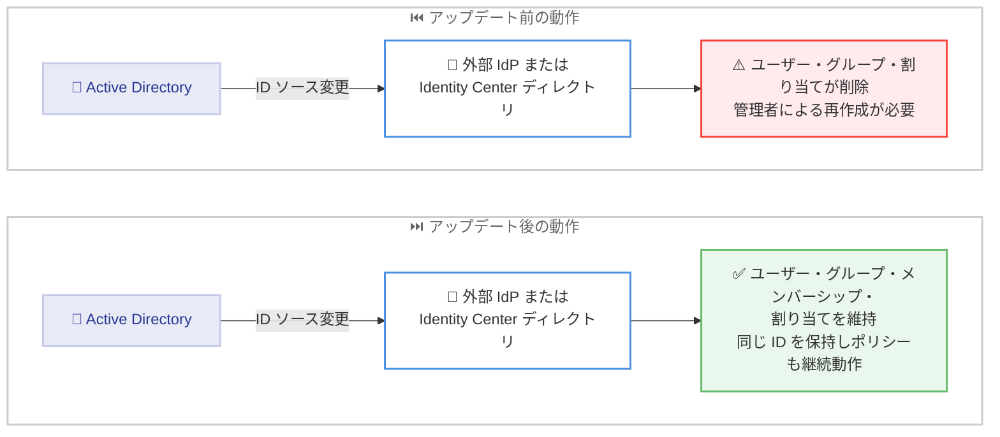

# AWS IAM Identity Center - Active Directory からの ID ソース変更の簡素化

**リリース日**: 2026 年 10 月 20 日
**サービス**: AWS IAM Identity Center
**機能**: Active Directory からの ID ソース変更時のユーザー・グループ・割り当ての維持

📊 [このアップデートのインフォグラフィックを見る](https://takech9203.github.io/aws-news-summary/20261020-iam-identity-center-chg-id-src-from-ad.html)

## 概要

AWS IAM Identity Center が、ID ソースを Active Directory から外部 ID プロバイダー (Okta や Microsoft Entra ID など) または Identity Center ディレクトリに変更する際に、ワークフォースのユーザー、グループ、グループメンバーシップ、許可セットの割り当て、アプリケーションの割り当てを維持できるようになりました。

これまでは、Active Directory から他の ID ソースへ変更すると、IAM Identity Center 内のユーザー、グループ、割り当てがすべて削除され、管理者はこれらを再作成する必要がありました。今回のアップデートにより、既存の ID ストアがそのまま残るため、ユーザーとグループは同じ ID を保持し、ユーザーのアクセス権や ID を参照するポリシーは変更後も引き続き機能します。

このアップデートは、オンプレミスの Active Directory から外部 IdP やクラウドネイティブな ID 管理への移行を計画している組織にとって、移行作業の負担とリスクを大幅に軽減する重要な改善です。

**アップデート前の課題**

このアップデート以前には、以下の課題がありました。

- Active Directory から他の ID ソースへ変更すると、ユーザー、グループ、メンバーシップ、割り当てがすべて削除されていた
- 許可セットの IAM ロールが AWS アカウントから削除され、リソースポリシーの更新が必要になる場合があった
- 変更後にユーザー、グループ、割り当てを手動またはスクリプトで再作成する必要があり、移行作業が長期化・複雑化していた
- ユーザーとグループの ID が変わるため、ID を参照するポリシー (AWS KMS キーポリシーや Amazon EKS クラスター設定など) の修正が必要だった

**アップデート後の改善**

今回のアップデートにより、以下が可能になりました。

- Active Directory から外部 IdP または Identity Center ディレクトリへの変更時に、ユーザー、グループ、グループメンバーシップ、許可セットの割り当て、アプリケーションの割り当てが維持される
- 既存の ID ストアがそのまま残るため、ユーザーとグループの ID が変わらず、ID を参照するポリシーが引き続き機能する
- ユーザーは移行後もこれまでと同じアクセス権を維持でき、割り当ての再作成が不要になった
- 新しい ID ソースのサインイン設定を行うだけで切り替えが完了し、移行の計画と実行が大幅に簡素化された

## アーキテクチャ図



Active Directory から外部 IdP または Identity Center ディレクトリへの ID ソース変更について、アップデート前後の動作の違いを示しています。アップデート後は既存の ID ストアが維持されるため、再作成作業が不要になります。

## サービスアップデートの詳細

### 主要機能

1. **ID ストアの維持**
   - Active Directory から外部 IdP または Identity Center ディレクトリへ変更しても、既存の ID ストアがそのまま残る
   - ユーザー、グループ、グループメンバーシップ、許可セットの割り当て、アプリケーションの割り当てが維持される
   - ユーザーとグループは同じ ID を保持するため、ID を参照するポリシーが変更後も機能する

2. **シンプルな切り替え手順**
   - 管理者は標準的なサインイン設定で新しい ID ソースを構成するだけで切り替えが完了する
   - 切り替え後、ユーザーはデュアルスタックの AWS アクセスポータル URL (`https://ssoins-<instance-id>.portal.<region>.app.aws`) からサインインする
   - 外部 IdP へ変更した場合は、SCIM プロビジョニングを構成して IdP を新しい権威ある ID ソースとして管理する

3. **方向による動作の違い**
   - Active Directory **から**の変更: ユーザー、グループ、メンバーシップ、割り当てを維持
   - Active Directory **への**変更 (逆方向): 従来どおりの動作で、ユーザー、グループ、メンバーシップ、割り当ては削除される
   - Identity Center ディレクトリと外部 IdP の間、または外部 IdP 同士の変更: 従来どおり維持される

## 技術仕様

### ID ソース変更時の動作一覧

| 変更の方向 | ユーザー・グループ・割り当て |
|------|------|
| Active Directory → 外部 IdP | 維持される (今回のアップデート) |
| Active Directory → Identity Center ディレクトリ | 維持される (今回のアップデート) |
| Identity Center ディレクトリ ⇔ 外部 IdP | 維持される (従来どおり) |
| 外部 IdP → 別の外部 IdP | 維持される (従来どおり) |
| 任意のソース → Active Directory | 削除される (従来どおり) |

### 変更後の主な挙動

| 項目 | 詳細 |
|------|------|
| アクセスポータル URL | `https://d-xxxxxxxxxx.awsapps.com/start` およびカスタムエイリアス URL はサポート対象外となり、デュアルスタック URL (`https://ssoins-<instance-id>.portal.<region>.app.aws`) を使用する |
| MFA | Identity Center ディレクトリへ変更した場合は MFA 設定を維持。外部 IdP へ変更した場合は IdP 側で MFA を処理 |
| RADIUS MFA | AWS Directory Service 経由の RADIUS MFA は変更後に適用されなくなる |
| AD 同期 | Active Directory からの同期は停止するが、Directory Service 上のディレクトリ自体は削除されない |
| ユーザーセッション | サインイン中のユーザーはサインアウトされ、再サインインが必要 |
| アクセス制御の属性 | 属性ベースのアクセス制御の設定は維持されるが、Active Directory からの属性値は更新されなくなる |

## 設定方法

### 前提条件

1. IAM Identity Center の組織インスタンス (Organization instance) を使用していること
2. 変更先が外部 IdP の場合、SCIM 2.0 をサポートし、安定した識別子 (通常はユーザー名) で既存ユーザー・グループをマッチングできること
3. すべてのユーザーにユーザー名、名、姓、表示名が設定されていること
4. 現在のユーザー、グループ、メンバーシップ、割り当てをエクスポートしてバックアップしておくこと

### 手順

#### ステップ 1: 変更前の準備

本番環境を反映したテスト環境で、接続済みアプリケーションを含めて変更を検証します。また、メンテナンスウィンドウをスケジュールし、サインインが中断される可能性があることをユーザーに通知します。

#### ステップ 2: ID ソースの変更

1. [IAM Identity Center コンソール](https://console.aws.amazon.com/singlesignon) を開く
2. [Settings] を選択し、[Identity source] タブを開く
3. [Actions] から [Change identity source] を選択する
4. 変更先の ID ソース (外部 IdP または Identity Center ディレクトリ) を選択して [Next] を選択する
5. 免責事項を確認し、「ACCEPT」と入力して変更を実行する

コンソール上の操作で ID ソースを切り替えます。外部 IdP へ切り替える場合は、SAML 接続の設定手順に従います。

#### ステップ 3: 変更後の構成

変更後は、新しい ID ソースに応じて以下を実施します。

- **外部 IdP の場合**: IdP を接続して SCIM プロビジョニングを構成する。IdP が SAML `NameID` として送信する属性が IAM Identity Center のユーザー名と一致している必要がある
- **Identity Center ディレクトリの場合**: Active Directory から同期されたユーザーにはパスワードがないため、[Email one-time password] を有効にして初回サインイン時にパスワードを設定できるようにする
- **共通**: デュアルスタックのアクセスポータル URL をユーザーに周知し、ブックマークや許可リストを更新する

## メリット

### ビジネス面

- **移行コストの削減**: ユーザー、グループ、割り当ての再作成が不要になり、Active Directory からの移行プロジェクトの工数を大幅に削減できる
- **移行リスクの低減**: アクセス権が維持されるため、移行時のアクセス断や設定漏れによる業務影響のリスクが低減される
- **モダナイゼーションの促進**: オンプレミス Active Directory からクラウドネイティブな ID 管理 (外部 IdP や Identity Center ディレクトリ) への移行の障壁が下がる

### 技術面

- **ID の一貫性**: ユーザーとグループが同じ ID を保持するため、AWS KMS キーポリシーや Amazon EKS クラスター設定など、ID を参照するポリシーの修正が不要
- **割り当ての継続性**: 許可セットの割り当てとアプリケーションの割り当てがそのまま機能し、再適用の作業が発生しない
- **マルチリージョン対応への道**: Active Directory を ID ソースとするインスタンスではマルチリージョンレプリケーションが利用できないため、外部 IdP などへ移行することでマルチリージョン構成が可能になる

## デメリット・制約事項

### 制限事項

- IAM Identity Center の組織インスタンスでのみ利用可能 (アカウントインスタンスは対象外)
- 逆方向 (Active Directory への変更) は従来どおりで、ユーザー、グループ、メンバーシップ、割り当てが完全に削除される。この削除は元に戻せない
- 変更後、従来の `https://d-xxxxxxxxxx.awsapps.com/start` URL とカスタムエイリアス URL はサポートされなくなり、デュアルスタック URL のみとなる
- Active Directory からの同期は停止し、以降の Active Directory 側の変更は IAM Identity Center に反映されない

### 考慮すべき点

- RADIUS MFA を利用していた場合、変更後は適用されないため、IAM Identity Center 側で MFA を有効化し、ユーザーに MFA デバイスの再登録を依頼する必要がある
- 外部 IdP へ変更する場合、IdP がユーザー名などの安定した識別子で既存ユーザーをマッチングできないと、重複ユーザーが作成されるおそれがある
- 変更後もしばらくの間は AWS Managed Microsoft AD インスタンスを保持し、すべてのアクセスと権限が期待どおり動作することを検証してから廃止することが推奨される
- ブックマーク、ゲートウェイやファイアウォールの許可リストなど、旧 URL を参照する箇所を事前に洗い出して更新計画を立てる必要がある

## ユースケース

### ユースケース 1: Active Directory から Microsoft Entra ID への移行

**シナリオ**: オンプレミスの Active Directory を利用してきた企業が、クラウドシフトの一環として Microsoft Entra ID へ ID 基盤を統合する。

**実装例**:
```text
1. 現在のユーザー・グループ・割り当てをエクスポートしてバックアップ
2. Entra ID 側で SCIM 2.0 と SAML を準備し、ユーザー名で既存ユーザーとマッチングできることを確認
3. IAM Identity Center コンソールで ID ソースを外部 IdP に変更
4. SAML 接続と SCIM プロビジョニングを構成
5. デュアルスタックポータル URL を全社に周知
```

**効果**: 数百〜数千のユーザー・割り当てを再作成することなく、アクセス権を維持したまま ID 基盤を移行できる。

### ユースケース 2: Active Directory の廃止と Identity Center ディレクトリへの一本化

**シナリオ**: 小規模な組織が AWS Managed Microsoft AD の運用コストを削減するため、IAM Identity Center の組み込みディレクトリへ移行する。

**実装例**:
```text
1. ID ソースを Identity Center ディレクトリに変更
2. Email one-time password を有効化し、ユーザーが初回サインイン時に
   パスワードを設定できるようにする
3. IAM Identity Center の MFA を有効化し、ユーザーに MFA デバイスの登録を依頼
4. 動作検証後、AWS Managed Microsoft AD を廃止
```

**効果**: ディレクトリ運用コストを削減しつつ、ユーザーとグループの ID や割り当てを維持したまま移行できる。

### ユースケース 3: マルチリージョン構成への移行準備

**シナリオ**: Active Directory を ID ソースとして利用している企業が、IAM Identity Center のマルチリージョンレプリケーションを利用したい。

**実装例**:
```text
1. Active Directory を ID ソースとするインスタンスはマルチリージョン
   レプリケーションに対応していないことを確認
2. ID ソースを外部 IdP または Identity Center ディレクトリへ変更
   (ユーザー・グループ・割り当ては維持される)
3. 変更後、追加リージョンへのレプリケーションを構成
```

**効果**: 既存の割り当てを維持したまま ID ソースを切り替え、マルチリージョン構成による可用性向上を実現できる。

## 料金

本機能は追加料金なしで利用できます。IAM Identity Center 自体も追加料金なしで利用可能です。

## 利用可能リージョン

IAM Identity Center が利用可能なすべての AWS リージョンの組織インスタンスで利用できます。

## 関連サービス・機能

- **AWS Directory Service**: AWS Managed Microsoft AD や AD Connector を通じて Active Directory を IAM Identity Center の ID ソースとして接続するサービス。変更後もディレクトリ自体は削除されない
- **AWS Organizations**: IAM Identity Center の組織インスタンスの基盤。本機能は組織インスタンスで利用可能
- **AWS KMS**: ID を参照するキーポリシーを利用している場合、ユーザー・グループの ID が維持されることでポリシー修正が不要になる
- **Amazon EKS**: クラスターのアクセス設定で許可セットや ID を参照している場合も、ID の維持により影響を受けにくくなる

## 参考リンク

- 📊 [インフォグラフィック](https://takech9203.github.io/aws-news-summary/20261020-iam-identity-center-chg-id-src-from-ad.html)
- [公式発表 (What's New)](https://aws.amazon.com/about-aws/whats-new/2026/10/iam-identity-center-chg-id-src-from-ad/)
- [AWS Blog: Managing identity source transition for AWS IAM Identity Center](https://aws.amazon.com/blogs/security/managing-identity-source-transition-for-aws-iam-identity-center/)
- [ドキュメント: Change your identity source](https://docs.aws.amazon.com/singlesignon/latest/userguide/manage-your-identity-source-change.html)
- [ドキュメント: Considerations for changing your identity source](https://docs.aws.amazon.com/singlesignon/latest/userguide/manage-your-identity-source-considerations.html)
- [製品ページ: AWS IAM Identity Center](https://aws.amazon.com/iam/identity-center/)

## まとめ

今回のアップデートにより、Active Directory から外部 IdP または Identity Center ディレクトリへの ID ソース変更時に、ユーザー、グループ、割り当てが維持されるようになり、ID 基盤のモダナイゼーションにおける最大の障壁の 1 つが解消されました。Active Directory からの移行を検討している組織は、バックアップの取得、テスト環境での検証、デュアルスタックポータル URL の周知といった準備を整えたうえで、本機能を活用した移行計画の策定を推奨します。
