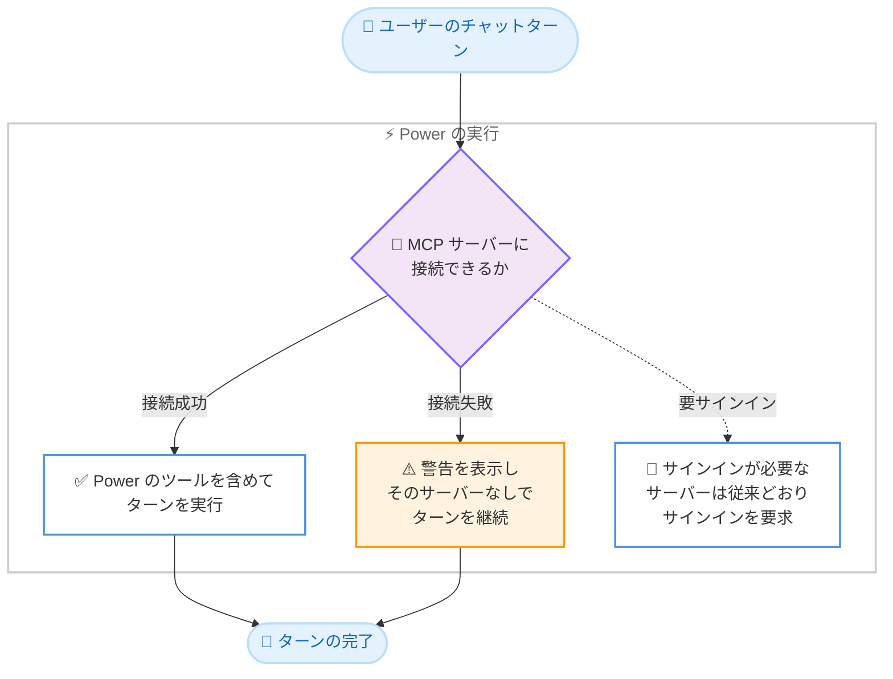

# Kiro - Memory 設定のデフォルト Off 化、Workflow プランへのフィードバック反映、Powers の耐障害性向上 (IDE 1.4.10)

**リリース日**: 2026 年 10 月 20 日
**サービス**: Kiro
**機能**: Memory Setting Defaults to Off, Workflow Plan Feedback, and Resilient Powers (Kiro IDE 1.4.10)

📊 [このアップデートのインフォグラフィックを見る](https://takech9203.github.io/aws-news-summary/20261020-kiro-changelog-2026-10-20.html)

## 概要

Kiro IDE 1.4.10 がリリースされました。本リリースは、直前の 1.4.0 で導入された Memory 機能の設定デフォルトを Off に変更するとともに、Workflow のプラン承認時にユーザーのフィードバックを承認済みステップへ正しく反映させる改善、Power の MCP サーバーに接続できない場合でもターンの実行を継続する耐障害性の向上を含むアップデートです。あわせて、チャット、Workflow、MCP に関する複数の不具合が修正されています。

Memory 機能のデフォルト動作変更は、記憶の利用と学習をユーザーが明示的にオプトインする方式への変更であり、プライバシーやチームポリシーの観点から記憶機能を慎重に扱いたいユーザーにとって重要な変更です。また、Powers の耐障害性向上により、外部 MCP サーバーの一時的な障害が作業全体を止めてしまう問題が緩和されます。

**アップデート前の課題**

このアップデート以前には、以下のような課題がありました。

- Memory 機能が導入された 1.4.0 では、記憶の利用・学習がデフォルトで有効な設定であり、ユーザーが明示的に選択しなくても Kiro が記憶を蓄積・利用する動作だった
- Workflow で提案されたプランに修正を依頼しても、承認されたステップが修正内容ではなく元のリクエストに従って実行されることがあった
- Power が利用する MCP サーバーへの接続に失敗すると、チャットにエラーカードが表示され、そのターンの実行に支障が出ていた
- 多数の画像を含む会話がリクエストサイズ超過で拒否されたり、コンパクション (要約) に失敗したりすることがあった
- スペックで Start Task または Run All Tasks を実行した後、次のメッセージが「Tool task_update is not available」エラーで失敗することがあった

**アップデート後の改善**

今回のアップデートにより、以下が改善されました。

- **Kiro Agent: Memory** 設定のデフォルトが **Off** になり、記憶機能の利用はユーザーの明示的な選択 (オプトイン) 方式に変更された。既に設定レベルを選択済みの場合、その選択は維持される
- Workflow のプランに修正を依頼した場合、承認済みステップが元のリクエストではなく修正内容に従って実行されるようになった
- Power の MCP サーバーへの接続に失敗しても、そのサーバーなしでターンが実行され、エラーカードの代わりに警告が表示されるようになった
- 画像を多く含む会話で、古い画像をリクエストから除外し、拒否された要約を画像なしで再試行できるようになった

## アーキテクチャ図



Powers の耐障害性向上後の動作フローです。MCP サーバーへの接続に失敗した場合でも、エラーで停止せず警告を表示してターンの実行を継続します。

## サービスアップデートの詳細

### 主要機能 (Improvements)

1. **Memory 設定のデフォルトが Off に変更**
   - **Kiro Agent: Memory** 設定のデフォルトが **Off** になった
   - 記憶機能を利用するには、**Use and learn** (利用と学習)、**Use but don't learn** (利用のみで学習しない)、**Use only** (利用のみ) のいずれかを明示的に選択する
   - この変更は新しいセッションに適用され、既にレベルを選択済みのユーザーの設定は維持される

2. **Workflow プランへのフィードバックがステップに反映**
   - 提案された Workflow プランに対して修正を依頼した場合、承認されたステップは元のリクエストではなく、ユーザーの修正内容に従って実行されるようになった
   - プランレビューでのフィードバックが実行内容に確実に反映されるため、意図しないステップ実行を防止できる

3. **サーバー利用不可時も Powers が動作を継続**
   - Power の MCP サーバーへの接続に失敗しても、そのサーバーなしでターンが実行される
   - チャットにはエラーカードの代わりに警告が表示される
   - サインインが必要なサーバーは、従来どおりサインインを要求する

### 不具合修正 (Fixes)

- 多数の画像を含む会話が拒否されたり、コンパクションに失敗したりする問題を修正。サイズ超過のリクエストから古い画像を除外し、拒否された要約を画像ペイロードなしで再試行できるようになった
- スペックで Start Task または Run All Tasks を実行した後、次のメッセージが「Tool task_update is not available」エラーで失敗する問題を修正
- 記憶の一覧表示を依頼した際に、セッションに未ロードの記憶のみが表示される問題を修正
- `oauth.redirectUri` でポートを固定した MCP サーバーに対し、サインインが不要な場合でも 2 つ目の Kiro セッションがアドレス使用中エラーで接続に失敗する問題を修正
- `managed-settings.json` に `signin_method` ルールが含まれている場合に、Kiro が「skipped some invalid rules」と報告する問題を修正

## 技術仕様

### Memory 設定のレベル

| 設定レベル | 動作 |
|------|------|
| Off (デフォルト) | 記憶を利用せず、学習もしない |
| Use and learn | 記憶を利用し、新しい記憶の学習も行う |
| Use but don't learn | 記憶を利用するが、新しい記憶は学習しない |
| Use only | 記憶の利用のみを行い、記憶を変更しない |

### 今回の変更の対象

| 項目 | 詳細 |
|------|------|
| 対象製品 | Kiro IDE |
| バージョン | 1.4.10 (1.4.0 のパッチリリース) |
| Memory デフォルト変更の適用範囲 | 新しいセッション。設定済みの選択は維持 |
| Powers の警告表示 | エラーカードの代わりにチャット内警告 |

## 設定方法

### 前提条件

1. Kiro IDE がインストールされていること
2. バージョン 1.4.10 以降にアップデートされていること

### 手順

#### ステップ 1: Kiro IDE のアップデート

Kiro IDE を再起動するか、アップデート通知に従って 1.4.10 へアップデートします。

#### ステップ 2: Memory 設定の確認と有効化

Kiro IDE の設定画面で **Kiro Agent: Memory** 設定を開きます。デフォルトは **Off** のため、記憶機能を利用する場合は **Use and learn**、**Use but don't learn**、**Use only** のいずれかを選択します。既にレベルを選択済みの場合は、その設定が維持されています。

#### ステップ 3: Workflow プランのレビュー

Workflow のプラン提案時に修正を依頼すると、承認後のステップは修正内容に従って実行されます。Kiro IDE での提案ステップのレビュー方法はドキュメントを参照してください。

## メリット

### ビジネス面

- **プライバシーとガバナンスの強化**: Memory 機能がオプトイン方式になったことで、組織のポリシーに沿って記憶機能の利用可否を意識的に判断できる
- **作業中断の削減**: MCP サーバーの一時的な障害で作業が止まらなくなり、開発の継続性が向上する
- **意図どおりの自動化**: Workflow プランへのフィードバックが確実に反映されるため、自動化されたステップの実行結果が期待と一致しやすくなる

### 技術面

- **既存設定の互換性**: Memory 設定を選択済みのユーザーには影響がなく、安全にアップデートできる
- **グレースフルデグラデーション**: Power の MCP サーバー障害時にエラーで停止せず、利用可能な機能でターンを継続する設計になった
- **大規模会話の安定性**: 画像を多く含む会話で古い画像を自動的に除外し、コンパクションの失敗を回避できる

## デメリット・制約事項

### 制限事項

- Memory 機能を利用したい新規ユーザーは、設定で明示的にレベルを選択する必要がある (デフォルトでは記憶が蓄積・利用されない)
- Memory 設定のデフォルト変更は新しいセッションから適用される
- サインインが必要な MCP サーバーは、障害時のフォールバック対象ではなく、従来どおりサインインが要求される

### 考慮すべき点

- 1.4.0 の Memory 機能を試していたユーザーは、新規インストール環境などでデフォルトが Off である点に注意が必要
- Power の MCP サーバー接続失敗時は警告表示のみでターンが継続するため、そのサーバーのツールを前提としたタスクでは結果を確認することが推奨される

## ユースケース

### ユースケース 1: チームポリシーに沿った Memory 機能の段階的導入

**シナリオ**: 企業の開発チームが、コンテキストの持ち越しによる生産性向上と情報管理ポリシーの両立を図りたい。

**実装例**:
```
1. Kiro IDE 1.4.10 へアップデート (デフォルトは Off のため記憶は蓄積されない)
2. ポリシー確認後、許可されたメンバーが Kiro Agent: Memory を Use and learn に設定
3. 記憶の変更を避けたい場合は Use only を選択
```

**効果**: 記憶機能の利用をチームの判断でコントロールしながら、必要なメンバーだけがセッション間のコンテキスト持ち越しを活用できる。

### ユースケース 2: Workflow プランの修正を反映した定型タスクの実行

**シナリオ**: 定期的なリリース作業を Workflow で自動化しているが、提案されたプランの一部ステップを状況に応じて変更したい。

**実装例**:
```
1. Workflow のプラン提案を確認
2. チャットで「ステップ 3 はステージング環境に対して実行して」と修正を依頼
3. 修正後のプランを承認して実行
```

**効果**: 承認済みステップが修正内容に従って実行されるため、元のリクエストのまま実行されてしまう手戻りを防げる。

### ユースケース 3: 外部 MCP サーバー障害時の作業継続

**シナリオ**: ドキュメント検索用の Power を常用しているが、その MCP サーバーが一時的にダウンしている状況でもコーディング作業を続けたい。

**実装例**:
```
1. 通常どおりチャットでタスクを依頼
2. MCP サーバー接続失敗の警告がチャットに表示される
3. そのサーバーのツールを除いた状態でターンが完了する
```

**効果**: 外部サーバーの障害がエラーカードで作業を中断させることなく、利用可能な機能で作業を継続できる。

## 利用可能リージョン

グローバル (Kiro はグローバルに提供されるサービスです)

## 関連サービス・機能

- **Kiro Memory**: セッションをまたいでリポジトリの規約や修正内容などのコンテキストを持ち越す機能。1.4.0 で IDE に導入され、今回デフォルトが Off に変更された
- **Kiro Workflows**: 定型タスクをステップとして定義・実行する機能。プランのレビューと承認のフローが今回改善された
- **Kiro Powers**: MCP サーバーを通じて外部ツールやドキュメントへのアクセスを提供する機能。サーバー障害時の耐障害性が今回向上した
- **Kiro CLI**: Kiro のコマンドラインインターフェース。Memory 機能は CLI でも提供されている

## 参考リンク

- 📊 [インフォグラフィック](https://takech9203.github.io/aws-news-summary/20261020-kiro-changelog-2026-10-20.html)
- [Kiro Changelog](https://kiro.dev/changelog/)
- [Kiro IDE 1.4.10 Changelog](https://kiro.dev/changelog/ide/1-4-10/)
- [Kiro Blog: Memory in Kiro IDE and CLI](https://kiro.dev/blog/memory-in-ide-cli/)
- [ドキュメント: Memory (IDE)](https://kiro.dev/docs/memory/#ide)
- [ドキュメント: Workflow の提案ステップのレビュー](https://kiro.dev/docs/workflows/manage/#review-proposed-steps-in-kiro-ide)

## まとめ

Kiro IDE 1.4.10 は、Memory 機能をオプトイン方式に変更し、Workflow プランへのフィードバック反映と Powers の耐障害性を改善するパッチリリースです。Memory 機能を利用したいユーザーは、アップデート後に **Kiro Agent: Memory** 設定で利用レベルを明示的に選択してください。Workflow や Powers を日常的に利用しているユーザーは、早めのアップデートにより作業の中断や意図しないステップ実行を回避できます。
