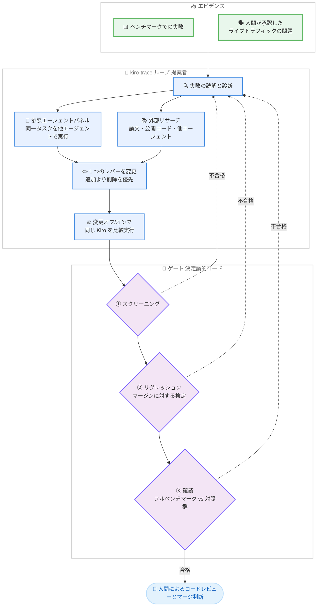

# Kiro - kiro-trace による自己改善の仕組み (How Kiro fixes itself, and how we keep the fixes honest)

**リリース日**: 2026 年 10 月 20 日
**サービス**: Kiro
**機能**: kiro-trace (自己改善トレーシングシステム) の解説記事

📊 [このアップデートのインフォグラフィックを見る](https://takech9203.github.io/aws-news-summary/20261020-kiro-how-kiro-fixes-itself.html)

## 概要

Kiro チームは、AI コーディングエージェントである Kiro が自身の実行履歴 (トラジェクトリ) から問題を発見し、修正を提案し、その修正を厳格に検証する社内トレーシングシステム「kiro-trace」の仕組みを解説する Blog 記事を公開しました。本記事は新機能の発表ではなく、Kiro の品質を継続的に向上させるための開発手法と品質保証プロセスの解説記事です。

kiro-trace は、ベンチマークや人間が承認したライブトラフィックの問題報告を入力として、失敗の診断、変更の提案、変更前後の比較実行を行い、3 段階のゲート (スクリーニング、リグレッション、確認) を通過した変更のみをプルリクエストとして人間のレビューに回します。運用開始後の最初の 1 週間で 8 件のプルリクエストを作成し、うち 7 件がマージされ、コードレビューで差し戻されたものは 0 件でした。

記事の象徴的な事例として、Kiro のファイル読み取り・検索ツールの説明文に含まれていた「ハーネスの動作に関する誤った記述」が、数百セッションにわたり 61,742 回もモデルに送信されていた問題が紹介されています。このような問題はユーザーからのチケットとして報告されることがほぼなく、人手で発見するには膨大な実行ログを読む必要があるため、自動化されたトレース分析が有効であることを示しています。

**アップデート前の課題**

AI エージェントの自己改善には、以下のような課題が存在していました。

- 最悪の問題はクリーンなバグレポートとして現れず、エラー後のリカバリー方法、ツールの呼び出し順序、長いコンテキストの保持方法の中に隠れており、数千件の実行ログを読まなければ気づけなかった
- エージェントが自分の修正を自分で採点するループでは、ベンチマークに過剰適合した narrow hack (局所的なハック) を採用してしまう危険があった
- 少数回の実行の平均値で判断すると、1 件の外れ値で結果が左右され、実際には「偶然の 1 回」に過ぎない改善を誤って採用するリスクがあった (記事では、1 つのホストでの偶然の成功を除くと「遅く、高コストで、精度も低い」変更をあやうく出荷しかけた事例が紹介されている)

**アップデート後の改善**

kiro-trace により、以下が実現されました。

- 最初の 1 週間で 7 件の修正がマージされ、プロンプト、ツール説明、引数チェック、レスポンス動作が改善された
- 変更不要なファイルの再読み取りを約 83% 削減、約 8 回に 1 回の検索が静かに失敗していたバグの修正など、測定可能な改善を達成した
- 長い会話の要約 (コンパクション) の保持スコア (retention) を 0.82 から 0.92 に向上させ、長い会話でも Kiro が作業内容を見失いにくくなった
- 確認済みの修正はすべて決定論的なアサーションとして恒久的なリグレッションスイートに追加され、一度修正した問題の再発を防止する体制が整った

## アーキテクチャ図

kiro-trace の 1 サイクルを示した図です。提案者 (ループ)、判定者 (決定論的コードのゲート)、最終判断者 (人間) の 3 つの役割を明確に分離しており、変更を書く主体と変更を受け入れる主体が同一にならないよう設計されています。

## サービスアップデートの詳細

### kiro-trace の設計原則

1. **提案者と判定者の分離**
   - 変更を書く主体と、その変更が有効かを判断する主体が同一だと、変更を受け入れる方向に偏る
   - Kiro は改善される対象、ループは変更の提案と適用、ゲート (プレーンなコード) は変更の採否を決定、という 3 つの役割を常に分離
   - 最終的なマージ判断は人間が行う

2. **失敗に絞った反復 (Iterate on the failures)**
   - 毎回フルベンチマークを実行するのは遅くて高コストなため、失敗モードをカバーする小さなタスクセットを組み立てて高速に反復
   - フルベンチマークは最後に 1 回だけ実行し、変更ありの実行と変更なしの対照実行を比較
   - 小さなセットで勝ってもフル実行で勝てない変更は出荷しない

3. **Kiro 自身の履歴に基づくレビュー**
   - 汎用的な LLM ジャッジではなく、Kiro の実際のコードレビューコメントや開発者の議論を読み込んだレビュアーを使用し、このチームが指摘するであろう点をフラグする
   - Kiro がタスクに失敗した場合、同じ入力・同じ予算で参照エージェント (他の強力なモデルやエージェント) のパネルを同一タスクで実行し、成功例との差分を具体的な修正のヒントにする
   - 別のリサーチステップで論文・公開コード・他エージェントの解法を取り込む (コードのコピーはしない)
   - デフォルトではルールを追加する前に何かを削除することを試みる (最近のモデルはすでに多くを知っているため)

4. **モデルが触れられないチェックによるデルタでの判断**
   - 変更はコストの低いものから段階的にチェックされ、大半の候補は高コストなチェックの前に脱落
   - スコアそのものではなくデルタ (差分) を測定し、対照群を毎回再実行することで、新しいモデルの効果ではなくその変更自体の寄与を測る
   - 小サンプルでは弱い検定が「有意差なし」となりやすいため、設定されたマージンに対して「リグレッションがないこと」の証明を要求
   - エージェントがネットワーク経由でタスクの答え (ソースやテスト) を調べた実行を無効化するコンタミネーションチェックを実施

### 代表的な修正事例

1. **誤ったツール説明の削除**
   - ハーネスの動作について誤った主張をする 1 文が、445 サンプルで 61,742 回モデルに送信されていたが何の役にも立っていなかったため削除
   - 存在しないツールを呼び出すよう指示するガイダンスも削除

2. **無駄なツール呼び出しの削減**
   - 変更されていないファイルを再読み取りしないようにし、冗長なファイル再読み取りを約 83% 削減
   - 過度に厳格、またはドキュメント不足だった 2 つのツールコントラクトを修正し、サンプリングした 80 セッションで読み取りツールのスキーマ拒否 205 件とサブエージェントオーケストレーションの拒否 167 件を解消

3. **技術的な些細な理由による失敗の防止**
   - モデルが boolean を文字列の "true" として返した際に呼び出しが拒否され作業が停止していた問題を、リトライ時に値を補正することで解決
   - 不正な仕様によって約 8 回に 1 回の検索がエラーなしで空の結果を返していたサイレントバグを修正

4. **過剰な委譲の抑制**
   - 単純な直接編集にまでサブエージェントを起動させていた包括的な委譲指示を削除し、委譲が有効な場面は維持

5. **参照エージェント追加による仕様欠陥の発見**
   - より厳格な参照エージェントをパネルに追加したところ、相対パスのバグが判明 (その参照エージェントでは読み取りの 13-17% が失敗、出荷モデルでは 1.6% にとどまり欠陥が隠れていた)
   - 仕様の修正はコントラクトを共有するすべてのモデルに有効で、現在レビュー中

6. **未出荷の最大の変更**
   - 積極的な削除により構築した小さなツール・プロンプトプロファイルは、Terminal-Bench 2.1 の pass@1 で 77.5% に対して 82.4% を記録し、トークンコストは約 3 分の 1
   - すべての Kiro ユーザーのデフォルトを変更するプロダクト判断を伴うため、チームレビュー中で未出荷

### コンパクション改善の事例: retention 0.82 から 0.92 へ

コンパクションは、Kiro がコンテキスト上限に達した際に長い会話を要約し、新しいインスタンスが作業を継続できるようにする仕組みです。

| フェーズ | 内容 |
|---------|------|
| 診断 | コンパクション後に Kiro が現在のタスクを放棄し、はるかに古いタスクを自信を持って再開することがあった。旧設計では過去のユーザーメッセージの生ダンプを新しい順で要約末尾に付加しており、要約が最も古い質問で終わっていたため、「はい、それでお願いします」のような短い確認メッセージが誤ったリクエストに紐付けられていた |
| 測定 | 実際にコンパクションが発生した社内の会話 (最大約 150 万トークン、4 つのサイズ帯) からベンチマークを構築。候補の要約だけを新しいモデルに渡し、作業を継続できるかを採点 (実行可能性、ファイルパスの有無、過去の決定の記載、スレッドの一貫性の 4 点) |
| 外部調査 | 各種プロダクションエージェントや公開されているハンドオフプラクティスのコンパクション手法を 11 個のプロンプトとして再構築し (うち 5 個は外部由来)、直接比較 |
| 修正と出荷 | 誤ったタスク再開の原因だった古いユーザーメッセージのリストを削除。コンパクション後は、サイズ上限付きの簡潔な固定テンプレートによる短い要約と直近のターンのみを保持し、特定のタスク名を含まない静的な再開キューで終了する設計に変更。retention は 0.82 から 0.92 に向上し出荷された |

### ループ自体の改善

- kiro-trace のチェックは、チームや自動ループが実際に騙された事例から成長している (正しい修正の出力がスコアラーに届かず 0 点になった事例、タスクのセットアップがエージェントの自己修復を許して実バグを隠した事例、古いチェックアウトにより修正済みの問題にプルリクエストを作成した事例など)
- 確認された修正ごとに、その実行に関する決定論的なアサーションを恒久的なリグレッションスイートに追加し、一度直した失敗の再発を検知
- 今後は Amazon 社内で解決済みのインシデントとチケットに基づいたチェックの構築を予定

## メリット

### ビジネス面

- **人手では発見不可能な問題の自動検出**: チケットとして報告されない種類の問題 (誤ったツール説明、無駄なトークン消費、サイレントな失敗) を、数千件の実行ログから自動的に発見できる
- **変更の信頼性担保**: 偶然の成功による見かけ上の改善を決定論的なチェックで排除し、本当に価値のある変更だけが出荷される
- **継続的な品質向上**: 先月だけでコアモジュールに 141 件のバグ修正コミット (1 日約 5 件) があった Kiro の改善サイクルを、自動化によってさらに加速

### 技術面

- **役割分離による健全性**: 提案者 (ループ)、判定者 (コード)、最終承認者 (人間) の分離により、自己採点ループの典型的な失敗 (narrow hack の採用) を防止
- **デルタベースの評価**: 対照群を毎回再実行してデルタで判断するため、モデル更新などの外部要因と変更自体の効果を区別できる
- **恒久的なリグレッション防止**: 修正ごとに決定論的アサーションが蓄積され、修正の再発防止がメカニズムレベルでカバーされる

## デメリット・制約事項

### 制限事項

- kiro-trace は Kiro チームの社内システムであり、ユーザーが直接利用できる機能ではない
- 記事中の数値はすべて社内実験のデルタであり、本番環境での推定値ではない
- 最も効果の大きい変更 (小さなツール・プロンプトプロファイル) は、プロダクト判断を伴うため未出荷

### 考慮すべき点

- 「有意な害なし」は「害なし」と同義ではなく、小さな害は変更が積み重なると急速に蓄積するため、マージンに対する検定が必要 (記事の Takeaway)
- 自己改善ループを構築する場合、提案者と判定者を分離し、採否の判断をモデルが触れられないコードに置くことが重要

## 参考になるポイント (エージェント開発者向け)

本記事は、AI エージェントの自己改善システムを構築する開発者に向けた以下の Takeaway を提示しています。

1. **提案者と判定者を分離する**: 採用・却下の判断は、モデルが触れられないコードに置く
2. **デルタで判断し、対照群を毎回再実行する**: 新しいモデルだけでもスコアは動くため
3. **マージンに対して検定する**: 「有意な害なし」は「害なし」ではなく、小さな害は変更の積み重ねで急速に蓄積する
4. **確認された修正を恒久的なリグレッションチェックに変換する**: 失敗したメカニズム自体を対象にすることで、単一の結果以上をカバーする
5. **追加の前に削除を試す**: モデルが賢くなるほど、最も安全な改善は削除であることが多い

## 料金

本記事は開発手法の解説記事であり、料金に関する変更はありません。Kiro の料金は [Kiro Pricing](https://kiro.dev/pricing/) を参照してください。

## 利用可能リージョン

グローバル (Kiro はグローバルに提供されるサービスです)

## 関連サービス・機能

- **Kiro IDE / CLI**: 本記事で解説された改善 (無駄な呼び出しの削減、より慎重な委譲、長い会話でのコンテキスト保持の向上) は、ゲートと人間のコードレビューを通過したうえで Kiro ユーザーに届けられる
- **コンパクション機能**: Kiro がコンテキスト上限到達時に会話を要約して作業を継続する仕組み。本記事の改善により retention が 0.82 から 0.92 に向上
- **Continuous Prompt Evaluation**: 人間が書いたプロンプト変更を LLM ジャッジとライブ A/B テストで評価する仕組みを扱った関連記事。kiro-trace はその後段 (自動トラジェクトリマイニング、変更生成、ハーネスの自己改善) を担う

## 参考リンク

- 📊 [インフォグラフィック](https://takech9203.github.io/aws-news-summary/20261020-kiro-how-kiro-fixes-itself.html)
- [Kiro Blog: How Kiro fixes itself, and how we keep the fixes honest](https://kiro.dev/blog/how-kiro-fixes-itself/)
- [Kiro Changelog](https://kiro.dev/changelog/)
- [Kiro 公式サイト](https://kiro.dev/)

## まとめ

本記事は、Kiro が自身の実行履歴から問題を発見し修正する社内システム kiro-trace の設計思想と実績を解説したものです。提案者・判定者・最終承認者の分離、デルタベースの評価、恒久的なリグレッションチェックといった原則は、AI エージェントの自己改善システムを構築するすべての開発者にとって参考になります。Kiro ユーザーにとっては、無駄なツール呼び出しの削減や長い会話でのコンテキスト保持の向上といった形で、継続的な品質改善の恩恵を受けられることを意味します。
