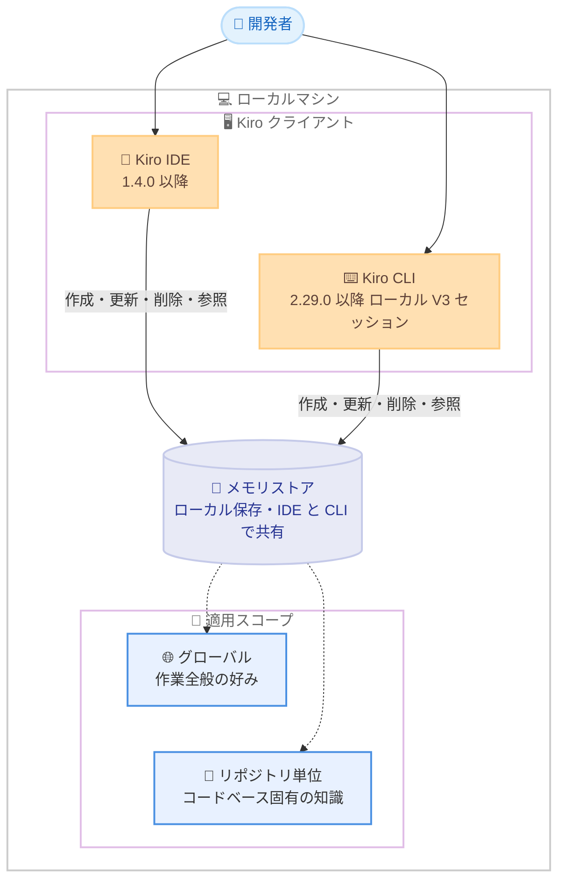

# Kiro - Kiro IDE と CLI におけるメモリ機能の導入

**リリース日**: 2026 年 10 月 20 日
**サービス**: Kiro
**機能**: Memory in Kiro IDE and CLI (セッションをまたぐメモリ機能)

📊 [このアップデートのインフォグラフィックを見る](https://takech9203.github.io/aws-news-summary/20261020-kiro-memory-in-ide-cli.html)

## 概要

Kiro IDE と Kiro CLI にメモリ機能が導入されました。Kiro は、ユーザーの好みの作業スタイル、リポジトリ固有のコマンドや規約、過去の修正指示、デバッグで得られた知見、すでに検討から除外したアプローチなどを記憶できるようになります。これらの情報が再び関連する場面になると、Kiro がコンテキストを自動的に引き継ぐため、コンテキストの再説明や同じ修正指示の繰り返しに費やす時間が減り、使い込むほど Kiro がユーザーの好みに沿って動作するようになります。

メモリは、過去の会話をそのまま再生するのではなく、後の作業に役立つ具体的なコンテキストを保持する仕組みです。Kiro は理解の変化に応じて記憶内容を更新 (refine) できます。記憶はユーザーのローカルマシンに保存され、同一マシン上の Kiro IDE と CLI の間で共有されるため、一方のクライアントで獲得したコンテキストをもう一方でも利用できます。各メモリはグローバルまたは特定リポジトリのいずれかのスコープで適用され、幅広い作業上の好みと特定コードベース固有のコンテキストを区別して扱えます。

なお、今回のローンチではメモリ機能は**デフォルトで無効 (オフ)** です。IDE と CLI の両方で、既存メモリの利用可否と、メモリの作成・更新可否をユーザー自身が制御できます。

**アップデート前の課題**

このアップデート以前には、以下のような課題がありました。

- セッションが変わるたびに、作業の進め方の好みやリポジトリ固有の事情を Kiro に再説明する必要があった
- 一度行った修正指示 (例: 特定のロジックの配置場所) を、新しいセッションで繰り返し伝える必要があった
- デバッグで得た知見 (例: ローカルサービス起動後にのみ統合テストが通る) や、すでに検討から除外したアプローチが、セッション終了とともに失われていた
- Steering ルールやプロジェクトドキュメントは事前に明文化できるコンテキストには有効だが、作業中に自然に生まれるコンテキストは記録されないまま失われがちだった

**アップデート後の改善**

今回のアップデートにより、以下が可能になりました。

- 作業中に現れたコンテキストを Kiro が自動的に記憶として捕捉し、以降のセッションに引き継げるようになった
- 同一マシン上の Kiro IDE と CLI の間で記憶が共有され、どちらのクライアントからも同じコンテキストを利用できるようになった
- グローバル / リポジトリ単位のスコープにより、汎用的な好みとコードベース固有の知識を区別して管理できるようになった
- IDE の Memories ビューや CLI の `/memories` コマンドで、Kiro が何を記憶しているかを確認・検索・削除できるようになった

## アーキテクチャ図



メモリはローカルマシン上に保存され、同一マシンの Kiro IDE と CLI の間で共有されます。各メモリはグローバルまたは特定リポジトリのスコープで適用されます。

## サービスアップデートの詳細

### 主要機能

1. **作業中に生まれるコンテキストの記憶**
   - ロジックの配置場所に関する修正指示、デバッグ中に判明した手順 (例: ローカルサービスの起動が統合テストの前提)、変更へのアプローチ方法の好みなどを、作業の流れの中で Kiro が自動的に捕捉する
   - Steering ルールやプロジェクトドキュメントが「事前に明文化して一貫して適用したいコンテキスト」向けであるのに対し、メモリは「作業中に現れ、放っておくと記録されないコンテキスト」向けという位置づけ
   - 過去の会話の再生ではなく、後の作業に役立つ具体的なコンテキストのみを保持し、Kiro の理解の変化に応じて記憶を更新できる

2. **ローカル保存と IDE / CLI 間の共有**
   - 記憶はユーザーのローカルマシンに保存される
   - 同一マシン上の Kiro IDE と CLI で記憶が共有され、一方で獲得したコンテキストをもう一方でも利用できる
   - 各メモリはグローバルまたは特定リポジトリのスコープを持ち、汎用的な好みとコードベース固有のコンテキストを区別できる

3. **記憶の可視化と制御**
   - IDE では、Kiro がメモリにアクセス・作成・更新・削除した際にチャット上に表示され、記憶の利用や変更を確認できる
   - アクティビティバーの Memories ビューから、記憶の一覧表示・検索、適用スコープの確認、個別エントリの閲覧、不要な記憶の削除が可能
   - CLI では、呼び出された記憶がチャット内に Memory エントリとして表示され、`/memories` コマンドで保存済みメモリの検索・プレビュー・表示ができる

4. **デフォルトオフとアクセス制御**
   - 今回のローンチではメモリ機能はデフォルトで無効
   - IDE と CLI の両方で「既存メモリを利用できるか」「メモリを作成・更新できるか」を個別に制御できる (IDE の Kiro Agent: Memory 設定には、記憶を変更せず利用のみ行う Use only などの選択肢がある)
   - 呼び出された記憶は Kiro が利用可能なコンテキストの一部となるため、メモリの利用によりコンテキスト使用量が増加する可能性がある

## 技術仕様

### 対応バージョンと動作要件

| 項目 | 詳細 |
|------|------|
| Kiro IDE | バージョン 1.4.0 以降 (IDE 1.4.0 のリリースは 2026 年 10 月 19 日) |
| Kiro CLI | バージョン 2.29.0 以降、ローカル V3 セッションで利用可能 |
| デフォルト設定 | オフ (IDE 1.4.10 でデフォルトがオフに変更) |
| 保存場所 | ローカルマシン (同一マシン上の IDE と CLI で共有) |
| 適用スコープ | グローバルまたはリポジトリ単位 |
| アクセス制御 | 既存メモリの利用可否と作成・更新可否を個別に設定可能 |
| CLI 設定反映 | メモリアクセス設定の変更は新しい CLI セッションから有効 |

### 関連する Changelog エントリ

| 日付 | バージョン | 内容 |
|------|-----------|------|
| 2026/10/19 | Kiro IDE 1.4.0 | Memory Across Chat Sessions - IDE にメモリ機能を導入。Memories ビュー、チャットでの記憶アクセス表示、Kiro Agent: Memory 設定 (Use only を含む) を追加 |
| 2026/10/20 | Kiro IDE 1.4.10 | Memory Setting Defaults to Off - メモリ設定のデフォルトをオフに変更 |

## 設定方法

### 前提条件

1. Kiro IDE 1.4.0 以降、または Kiro CLI 2.29.0 以降がインストールされていること
2. Kiro CLI で利用する場合は、ローカル V3 セッションを使用していること
3. メモリはデフォルトで無効のため、利用には明示的な有効化が必要であること

### 手順

#### ステップ 1: Kiro IDE でメモリを有効化する

1. アクティビティバーから **Memories** ビューを開く
2. Memories ビューの設定を開く
3. **Use and learn** を選択する

これにより、Kiro が既存のメモリを利用し、作業中に自動的にメモリを作成・更新できるようになります。有効化後は通常どおり Kiro と作業するだけで、記憶が蓄積されていきます。

#### ステップ 2: Kiro CLI でメモリを有効化する

```bash
# CLI のチャット内でメモリの確認・設定を行う
/memories
```

`/memories` コマンドで保存済みメモリの確認やアクセス設定を行います。**read & write** アクセスを設定すると、自動メモリ更新を有効化でき、Kiro が作業中にメモリを作成・更新できるようになります。メモリアクセス設定の変更は、新しい CLI セッションから有効になります。

#### ステップ 3: 記憶の確認と管理

- IDE: Memories ビューに戻れば、いつでも記憶の内容を確認し、不要な記憶を削除したり、メモリの動作設定を変更したりできます
- CLI: `/memories` で保存済みメモリの検索・プレビュー・表示ができます

## メリット

### ビジネス面

- **再説明コストの削減**: セッションごとのコンテキスト再説明や修正指示の繰り返しが不要になり、開発者が本来の作業に集中できる
- **利用期間に応じた価値向上**: Kiro を使い込むほどユーザーの好みやプロジェクト固有の知識が蓄積され、支援の精度が高まる
- **知見の喪失防止**: デバッグ中に得た知見や検討済みのアプローチがセッション終了で失われず、同じ試行錯誤の繰り返しを防げる

### 技術面

- **IDE / CLI 間のシームレスな共有**: 同一マシン上であれば、IDE で獲得したコンテキストを CLI でも活用でき、クライアントをまたいだ一貫した動作が得られる
- **スコープによる適切な適用**: グローバルとリポジトリ単位のスコープにより、汎用的な好みと特定コードベース固有の知識が混ざらない
- **透明性と制御性**: チャット上での記憶アクセス表示、Memories ビュー、`/memories` コマンドにより、Kiro が何を記憶し利用しているかを常に確認・管理できる
- **Steering ルールとの補完関係**: 事前に明文化するルールと、作業中に自然発生するコンテキストの両方をカバーできる

## デメリット・制約事項

### 制限事項

- メモリはデフォルトで無効のため、利用には IDE または CLI での明示的な有効化が必要
- Kiro CLI ではローカル V3 セッションでのみ利用可能
- 記憶はローカルマシンに保存されるため、別のマシンとの間では共有されない
- CLI でのメモリアクセス設定の変更は、新しいセッションを開始するまで反映されない

### 考慮すべき点

- 呼び出された記憶は Kiro のコンテキストに含まれるため、メモリの利用によりコンテキスト使用量が増加する可能性がある
- 不要・不正確になった記憶が蓄積されると意図しない動作につながる可能性があるため、Memories ビューや `/memories` で定期的に内容を確認し、不要な記憶を削除することが望ましい
- 事前に明文化して一貫適用したいコンテキストには、引き続き Steering ルールやプロジェクトドキュメントの利用が適している

## ユースケース

### ユースケース 1: リポジトリ固有の規約・手順の自動適用

**シナリオ**: 特定のリポジトリでは、統合テストの実行前にローカルの依存サービスを起動する必要があり、また特定の種類のロジックは決まったディレクトリに配置する規約がある。

**実装例**:
```text
1. IDE の Memories ビューで Use and learn を有効化
2. 作業中に「このロジックは services 層に置いて」と修正指示
3. デバッグ中に「ローカルサービス起動後にテストが通る」ことが判明
→ Kiro がこれらをリポジトリスコープのメモリとして記憶
```

**効果**: 次回以降のセッションで、Kiro が自動的に規約に沿った配置や正しいテスト手順を適用し、同じ指摘を繰り返す必要がなくなる。

### ユースケース 2: IDE と CLI をまたいだ作業スタイルの共有

**シナリオ**: 日中は Kiro IDE でコードレビューや実装を行い、定型作業やスクリプト実行は Kiro CLI で行う開発者が、どちらのクライアントでも同じ作業スタイル (コミットメッセージの書き方、変更アプローチの好みなど) を適用したい。

**実装例**:
```text
1. IDE 側で Use and learn を有効化し、作業中に好みを記憶させる
2. CLI 側で /memories から read & write アクセスを設定
→ 同一マシン上でメモリが共有され、CLI でも IDE で獲得した
   グローバルスコープの記憶が利用される
```

**効果**: クライアントを切り替えても一貫した支援が受けられ、環境ごとの再設定や再説明が不要になる。

### ユースケース 3: 検討済みアプローチの記録による手戻り防止

**シナリオ**: パフォーマンス改善の作業で、いくつかのアプローチを試した結果、特定の方式は副作用があるため採用しないと判断した。数週間後に別のセッションで同様の改善作業を行う。

**実装例**:
```text
1. メモリ有効化済みの状態で、除外したアプローチとその理由を
   Kiro との対話の中で明確にする
→ Kiro が「すでに検討から除外したアプローチ」として記憶
2. 後日のセッションで同じ領域の改善を依頼
→ Kiro が除外済みアプローチを避けた提案を行う
```

**効果**: 過去に否定した方式を Kiro が再提案することがなくなり、検討の手戻りを防止できる。

## 利用可能リージョン

Kiro はグローバルに提供されるサービスであり、本機能も Kiro IDE 1.4.0 以降および Kiro CLI 2.29.0 以降 (ローカル V3 セッション) でグローバルに利用可能です。

## 関連サービス・機能

- **Kiro Steering (ルールとプロジェクトドキュメント)**: 事前に明文化して一貫適用したいコンテキストを定義する機能。作業中に自然発生するコンテキストを扱うメモリと補完関係にある
- **Kiro CLI V3 セッション**: CLI 側でメモリ機能が動作する実行環境。メモリはローカル V3 セッションで利用可能
- **Kiro IDE Memories ビュー**: 記憶の一覧・検索・削除とメモリ動作設定を行う管理 UI

## 参考リンク

- 📊 [インフォグラフィック](https://takech9203.github.io/aws-news-summary/20261020-kiro-memory-in-ide-cli.html)
- [公式発表 (Kiro Blog): Introducing memory in Kiro IDE and CLI](https://kiro.dev/blog/memory-in-ide-cli/)
- [Kiro Changelog](https://kiro.dev/changelog/)
- [ドキュメント: Memory](https://kiro.dev/docs/memory/)
- [ドキュメント: Kiro CLI V3](https://kiro.dev/docs/cli/v3/)
- [ドキュメント: Steering](https://kiro.dev/docs/steering/)

## まとめ

Kiro IDE と CLI へのメモリ機能の導入により、作業中に生まれるコンテキストがセッションをまたいで引き継がれ、Kiro は使い込むほど開発者の好みやプロジェクト固有の知識に沿った支援ができるようになります。メモリはデフォルトで無効かつローカル保存であり、何を記憶させるか・学習を続けるかをユーザーが完全に制御できる設計です。Kiro IDE 1.4.0 以降または Kiro CLI 2.29.0 以降を利用している場合は、Memories ビューまたは `/memories` コマンドからメモリを有効化し、再説明の手間を減らす効果を試すことを推奨します。
