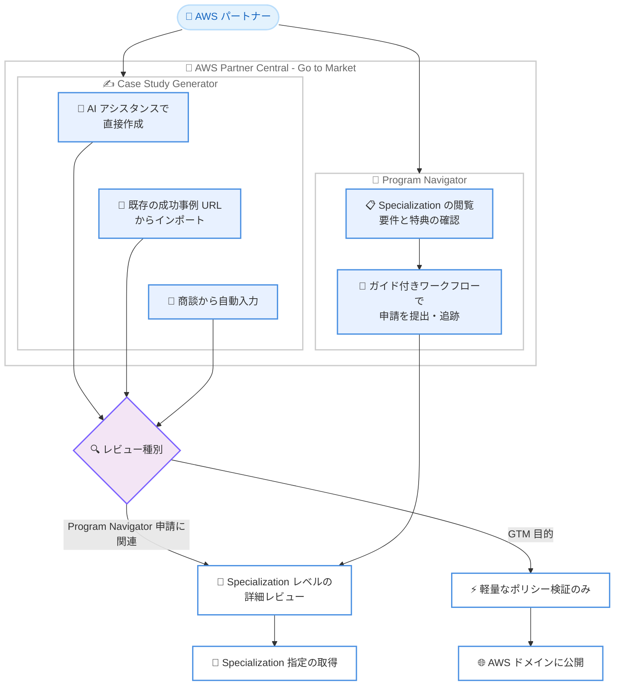

# AWS Partner Central - Program Navigator、Case Study Generator、効率化された Specialization レビュー

**リリース日**: 2026 年 10 月 20 日
**サービス**: AWS Partner Central
**機能**: Program Navigator / Case Study Generator / 効率化された Specialization レビュープロセス

📊 [このアップデートのインフォグラフィックを見る](https://takech9203.github.io/aws-news-summary/20261020-partner-central-program-navigator.html)

## 概要

AWS Partner Central に、AWS Specialization プログラムへの申請を一元管理できる新機能「Program Navigator」、AI を活用してケーススタディを作成できる「Case Study Generator」、および効率化された Specialization レビュープロセスが追加されました。これらの機能はすべての AWS パートナーが利用可能で、Partner Central の左ナビゲーションにある「Go to Market」セクションからアクセスできます。

Program Navigator では、パートナーは Specialization の指定 (Designation) を一覧で確認し、各プログラムの要件と特典を把握した上で、ガイド付きのステップバイステップワークフローに沿って申請の提出と進捗追跡を行えます。Case Study Generator では、AI アシスタンスによる直接作成、既存の顧客成功事例 URL からのインポート、商談 (オポチュニティ) からの自動入力という 3 つの方法でケーススタディを作成できます。

さらに、レビュープロセスも効率化されました。GTM (市場開拓) 目的のケーススタディは軽量なポリシー検証のみで AWS ドメインに直接公開できるようになり、詳細な Specialization レベルのレビューは Program Navigator の申請に関連するケーススタディのみに適用されます。

**アップデート前の課題**

このアップデート以前には、以下のような課題がありました。

- Specialization プログラムの要件や特典の確認、申請の提出・追跡を一元的に行う仕組みがなく、申請プロセスの見通しが立てにくかった
- ケーススタディをゼロから手作業で作成する必要があり、既存の成功事例や商談情報を活用した効率的な作成手段がなかった
- GTM 目的のケーススタディであっても詳細なレビューを経る必要があり、公開までに時間がかかっていた

**アップデート後の改善**

今回のアップデートにより、以下が可能になりました。

- Program Navigator により、Specialization の閲覧、要件・特典の確認、ガイド付きワークフローでの申請提出・追跡が一元的に行えるようになった
- Case Study Generator により、AI アシスタンス、既存事例 URL のインポート、商談からの自動入力という 3 つの方法でケーススタディを効率的に作成できるようになった
- GTM 目的のケーススタディは軽量なポリシー検証のみで AWS ドメインに直接公開できるようになり、公開までのリードタイムが短縮された
- Program Navigator 経由の申請ではレビュー時間が短縮され、要件レベルの詳細なフィードバックが得られるようになった

## アーキテクチャ図



Program Navigator による Specialization 申請フローと、Case Study Generator による 3 つのケーススタディ作成方法、および目的に応じて分岐するレビュープロセスの全体像を示しています。

## サービスアップデートの詳細

### 主要機能

1. **Program Navigator**
   - AWS Specialization プログラムへの申請を一元管理する新機能
   - Specialization の指定を閲覧し、各プログラムの要件と特典を確認可能
   - ガイド付きのステップバイステップワークフローで申請を提出し、進捗を追跡可能
   - Program Navigator 経由の申請ではレビュー時間が短縮され、要件レベルの詳細なフィードバックを提供

2. **Case Study Generator**
   - ケーススタディ作成のための新しいエクスペリエンス
   - 以下の 3 つの開始方法を提供。
     - AI アシスタンスを使った直接作成
     - 既存の顧客成功事例 URL からのインポート
     - 商談 (オポチュニティ) からの自動入力

3. **効率化されたレビュープロセス**
   - GTM 目的のケーススタディは、軽量なポリシー検証のみの簡素化されたレビューを経て、Specialization レビューなしで AWS ドメインに直接公開可能
   - 詳細な Specialization レベルのレビューは、Program Navigator の申請に関連するケーススタディのみに適用
   - Specialization 以外のプログラム申請は従来の方法で継続

## 技術仕様

### 機能概要

| 項目 | 詳細 |
|------|------|
| 提供場所 | AWS Partner Central の「Go to Market」セクション |
| 対象ユーザー | すべての AWS パートナー |
| Program Navigator | Specialization の閲覧、要件・特典の確認、申請の提出・追跡 |
| Case Study Generator | AI 作成、URL インポート、商談からの自動入力の 3 方式 |
| GTM ケーススタディのレビュー | 軽量なポリシー検証のみで AWS ドメインに公開可能 |
| Specialization レビュー | Program Navigator 申請に関連するケーススタディのみに適用 |

### API 変更履歴

2026 年 10 月 20 日時点で、本アップデートに関連する API 変更は確認されていません。本機能は AWS Partner Central のポータル機能として提供されます。

## 設定方法

### 前提条件

1. AWS Partner Network (APN) に登録済みであること
2. AWS Partner Central のアカウントを保有していること
3. Partner Central で適切なユーザーロールが割り当てられていること

### 手順

#### ステップ 1: AWS Partner Central にサインイン

AWS Partner Central (https://console.aws.amazon.com/partnercentral/home) にサインインします。

#### ステップ 2: Program Navigator にアクセス

左ナビゲーションの「Go to Market」セクションから「Program Navigator」を選択します。Specialization の一覧から対象プログラムを選び、要件と特典を確認した上で、ガイド付きワークフローに沿って申請を提出します。

#### ステップ 3: Case Study Generator でケーススタディを作成

左ナビゲーションの「Go to Market」セクションから「Case Studies」を選択します。AI アシスタンスによる直接作成、既存の顧客成功事例 URL からのインポート、商談からの自動入力のいずれかの方法でケーススタディを作成し、レビューに提出します。

## メリット

### ビジネス面

- **申請プロセスの可視化**: Specialization の要件と特典を事前に確認でき、申請の進捗も追跡できるため、プログラム取得の計画が立てやすくなる
- **市場投入までの時間短縮**: GTM 目的のケーススタディは軽量なレビューで AWS ドメインに直接公開できるため、マーケティング活動を迅速に展開できる
- **コンテンツ作成コストの削減**: AI アシスタンスや商談からの自動入力により、ケーススタディ作成にかかる工数を削減できる

### 技術面

- **ガイド付きワークフロー**: ステップバイステップの申請フローにより、申請内容の不備や手戻りを減らせる
- **既存データの再利用**: 既存の成功事例 URL や Partner Central 上の商談データを活用してケーススタディを生成できる
- **詳細なフィードバック**: Program Navigator 経由の申請では要件レベルの詳細なフィードバックが得られ、改善ポイントを特定しやすい

## デメリット・制約事項

### 制限事項

- 詳細な Specialization レベルのレビューは、Program Navigator の申請に関連するケーススタディにのみ適用される
- Specialization 以外のプログラム申請は従来の方法のままで、今回の効率化の対象外
- 本機能の利用には AWS Partner Central へのアクセス権が必要

### 考慮すべき点

- GTM 目的で公開したケーススタディを Specialization 申請に使用する場合は、別途 Specialization レベルのレビューが必要になる点に注意が必要
- AI アシスタンスで生成したケーススタディは、公開前に内容の正確性を自社で確認することが望ましい

## ユースケース

### ユースケース 1: Specialization 取得計画の策定と申請

**シナリオ**: コンサルティングパートナーが新たに AWS Specialization の取得を目指しており、要件の把握から申請までを効率的に進めたい。

**実装例**:
```
1. Partner Central の「Go to Market」から Program Navigator を開く
2. 取得候補の Specialization の要件と特典を比較検討する
3. ガイド付きワークフローに沿って必要情報を入力し申請を提出する
4. Program Navigator 上で申請ステータスとフィードバックを追跡する
```

**効果**: 要件の見落としを防ぎ、レビュー時間の短縮と要件レベルのフィードバックにより、Specialization 取得までの期間を短縮できる。

### ユースケース 2: 商談データからのケーススタディ迅速公開

**シナリオ**: パートナーが成約済みの商談をもとに、マーケティング用のケーススタディを早期に公開したい。

**実装例**:
```
1. Case Study Generator で「商談からの自動入力」を選択する
2. 対象の商談を選び、AI アシスタンスで内容を補完・編集する
3. GTM 目的として提出し、軽量なポリシー検証を受ける
4. 検証完了後、AWS ドメイン上に公開する
```

**効果**: Specialization レビューを待たずにケーススタディを公開でき、営業・マーケティング活動に迅速に活用できる。

### ユースケース 3: 既存の成功事例の再活用

**シナリオ**: 自社サイトに掲載済みの顧客成功事例を、AWS ドメイン上のケーススタディとしても展開したい。

**実装例**:
```
1. Case Study Generator で「既存の顧客成功事例 URL からのインポート」を選択する
2. 自社サイトの事例ページ URL を指定して内容を取り込む
3. 取り込んだ内容を編集し、ポリシー検証に提出する
```

**効果**: 既存コンテンツを再利用することで、新規作成の工数をかけずに AWS ドメイン上での露出を増やせる。

## 料金

本機能は AWS Partner Central の機能として提供されます。公式発表に追加料金に関する記載はありません。

## 利用可能リージョン

すべての AWS パートナーが AWS Partner Central で利用可能です (特定のリージョンに依存しないグローバルなポータル機能)。

## 関連サービス・機能

- **AWS Partner Central**: パートナー向けポータル。今回の新機能はすべて Partner Central の「Go to Market」セクションから利用する
- **AWS Specialization プログラム**: 技術的な専門性や顧客実績を証明するパートナー認定制度。Program Navigator で申請を一元管理できる
- **APN Customer Engagements (ACE)**: 商談 (オポチュニティ) 管理の仕組み。Case Study Generator の「商談からの自動入力」で活用される

## 参考リンク

- 📊 [インフォグラフィック](https://takech9203.github.io/aws-news-summary/20261020-partner-central-program-navigator.html)
- [公式発表 (What's New)](https://aws.amazon.com/about-aws/whats-new/2026/10/partner-central-program-navigator/)
- [AWS Partner Central](https://console.aws.amazon.com/partnercentral/home)
- [AWS パートナーネットワーク](https://aws.amazon.com/partners/)

## まとめ

AWS Partner Central の Program Navigator と Case Study Generator により、Specialization 申請の一元管理と AI を活用したケーススタディ作成が可能になり、GTM 目的のケーススタディは軽量なレビューのみで迅速に公開できるようになりました。AWS パートナー企業は、Partner Central の「Go to Market」セクションから新機能を確認し、Specialization 取得計画やケーススタディ公開のワークフローへの組み込みを検討することを推奨します。
