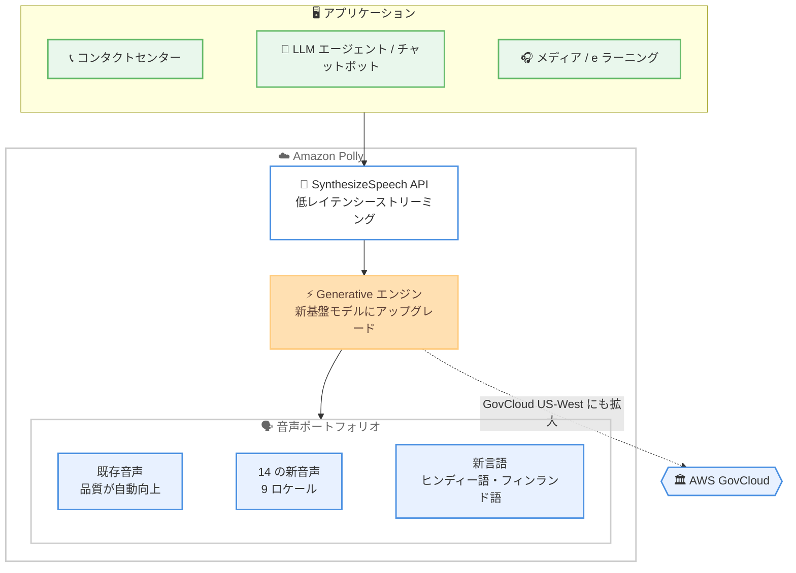

# Amazon Polly - Generative エンジンのアップグレードと 14 の新音声、2 つの新言語の追加

**リリース日**: 2026 年 10 月 20 日
**サービス**: Amazon Polly
**機能**: Generative エンジンの新基盤モデルへのアップグレード、9 ロケール 14 音声の追加、ヒンディー語・フィンランド語の GA、AWS GovCloud への拡大

📊 [このアップデートのインフォグラフィックを見る](https://takech9203.github.io/aws-news-summary/20261020-polly-generative.html)

## 概要

Amazon Polly の Generative エンジンが新しい基盤モデルにアップグレードされ、より自然で正確な音声出力を低レイテンシーで提供できるようになりました。このアップグレードはドロップイン方式で適用されるため、既存アプリケーションのコード変更は不要で、すべての Generative 音声の品質が自動的に向上します。数値、メールアドレス、住所といった複雑なコンテンツの読み上げ精度が改善され、出力を調整する手間が削減されます。SSML タグも従来どおり動作します。

あわせて、9 ロケールで 14 の新しい音声が追加されました。米国英語の Kenneth と Nate、オーストラリア英語の Russell と Curtis、ヒンディー語およびインド英語の Kiara と Arjun、ドイツ語の Tina、米国スペイン語の Carlos、ブラジルポルトガル語の Leo と Carolina、韓国語の Hyunduk、フィンランド語の Suvi が利用可能です。また、新言語としてヒンディー語とフィンランド語が Generative エンジンで初めて一般提供 (GA) されました。

さらに、Generative エンジンの提供が AWS GovCloud (US-West) にも拡大され、公共部門や規制の厳しい業界のお客様も利用できるようになりました。低レイテンシーのストリーミング API により、コンタクトセンター、チャットボット、LLM ベースのエージェント型音声アプリケーションに適しており、ニュース、メディア、エンターテインメント、e ラーニング、アクセシビリティ用途にも幅広く活用できます。

**アップデート前の課題**

- 数値、メールアドレス、住所などの複雑なコンテンツでは読み上げが不正確になる場合があり、SSML や前処理による出力の微調整が必要だった
- Generative エンジンではヒンディー語とフィンランド語が利用できず、これらの言語の音声アプリケーションには他のエンジンを使う必要があった
- 利用できる音声の種類が限られており、ブランドやコンテンツに合わせた音声の選択肢が少なかった
- AWS GovCloud では Generative エンジンを利用できず、公共部門のワークロードで最新の音声品質を活用できなかった

**アップデート後の改善**

- 新しい基盤モデルにより、コード変更なしでより自然で正確な音声出力を低レイテンシーで利用できるようになった
- ヒンディー語とフィンランド語が Generative エンジンで GA となり、対応言語が拡大した
- 9 ロケールに 14 の新音声が追加され、用途やブランドに合わせた音声選択の幅が広がった
- AWS GovCloud (US-West) で Generative エンジンが利用可能になり、公共部門や規制業界でも最新の音声合成を利用できるようになった

## アーキテクチャ図



アプリケーションは従来どおり Polly の API を呼び出すだけで、アップグレードされた Generative エンジンによる高品質な音声合成を利用できます。既存音声の品質向上、新音声・新言語の追加、GovCloud への拡大がコード変更なしで提供されます。

## サービスアップデートの詳細

### 主要機能

1. **Generative エンジンの新基盤モデルへのアップグレード**
   - より自然で正確な音声出力を低レイテンシーで実現
   - ドロップイン方式のアップグレードで、既存の音声ポートフォリオ全体の品質が自動的に向上
   - 数値、メールアドレス、住所などの複雑なコンテンツの読み上げ精度が改善され、出力の微調整が不要に
   - SSML タグは従来どおり動作し、既存アプリケーションとの互換性を維持

2. **9 ロケールで 14 の新音声を追加**
   - 米国英語: Kenneth、Nate
   - オーストラリア英語: Russell、Curtis
   - ヒンディー語およびインド英語: Kiara、Arjun
   - ドイツ語: Tina
   - 米国スペイン語: Carlos
   - ブラジルポルトガル語: Leo、Carolina
   - 韓国語: Hyunduk
   - フィンランド語: Suvi

3. **ヒンディー語とフィンランド語の GA**
   - Generative エンジンで初めて 2 言語が一般提供に
   - インド市場や北欧市場向けの音声アプリケーション開発が可能に

4. **AWS GovCloud への拡大**
   - Generative エンジンが AWS GovCloud (US-West) で利用可能に
   - 公共部門や規制の厳しい業界のお客様が最新の音声合成を利用可能に

## 技術仕様

### 新音声の一覧

| ロケール | 新音声 |
|------|------|
| 米国英語 (en-US) | Kenneth、Nate |
| オーストラリア英語 (en-AU) | Russell、Curtis |
| ヒンディー語 / インド英語 | Kiara、Arjun |
| ドイツ語 (de-DE) | Tina |
| 米国スペイン語 (es-US) | Carlos |
| ブラジルポルトガル語 (pt-BR) | Leo、Carolina |
| 韓国語 (ko-KR) | Hyunduk |
| フィンランド語 (fi-FI) | Suvi |

### エンジンアップグレードのポイント

| 項目 | 詳細 |
|------|------|
| 適用方法 | ドロップイン方式 (コード変更不要) |
| 音声品質 | より自然で正確な音声出力 |
| レイテンシー | 低レイテンシーのストリーミングに対応 |
| 複雑なコンテンツ | 数値、メールアドレス、住所の読み上げ精度が向上 |
| SSML | 従来どおり動作 |

## 設定方法

### 前提条件

1. AWS アカウントを保有していること
2. Amazon Polly を利用可能なリージョンを選択していること
3. `polly:SynthesizeSpeech` などの必要な IAM 権限を持っていること

### 手順

#### ステップ 1: 利用可能な Generative 音声の確認

```bash
aws polly describe-voices \
  --engine generative \
  --region us-east-1 \
  --query "Voices[].{Name:Name,Language:LanguageName,Gender:Gender}" \
  --output table
```

Generative エンジンに対応した音声の一覧を取得し、新しく追加された音声 (Kenneth、Nate、Kiara、Suvi など) が利用可能であることを確認します。

#### ステップ 2: 新音声で音声合成を実行

```bash
aws polly synthesize-speech \
  --engine generative \
  --voice-id Kenneth \
  --output-format mp3 \
  --text "Hello, this is the upgraded Amazon Polly Generative engine." \
  --region us-east-1 \
  output.mp3
```

Generative エンジンと新音声 Kenneth を指定して音声を合成し、MP3 ファイルとして保存します。既存の Generative 音声を使用している場合は、同じ API 呼び出しのままアップグレードされた品質の音声が出力されます。

#### ステップ 3: 新言語 (ヒンディー語) での音声合成

```bash
aws polly synthesize-speech \
  --engine generative \
  --voice-id Kiara \
  --output-format mp3 \
  --text "नमस्ते, अमेज़न पॉली में आपका स्वागत है।" \
  --region us-east-1 \
  output_hindi.mp3
```

新しく GA となったヒンディー語の音声 Kiara を使用して音声合成を実行します。フィンランド語の場合は `--voice-id Suvi` を指定します。

## メリット

### ビジネス面

- **多言語展開の加速**: ヒンディー語とフィンランド語の追加により、インドや北欧市場向けの音声サービスを高品質な Generative 音声で展開可能
- **ブランド適合性の向上**: 9 ロケール 14 音声の追加により、コンテンツやブランドイメージに合った音声を選択できる幅が拡大
- **公共部門での活用**: AWS GovCloud への拡大により、政府機関や規制業界でも最新の音声合成技術を利用可能

### 技術面

- **移行コストゼロ**: ドロップイン方式のアップグレードのため、既存アプリケーションはコード変更なしで品質向上の恩恵を受けられる
- **前処理の削減**: 数値、メールアドレス、住所などの読み上げ精度向上により、SSML や正規化処理による微調整の手間が削減
- **リアルタイム用途への適合**: 低レイテンシーのストリーミング API により、コンタクトセンターや LLM ベースのエージェント型音声アプリケーションに対応

## デメリット・制約事項

### 制限事項

- Generative エンジンの利用可能リージョンは 11 リージョンに限定される (すべてのリージョンで利用できるわけではない)
- 新音声・新言語は Generative エンジン向けであり、他のエンジン (Neural、Standard、Long-form) での提供状況は別途確認が必要
- Generative エンジンは Neural や Standard エンジンと比較して文字あたりの料金が高い

### 考慮すべき点

- 基盤モデルの変更により音声の韻律や話し方が従来と変わる可能性があるため、既存コンテンツでの聞こえ方を事前に検証することを推奨
- 大量のテキストを合成するワークロードでは、エンジンごとの料金差を考慮したコスト評価が必要
- GovCloud での利用は US-West のみであるため、GovCloud (US-East) を利用中の場合は注意が必要

## ユースケース

### ユースケース 1: コンタクトセンターの自動音声応答

**シナリオ**: Amazon Connect と組み合わせて、顧客からの問い合わせに自然な音声で応答する IVR を構築する。口座番号やメールアドレスの読み上げ精度が重要となる。

**実装例**:
```python
import boto3

polly = boto3.client("polly", region_name="ap-northeast-1")
response = polly.synthesize_speech(
    Engine="generative",
    VoiceId="Kenneth",
    OutputFormat="pcm",
    SampleRate="16000",
    Text="Your confirmation number is 4 8 2 9 1 7. A receipt was sent to user@example.com.",
)
```

**効果**: 数値やメールアドレスの読み上げ精度向上により、顧客への情報伝達ミスが減少し、SSML による読み方調整の工数も削減される。

### ユースケース 2: LLM ベースのエージェント型音声アシスタント

**シナリオ**: Amazon Bedrock の LLM が生成した応答テキストを、低レイテンシーでストリーミング音声に変換し、リアルタイム対話型の音声エージェントを構築する。

**実装例**:
```python
# LLM の応答を逐次 Polly でストリーミング合成
response = polly.synthesize_speech(
    Engine="generative",
    VoiceId="Nate",
    OutputFormat="mp3",
    Text=llm_response_text,
)
audio_stream = response["AudioStream"]
```

**効果**: 低レイテンシーのストリーミングにより、会話の応答待ち時間を抑えた自然な音声対話体験を実現できる。

### ユースケース 3: 多言語 e ラーニングコンテンツの制作

**シナリオ**: グローバル企業がトレーニング教材をヒンディー語、フィンランド語を含む多言語で音声化し、ナレーション収録コストを削減する。

**実装例**:
```bash
# ヒンディー語教材の音声化
aws polly synthesize-speech \
  --engine generative \
  --voice-id Arjun \
  --output-format mp3 \
  --text file://lesson_hindi.txt \
  lesson_hindi.mp3
```

**効果**: ナレーターの手配や収録スタジオが不要になり、教材の更新時も即座に音声を再生成できるため、制作コストとリードタイムを大幅に削減できる。

## 料金

Amazon Polly の料金は、合成したテキストの文字数に基づく従量課金です。Generative エンジンは Neural、Standard などの他エンジンとは異なる料金レートが適用されます。今回のエンジンアップグレード自体による追加料金は発表されていません。最新の料金は [Amazon Polly 料金ページ](https://aws.amazon.com/polly/pricing/) を参照してください。

## 利用可能リージョン

Generative エンジンは以下のリージョンで利用可能です。

- 米国東部 (バージニア北部)
- 米国西部 (オレゴン)
- 欧州 (フランクフルト)
- 欧州 (チューリッヒ)
- 欧州 (ロンドン)
- アジアパシフィック (シドニー)
- アジアパシフィック (ソウル)
- アジアパシフィック (シンガポール)
- アジアパシフィック (東京)
- カナダ (中部)
- AWS GovCloud (US-West)

## 関連サービス・機能

- **Amazon Connect**: コンタクトセンターの IVR や自動応答で Polly の音声を利用可能
- **Amazon Bedrock**: LLM が生成したテキストを Polly で音声化することで、エージェント型音声アプリケーションを構築可能
- **Amazon Lex**: チャットボットの音声応答に Polly の Generative 音声を組み合わせて、より自然な対話体験を提供
- **Amazon Transcribe**: 音声認識と組み合わせることで、双方向の音声対話システムを構築可能

## 参考リンク

- 📊 [インフォグラフィック](https://takech9203.github.io/aws-news-summary/20261020-polly-generative.html)
- [公式発表 (What's New)](https://aws.amazon.com/about-aws/whats-new/2026/10/polly-generative/)
- [Amazon Polly 製品ページ](https://aws.amazon.com/polly)
- [音声サンプル (Polly Features)](https://aws.amazon.com/polly/features/)
- [ドキュメント](https://docs.aws.amazon.com/polly/latest/dg/what-is.html)
- [料金ページ](https://aws.amazon.com/polly/pricing/)

## まとめ

Amazon Polly Generative エンジンの基盤モデルアップグレードは、コード変更なしで既存アプリケーションの音声品質を向上させる価値の高いアップデートです。14 の新音声とヒンディー語・フィンランド語の GA、AWS GovCloud への拡大により、適用できる市場とワークロードが大きく広がりました。Generative エンジンを利用中の場合は、既存コンテンツでの聞こえ方を確認しつつ、新音声や新言語の活用を検討することをお勧めします。
